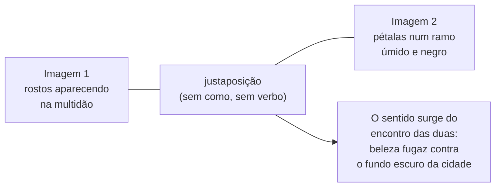
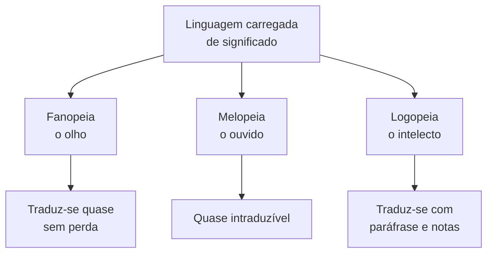
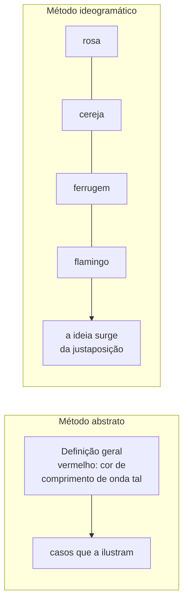

> **Aviso de Idioma:** Este currículo e todos os seus recursos de apoio foram estruturados exclusivamente em **Português (PT-BR)**.

# Aula 3 · Pound: imagem, precisão e o *ABC da Literatura*

**MOD-205 · 10 horas · Leitura principal:** Ezra Pound, *ABC da Literatura* (1934), tradução de Augusto de Campos e José Paulo Paes, primeira parte; "Alguns nãos de um imagista" (1913); Ernest Fenollosa e Ezra Pound, "Os caracteres da escrita chinesa como instrumento para a poesia" (1919), em *Ideograma*, organização de Haroldo de Campos

## O que você vai aprender

- Situar Ezra Pound no modernismo de língua inglesa e na sua recepção brasileira.
- Explicar os princípios do <abbr title="Imagismo: movimento poético lançado por Pound, H.D. e Richard Aldington em Londres, por volta de 1912, que defendia o tratamento direto da coisa, a eliminação de toda palavra que não contribua para a apresentação e o ritmo da frase musical em vez do metrônomo.">imagismo</abbr> e ler um poema imagista.
- Definir <abbr title="Fanopeia, melopeia e logopeia: em Pound, as três maneiras de carregar a linguagem de sentido. Fanopeia: projetar uma imagem visual na imaginação. Melopeia: carregar as palavras de música e ritmo. Logopeia: a dança do intelecto entre as palavras, o jogo com os seus usos e conotações.">fanopeia, melopeia e logopeia</abbr>.
- Explicar o <abbr title="Método ideogramático: em Pound, inspirado numa leitura de Fenollosa sobre a escrita chinesa, o procedimento de justapor fatos e imagens concretas, sem ligações explicativas, para que a ideia geral surja do conjunto. Parente da montagem de Benjamin e Eisenstein.">método ideogramático</abbr>, as suas fontes e as críticas que recebeu.
- Relacionar a exigência de precisão de Pound com a escrita técnica, os nomes no código e o guia de estilo deste curso.

## Pergunta de abertura

> Compare duas frases sobre o mesmo assunto: "No âmbito da questão da segurança pública, diversos fatores do contexto social influenciam a dinâmica do processo." e "Entre 2019 e 2023, os furtos de celular registrados no bairro dobraram." Qual delas diz alguma coisa? E por que tanta gente escreve como a primeira?

## 1. Um americano em Londres

Ezra Pound nasceu em 1885 em Hailey, uma pequena cidade do estado de Idaho, nos Estados Unidos, e cresceu perto da Filadélfia. Estudou línguas românicas e literatura provençal. Em 1908 mudou-se para Londres, onde se tornou em poucos anos uma das figuras centrais da poesia moderna: foi secretário de W. B. Yeats, lançou o imagismo, ajudou a publicar James Joyce, descobriu e promoveu T. S. Eliot, cuja *Terra Desolada* (1922) cortou e reorganizou a ponto de Eliot dedicar o poema a ele como "*il miglior fabbro*", o melhor artesão. Viveu em Paris de 1921 a 1924 e depois se instalou em Rapallo, na Itália, onde ficou até o fim da Segunda Guerra.


*Ezra Pound em 1913, no ano do manifesto imagista. Fotografia de Alvin Langdon Coburn. National Portrait Gallery, Washington. CC0.*

A biografia política de Pound, a adesão ao fascismo italiano e a propaganda antissemita, é tema da aula 4. Esta aula estuda o Pound crítico e professor de poesia, cujas ideias sobre a linguagem estão entre as mais influentes do século XX.

### Pound no Brasil

O Brasil tem uma relação singular com Pound. Em 1952, os poetas Augusto de Campos, Haroldo de Campos e Décio Pignatari fundaram em São Paulo o grupo **Noigandres**, nome tirado de uma palavra provençal que aparece no Canto XX de Pound, e lançaram a **poesia concreta**, que tomou de Pound o método ideogramático e a exigência de precisão. Os concretistas traduziram Pound para o português, e o *ABC da Literatura*, na tradução de Augusto de Campos e José Paulo Paes, é até hoje um livro de cabeceira de escritores e professores brasileiros.

## 2. O imagismo

Em março de 1913, a revista *Poetry*, de Chicago, publicou o manifesto do imagismo: uma nota de F. S. Flint com três princípios e um texto de Pound, "Alguns nãos de um imagista". Os três princípios:

1. **Tratamento direto da "coisa"**, seja ela subjetiva ou objetiva.
2. **Não usar absolutamente nenhuma palavra que não contribua para a apresentação.**
3. Quanto ao ritmo, **compor na sequência da frase musical**, e não na sequência do metrônomo.

E, entre os conselhos de Pound, um que vale para qualquer escrita: "**Vá com medo das abstrações.**" Não diga "terras sombrias de paz", que mistura uma imagem e uma abstração e enfraquece as duas. Mostre a coisa.

O poema imagista mais famoso tem catorze palavras e foi escrito depois que Pound viu, na saída de uma estação do metrô de Paris, uma sequência de rostos bonitos na multidão. Ele conta que escreveu primeiro um poema de trinta versos, que destruiu; seis meses depois, outro com a metade, também destruído; um ano depois, chegou a isto:

> *In a Station of the Metro*
> The apparition of these faces in the crowd;
> Petals on a wet, black bough.
>
> *Numa estação do metrô*
> A aparição destes rostos na multidão;
> pétalas num ramo úmido, negro.
> (Ezra Pound, 1913; tradução livre)

Não há verbo, não há comparação explícita ("como pétalas"), não há comentário. Há duas imagens justapostas, e o sentido nasce do encontro entre elas: o brilho súbito dos rostos contra a massa escura da multidão, como pétalas contra um galho molhado. O ponto e vírgula é a única ligação. Pound chamava isso de "uma forma de superposição": uma ideia posta em cima da outra.



## 3. O *ABC da Literatura*

Em 1934, Pound publicou o *ABC da Literatura*, um manual para quem quer aprender a ler poesia, com uma tese central:

> "Grande literatura é simplesmente linguagem carregada de significado até o máximo grau possível." (tradução de Augusto de Campos e José Paulo Paes)

E outra, que ficou famosa: "Literatura é novidade que permanece novidade."

### O método: olhar o peixe

O livro abre com uma anedota que é uma aula de método científico. Um estudante de pós-graduação procura o naturalista Louis Agassiz, que lhe entrega um peixe e pede que o descreva. O estudante responde: "É só um peixe-sol". Agassiz manda olhar de novo. O estudante escreve uma descrição de manual, com o nome latino e as características da família. Agassiz manda olhar de novo. Depois de três semanas, o peixe já em decomposição, o estudante sabia alguma coisa sobre ele.

O que Pound quer dizer: **o conhecimento começa pelo exame direto do particular**, e não pelas generalizações aprendidas. Para estudar poesia, leia os poemas, compare-os, coloque um ao lado do outro; não comece pelos manuais que falam sobre eles. É o mesmo princípio que a aula 2 do MOD-204 chamou de olhar o caso concreto antes da regra, e que o MOD-207 vai chamar de trabalho de campo.

### As três modalidades

Como se "carrega" a linguagem de sentido? Pound distingue três modos, que ele já tinha descrito no ensaio "Como ler" (1929):

| Modalidade | O que faz | Exemplo em português |
| :--- | :--- | :--- |
| **Fanopeia** | Projeta uma imagem visual na imaginação | A poesia de João Cabral de Melo Neto, feita de coisas vistas com nitidez: a pedra, a faca, o rio |
| **Melopeia** | Carrega as palavras de música, som e ritmo | "Minha terra tem palmeiras, / Onde canta o Sabiá" (Gonçalves Dias, 1843) |
| **Logopeia** | "A dança do intelecto entre as palavras": jogo com os usos, contextos e ironias das palavras | A ironia de Machado de Assis, em que o sentido está no desvio entre o que se diz e o que se quer dizer |



Pound observa que a fanopeia se traduz quase sem perda (uma imagem é uma imagem em qualquer língua), a melopeia quase não se traduz (a música está presa aos sons de uma língua) e a logopeia só se traduz com paráfrase, porque depende de usos e conotações próprios de cada língua.

### A linguagem e o Estado

O *ABC* contém também uma tese política sobre a linguagem, que Pound tomou de Confúcio (a "retificação dos nomes": um governo começa a se corromper quando os nomes deixam de corresponder às coisas). Os bons escritores são, para Pound, aqueles que **mantêm a linguagem eficiente**, precisa, limpa. Quando a linguagem de uma nação apodrece, quando as palavras passam a não querer dizer nada, a lei, a administração e o pensamento político apodrecem junto, porque ninguém consegue mais dizer com exatidão o que está fazendo nem cobrar dos outros o que eles disseram.

Responda à pergunta de abertura: a primeira frase não diz nada. Cada palavra vaga ("âmbito", "questão", "fatores", "contexto", "dinâmica", "processo") ocupa o lugar de uma informação que o autor não tem, ou não quer dar. Muita gente escreve assim porque essa linguagem **protege**: não se compromete com nenhum fato que possa ser conferido e soa como saber técnico. É exatamente a linguagem que Pound acusava de corromper a vida pública.

## 4. O método ideogramático

Em 1913, a viúva do estudioso estadunidense Ernest Fenollosa, que vivera no Japão e estudara a poesia chinesa, entregou a Pound os cadernos do marido. Entre eles estava um ensaio que Pound editou e publicou em 1919: "Os caracteres da escrita chinesa como instrumento para a poesia".

A tese de Fenollosa: os caracteres chineses seriam, em grande parte, **imagens concretas combinadas**, e não sinais abstratos de sons. Um exemplo célebre do ensaio: o caractere para "leste", 東, mostraria o sol (日) enroscado nos galhos de uma árvore (木), isto é, o sol nascendo atrás das árvores. A ideia abstrata ("leste") nasceria da justaposição de coisas concretas.

Pound transformou essa leitura num método de composição e de pensamento: o **método ideogramático**. Em vez de definir uma ideia abstrata, apresente lado a lado casos concretos, fatos, citações, documentos, e deixe que a ideia surja do conjunto. Para explicar "vermelho", diz ele no *ABC*, o chinês junta as imagens abreviadas de uma rosa, uma cereja, ferrugem e um flamingo.



### As críticas

A leitura de Fenollosa sobre a escrita chinesa foi duramente criticada pelos sinólogos. A grande maioria dos caracteres chineses não é composta de imagens combinadas, mas de um elemento que indica o sentido e outro que indica a pronúncia; e mesmo os caracteres de origem pictográfica são lidos pelos falantes como palavras, e não como desenhos. Como teoria da escrita chinesa, o ensaio é em boa parte equivocado.

Como **método de composição**, porém, o ideograma de Pound teve uma fecundidade enorme, e é aí que ele se encontra com a montagem que você estudou no MOD-203 (aula 6). O cineasta soviético Serguei Eisenstein, num ensaio de 1929, também partiu do ideograma para explicar a montagem cinematográfica: dois planos justapostos produzem um terceiro sentido, que não está em nenhum dos dois. E Benjamin construiu o *Trabalho das Passagens* como uma montagem de citações. Um poeta que aderiu ao fascismo, um cineasta comunista e um crítico marxista chegaram, por caminhos diferentes, ao mesmo procedimento. É um primeiro indício de que a validade de uma forma não se confunde com a posição política de quem a usa (aula 5).

## 5. Precisão na escrita e no código

A exigência de Pound vale para qualquer escrita técnica. O guia de estilo deste curso (`docs/ESTILO.md`) proíbe fórmulas vazias e jargões de moda pelo mesmo motivo que Pound proibia abstrações: elas ocupam o lugar de uma informação. E o script `scripts/revisar-estilo.py` faz automaticamente uma parte dessa higiene. Uma versão em miniatura, que procura palavras vagas:

```python
import re

VAGAS = {"questão", "aspecto", "aspectos", "elemento", "elementos", "contexto", "dinâmica", "dinâmicas",
         "processo", "processos", "fator", "fatores", "situação", "cenário", "nível", "âmbito"}

def palavras(texto):
    return re.findall(r"[a-záàâãéêíóôõúç]+", texto.lower())

def diagnostico(texto):
    lista = palavras(texto)
    vagas = [p for p in lista if p in VAGAS]
    return {"palavras": len(lista), "vagas": vagas, "proporcao": len(vagas) / len(lista)}

burocratico = ("No âmbito da questão da segurança pública, diversos fatores e elementos do contexto "
               "social influenciam a dinâmica do processo de aumento dos índices no cenário atual.")
preciso = "Entre 2019 e 2023, os furtos de celular registrados no bairro dobraram."    # dado inventado

for nome, texto in (("burocrático", burocratico), ("preciso", preciso)):
    d = diagnostico(texto)
    print(f"{nome:<12} {d['palavras']:>2} palavras, {len(d['vagas'])} vagas ({d['proporcao']:.0%}): {d['vagas']}")
```

A proporção de palavras vagas é uma medida grosseira (lembre da lei de Goodhart, MOD-204, aula 4: quem quiser enganá-la, engana), mas o exercício de procurá-las e substituí-las por fatos é o exercício que Pound propunha.

No código, a precisão tem nome: **os nomes**. Uma variável chamada `dados2`, uma função chamada `processar` ou um módulo chamado `utils` são o equivalente técnico de "no âmbito da questão": não dizem nada sobre o que fazem. Compare:

```text
# Vago
d2 = proc(d, "CE")

# Preciso
deputados_do_ceara = filtrar_por_uf(deputados, uf="CE")
```

O segundo exemplo pode ser lido por uma pessoa que não conhece o resto do programa. Pound diria que os nomes vagos tornam o código ineficiente como linguagem, e um código cuja linguagem apodreceu fica impossível de manter, como um Estado cuja linguagem apodreceu fica impossível de governar. A ligação vai além da metáfora. Código é escrito para máquinas executarem e, sobretudo, para pessoas lerem e cobrarem (MOD-202, aula 5).

## Leitura guiada

1. ***ABC da Literatura*, primeira parte** (cerca de 50 páginas): copie a anedota de Agassiz, a definição de grande literatura e as definições das três modalidades.
2. **"Alguns nãos de um imagista"** (cerca de 5 páginas, em *A Arte da Poesia*, coletânea de ensaios de Pound traduzida no Brasil): anote os conselhos que valem para a escrita em prosa.
3. **Fenollosa e Pound, "Os caracteres da escrita chinesa"**, em *Ideograma* (cerca de 30 páginas): leia a passagem sobre o caractere "leste" e o comentário de Haroldo de Campos na introdução do volume.

## Exercícios

**1.** Escreva um poema de até três versos à maneira imagista, sobre um objeto da sua rua. Depois explique como ele aplica (ou deixa de aplicar) os três princípios de 1913.

<details>
<summary>Critérios de correção</summary>

O poema deve apresentar a coisa diretamente, sem abstrações e sem comentário, e usar a justaposição em vez da comparação explícita. A explicação deve examinar cada palavra: ela contribui para a apresentação? A melhor resposta mostra as versões descartadas e por que foram cortadas, como Pound fez com o poema do metrô.
</details>

**2.** Classifique cada exemplo como predominantemente fanopeia, melopeia ou logopeia, e justifique: (a) um verso que descreve com nitidez uma faca sobre a mesa; (b) uma canção de ninar cujo sentido importa menos que o som; (c) um parágrafo irônico em que o narrador elogia o que de fato condena.

<details>
<summary>Gabarito</summary>

(a) Fanopeia: projeta uma imagem visual. (b) Melopeia: o peso está no som e no ritmo. (c) Logopeia: o sentido está no jogo entre o que as palavras dizem e o que querem dizer.
</details>

**3.** Amplie a lista `VAGAS` do código da seção 5 com dez palavras ou expressões vagas comuns em textos institucionais e aplique o diagnóstico a um parágrafo real de um relatório público (de uma prefeitura, de um ministério, de uma empresa). Reescreva o parágrafo trocando cada palavra vaga por um fato ou eliminando-a.

<details>
<summary>Critérios de correção</summary>

O parágrafo original deve ter fonte. A reescrita deve ser mais curta e mais verificável: cada afirmação deve poder ser conferida. Quando não houver fato para pôr no lugar de uma palavra vaga, a resposta deve dizer isso, porque essa ausência é em si uma descoberta sobre o texto.
</details>

**4.** A leitura de Fenollosa sobre a escrita chinesa é, em grande parte, equivocada. Isso invalida o método ideogramático? Responda em uma página, comparando com a montagem de Eisenstein e de Benjamin.

<details>
<summary>Critérios de correção</summary>

A resposta deve separar a teoria da escrita chinesa (equivocada, segundo os sinólogos) do método de composição (justapor particulares para fazer surgir o geral), mostrando que a validade do segundo não depende da verdade da primeira: o método funciona ou não pelos resultados que produz em quem lê. A comparação com Eisenstein e Benjamin deve mostrar a convergência de procedimentos vindos de posições políticas opostas.
</details>

## Resumo da aula

- Pound foi uma figura central do modernismo de língua inglesa e, pelo concretismo, uma referência decisiva da poesia brasileira.
- O imagismo pedia tratamento direto da coisa, nenhuma palavra supérflua e ritmo musical; o poema do metrô mostra a força da justaposição.
- O *ABC da Literatura* define a grande literatura como linguagem carregada de sentido ao máximo e começa pelo exame direto do particular (o peixe de Agassiz).
- Fanopeia, melopeia e logopeia são os três modos de carregar a linguagem de sentido.
- O método ideogramático justapõe particulares para fazer surgir o geral; a sua base sinológica é frágil, mas como método ele converge com a montagem de Eisenstein e Benjamin.
- Para Pound, a precisão da linguagem é condição da vida pública; no código, a precisão começa pelos nomes.

## Para ir além

- Augusto de Campos (org.), *Ezra Pound: Poesia* (1983), traduções de Augusto e Haroldo de Campos, Décio Pignatari, José Lino Grünewald e Mário Faustino.
- Haroldo de Campos (org.), *Ideograma: Lógica, Poesia, Linguagem* (1977), com o ensaio de Fenollosa e o texto de Eisenstein sobre o ideograma.