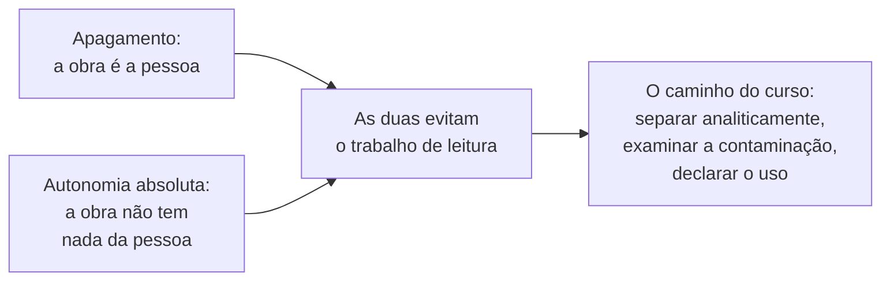
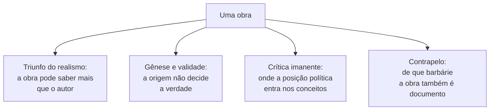
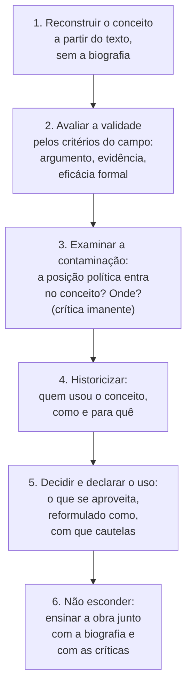

> **Aviso de Idioma:** Este currículo e todos os seus recursos de apoio foram estruturados exclusivamente em **Português (PT-BR)**.

# Aula 5 · Obra e pessoa: critérios de leitura

**MOD-205 · 10 horas · Leitura principal:** Engels, carta a Margaret Harkness (abril de 1888); Lukács, *Balzac e o Realismo Francês* (1952), introdução; Theodor Adorno, *O Jargão da Autenticidade* (1964), seleção; Peter Trawny, *Heidegger e o Mito da Conspiração Judaica Mundial* (2014), capítulos 1 e 2

## O que você vai aprender

- Formular com precisão o problema da relação entre obra e pessoa, a partir dos casos de Ortega, Pound e Heidegger.
- Recusar com argumentos as duas respostas fáceis: o apagamento moralista e a apologia da autonomia absoluta.
- Usar quatro ferramentas clássicas: o <abbr title="Triunfo do realismo: expressão de Engels, desenvolvida por Lukács, para o fato de que uma grande obra pode mostrar a realidade social contra as convicções políticas do próprio autor, como Balzac, monarquista, que retratou a decadência da aristocracia.">triunfo do realismo</abbr>, a distinção entre gênese e validade, a <abbr title="Crítica imanente: crítica que examina uma obra pelos seus próprios conceitos e pretensões, mostrando as contradições e os pressupostos que ela contém, em vez de julgá-la de fora por critérios alheios a ela.">crítica imanente</abbr> e a leitura a contrapelo.
- Aplicar um protocolo de leitura em seis passos.
- Distinguir estudar uma obra de homenagear o seu autor.

## Pergunta de abertura

> Numa aula sobre a filosofia da técnica, uma estudante pergunta: "Por que temos de ler Heidegger, se ele foi nazista? E se a gente lê, não está ajudando a manter o prestígio dele?" Outro estudante responde: "A filosofia não tem nada a ver com a vida do autor." Os dois têm razão em alguma coisa? O que você responderia?

## 1. O problema

O século XX produziu obras de grande importância intelectual e estética escritas por pessoas que defenderam ou serviram a causas que hoje reconhecemos como criminosas. Três casos que este curso estuda:

| Autor | A obra que o curso usa | O que pesa na biografia |
| :--- | :--- | :--- |
| **Ortega y Gasset** | A circunstância, o perspectivismo, a barbárie do especialismo, a filosofia da técnica | Elitismo declarado e desconfiança da democracia de massas; posição ambígua diante do franquismo depois de 1945 |
| **Ezra Pound** | O imagismo, a precisão da linguagem, o método ideogramático | Adesão ao fascismo, propaganda antissemita na rádio de Roma entre 1941 e 1943 |
| **Martin Heidegger** | *Ser e Tempo* (MOD-101), *A Questão da Técnica* | Filiação ao partido nazista em 1933, reitorado da Universidade de Freiburg em 1933 e 1934, passagens antissemitas nos *Cadernos Negros*, publicados a partir de 2014 |

O problema não é exclusivo da direita. O curso estuda Lukács, que fez sucessivas autocríticas para se manter dentro do movimento comunista sob Stálin (MOD-203, aula 5), e estuda Lênin e Trótski, que dirigiram a repressão no período da guerra civil russa (MOD-201). E tampouco é exclusivo da filosofia: a engenharia que levou à Lua foi dirigida, em parte, por engenheiros que haviam trabalhado nos foguetes nazistas com trabalho escravo. O problema é geral, e precisa de um método geral.

## 2. Duas respostas fáceis

Há duas maneiras de não enfrentar o problema. As duas são populares, e as duas falham.

| Resposta | O que afirma | Por que falha |
| :--- | :--- | :--- |
| **Apagamento** | A obra está contaminada pela pessoa; não se deve ler, ensinar nem citar | Confunde a validade de uma ideia com a virtude de quem a teve; perde ferramentas que pessoas de todas as posições usaram; e, ao não estudar como uma grande inteligência pôde servir ao pior, perde a chance de entender como isso acontece |
| **Autonomia absoluta** | A obra é pura forma ou puro pensamento; a vida e a política do autor são irrelevantes | Ignora que conceitos são produzidos por pessoas situadas (aula 1) e podem carregar as suas posições; esconde dos estudantes o que eles têm o direito de saber; e transforma o estudo em homenagem |

Os dois estudantes da pergunta de abertura representam essas duas respostas. Ela tem razão ao perceber que a biografia importa e que o prestígio é uma questão política. Ele tem razão ao perceber que a validade de uma ideia não depende da virtude de quem a formulou. Mas cada um, sozinho, dá uma resposta errada.

A palavra decisiva é **analiticamente**. Separar obra e pessoa não é afirmar que elas estão separadas na realidade (elas nunca estão): é um procedimento de análise, que distingue para poder examinar a relação entre as duas.

## 3. Quatro ferramentas

### O triunfo do realismo

Em 1888, Engels escreveu uma carta à romancista inglesa Margaret Harkness sobre o romance realista. Ali está uma observação sobre Balzac que se tornou clássica. Balzac era monarquista legitimista: as suas simpatias estavam com a aristocracia que a Revolução Francesa derrubara. E, no entanto, a sua *Comédia Humana* mostra melhor do que qualquer historiador a decadência dessa aristocracia e a ascensão da burguesia. Engels conclui que Balzac foi obrigado a ir contra as próprias simpatias de classe e preconceitos políticos, porque viu a realidade como ela era, e chama isso de "um dos maiores triunfos do realismo". Lukács desenvolveu a ideia nos seus estudos sobre o romance europeu.

O triunfo do realismo diz que uma obra **pode saber mais do que o seu autor**: a força da observação e da forma pode levar a obra contra as convicções de quem a escreveu. É uma ferramenta preciosa, mas tem um limite: ela funciona quando a obra contradiz o autor. E quando a obra **confirma** o autor, como nas transmissões de Pound?

### Gênese e validade

O filósofo Hans Reichenbach distinguiu, em 1938, o **contexto da descoberta** (como alguém chegou a uma ideia: a sua biografia, os seus interesses, as suas motivações) do **contexto da justificação** (se a ideia é verdadeira, ou válida, segundo os critérios do seu campo). A validade de um teorema não depende de o matemático ser bondoso; a de um argumento não depende de quem o formulou. Julgar uma ideia pela sua origem, e não pelas suas razões, é a chamada <abbr title="Falácia genética: erro de raciocínio que consiste em julgar uma ideia verdadeira ou falsa pela sua origem (quem a formulou, em que circunstâncias) e não pelas razões e evidências que a sustentam.">falácia genética</abbr>; atacar o argumento atacando a pessoa é a falácia *ad hominem*.

Essa distinção protege contra o apagamento. Mas ela também tem limite: nas ciências humanas, os conceitos não são teoremas. Um conceito como "homem-massa" ou "usura" não é apenas verdadeiro ou falso: ele **organiza** o modo de ver a realidade, e pode organizá-lo de um jeito que já contém uma posição política.

### A crítica imanente

Por isso é preciso uma terceira ferramenta. A crítica imanente, praticada por Hegel e por Marx e sistematizada pela teoria crítica, examina uma obra **pelos seus próprios conceitos**: mostra as contradições que ela contém, os pressupostos que não declara, as consequências que ela mesma não percebe. Em *O Jargão da Autenticidade* (1964), Adorno aplicou esse procedimento à linguagem de Heidegger e dos seus seguidores, procurando mostrar como certas palavras solenes ("autenticidade", "enraizamento", "chamado") produziam uma aura de profundidade que servia a uma posição autoritária.

A análise de Postone sobre a crítica da usura (aula 4) é uma crítica imanente: ela não condena Pound de fora, mostra que a **forma** da sua crítica econômica, separar o concreto do abstrato e personificar o abstrato, já contém o caminho para o antissemitismo. É a ferramenta mais exigente, e a mais útil, porque responde à pergunta que as outras duas deixam aberta: **onde**, exatamente, a posição política entra na obra.

### A leitura a contrapelo

Por fim, a frase de Benjamin que você estudou no MOD-203 (aula 9): "nunca houve um documento de cultura que não fosse também um documento de barbárie". Ela não manda jogar fora os documentos de cultura: manda lê-los **a contrapelo**, isto é, sabendo de que barbárie eles também são documento. Para Benjamin, isso vale para todas as obras, e não só para as de autores fascistas. A catedral é obra de arte e é também o trabalho de quem a construiu sem nome; o romance é invenção e é também o mundo de quem foi excluído dele.

## 4. Um protocolo em seis passos

Combinando as ferramentas, o curso propõe um protocolo explícito, que você vai aplicar no projeto do módulo:

O passo 3 é o centro. Uma pergunta ajuda a fazê-lo: **se eu aplicar o conceito de modo coerente, ele me leva à posição política do autor?** Se sim, a contaminação está no conceito. Se não, se o conceito pode ser aplicado com coerência por pessoas de posições opostas, a contaminação, se houver, está no uso.

## 5. Os três casos

### Ortega e o especialismo

1. **Reconstrução**: a especialização produz o sábio-ignorante, que leva a sua autoridade para onde ela não vale (aula 2).
2. **Validade**: o argumento é plausível e tem apoio em evidências (a transferência indevida de autoridade é um fenômeno documentado, por exemplo, na publicidade e na política).
3. **Contaminação**: parcial. O argumento usa o conceito de homem-massa, que carrega o elitismo de Ortega: o especialista é mau porque se comporta como a massa. Mas o núcleo (especialização, ignorância do resto, transferência de autoridade) não depende desse conceito.
4. **Historicização**: Lukács e Gramsci chegaram a diagnósticos parecidos com explicações sociais e conclusões democráticas.
5. **Uso**: aproveita-se o diagnóstico do especialismo, reformulado sem a antropologia elitista da massa, e explicado também pelas causas sociais que Ortega não considerava.

### Pound e a precisão da linguagem

1. **Reconstrução**: a grande literatura carrega a linguagem de sentido; a imprecisão da linguagem corrompe a vida pública (aula 3).
2. **Validade**: as ferramentas formais (imagismo, três modalidades) são eficazes e foram verificadas pela prática de gerações de escritores.
3. **Contaminação**: baixa nas ferramentas formais, que pessoas de todas as posições usaram. Mais alta na "retificação dos nomes" de inspiração confuciana, que em Pound se associa a um ideal de ordem autoritária. E máxima na teoria da usura (aula 4).
4. **Historicização**: os concretistas brasileiros, de esquerda, fizeram de Pound um instrumento de renovação da poesia; o próprio Pound, no fim da vida, renegou o antissemitismo.
5. **Uso**: aproveitam-se as ferramentas formais; a teoria da usura é estudada como objeto de crítica, e não como ferramenta.

### Heidegger e a técnica

É o caso mais difícil, e o mais importante para quem estuda a técnica.

1. **Reconstrução**: em *A Questão da Técnica* (1953), a técnica moderna é um modo de desvelamento que trata tudo, inclusive o ser humano, como recurso disponível, como estoque.
2. **Validade**: a análise foi fecunda e influenciou a filosofia da técnica, a ecologia e a crítica da racionalidade instrumental.
3. **Contaminação**: aqui está o problema. Nos *Cadernos Negros*, Heidegger associa o "judaísmo mundial" justamente à racionalidade calculadora, à capacidade de "calcular" e à maquinação, que são as figuras da sua crítica da técnica. O filósofo Peter Trawny, editor dos cadernos, chamou isso de "antissemitismo ontológico-histórico": o antissemitismo entra **no centro** da filosofia da técnica, e não na periferia. Emmanuel Faye foi mais longe e sustentou que toda a obra de Heidegger introduz o nazismo na filosofia; outros intérpretes contestam essa conclusão.
4. **Historicização**: muitos dos maiores leitores de Heidegger foram judeus e de esquerda (Hannah Arendt, Herbert Marcuse, Karl Löwith, Hans Jonas), e cada um fez com ele um acerto de contas diferente. Marcuse escreveu-lhe em 1947 pedindo que se retratasse publicamente, e a resposta de Heidegger foi evasiva.
5. **Uso**: a análise da técnica pode ser estudada, mas **com a cautela declarada** de que a sua figura central foi, para o próprio autor, associada a um grupo humano. A melhor prática é lê-la ao lado de críticas da técnica que não têm esse problema (Benjamin, Lukács, a teoria crítica), e verificar, a cada uso, se o argumento não reproduz a estrutura de personificação que Postone descreve.

## 6. Estudar não é homenagear

Uma última distinção, que responde à preocupação da estudante. **Estudar** uma obra é diferente de **homenagear** o seu autor. Estudar é examinar, criticar, usar o que serve e recusar o que não serve. Homenagear é dar nome a uma praça, conceder um prêmio, erguer uma estátua: é afirmar publicamente que a pessoa é um exemplo. O escândalo do Prêmio Bollingen a Pound em 1949 (aula 4) era sobre homenagem, e não sobre leitura.

O curso estuda Pound e Heidegger e não os homenageia. E reconhece que a leitura tem efeitos diferentes sobre pessoas diferentes: para uma estudante judia ou negra, ler um autor antissemita ou racista não é a mesma experiência que para outra pessoa. Por isso o passo 6 do protocolo exige que a obra seja ensinada **com** a biografia e **com** as críticas, e que o direito de criticar o autor, inclusive de rejeitá-lo, faça parte do estudo.

Responda à pergunta de abertura: lê-se Heidegger porque a sua análise da técnica é uma das mais influentes do século XX, e porque entender **como** uma grande inteligência filosófica se associou ao nazismo é uma das lições mais importantes que a filosofia pode dar. Lê-se sem homenagem, com a biografia, com os *Cadernos Negros* e com os críticos, e com o protocolo que permite dizer onde a contaminação está.

## Leitura guiada

1. **Engels, carta a Margaret Harkness, abril de 1888** (cerca de 4 páginas, em coletâneas de textos de Marx e Engels sobre literatura e arte): copie a passagem sobre Balzac e o triunfo do realismo.
2. **Adorno, *O Jargão da Autenticidade*** (seleção de cerca de 30 páginas): como a crítica imanente procede com a linguagem?
3. **Trawny, *Heidegger e o Mito da Conspiração Judaica Mundial*, capítulos 1 e 2** (cerca de 40 páginas): o que é o "antissemitismo ontológico-histórico"?

## Exercícios

**1.** Explique por que o apagamento e a autonomia absoluta são duas maneiras de evitar o trabalho de leitura.

Gabarito comentado

O apagamento decide de antemão que a obra está contaminada e dispensa o exame de onde e como; a autonomia absoluta decide de antemão que não está e dispensa o mesmo exame. Os dois substituem a análise por uma regra geral. O procedimento do curso exige, caso a caso, reconstruir o conceito, avaliar a validade e procurar onde a posição política entra.

**2.** Qual é o limite do triunfo do realismo como ferramenta? E o da distinção entre gênese e validade?

Gabarito comentado

O triunfo do realismo só funciona quando a obra contradiz as convicções do autor; quando a obra as confirma, ele não ajuda. A distinção entre gênese e validade funciona bem para enunciados que são verdadeiros ou falsos (teoremas, afirmações empíricas), mas os conceitos das ciências humanas também organizam o modo de ver a realidade e podem carregar uma posição política na própria forma. Para esses casos é preciso a crítica imanente.

**3.** Aplique a pergunta do passo 3 ("se eu aplicar o conceito de modo coerente, ele me leva à posição do autor?") ao conceito de homem-massa de Ortega.

Critérios de correção

A resposta deve aplicar o conceito a casos e verificar se ele conduz, por coerência, à desconfiança da participação popular. Uma boa resposta mostra que a definição (tipo humano, não classe) não leva necessariamente ao elitismo político, mas que o uso que Ortega faz dela, com a defesa das "minorias seletas" que dirijam a sociedade, sim; e que, portanto, a contaminação está na passagem da descrição do tipo humano para a proposta política.

**4.** Escreva a Parte I do projeto do módulo: aplique o protocolo de seis passos a um conceito de Ortega e a um de Pound.

Critérios de correção

Cada passo deve estar presente e fundamentado em citações dos textos. O passo 3 deve localizar com precisão onde a posição política entra (ou mostrar que não entra). O passo 5 deve declarar o uso com clareza: o que se aproveita, como se reformula e com que cautelas. A avaliação considera sobretudo a maturidade: nem apologia, nem moralismo.

## Resumo da aula

- Ortega, Pound e Heidegger produziram obras importantes e tiveram posições políticas condenáveis; o problema também existe à esquerda e na história da técnica.
- O apagamento e a autonomia absoluta são respostas fáceis que evitam o trabalho de leitura; separar obra e pessoa é um procedimento analítico, não uma afirmação sobre a realidade.
- O triunfo do realismo, a distinção entre gênese e validade, a crítica imanente e a leitura a contrapelo são as ferramentas; a crítica imanente diz onde a política entra no conceito.
- O protocolo tem seis passos: reconstruir, avaliar, examinar a contaminação, historicizar, declarar o uso e não esconder.
- Em Heidegger, a contaminação toca o centro da crítica da técnica; o uso exige cautela declarada e leitura ao lado de outras críticas.
- Estudar não é homenagear, e o direito de criticar o autor faz parte do estudo.

## Para ir além

- Hannah Arendt, "Martin Heidegger faz oitenta anos" (1969), o ensaio em que a antiga aluna avalia a obra e o "erro" político do mestre.
- Emmanuel Faye, *Heidegger: a Introdução do Nazismo na Filosofia* (2005), a tese mais dura sobre o caso, para ler junto com as críticas que recebeu.