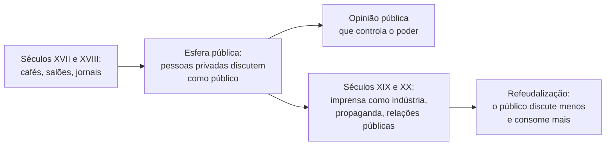
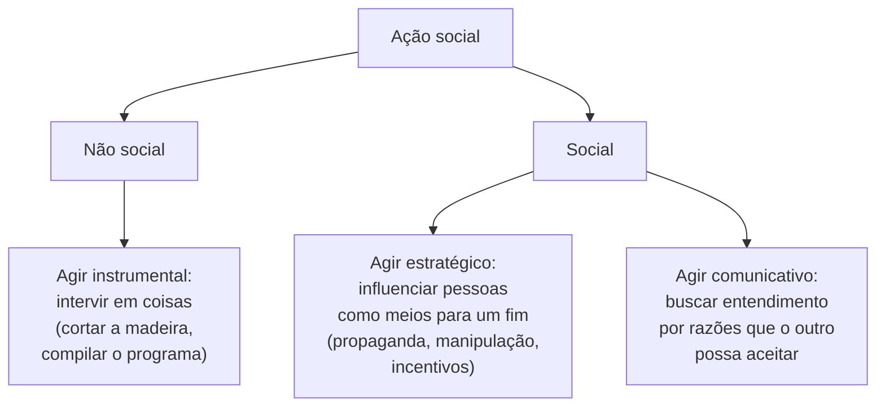
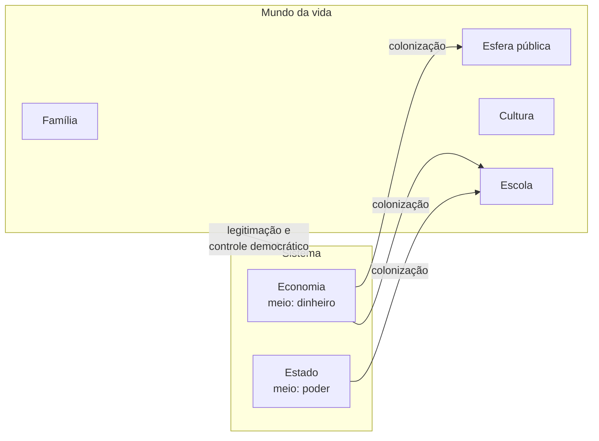

> **Aviso de Idioma:** Este currículo e todos os seus recursos de apoio foram estruturados exclusivamente em **Português (PT-BR)**.

# Aula 7 · Habermas: esfera pública e agir comunicativo

**MOD-205 · 10 horas · Leitura principal:** Jürgen Habermas, *Mudança Estrutural da Esfera Pública* (1962), capítulos I a III e VI (seleção); *Técnica e Ciência como "Ideologia"* (1968), ensaio que dá título ao livro; *Teoria do Agir Comunicativo* (1981), volume I, capítulo 3, e volume II, capítulo 8 (seleção); Nancy Fraser, "Repensando a esfera pública" (1990)

## O que você vai aprender

- Explicar a formação e a decadência da <abbr title="Esfera pública: em Habermas, o espaço social em que pessoas privadas se reúnem como público para discutir, pela razão, assuntos de interesse comum, e assim formar uma opinião capaz de controlar o poder do Estado.">esfera pública</abbr> burguesa.
- Explicar a crítica da tecnocracia em *Técnica e Ciência como "Ideologia"*.
- Distinguir o <abbr title="Agir estratégico: em Habermas, a ação orientada ao êxito, que trata os outros como meios para alcançar um fim, influenciando-os por incentivos, ameaças ou manipulação.">agir estratégico</abbr> do <abbr title="Agir comunicativo: em Habermas, a ação em que as pessoas coordenam os seus planos buscando um entendimento, por meio de razões que todos possam aceitar, em vez de se influenciarem como meios.">agir comunicativo</abbr>, e definir as <abbr title="Pretensões de validade: em Habermas, o que todo falante afirma implicitamente ao falar e pode ser chamado a justificar: que o que diz é verdadeiro, que é correto segundo as normas aceitas e que é sincero.">pretensões de validade</abbr>.
- Explicar a distinção entre <abbr title="Mundo da vida: em Habermas, o horizonte de saberes, normas e identidades compartilhados em que se dá a comunicação cotidiana: a família, a cultura, a escola, a vida pública.">mundo da vida</abbr> e sistema, e a <abbr title="Colonização do mundo da vida: em Habermas, a invasão de esferas que deveriam ser coordenadas pela comunicação (família, educação, cultura, debate público) pelos meios sistêmicos do dinheiro e do poder administrativo.">colonização do mundo da vida</abbr>.
- Analisar as plataformas digitais com essas categorias e conhecer as críticas de Nancy Fraser.

## Pergunta de abertura

> Numa rede social, as publicações que aparecem primeiro para você não são as mais recentes nem as mais bem fundamentadas: são as que mais geram reações. Isso é só uma escolha técnica de ordenação? Ou essa escolha muda o que uma sociedade consegue discutir, e como?

## 1. Um filósofo da segunda geração

Jürgen Habermas nasceu em 1929 em Düsseldorf, na Alemanha. Tinha quinze anos no fim da guerra, e os processos de Nuremberg, que revelaram os crimes do regime em que crescera, marcaram a sua geração e a sua obra. Foi assistente de Theodor Adorno no Instituto de Pesquisa Social de Frankfurt e tornou-se a principal figura da chamada **segunda geração** da teoria crítica, depois de Adorno, Horkheimer, Marcuse e Benjamin (MOD-203).


*Jürgen Habermas em 2008. Foto: Wolfram Huke. CC BY-SA 3.0.*

Habermas se afastou dos seus mestres num ponto decisivo. Adorno e Horkheimer, em *Dialética do Esclarecimento* (1947), viam a razão moderna reduzida a razão instrumental, a capacidade de calcular meios para fins, e quase não encontravam saída. Habermas sustentou que a razão moderna tem **outra dimensão**, a comunicativa, que não se reduz ao cálculo, e que nela está o critério para criticar a dominação.

## 2. A esfera pública burguesa

*Mudança Estrutural da Esfera Pública* (1962), a tese de livre-docência de Habermas, conta a história de um espaço social novo, que surgiu na Europa nos séculos XVII e XVIII: a **esfera pública**. Nos cafés de Londres (havia milhares deles no início do século XVIII), nos salões de Paris, nas sociedades de leitura alemãs, nos jornais e revistas, pessoas privadas passaram a se reunir **como público** para discutir literatura e, depois, política.

Três traços definiam essa esfera pública, como ideal:

| Traço | O que significa |
| :--- | :--- |
| **Paridade** | Na discussão, contava o argumento, e não a posição social de quem falava; o status era posto entre parênteses |
| **Assuntos de interesse comum** | Temas que antes eram monopólio da Igreja e do Estado passaram a ser discutidos pelo público |
| **Abertura** | Em princípio, qualquer pessoa com acesso aos jornais e à discussão podia participar |

O princípio que organizava tudo era a **publicidade**, no sentido antigo da palavra: tornar público, submeter ao exame de todos. Kant, em "Resposta à pergunta: o que é o Esclarecimento?" (1784), chamou isso de **uso público da razão**. A opinião pública formada assim passava a controlar o poder: um governo tinha de justificar as suas decisões diante do público.

### A refeudalização

A segunda metade do livro descreve a decadência desse espaço, a partir do fim do século XIX. A imprensa se tornou uma indústria, financiada por anúncios; os partidos se tornaram máquinas de propaganda; as relações públicas e o marketing passaram a fabricar a opinião em vez de deixá-la se formar; o público que discutia virou um **público que consome**. A "publicidade" mudou de sentido: de tornar público para exame passou a significar propaganda comercial. Habermas chamou esse processo de **refeudalização** da esfera pública: como nas cortes feudais, o poder voltou a se exibir diante do público, em vez de se justificar perante ele.



## 3. Técnica e ciência como ideologia

Em 1968, num ensaio dedicado a Herbert Marcuse, Habermas introduziu uma distinção que organiza toda a sua obra posterior:

| | Trabalho (agir racional com respeito a fins) | Interação (agir comunicativo) |
| :--- | :--- | :--- |
| Orientado a | Êxito: atingir um fim com os meios mais eficientes | Entendimento: coordenar a vida comum por normas aceitas |
| Regras | Técnicas, baseadas em saber empírico | Normas sociais, baseadas em reconhecimento mútuo |
| Racionalização significa | Mais eficiência, mais controle técnico | Mais liberdade de discussão, menos dominação |

A tese do ensaio é que, nas sociedades industriais avançadas, a técnica e a ciência passaram a funcionar como **ideologia**. Questões que são políticas (que sociedade queremos? como distribuir os riscos e os benefícios?) são apresentadas como **problemas técnicos**, que só especialistas podem resolver. A política se reduz à administração, e o público é excluído da decisão sobre os fins. Habermas chama isso de **consciência tecnocrática**.

Repare como o diagnóstico se encontra com dois que você já estudou: a barbárie do especialismo de Ortega (aula 2) e a pergunta de Lukács sobre quem põe as finalidades de um sistema (MOD-203, aula 5). Quando uma prefeitura decide a rota dos ônibus "pelo algoritmo", uma escolha política (quais bairros serão atendidos primeiro) é apresentada como resultado técnico.

## 4. A teoria do agir comunicativo

A obra maior de Habermas, *Teoria do Agir Comunicativo* (1981), desenvolve essa distinção numa teoria da sociedade.

### Três tipos de ação



No agir estratégico, eu trato o outro como um meio: quero que ele faça algo, e uso o que for eficaz, um incentivo, uma ameaça, uma manipulação. No agir comunicativo, eu procuro que o outro **concorde** comigo por razões que ele mesmo possa aceitar, e aceito mudar de posição se as razões dele forem melhores. O único poder que vale é o que Habermas chama de "a força sem coerção do melhor argumento".

### As pretensões de validade

Quando falamos sério com alguém, dizemos mais do que o conteúdo da frase. Afirmamos implicitamente três coisas, que o outro pode contestar e que podemos ser chamados a justificar:

| Pretensão | O que afirmo | Como o outro pode contestar |
| :--- | :--- | :--- |
| **Verdade** | O que digo sobre o mundo é verdadeiro | "Isso não é fato. Qual é a fonte?" |
| **Correção** | O que digo é correto diante das normas que compartilhamos | "Você não tem o direito de exigir isso." |
| **Sinceridade** | Digo o que de fato penso | "Você não acredita nisso, está dizendo para me convencer." |

Habermas trata também da inteligibilidade (o que digo pode ser entendido), que é condição de todas as outras. Para ele, essas pretensões estão embutidas na própria linguagem: mesmo quem mente precisa fingir que as cumpre. É aqui que Habermas encontra o critério normativo que, segundo ele, faltava a Foucault (aula 6): o poder ilegítimo é o que não conseguiria se justificar numa discussão livre, em que todos os afetados pudessem participar e contestar as pretensões de validade.

### Mundo da vida e sistema

A segunda grande distinção da obra é entre duas formas de integração social:

- **O mundo da vida**: o horizonte de saberes, normas e identidades compartilhados em que vivemos e nos comunicamos; a família, a escola, a cultura, a vida associativa, o debate público. Aqui, a coordenação se faz pela comunicação.
- **O sistema**: a economia e o Estado administrativo, que coordenam as ações por **meios** que dispensam o entendimento: o **dinheiro** e o **poder**. Ninguém precisa concordar com o preço para comprar; ninguém precisa ser convencido de cada regulamento para cumpri-lo.

Os dois são necessários: uma sociedade complexa não poderia coordenar tudo pela discussão. O problema começa quando os meios sistêmicos **invadem** esferas que só funcionam pela comunicação: quando a escola passa a ser governada por metas e indicadores, a família pela lógica do consumo, o debate público pela lógica da audiência e do marketing. Habermas chama isso de **colonização do mundo da vida**.



## 5. A plataforma como esfera pública

Volte à pergunta de abertura. Uma rede social é hoje um dos principais lugares onde as pessoas discutem assuntos de interesse comum: uma parte da esfera pública. Mas a ordem em que as publicações aparecem é decidida por um critério que alguém escolheu. Compare três critérios, com dados fictícios:

```python
# Publicações de um feed, com dados fictícios. "verificavel": a publicação traz fonte que se pode conferir.
publicacoes = [
    {"id": "P1", "hora": 9, "texto": "Relatório do TCU sobre a merenda escolar, com link", "curtidas": 40, "comentarios": 12, "compartilhamentos": 8, "verificavel": True},
    {"id": "P2", "hora": 10, "texto": "Vereador X é um traidor e todo mundo sabe", "curtidas": 300, "comentarios": 420, "compartilhamentos": 150, "verificavel": False},
    {"id": "P3", "hora": 11, "texto": "Audiência pública sobre o plano diretor na quinta", "curtidas": 25, "comentarios": 5, "compartilhamentos": 10, "verificavel": True},
    {"id": "P4", "hora": 12, "texto": "Vídeo: briga na câmara municipal", "curtidas": 500, "comentarios": 380, "compartilhamentos": 260, "verificavel": False},
    {"id": "P5", "hora": 13, "texto": "Dados abertos: gastos da prefeitura com publicidade", "curtidas": 60, "comentarios": 30, "compartilhamentos": 20, "verificavel": True},
]

def engajamento(p):
    """Comentários e compartilhamentos valem mais: prendem a atenção por mais tempo."""
    return p["curtidas"] + 3 * p["comentarios"] + 5 * p["compartilhamentos"]

criterios = {
    "cronológico": lambda p: -p["hora"],
    "engajamento": lambda p: -engajamento(p),
    "verificável primeiro": lambda p: (not p["verificavel"], -p["hora"]),
}

for nome, chave in criterios.items():
    topo = sorted(publicacoes, key=chave)[:3]
    print(f"{nome:<21}", [p["id"] for p in topo])
```

O critério de engajamento põe no topo a briga e a acusação sem prova (P4 e P2), porque são as publicações que mais geram reação. A audiência pública e o relatório do TCU, que poderiam informar uma discussão, ficam para trás. Ninguém decidiu que a esfera pública deve privilegiar o conflito: decidiu-se maximizar o tempo de atenção, porque é ele que se vende aos anunciantes. É agir estratégico **embutido no código**, e é colonização do mundo da vida no sentido exato de Habermas: o meio dinheiro, através da métrica de engajamento, passa a organizar o espaço em que uma sociedade discute.

O terceiro critério mostra que a ordenação **poderia ser outra**: privilegiar o que tem fonte verificável é uma escolha que favorece a pretensão de verdade. Também é uma escolha, também tem problemas (quem decide o que é verificável?), mas mostra que a ordem do feed é uma decisão política apresentada como técnica, a consciência tecnocrática do ensaio de 1968.

Em 2022, aos 93 anos, Habermas publicou *Uma Nova Mudança Estrutural da Esfera Pública e a Política Deliberativa*, sobre as plataformas digitais. A tese: as plataformas aboliram o filtro editorial dos meios tradicionais (o que tem um lado emancipador, porque todos podem falar) mas fragmentaram o público em bolhas semipúblicas, em que cada grupo confirma as próprias opiniões, e enfraqueceram a capacidade de formar uma opinião pública comum.

### Software e entendimento

A distinção entre agir estratégico e comunicativo também ilumina o próprio trabalho de quem faz software. Os projetos de software livre coordenam milhares de pessoas que não têm patrão comum, e o fazem em grande parte por **discussão**: propostas escritas, revisões de código públicas, argumentos técnicos que qualquer um pode contestar. A IETF, que define os protocolos da internet, resume o seu método na fórmula "consenso aproximado e código que funciona". Não é a situação ideal de fala (há hierarquias, exclusões, cansaço), mas é uma aproximação real do agir comunicativo, e um contraste com a empresa em que a decisão vem de cima e a métrica decide o resto.

## 6. As críticas: os contrapúblicos

A crítica mais influente à teoria da esfera pública veio da filósofa estadunidense Nancy Fraser, em "Repensando a esfera pública" (1990). A esfera pública burguesa, diz Fraser, nunca foi aberta a todos: excluía as mulheres, os trabalhadores, as pessoas não brancas, e o "pôr o status entre parênteses" escondia desigualdades reais, que continuavam atuando na discussão. E os grupos excluídos não ficaram calados: formaram **contrapúblicos subalternos**, espaços próprios de discussão, como a imprensa operária, os movimentos de mulheres e a imprensa negra, onde elaboraram interpretações que depois disputaram com o público dominante.

No Brasil, a crítica tem um peso particular. Uma esfera pública formada numa sociedade escravista, em que a maioria da população estava excluída da cidadania, não pode ser pensada com o modelo europeu sem ajustes. A imprensa negra brasileira do início do século XX foi um contrapúblico no sentido de Fraser. E a dificuldade de separar o público do privado, que Sérgio Buarque de Holanda chamou de **cordialidade**, é o tema do MOD-206.

## Leitura guiada

1. ***Mudança Estrutural da Esfera Pública*, capítulos I a III** (cerca de 60 páginas): os cafés, os salões e as sociedades de leitura. Capítulo VI (cerca de 30 páginas): a refeudalização.
2. ***Técnica e Ciência como "Ideologia"*** (cerca de 40 páginas): a distinção entre trabalho e interação e a consciência tecnocrática.
3. **Nancy Fraser, "Repensando a esfera pública"** (cerca de 30 páginas, com tradução em português): os contrapúblicos subalternos.

## Exercícios

**1.** Explique a diferença entre agir estratégico e agir comunicativo com um exemplo do cotidiano de uma equipe de desenvolvimento de software.

<details>
<summary>Gabarito comentado</summary>

Agir estratégico: o gerente consegue que a equipe aceite um prazo impossível oferecendo um bônus a quem cumprir e insinuando demissões para quem não cumprir; trata as pessoas como meios. Agir comunicativo: a equipe discute o prazo, cada pessoa apresenta razões (o tamanho da tarefa, os riscos, a experiência de projetos anteriores) e chega-se a um prazo que todos aceitam porque as razões convenceram. No segundo caso, a pretensão de verdade ("é possível fazer em duas semanas") pode ser contestada e precisa ser justificada.
</details>

**2.** O que Habermas chama de consciência tecnocrática? Dê um exemplo atual de decisão política apresentada como problema técnico.

<details>
<summary>Gabarito comentado</summary>

É a ideologia que transforma questões políticas (sobre fins, valores e distribuição) em problemas técnicos que só especialistas podem resolver, excluindo o público da decisão. Exemplo: uma secretaria de educação que distribui vagas em creches "pelo sistema", sem discutir publicamente os critérios de prioridade (renda, distância, mães que trabalham), que são escolhas políticas embutidas no código.
</details>

**3.** Acrescente ao código da seção 5 um quarto critério de ordenação que você considere melhor para a esfera pública, e explique a que pretensão de validade ele dá peso. Que problemas ele cria?

<details>
<summary>Gabarito</summary>

Um exemplo, que privilegia a diversidade de interações (comentários em relação a compartilhamentos, como indício de discussão e não só de difusão):

```python
def discussao(p):
    return p["comentarios"] / (1 + p["compartilhamentos"])

print("discussão           ", [p["id"] for p in sorted(publicacoes, key=lambda p: -discussao(p))[:3]])
```

Ele dá peso à discussão, mas cria problemas: no exemplo, põe no topo justamente a acusação e a briga (P2 e P4), porque brigas também geram muitos comentários; e e um critério conhecido pode ser manipulado (lei de Goodhart, MOD-204, aula 4). A boa resposta reconhece que nenhum critério é neutro e defende que os critérios sejam públicos, discutidos e contestáveis, que é a exigência de Habermas aplicada ao código.
</details>

**4.** Escreva a Parte II do projeto do módulo: analise uma plataforma real com as categorias de Foucault (aula 6) e de Habermas, e responda à crítica de Fraser.

<details>
<summary>Critérios de correção</summary>

A análise deve usar fontes verificáveis sobre a plataforma (documentação, pesquisas, reportagens). Deve aplicar ao menos dois conceitos de cada autor e mostrar onde eles convergem e onde divergem (Foucault vê poder também na comunicação; Habermas vê na comunicação o critério contra o poder). A resposta a Fraser deve identificar contrapúblicos que usam ou disputam a plataforma.
</details>

## Resumo da aula

- Habermas, da segunda geração da teoria crítica, sustenta que a razão moderna tem uma dimensão comunicativa que não se reduz ao cálculo instrumental.
- A esfera pública burguesa dos séculos XVII e XVIII reunia pessoas privadas como público, pelo uso público da razão; a imprensa comercial, a propaganda e as relações públicas a refeudalizaram.
- *Técnica e Ciência como "Ideologia"* distingue trabalho e interação e critica a consciência tecnocrática, que transforma questões políticas em problemas técnicos.
- O agir comunicativo busca o entendimento por razões; toda fala sincera levanta pretensões de verdade, correção e sinceridade.
- O sistema (dinheiro e poder) coloniza o mundo da vida quando invade esferas que só funcionam pela comunicação; o feed ordenado por engajamento é um exemplo.
- Fraser mostrou as exclusões da esfera pública burguesa e a força dos contrapúblicos subalternos, crítica decisiva para pensar o Brasil.

## Para ir além

- Jürgen Habermas, *Uma Nova Mudança Estrutural da Esfera Pública e a Política Deliberativa* (2022; tradução brasileira de 2023).
- Jürgen Habermas, *O Discurso Filosófico da Modernidade* (1985), lições IX e X, sobre Foucault.