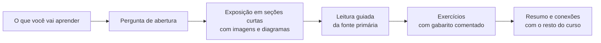
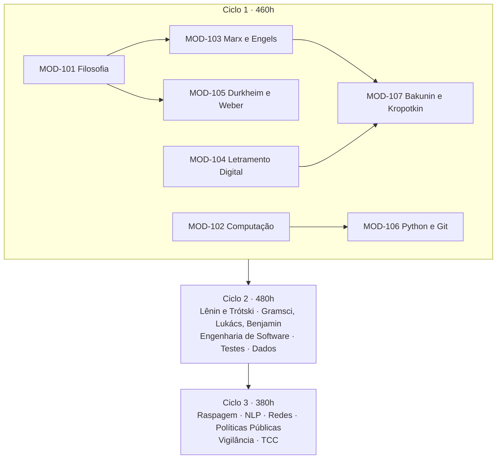

> **Aviso de Idioma:** Este currículo e todos os seus recursos de apoio foram estruturados exclusivamente em **Português (PT-BR)**.

# Como estudar neste curso

O Último Curso tem 1.320 horas divididas em 3 ciclos e 20 módulos. Cada módulo tem um **guia** (a visão geral, com objetivos, linha do tempo, mapa de conceitos e avaliação) e uma sequência de **aulas** escritas para serem lidas com calma, de preferência com um caderno ao lado.

Este texto explica como as aulas estão organizadas, como usar os recursos visuais e como montar uma rotina de estudo que se sustente por meses.

## 1. A anatomia de uma aula

Toda aula segue o mesmo roteiro, para que você saiba onde está a cada momento:

1. **O que você vai aprender:** a lista de capacidades que a aula pretende construir. Volte a ela no final e confira se consegue fazer cada item sem consultar o texto.
2. **Pergunta de abertura:** um problema concreto que motiva o assunto. Tente responder antes de ler. Errar aqui é parte do método.
3. **Exposição:** o conteúdo em seções curtas. Cada conceito aparece com a obra de origem, uma explicação em linguagem direta e um exemplo.
4. **Leitura guiada:** a indicação exata do trecho da fonte primária (capítulo, seção ou parágrafos) e do que procurar nele. A aula prepara a leitura e nunca a substitui.
5. **Exercícios:** questões de compreensão, de aplicação e, nas aulas técnicas, de programação. O gabarito fica escondido dentro de uma caixa que você abre só depois de tentar.
6. **Resumo e conexões:** o que levar da aula e onde aquilo reaparece no curso.

## 2. Os recursos visuais

### Tooltips de jargão

Termos técnicos aparecem <abbr title="Assim: passe o mouse ou toque no termo para ler uma explicação curta, sem sair do texto.">sublinhados com pontinhos</abbr>. Passe o mouse por cima (no computador) ou toque neles (no celular) para ver uma definição curta. A definição completa de cada termo está no [Glossário](./GLOSSARIO.md).

A regra que seguimos: **todo jargão recebe tooltip na primeira vez que aparece em cada aula**, seja ele grego (*phronesis*), alemão (*Gestell*), marxista (*mais-valia*) ou computacional (*hash*).

### Diagramas

Conceitos com muitas peças móveis (a dialética do senhor e do escravo, o circuito do capital, o caminho de um pacote pela Internet, a busca binária) ganham diagramas desenhados em <abbr title="Linguagem de texto que vira diagrama. O GitHub e o portal do curso desenham os gráficos automaticamente a partir do código.">Mermaid</abbr>. Leia o diagrama com o texto ao lado: ele resume o argumento, e o texto explica cada seta.

Usamos quatro tipos de diagrama:

| Tipo | Para que serve | Exemplo no curso |
| :--- | :--- | :--- |
| Linha do tempo | Situar obras e acontecimentos | Da Comuna de Paris ao *Que Fazer?* |
| Fluxograma | Mostrar um processo ou argumento passo a passo | Como um algoritmo de busca decide |
| Mapa conceitual | Mostrar como conceitos se apoiam uns nos outros | *Episteme*, *techne* e *phronesis* |
| Diagrama de sequência | Mostrar trocas entre partes de um sistema | O aperto de mão do TLS |

### Imagens históricas

As fotografias, gravuras e documentos vêm da [Wikimedia Commons](https://commons.wikimedia.org/) e estão em domínio público ou sob licença livre. Os créditos completos (autor, data, licença) estão em [Créditos das Imagens](./CREDITOS-IMAGENS.md). Uma imagem histórica entra numa aula quando ajuda a ver alguma coisa: o tamanho de uma fábrica de 1835, o rosto de quem escreveu, a primeira página de um livro que mudou a política.

## 3. Ritmo de estudo

O curso foi calculado em blocos de **10 horas semanais**. Um módulo de 70 horas leva 7 semanas nesse ritmo. Uma distribuição que funciona para quem trabalha:

| Dia | Atividade | Tempo |
| :--- | :--- | :---: |
| Segunda | Ler a aula da semana e fazer as anotações | 2h |
| Terça | Leitura guiada da fonte primária | 2h |
| Quarta | Leitura guiada (continuação) e fichamento | 2h |
| Quinta | Exercícios | 1h30 |
| Sábado | Projeto prático do módulo | 2h30 |

Os ciclos não são estanques. Dentro de cada ciclo os módulos teóricos e técnicos podem ser cursados **em paralelo** (um de teoria e um de computação ao mesmo tempo), desde que você respeite os pré-requisitos indicados no guia de cada módulo.

## 4. O fichamento

Para cada obra da leitura guiada, faça um fichamento usando o modelo em [`templates/FICHAMENTO_TEORICO.md`](../templates/FICHAMENTO_TEORICO.md). O fichamento tem três funções:

1. **Obrigar a leitura ativa:** você só consegue escrever a tese central de um texto depois de entendê-la.
2. **Formar o seu arquivo:** no fim do curso, os fichamentos viram matéria-prima da monografia do MOD-306.
3. **Separar o que o autor diz do que você pensa:** citações literais com página, paráfrases fiéis e comentários seus ficam em seções diferentes.

> **Dica:** guarde os fichamentos num repositório Git desde o primeiro dia (o MOD-106 ensina como). O histórico de commits vira um diário do seu estudo.

## 5. Onde encontrar os textos

Todos os textos obrigatórios estão disponíveis de graça em português. Os acervos principais:

- [Arquivo Marxista na Internet (seção em português)](https://www.marxists.org/portugues/): Marx, Engels, Lênin, Trótski, Gramsci, Lukács, Kropotkin, Bakunin e muitos outros.
- [Domínio Público (Ministério da Educação)](http://www.dominiopublico.gov.br/): clássicos da filosofia e das ciências sociais.
- [SciELO Livros](https://books.scielo.org/): livros acadêmicos brasileiros em acesso aberto.
- [e-Aulas USP](https://eaulas.usp.br/): aulas gravadas de filosofia, sociologia e computação.
- [Engenharia de Software Moderna](https://engsoftmoderna.info/), [Pro Git em português](https://git-scm.com/book/pt-br/v2) e o [Tutorial oficial de Python em português](https://docs.python.org/pt-br/3/tutorial/).

Quando uma tradução específica for recomendada, a aula diz qual e por quê.

## 6. Como saber se aprendeu

Cada módulo termina com um **projeto prático avaliativo**, descrito no guia do módulo, com entregáveis e critérios. Use o modelo [`templates/ENTREGA_PROJETO.md`](../templates/ENTREGA_PROJETO.md) para documentar a entrega e [`templates/PROGRESSO_ALUNO.md`](../templates/PROGRESSO_ALUNO.md) para acompanhar o seu avanço.

Um bom teste antes de seguir para o módulo seguinte: explicar em voz alta, para alguém que não estudou o assunto, os três conceitos mais importantes do módulo, sem olhar as anotações.
