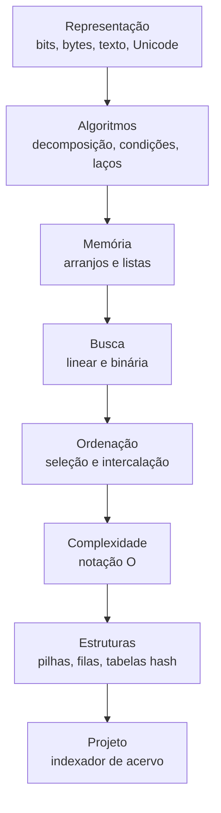
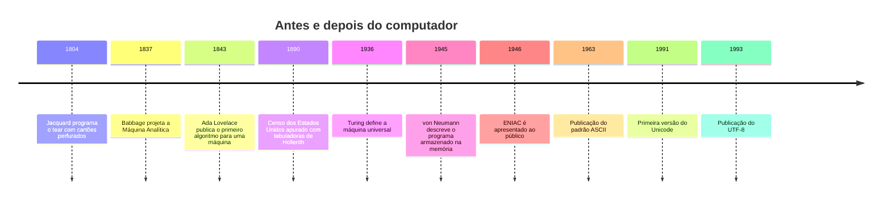

> **Aviso de Idioma:** Este currículo e todos os seus recursos de apoio foram estruturados exclusivamente em **Português (PT-BR)**.

# MOD-102: Introdução à Computação e Pensamento Algorítmico

**Ciclo 1 · Eixo 1 (Computação e Algoritmos) · 70 horas · 7 aulas · Sem pré-requisitos**

*Cartões perfurados de um tear de Jacquard, Museu de Ciência e Indústria de Manchester. Cada furo diz ao tear qual fio levantar: um programa gravado em papelão, mais de um século antes do computador. Foto de George H. Williams, domínio público.*

## Apresentação

Este módulo ensina o que acontece dentro da "caixa-preta" que organiza a vida social contemporânea. Você vai aprender como um computador representa textos e números, como se escreve um <abbr title="Algoritmo: sequência finita e precisa de passos que resolve um problema. Uma receita de bolo é um algoritmo informal; um programa é um algoritmo escrito numa linguagem que a máquina executa.">algoritmo</abbr>, por que algumas buscas levam milissegundos e outras levam horas, e que estruturas de dados tornam possível encontrar um CPF entre 200 milhões.

Seguimos a filosofia pedagógica do curso CS50 de Harvard (disponível em português como CC50): rigor conceitual, resolução de problemas concretos e nenhuma demonstração matemática que não seja necessária. Todos os exemplos usam dados públicos brasileiros: decretos, ementas de leis, registros eleitorais.

> **Por que um curso de teoria social precisa disso?** Porque não se critica com precisão o que não se entende. Quem sabe o que é uma busca binária e uma tabela de dispersão sabe perguntar de onde vêm a velocidade e o custo de um sistema de vigilância, e sabe quando uma explicação técnica é desculpa.

## Mapa do módulo

## Linha do tempo

## Objetivos de aprendizagem

Ao terminar o módulo, você será capaz de:

- Explicar como textos, números e documentos são representados em binário, ASCII e Unicode, e diagnosticar problemas de acentuação em arquivos públicos.
- Decompor um problema do mundo social em um algoritmo finito e determinístico, escrito em pseudocódigo e em Python.
- Implementar e comparar busca linear, busca binária, ordenação por seleção e ordenação por intercalação.
- Estimar a complexidade de um algoritmo com a notação O e confirmar a estimativa medindo o tempo real.
- Escolher entre lista, pilha, fila, conjunto e dicionário para processar registros públicos.

## Aulas

| Aula | Tema | Duração |
| :---: | :--- | :---: |
| 1 | [Bits, bytes e texto: como a máquina representa o mundo](./mod-102/aula-01-representacao-informacao-binario-unicode.md) | 10h |
| 2 | [Pensar em algoritmos: decomposição, condições e laços](./mod-102/aula-02-algoritmos-decomposicao-controle-fluxo.md) | 10h |
| 3 | [Memória, arranjos e listas](./mod-102/aula-03-memoria-arranjos-listas.md) | 10h |
| 4 | [Busca linear e busca binária](./mod-102/aula-04-busca-linear-binaria.md) | 10h |
| 5 | [Ordenação: seleção e intercalação](./mod-102/aula-05-ordenacao-selecao-intercalacao.md) | 10h |
| 6 | [Complexidade: quanto custa um algoritmo](./mod-102/aula-06-complexidade-notacao-o.md) | 10h |
| 7 | [Pilhas, filas e tabelas de dispersão](./mod-102/aula-07-pilhas-filas-tabelas-hash.md) | 10h |

## Recursos gratuitos

| Recurso | Para que usar |
| :--- | :--- |
| [CC50: Ciência da Computação de Harvard no Brasil](https://www.estudarfora.org.br/cc50/) | Aulas em vídeo legendadas que acompanham as aulas 1 a 7 |
| [UNIVESP: Algoritmos e Programação de Computadores](https://www.youtube.com/user/univesptv) | Revisão em vídeo, em português, de laços, busca e ordenação |
| [Tutorial oficial de Python em português](https://docs.python.org/pt-br/3/tutorial/) | Referência da linguagem usada nos exercícios |
| [Visualgo](https://visualgo.net/pt) | Animações de algoritmos de busca e ordenação |

## Ambiente de trabalho

As aulas usam **Python 3.11 ou superior**, sem bibliotecas externas. Se você ainda não instalou Python, siga a aula 1 do MOD-106 antes de começar a aula 2 deste módulo. Os dois módulos podem ser cursados em paralelo.

## Projeto prático avaliativo

### CLI de Indexação e Busca em Acervo Público de Decretos

Construa uma ferramenta de linha de comando `indexador_acervo.py`, em Python puro, que carregue **10.000 ementas de decretos ou leis** (de um arquivo CSV montado a partir do portal da Câmara dos Deputados ou do Planalto) e compare o tempo de resposta de três estratégias de consulta:

1. Varredura sequencial completa: $O(n)$.
2. Busca binária sobre a lista ordenada pelo número do decreto: $O(\log n)$.
3. Índice invertido em tabela de dispersão por palavra-chave e identificador: $O(1)$ em média.

**Entregáveis**

- Script em Python com funções separadas para carregar, ordenar, buscar e indexar, cada uma com testes simples usando `assert`.
- Relatório em Markdown com uma tabela de tempos medidos para 1.000, 5.000 e 10.000 registros e um gráfico (pode ser feito à mão ou com Mermaid) comparando as três estratégias.
- Parágrafo final discutindo o custo de memória do índice: o que se ganha em velocidade e o que se paga em espaço.

**Critérios de avaliação**

| Critério | Peso |
| :--- | :---: |
| Corretude dos três algoritmos (inclusive casos de borda: lista vazia, item ausente) | 40% |
| Medição honesta (várias repetições, média, mesmas condições) | 25% |
| Clareza do código: nomes em português, funções curtas, comentários onde há decisão | 20% |
| Análise do compromisso entre memória e velocidade | 15% |

**Diretório de entrega:** `projetos/ciclo-1/mod-102-indexador-acervo`

## Antes e depois deste módulo

- **Pré-requisitos:** nenhum. Matemática de ensino fundamental basta.
- **Este módulo prepara:** MOD-106 (Python e Git), MOD-202 (engenharia de software) e todo o Ciclo 3, onde busca, ordenação e índices aparecem em raspagem, processamento de texto e grafos.

## Glossário do módulo

*Algoritmo* · *ASCII* · *Bit* · *Busca binária* · *Byte* · *Complexidade* · *Dicionário* · *Fila* · *Função de dispersão (hash)* · *Invariante de laço* · *Lista* · *Notação O* · *Pilha* · *Pseudocódigo* · *Unicode* · *UTF-8*
