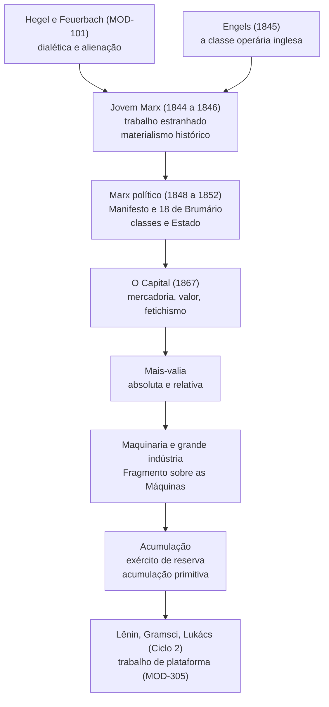
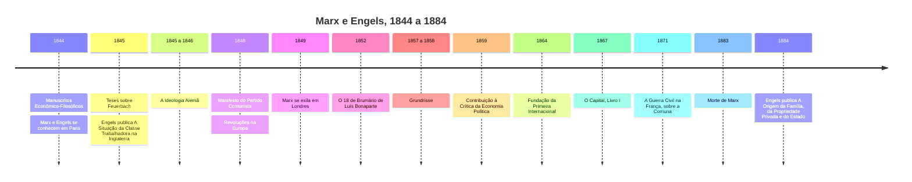

> **Aviso de Idioma:** Este currículo e todos os seus recursos de apoio foram estruturados exclusivamente em **Português (PT-BR)**.

# MOD-103: Crítica da Economia Política e Materialismo Histórico: Karl Marx e Friedrich Engels

**Ciclo 1 · Eixo 4 (Filosofia Política e Teoria Social) · 70 horas · 7 aulas · Pré-requisito: MOD-101**

*Karl Marx (1818 a 1883), fotografia de John Jabez Edwin Mayall. Domínio público.*

## Apresentação

Nenhum autor moderno foi tão citado, tão combatido e tão pouco lido de verdade quanto Karl Marx. Este módulo propõe a leitura direta: o jovem Marx que critica Hegel e Feuerbach, o Marx do *Manifesto* e das análises políticas, e o Marx maduro d'*O Capital*, que desmonta a mecânica da sociedade capitalista peça por peça. Ao lado dele, Friedrich Engels, coautor e sociólogo pioneiro da classe operária inglesa.

Para quem trabalha com tecnologia, há uma razão especial para ler Marx: ele escreveu a mais detalhada análise do século XIX sobre **o que as máquinas fazem com o trabalho**. O capítulo 13 d'*O Capital* (Maquinaria e grande indústria) e o "Fragmento sobre as Máquinas" dos *Grundrisse* são leituras obrigatórias para entender a automação, a inteligência artificial e o trabalho por plataformas.

## Mapa do módulo

## Linha do tempo

## Objetivos de aprendizagem

- Explicar as quatro dimensões do trabalho estranhado nos *Manuscritos* de 1844.
- Enunciar os conceitos de forças produtivas, relações de produção, modo de produção, base e superestrutura, e usá-los sem reduzir a teoria a um determinismo mecânico.
- Analisar um acontecimento político com as categorias do *18 de Brumário* (frações de classe, representação, bonapartismo).
- Explicar a mercadoria, o duplo caráter do trabalho e o fetichismo da mercadoria.
- Calcular a taxa de mais-valia e a composição orgânica do capital e distinguir mais-valia absoluta e relativa.
- Distinguir subsunção formal e real do trabalho ao capital e aplicar o capítulo da maquinaria à automação por software.
- Explicar o exército industrial de reserva e a acumulação primitiva, com atenção à história brasileira.

## Aulas

| Aula | Tema | Duração | Leitura principal |
| :---: | :--- | :---: | :--- |
| 1 | [Fábrica, miséria e trabalho estranhado](./mod-103/aula-01-revolucao-industrial-trabalho-estranhado.md) | 10h | *Manuscritos de 1844* (Trabalho estranhado); Engels, *A Situação da Classe Trabalhadora* (seleção) |
| 2 | [O materialismo histórico](./mod-103/aula-02-materialismo-historico-teses-ideologia.md) | 10h | *Teses sobre Feuerbach*; *A Ideologia Alemã* (parte I); Prefácio de 1859 |
| 3 | [Classes, Estado e política: o *Manifesto* e o *18 de Brumário*](./mod-103/aula-03-manifesto-dezoito-brumario.md) | 10h | *Manifesto*, capítulos I e II; *18 de Brumário*, capítulos I e VII |
| 4 | [A mercadoria e o seu fetiche](./mod-103/aula-04-mercadoria-valor-fetichismo.md) | 10h | *O Capital* I, capítulo 1 |
| 5 | [Mais-valia: de onde vem o lucro](./mod-103/aula-05-mais-valia-absoluta-relativa.md) | 10h | *O Capital* I, capítulos 4 a 8 e 10 |
| 6 | [Maquinaria, grande indústria e *General Intellect*](./mod-103/aula-06-maquinaria-fragmento-maquinas.md) | 10h | *O Capital* I, capítulo 13; *Grundrisse*, Fragmento sobre as Máquinas |
| 7 | [Acumulação, exército de reserva e acumulação primitiva](./mod-103/aula-07-acumulacao-exercito-reserva-acumulacao-primitiva.md) | 10h | *O Capital* I, capítulos 23 e 24; Engels, *A Origem da Família* (seleção) |

## Leituras e onde encontrar

| Obra | Onde ler de graça |
| :--- | :--- |
| Todas as obras de Marx e Engels deste módulo | [Arquivo Marxista na Internet, seção Marx e Engels em português](https://www.marxists.org/portugues/marx/index.htm) |
| *O Capital*, Livro I | Arquivo Marxista na Internet. A edição da Boitempo (tradução de Rubens Enderle, 2013) é a referência acadêmica atual; a numeração de capítulos usada nas aulas segue a quarta edição alemã, adotada pela Boitempo |
| Aulas de apoio | Cursos de leitura d'*O Capital* nas [e-Aulas USP](https://eaulas.usp.br/) |

## Projeto prático avaliativo

### Caderno Crítico d'*O Capital* e Simulador de Mais-Valia e Composição Orgânica

**Parte 1, caderno de leitura:** fichamentos dos *Manuscritos* (trabalho estranhado), das *Teses sobre Feuerbach*, do *Manifesto* (capítulo I), d'*O Capital* (capítulos 1, 13 e 24) e do Fragmento sobre as Máquinas, no modelo [`templates/FICHAMENTO_TEORICO.md`](../../templates/FICHAMENTO_TEORICO.md).

**Parte 2, simulador em Python:** um script que, a partir de dados de uma série histórica (você pode usar a Pesquisa Industrial Anual do IBGE ou dados didáticos fornecidos na aula 5), calcule para cada ano:

- a taxa de mais-valia (m/v);
- a composição orgânica do capital (c/v);
- a taxa de lucro (m/(c+v));

e produza um gráfico (Mermaid ou Matplotlib) da evolução dos três indicadores, com um texto de 1.500 palavras interpretando os resultados à luz dos capítulos 13 e 23.

**Critérios de avaliação**

| Critério | Peso |
| :--- | :---: |
| Compreensão da teoria do valor e da diferença entre subsunção formal e real | 35% |
| Correção dos cálculos e transparência das hipóteses (o que foi tomado como c, v e m nos dados) | 30% |
| Articulação entre o capítulo da maquinaria e a automação por software | 25% |
| Clareza e estilo | 10% |

**Diretório de entrega:** `projetos/ciclo-1/mod-103-marx-engels-maquinaria`

## Antes e depois deste módulo

- **Pré-requisito:** MOD-101, especialmente as aulas sobre Hegel e Feuerbach.
- **Este módulo prepara:** MOD-107 (o debate de Marx com Bakunin), MOD-201 (Lênin e Trótski), MOD-203 (Gramsci, Lukács e Benjamin) e MOD-305 (trabalho de plataforma).

## Glossário do módulo

*Acumulação primitiva* · *Alienação (estranhamento)* · *Base e superestrutura* · *Capital constante* · *Capital variável* · *Composição orgânica* · *Exército industrial de reserva* · *Fetichismo da mercadoria* · *Força de trabalho* · *Forças produtivas* · *General Intellect* · *Mais-valia* · *Modo de produção* · *Relações de produção* · *Subsunção formal e real* · *Trabalho abstrato* · *Valor de uso* · *Valor de troca*
