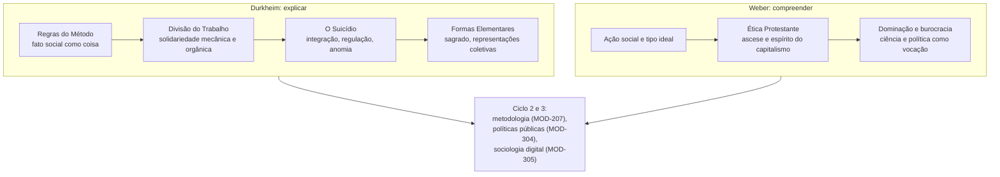
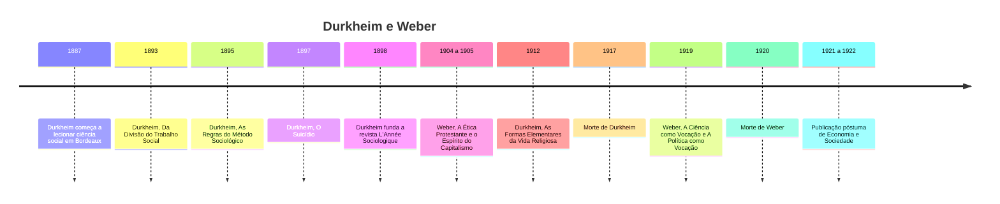

> **Aviso de Idioma:** Este currículo e todos os seus recursos de apoio foram estruturados exclusivamente em **Português (PT-BR)**.

# MOD-105: Sociologia Clássica: Émile Durkheim e Max Weber

**Ciclo 1 · Eixo 4 (Filosofia Política e Teoria Social) · 70 horas · 7 aulas · Pré-requisito: MOD-101**

*Émile Durkheim (1858 a 1917), fundador da sociologia acadêmica francesa. Domínio público.*

## Apresentação

Marx (MOD-103) mostrou que a sociedade capitalista tem leis próprias que se impõem às pessoas. Na virada do século XX, dois autores transformaram a investigação dessas forças numa disciplina científica com método: **Émile Durkheim**, na França, e **Max Weber**, na Alemanha. Eles discordavam em quase tudo sobre o método, e é por isso que precisam ser lidos juntos.

- **Durkheim** pergunta o que mantém uma sociedade unida e propõe tratar os fatos sociais "como coisas", medindo-os com estatística. *O Suicídio* (1897) é o primeiro grande estudo sociológico baseado em dados quantitativos.
- **Weber** pergunta pelo sentido que as pessoas dão às suas ações e propõe uma sociologia **compreensiva**. A sua análise da racionalização, da burocracia e da dominação é indispensável para entender o Estado moderno e, hoje, o Estado digital.

Os dois são fundamentais para quem trabalha com dados sociais: Durkheim inventa o uso sociológico da estatística; Weber ensina que os números precisam ser interpretados pelo sentido que as pessoas dão ao que fazem.

## Mapa do módulo

## Linha do tempo

## Objetivos de aprendizagem

- Definir fato social pelas suas três características e aplicar a regra de tratá-lo como coisa.
- Explicar solidariedade mecânica e orgânica e usar o direito como indicador do tipo de solidariedade.
- Reconstruir o método e a tipologia de *O Suicídio* e calcular taxas padronizadas.
- Explicar sagrado, profano, representações coletivas e efervescência coletiva.
- Definir ação social, os quatro tipos de ação e o tipo ideal em Weber.
- Reconstruir o argumento de *A Ética Protestante* e o diagnóstico da "crosta de aço".
- Explicar os três tipos de dominação legítima, as características da burocracia e as duas éticas da política.

## Aulas

| Aula | Tema | Duração | Leitura principal |
| :---: | :--- | :---: | :--- |
| 1 | [O fato social e as regras do método](./mod-105/aula-01-durkheim-fato-social-regras-metodo.md) | 10h | *As Regras do Método Sociológico*, Prefácio, capítulos I e II |
| 2 | [A divisão do trabalho e as formas de solidariedade](./mod-105/aula-02-durkheim-divisao-trabalho-solidariedade.md) | 10h | *Da Divisão do Trabalho Social*, Introdução, livro I (capítulos 2 e 3) e livro III |
| 3 | [*O Suicídio*: estatística e anomia](./mod-105/aula-03-durkheim-suicidio-anomia.md) | 10h | *O Suicídio*, Introdução e livro II |
| 4 | [Religião, sagrado e representações coletivas](./mod-105/aula-04-durkheim-formas-elementares.md) | 10h | *As Formas Elementares da Vida Religiosa*, Introdução e Conclusão |
| 5 | [Weber: compreender a ação social](./mod-105/aula-05-weber-acao-social-tipo-ideal.md) | 10h | *Economia e Sociedade*, capítulo I, §§ 1 e 2; "A objetividade do conhecimento" (seleção) |
| 6 | [*A Ética Protestante e o Espírito do Capitalismo*](./mod-105/aula-06-weber-etica-protestante.md) | 10h | *A Ética Protestante*, capítulos 2 e 5 (parte II) |
| 7 | [Dominação, burocracia e as vocações da ciência e da política](./mod-105/aula-07-weber-dominacao-burocracia-vocacoes.md) | 10h | *Economia e Sociedade* (tipos de dominação); *A Ciência como Vocação*; *A Política como Vocação* |

## Leituras e onde encontrar

| Obra | Onde ler |
| :--- | :--- |
| Durkheim, as quatro obras do módulo | [Domínio Público (MEC)](http://www.dominiopublico.gov.br/) e acervos universitários. Há boas traduções da Martins Fontes |
| Weber, *A Ética Protestante* | Tradução de José Marcos Mariani de Macedo (Companhia das Letras), referência atual; versões em domínio público em acervos universitários |
| Weber, *Ciência e Política: Duas Vocações* | Acervos universitários e bibliotecas digitais |
| Apoio | Tania Quintaneiro, Maria Ligia Barbosa e Márcia Oliveira, *Um Toque de Clássicos: Marx, Durkheim e Weber* (Editora UFMG), excelente introdução; aulas de Sociologia Clássica nas [e-Aulas USP](https://eaulas.usp.br/) |

## Projeto prático avaliativo

### Dossiê Durkheim e Weber: anomia digital e burocracia algorítmica

Um estudo comparado de 3.500 palavras em duas partes:

1. **Durkheim:** escolha um indicador social brasileiro com série histórica pública (por exemplo, taxas de mortalidade por causas externas no DataSUS, ou taxas de desemprego por faixa etária na PNAD). Calcule as taxas padronizadas em Python, por grupo e por ano, e interprete-as com os conceitos de integração e regulação. Discuta explicitamente o risco da falácia ecológica (aula 3).
2. **Weber:** analise um serviço público digitalizado (o aplicativo do INSS, o gov.br, a carteira de trabalho digital) como forma de dominação racional-legal. Que características da burocracia weberiana ele radicaliza? Onde a "crosta de aço" se torna literal?

**Entregáveis:** fichamentos de *As Regras do Método*, *O Suicídio*, *A Ética Protestante* e do trecho de *Economia e Sociedade* sobre dominação; ensaio em Markdown com tabelas tipológicas e um notebook ou script Python com os cálculos.

**Critérios de avaliação**

| Critério | Peso |
| :--- | :---: |
| Domínio da diferença entre a explicação durkheimiana e a compreensão weberiana | 35% |
| Correção dos cálculos e honestidade sobre os limites dos dados | 25% |
| Pertinência da aplicação ao Brasil contemporâneo | 25% |
| Clareza e estilo | 15% |

**Diretório de entrega:** `projetos/ciclo-1/mod-105-durkheim-weber`

> **Cuidado com o tema.** O suicídio é um assunto sensível. Ao trabalhar com esses dados, trate-os com respeito e sem sensacionalismo. Se você ou alguém próximo estiver em sofrimento, o Centro de Valorização da Vida atende de graça, 24 horas, pelo telefone **188** e pelo site [cvv.org.br](https://cvv.org.br/).

## Antes e depois deste módulo

- **Pré-requisito:** MOD-101. O MOD-103 (Marx) ajuda muito, e pode ser cursado em paralelo.
- **Este módulo prepara:** MOD-203 (Lukács une Marx e Weber na teoria da reificação), MOD-207 (metodologia), MOD-304 (burocracia e políticas públicas) e MOD-305 (sociologia digital).

## Glossário do módulo

*Afinidade eletiva* · *Anomia* · *Ação social* · *Ascese intramundana* · *Burocracia* · *Carisma* · *Consciência coletiva* · *Crosta de aço* · *Desencantamento do mundo* · *Dominação legítima* · *Efervescência coletiva* · *Ética da convicção* · *Ética da responsabilidade* · *Fato social* · *Neutralidade axiológica* · *Representações coletivas* · *Solidariedade mecânica e orgânica* · *Tipo ideal*
