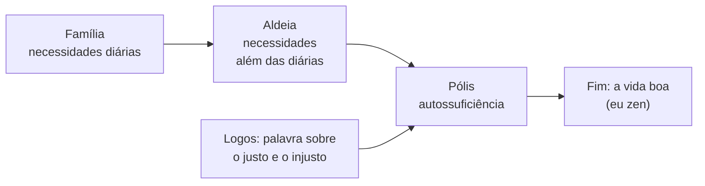
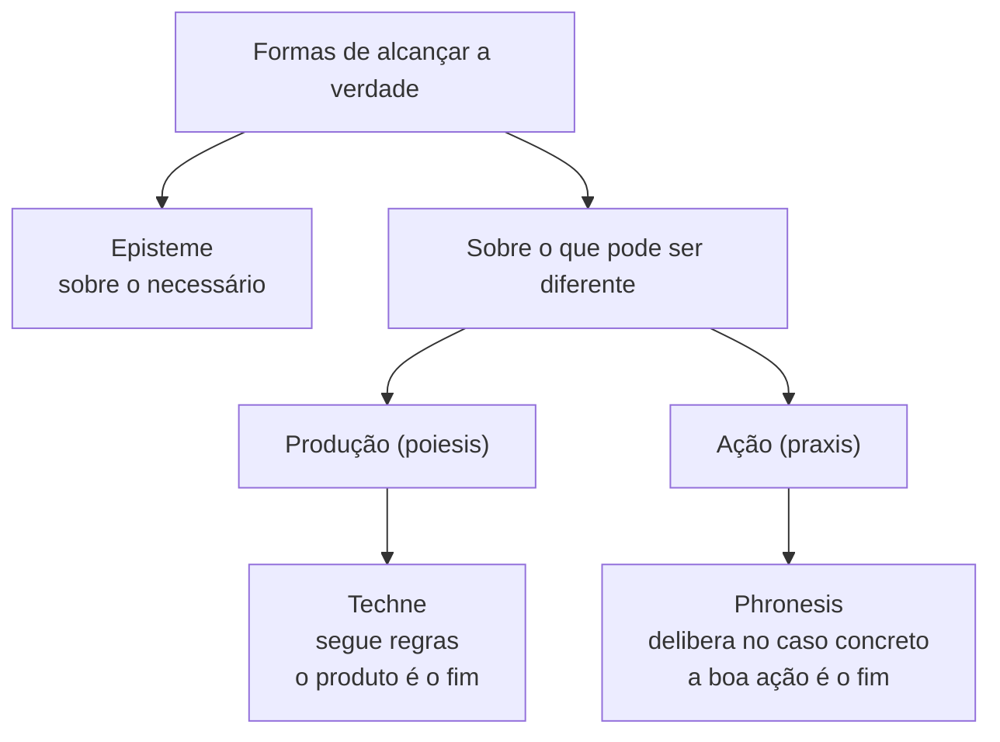

> **Aviso de Idioma:** Este currículo e todos os seus recursos de apoio foram estruturados exclusivamente em **Português (PT-BR)**.

# Aula 3 · Aristóteles: o animal político e os três saberes

**MOD-101 · 10 horas · Leitura principal:** *Ética a Nicômaco*, livro VI (capítulos 3 a 8); *Política*, livro I (capítulos 1 e 2) e livro III (capítulos 6 e 7)

*Busto de Aristóteles, cópia romana em mármore de um bronze de Lísipo (c. 330 a.C.). Palazzo Altemps, Roma. Foto de Jastrow, domínio público.*

## O que você vai aprender

- Explicar por que, para Aristóteles, o ser humano é um <abbr title="Zoon politikon (grego): animal político. Para Aristóteles, o ser humano só realiza plenamente a sua natureza vivendo na pólis, em comunidade organizada por leis e pela palavra.">*zoon politikon*</abbr> e qual o papel do <abbr title="Logos (grego): palavra, razão, discurso. Aristóteles distingue a voz (que expressa dor e prazer, comum aos animais) do logos (que expressa o justo e o injusto, próprio do humano).">*logos*</abbr> nessa definição.
- Distinguir *episteme*, <abbr title="Techne (grego): saber produtivo, voltado a fabricar algo que existe fora da própria ação (a casa, o remédio, o sapato). Tem regras e pode ser ensinado.">*techne*</abbr> e <abbr title="Phronesis (grego): prudência ou sabedoria prática. Saber deliberar bem sobre o que é bom para a vida humana em situações concretas e variáveis. Não se reduz a regras.">*phronesis*</abbr>.
- Diferenciar produção (*poiesis*) e ação (*praxis*).
- Classificar as seis formas de governo e explicar o critério da classificação.
- Argumentar por que decisões políticas não podem ser entregues a procedimentos técnicos.

## Pergunta de abertura

> Um algoritmo da prefeitura decide em que bairros haverá mais ônibus, com base em dados de uso. Um morador de um bairro sem ônibus diz que ninguém usa a linha porque ela não existe. Quem tem razão, o algoritmo ou o morador? E que tipo de saber seria preciso para decidir?

## 1. Do Liceu à biologia política

Aristóteles (384 a 322 a.C.) nasceu em Estagira, no norte da Grécia, filho de um médico. Estudou vinte anos na Academia de Platão e depois foi preceptor do jovem Alexandre da Macedônia. De volta a Atenas, fundou a sua própria escola, o Liceu.

A diferença de temperamento com Platão é visível no afresco de Rafael: Platão aponta para o alto, Aristóteles estende a mão para a terra. Aristóteles foi também um enorme biólogo: classificou centenas de espécies, dissecou animais e pensou a política com olhos de naturalista. Enquanto Platão desenhou uma cidade ideal, Aristóteles e seus alunos coletaram as constituições de 158 cidades gregas para compará-las. É, de certo modo, o primeiro cientista político empírico.

## 2. O animal político

A *Política* começa com uma genealogia (livro I, capítulos 1 e 2). A família reúne pessoas para a vida cotidiana; várias famílias formam a aldeia; várias aldeias formam a *pólis*, que é autossuficiente. A *pólis* nasce para garantir a vida, mas existe para garantir **a vida boa**.

Daí a famosa frase: o ser humano é por natureza um animal político (1253a). E a prova que Aristóteles oferece é a linguagem:

> Muitos animais têm **voz** (*phoné*), que indica dor e prazer. Só o humano tem **palavra** (*logos*), que serve para manifestar o útil e o nocivo, e portanto o justo e o injusto. A comunidade dessas coisas é que faz a família e a cidade.

Quem vive fora da cidade, conclui Aristóteles, "ou é um animal selvagem ou é um deus".

## 3. Os três saberes

No livro VI da *Ética a Nicômaco*, Aristóteles classifica as maneiras como a alma alcança a verdade. Três delas são decisivas para este curso:

| Saber | Objeto | Finalidade | Exemplo |
| :--- | :--- | :--- | :--- |
| ***Episteme*** (ciência) | O que não pode ser diferente: o necessário e eterno | Conhecer | Demonstrar um teorema |
| ***Techne*** (arte, técnica) | O que pode ser diferente e é **produzido** | Fabricar algo que existe fora da ação | Construir uma casa, curar um doente, escrever um programa |
| ***Phronesis*** (prudência) | O que pode ser diferente e é **agido** | Agir bem; a própria ação é o fim | Decidir com justiça numa situação concreta |

A distinção entre *techne* e *phronesis* depende de outra: a diferença entre **produção** (<abbr title="Poiesis (grego): produção, fabricação. Atividade cujo fim é um produto separado dela: a casa é o fim da construção.">*poiesis*</abbr>) e **ação** (<abbr title="Praxis (grego): ação. Atividade cujo fim está nela mesma: agir com justiça já é o fim, não um meio para obter um objeto.">*praxis*</abbr>).

- Na **produção**, o fim está fora da atividade. Construir uma casa termina quando a casa fica pronta, e a casa pode ser julgada independentemente de quem a construiu.
- Na **ação**, o fim está na própria atividade. Agir com justiça não "produz" a justiça como um objeto; agir justamente já é o fim.

### Por que a *phronesis* não vira regra

A *techne* pode ser ensinada por regras gerais e pode ser aplicada "do mesmo jeito" em casos parecidos. A *phronesis* lida com o particular: situações em que as regras gerais não bastam, em que é preciso ver o que o caso pede. Por isso Aristóteles diz que jovens podem ser bons geômetras, mas dificilmente são prudentes, porque a prudência exige **experiência** (1142a).

O exemplo clássico é a justiça do juiz. A lei é geral; o caso é particular. Quando a aplicação literal da lei produz injustiça, o juiz prudente recorre à <abbr title="Equidade (epieikeia, em grego): correção da lei geral no caso particular, quando aplicá-la literalmente produziria injustiça. Aristóteles a compara à régua de chumbo de Lesbos, que se dobra à forma da pedra.">equidade</abbr>, que Aristóteles compara à régua flexível de chumbo usada pelos construtores de Lesbos, capaz de se dobrar à forma da pedra (*Ética a Nicômaco* V, 1137b).

> **Conexão com a computação:** um algoritmo é, por definição, uma *techne*: uma sequência de regras gerais aplicadas da mesma maneira a todos os casos que se encaixam nas condições. Quando um sistema automatizado decide quem recebe um benefício social, ele transforma uma questão de *phronesis* (o que é justo neste caso?) em uma questão de *techne* (o caso satisfaz as regras?). A régua de chumbo de Lesbos não existe no código, a menos que alguém a programe, e programá-la é de novo transformá-la em regra. Esse é o núcleo do projeto do módulo.

## 4. As formas de governo

No livro III da *Política*, Aristóteles classifica as constituições por dois critérios cruzados: **quantos governam** e **em benefício de quem**.

| Quem governa | Para o bem comum (formas retas) | Para o interesse de quem governa (formas desviadas) |
| :--- | :--- | :--- |
| Um | Monarquia | Tirania |
| Poucos | Aristocracia | <abbr title="Oligarquia: para Aristóteles, o governo dos ricos em benefício dos ricos. O critério decisivo não é o número, e sim a riqueza.">Oligarquia</abbr> |
| Muitos | *Politeia* (governo constitucional) | Democracia (governo dos pobres em benefício dos pobres) |

Dois detalhes surpreendem o leitor moderno:

1. **"Democracia" é uma forma desviada.** Para Aristóteles, ela é o governo dos pobres em seu próprio interesse, assim como a oligarquia é o governo dos ricos em seu próprio interesse. A forma reta do governo de muitos ele chama de *politeia*.
2. **O critério real é a riqueza, não o número.** Aristóteles observa (1279b a 1280a) que, mesmo que os ricos fossem maioria, um governo dos ricos seria oligarquia. A política grega era atravessada pela luta entre ricos e pobres, e Aristóteles reconhece isso abertamente. Marx, no MOD-103, vai radicalizar essa observação.

## 5. Os limites de Aristóteles

Aristóteles é fundamental e também precisa ser lido criticamente. No livro I da *Política*, ele defende a **escravidão natural**: haveria pessoas destinadas por natureza a obedecer, "instrumentos animados". E afirma a inferioridade natural das mulheres.

Há uma passagem notável nesse mesmo trecho (1253b): se as lançadeiras tecessem sozinhas e os plectros tocassem a cítara sozinhos, os mestres de obra não precisariam de auxiliares nem os senhores de escravos. Aristóteles imagina a automação, e a imagina como aquilo que tornaria a escravidão desnecessária. Marx vai citar essa passagem n'*O Capital* para mostrar a ironia histórica: a máquina chegou, e em vez de libertar o trabalhador, prolongou a sua jornada. Guarde essa passagem para o MOD-103.

## Leitura guiada

1. ***Política* I, 1 e 2 (1252a a 1253a)**: a genealogia da cidade e a definição do animal político. Copie a passagem sobre voz e *logos*.
2. ***Política* I, 4 (1253b a 1254a)**: os instrumentos animados e as lançadeiras que tecem sozinhas.
3. ***Ética a Nicômaco* VI, 3 a 8 (1139b a 1142a)**: os saberes. Faça uma tabela com a definição de cada um nas palavras de Aristóteles.
4. ***Política* III, 6 e 7 (1278b a 1279b)**: a classificação das constituições.

A numeração como "1253a" é a <abbr title="Paginação de Bekker: numeração padrão das obras de Aristóteles, tirada da edição de Immanuel Bekker (1831). Permite achar o mesmo trecho em qualquer tradução.">paginação de Bekker</abbr>, presente nas margens das boas edições.

## Exercícios

**1. Compreensão.** Qual é a diferença entre *poiesis* e *praxis*? Dê um exemplo de cada um tirado do trabalho com software.

Gabarito comentado

Na *poiesis* o fim é um produto separado da atividade; na *praxis* o fim é a própria ação bem realizada. Escrever um programa é *poiesis*: o fim é o programa, que pode ser avaliado depois por quem não o escreveu. Decidir, numa reunião da equipe, se o programa deve coletar ou não dados de localização dos usuários é *praxis*: trata-se de agir bem em relação a outras pessoas, e o fim é a decisão justa em si.

**2. Aplicação.** Volte à pergunta de abertura. Que parte da decisão sobre as linhas de ônibus é *techne* e que parte é *phronesis*?

Gabarito comentado

É *techne* calcular a demanda observada, estimar custos e otimizar rotas dado um objetivo. É *phronesis* decidir qual deve ser o objetivo (atender quem já usa ou criar acesso onde não há?), reconhecer que a falta de uso pode ser efeito da falta de oferta (um viés que os dados não mostram sozinhos) e pesar o direito de ir e vir de quem mora longe. O algoritmo não erra no cálculo, mas responde a uma pergunta que alguém escolheu por ele.

**3. Análise.** Por que Aristóteles diz que a oligarquia é o governo dos ricos, e não dos poucos? O que isso revela sobre a sua teoria política?

Gabarito comentado

Porque o que define o regime é a quem ele serve, e nas cidades gregas a divisão política decisiva era entre ricos e pobres. Os ricos costumam ser poucos e os pobres muitos, mas isso é um acidente; o essencial é a riqueza. Isso mostra que Aristóteles já via a política como atravessada por conflitos de interesse econômico, uma ideia que Marx vai desenvolver como teoria da luta de classes.

**4. Conexão.** Releia a passagem das lançadeiras (1253b). Escreva um parágrafo comparando a expectativa de Aristóteles com o que de fato aconteceu com a automação industrial e com a automação digital.

Critérios de correção

A resposta deve: (1) explicar a hipótese de Aristóteles (máquinas autônomas dispensariam o trabalho servil); (2) notar que a automação industrial não aboliu o trabalho pesado, e muitas vezes o intensificou; (3) relacionar com a automação digital (aplicativos que gerenciam entregadores, por exemplo). A melhor resposta antecipa a pergunta do MOD-103: o que decide o efeito da máquina não é a máquina, e sim as relações sociais em que ela é usada.

## Resumo da aula

- O ser humano é animal político porque tem *logos*, a palavra que discute o justo e o injusto.
- *Episteme* conhece o necessário; *techne* produz; *phronesis* delibera sobre a ação no caso concreto.
- Produção (*poiesis*) tem o fim fora de si; ação (*praxis*) tem o fim em si.
- Algoritmos são *techne*. Entregar a eles decisões de *phronesis* é uma escolha política, não um avanço técnico neutro.
- As formas de governo se dividem por número e por finalidade, mas o critério real é a riqueza.
- Aristóteles defende a escravidão natural e, na mesma página, imagina a automação.

## Para ir além

- Aristóteles, *Ética a Nicômaco*, livro V, capítulo 10: a equidade.
- Aristóteles, *Retórica*, livro I, capítulos 1 a 3: a retórica pensada como contraparte da dialética, uma resposta indireta a Platão.
