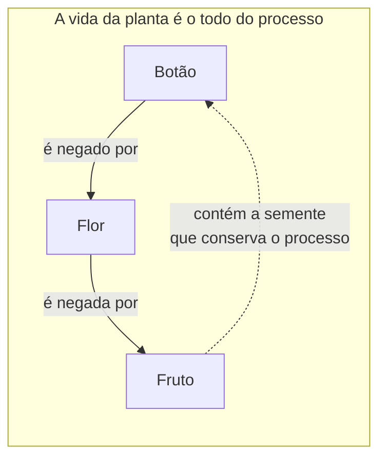
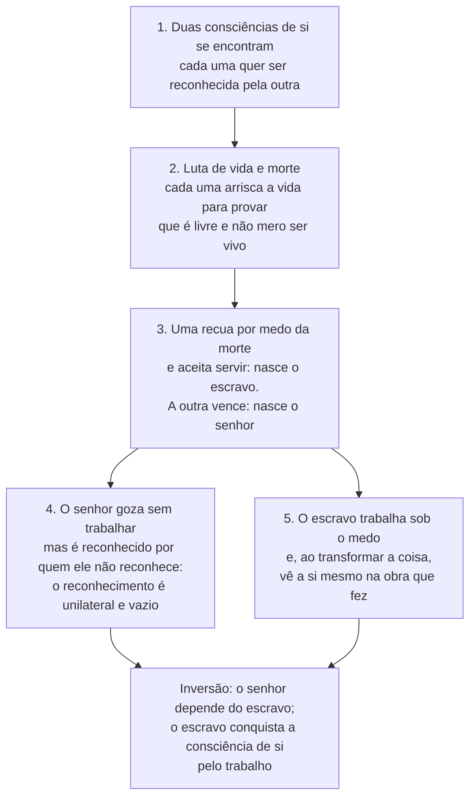

> **Aviso de Idioma:** Este currículo e todos os seus recursos de apoio foram estruturados exclusivamente em **Português (PT-BR)**.

# Aula 4 · Hegel: dialética e a luta pelo reconhecimento

**MOD-101 · 10 horas · Leitura principal:** *Fenomenologia do Espírito*, Prefácio (§§ 17 a 32, seleção) e capítulo IV, "Dominação e escravidão" (§§ 178 a 196)

*Georg Wilhelm Friedrich Hegel no ano da sua morte. Óleo de Jakob Schlesinger (1831), Alte Nationalgalerie, Berlim. Domínio público.*

## O que você vai aprender

- Situar Hegel entre a Revolução Francesa e a Restauração.
- Explicar o que Hegel entende por <abbr title="Dialética (em Hegel): movimento pelo qual um conceito ou uma realidade, ao se desenvolver, produz a sua própria contradição e a supera numa forma mais rica que conserva o que havia de verdadeiro nos momentos anteriores.">dialética</abbr> e afastar o resumo escolar "tese, antítese, síntese".
- Definir <abbr title="Aufhebung (alemão): palavra central de Hegel, que significa ao mesmo tempo suprimir, conservar e elevar. Traduzida como suprassunção ou superação.">*Aufhebung*</abbr> e o "trabalho do negativo".
- Narrar, passo a passo, a dialética do senhor e do escravo.
- Explicar por que o trabalho é, para Hegel, a mediação que forma a consciência.

## Pergunta de abertura

> Um influenciador com milhões de seguidores depende, para existir como influenciador, do reconhecimento de pessoas que ele não reconhece individualmente. Quem depende de quem nessa relação?

## 1. O filósofo da Revolução

Hegel nasceu em Stuttgart em 1770 e tinha 19 anos quando caiu a Bastilha. Segundo um relato célebre, plantou com os colegas de seminário Hölderlin e Schelling uma "árvore da liberdade" para celebrar a Revolução. Em 1806, terminando a *Fenomenologia do Espírito* em Iena, viu Napoleão passar a cavalo depois da batalha e escreveu a um amigo que tinha visto "a alma do mundo" montada num cavalo.

Essa experiência histórica é decisiva. Hegel quer pensar um mundo em que tudo muda: instituições milenares caem em semanas, a liberdade proclamada vira Terror, o Terror vira Império. A filosofia que ele constrói é uma filosofia do **movimento**: a verdade não é uma coisa parada, é um processo.

> "O verdadeiro é o todo. Mas o todo é somente a essência que se completa mediante o seu desenvolvimento." (*Fenomenologia*, Prefácio, § 20)

## 2. O que a dialética não é

Os manuais costumam resumir Hegel como "tese, antítese, síntese". Hegel praticamente não usa essa fórmula e a criticava como esquema morto. A dialética não é um molde que se aplica de fora a qualquer conteúdo; é o modo como o próprio conteúdo se move quando é pensado até o fim.

Um exemplo simples, inspirado no Prefácio (§ 2): o botão de uma flor desaparece quando a flor desabrocha, e se poderia dizer que a flor **refuta** o botão. O fruto, por sua vez, declara a flor uma existência falsa da planta. Essas formas se excluem, mas ao mesmo tempo são momentos necessários de uma mesma vida orgânica: sem botão não há flor, sem flor não há fruto.

O motor do movimento é o que Hegel chama de **negativo**: cada forma traz dentro de si o que a contradiz e a obriga a se transformar. O "trabalho do negativo" (§ 19) é esse esforço de atravessar a contradição em vez de fugir dela.

### *Aufhebung*: suprimir, conservar, elevar

A palavra alemã *aufheben* tem três sentidos no uso comum: **suprimir** (abolir uma lei), **conservar** (guardar algo) e **elevar** (levantar). Hegel usa os três ao mesmo tempo. Quando uma forma é superada dialeticamente, ela é suprimida como forma independente, conservada como momento do que veio depois e elevada a um nível mais rico. Em português a palavra costuma ser traduzida como "suprassunção" ou "superação".

## 3. Consciência e consciência de si

A *Fenomenologia do Espírito* narra a formação da consciência, das formas mais simples de conhecer o mundo até o saber absoluto. No capítulo IV, a consciência descobre que, além de conhecer **objetos**, pode tomar a **si mesma** como objeto: torna-se consciência de si.

E aqui vem a tese decisiva: **a consciência de si só se realiza no reconhecimento de outra consciência de si**. Eu só sei quem sou quando outro me reconhece como alguém. A identidade pessoal não é um dado interior; é uma relação social.

> "A consciência de si alcança a sua satisfação somente em outra consciência de si." (§ 175)

## 4. A dialética do senhor e do escravo

Esta é a passagem mais lida e mais citada de Hegel. Ela não descreve um fato histórico datado; é um modelo de como o reconhecimento se forma por meio do conflito. Vamos em cinco movimentos.

**1. O encontro.** Duas consciências de si se encontram. Cada uma quer ser reconhecida como livre, como mais do que um corpo vivo.

**2. A luta.** Para provar que não está presa à mera vida, cada uma precisa arriscar a vida. Começa uma luta de vida e morte. Mas se uma morre, a outra perde quem a reconheceria. A luta até a morte é uma contradição.

**3. A submissão.** Uma das consciências tem medo da morte e recua: prefere a vida à liberdade. Ela se torna **escravo** (em alemão, *Knecht*, servo). A outra, que não recuou, se torna **senhor** (*Herr*).

**4. O impasse do senhor.** O senhor parece ter vencido: é reconhecido e goza das coisas que o escravo prepara, sem precisar trabalhar. Mas há um problema. Ele é reconhecido por alguém que ele **não reconhece** como igual. O reconhecimento que recebe vem de uma consciência que ele reduziu a coisa. É um reconhecimento vazio. Além disso, o senhor se relaciona com o mundo só pelo gozo, que consome a coisa e desaparece.

**5. A formação do escravo.** O escravo vive sob o medo absoluto da morte, que o abalou por inteiro. E trabalha. No trabalho, ele precisa **refrear o desejo** (não pode consumir o que produz) e **dar forma à coisa**. A forma que ele imprime no objeto permanece. Diante do produto do seu trabalho, o escravo vê a si mesmo fora de si, objetivado:

> "O trabalho é desejo refreado, um desvanecer contido; ou seja, o trabalho forma." (§ 195)

**A inversão.** O resultado é surpreendente: o senhor, que parecia independente, depende inteiramente do escravo. O escravo, que parecia dependente, conquista pela disciplina do trabalho a consciência da sua própria capacidade. A verdade da consciência independente, diz Hegel, é a consciência servil.

## 5. Por que esta passagem importa tanto

1. **O trabalho forma o humano.** Antes de Hegel, a filosofia tratava o trabalho como atividade inferior, própria de escravos (lembre de Aristóteles). Hegel faz do trabalho a mediação pela qual a consciência se forma. Marx vai dizer que Hegel "apreende a essência do trabalho", mas só do trabalho abstrato e espiritual, e vai materializar essa ideia (MOD-103).
2. **A identidade é social.** Ninguém é livre sozinho. A liberdade exige reconhecimento recíproco, e o reconhecimento unilateral (de cima para baixo) fracassa até para quem domina.
3. **A dominação contém a sua própria contradição.** Quem domina depende de quem é dominado. Esse é o modelo de toda crítica dialética posterior, de Marx a Fanon. No MOD-206 você vai ler a resposta de Frantz Fanon, que em *Pele Negra, Máscaras Brancas* mostra que, na situação colonial, o senhor branco não quer o reconhecimento do negro, quer apenas o seu trabalho: a dialética hegeliana é bloqueada pelo racismo.

> **Conexão com a computação:** o trabalho que treina sistemas de inteligência artificial (rotular imagens, moderar conteúdo, avaliar respostas) é feito por milhões de pessoas mal pagas, muitas no Sul Global, cujo nome nunca aparece no produto. Pergunte-se, com Hegel: quem reconhece quem nessa relação? O que o trabalho forma em quem o faz, e quem se apropria da forma produzida?

## Leitura guiada

1. **Prefácio, §§ 2, 17 a 20 e 32** (cerca de 5 páginas): o botão e a flor, a substância como sujeito e o trabalho do negativo. Prefácios de Hegel são difíceis; leia devagar e não se preocupe em entender tudo.
2. **Capítulo IV, §§ 178 a 196** (cerca de 12 páginas): a dialética do senhor e do escravo. Faça uma lista numerada dos movimentos, com o número do parágrafo de cada um, e compare com o diagrama desta aula.

A tradução de referência em português é a de Paulo Meneses. Ela usa "dominação e escravidão" para o título da seção, e "suprassumir" para *aufheben*.

## Exercícios

**1. Compreensão.** Por que a luta de vida e morte, se levada até o fim, fracassa?

Gabarito comentado

Porque o objetivo da luta é ser reconhecido. Se uma das consciências morre, desaparece quem reconheceria a vencedora. A morte do outro destrói a própria condição do reconhecimento. Por isso a luta termina não em morte, mas em submissão.

**2. Compreensão.** Explique a frase "o trabalho é desejo refreado" (§ 195).

Gabarito comentado

O desejo, quando satisfeito diretamente, consome o objeto (comer o pão). O escravo não pode consumir o que produz: precisa conter o desejo e, em vez de destruir a coisa, dar-lhe forma. Essa contenção transforma o objeto e transforma quem trabalha, que aprende disciplina e vê a sua capacidade fixada no produto.

**3. Aplicação.** Relacione a dialética do senhor e do escravo com a pergunta de abertura sobre o influenciador.

Gabarito comentado

O influenciador recebe reconhecimento massivo de seguidores que ele não reconhece individualmente: é um reconhecimento unilateral, como o do senhor. Ele depende inteiramente dessa massa para existir como influenciador. Uma resposta mais completa nota que há um terceiro, a plataforma, que organiza e monetiza o reconhecimento de ambos, e pergunta quem ocupa o lugar do senhor de fato.

**4. Análise crítica.** Por que é um erro resumir a dialética de Hegel como "tese, antítese, síntese"? Use o exemplo do botão, da flor e do fruto.

Gabarito comentado

Porque a fórmula transforma a dialética num esquema externo de três etapas estanques que se aplica a qualquer conteúdo. Em Hegel, a negação nasce de dentro da própria forma (o botão contém o desenvolvimento que o nega), e a forma superada não desaparece: é conservada como momento do todo (*Aufhebung*). O exemplo da planta mostra um processo contínuo em que cada forma é necessária e a verdade é o processo inteiro.

## Resumo da aula

- Hegel pensa a partir da Revolução Francesa: a verdade é processo, "o verdadeiro é o todo".
- A dialética é o movimento do próprio conteúdo através das suas contradições, e não a fórmula escolar de três etapas.
- *Aufhebung* significa suprimir, conservar e elevar ao mesmo tempo.
- A consciência de si só se realiza no reconhecimento de outra consciência de si.
- Na dialética do senhor e do escravo, o senhor depende de quem domina e o escravo se forma pelo trabalho. Essa passagem é a matriz das teorias críticas do trabalho e da dominação.

## Para ir além

- Alexandre Kojève, *Introdução à Leitura de Hegel* (1947): a leitura que tornou a dialética do senhor e do escravo célebre no século XX.
- Frantz Fanon, *Pele Negra, Máscaras Brancas*, capítulo 7, seção "O negro e Hegel" (será lido no MOD-206).
