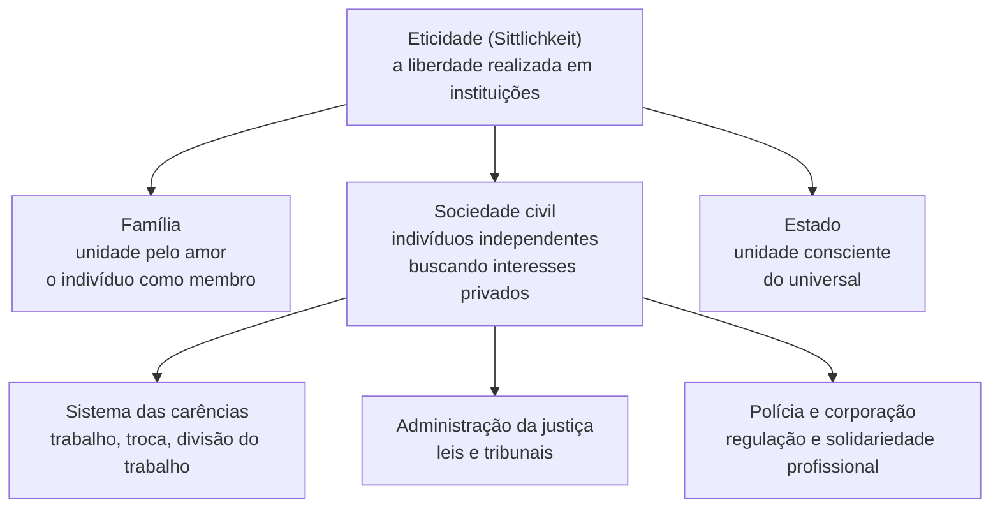
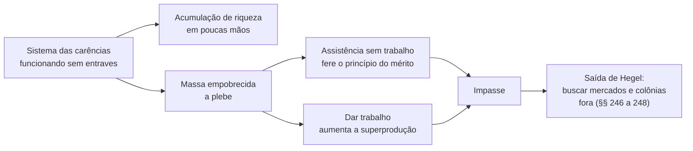

> **Aviso de Idioma:** Este currículo e todos os seus recursos de apoio foram estruturados exclusivamente em **Português (PT-BR)**.

# Aula 5 · Hegel: sociedade civil, carências e Estado

**MOD-101 · 10 horas · Leitura principal:** *Princípios da Filosofia do Direito* (1820), Prefácio (trecho final) e §§ 142 a 157, 182 a 208, 241 a 248 e 257 a 260

## O que você vai aprender

- Explicar a estrutura da <abbr title="Eticidade (Sittlichkeit, em alemão): para Hegel, a vida ética concreta de uma comunidade, feita de costumes, instituições e leis em que a liberdade individual se realiza. Divide-se em família, sociedade civil e Estado.">eticidade</abbr> (família, sociedade civil, Estado).
- Definir a <abbr title="Sociedade civil (bürgerliche Gesellschaft): em Hegel, a esfera das relações econômicas entre indivíduos independentes que buscam os seus interesses privados. Bürgerlich significa ao mesmo tempo civil e burguês.">sociedade civil</abbr> como "sistema das carências".
- Explicar o problema da "plebe" e por que Hegel vê a pobreza como contradição interna da sociedade civil.
- Entender o papel que Hegel atribui ao Estado e por que essa teoria foi tão disputada por Marx.
- Ler o famoso Prefácio ("o que é racional é efetivo") e a imagem da coruja de Minerva.

## Pergunta de abertura

> Num mercado em que cada um busca o próprio interesse, todos acabam dependendo de todos: o padeiro depende do agricultor, que depende do fabricante de tratores, que depende do padeiro. Essa interdependência garante, por si só, que ninguém passe fome?

## 1. Do reconhecimento às instituições

Na aula anterior, o reconhecimento aparecia como luta entre duas consciências. Na *Filosofia do Direito*, publicada em Berlim em 1820, Hegel mostra como o reconhecimento se estabiliza em **instituições**: costumes, contratos, leis, corporações, Estado.

A obra tem três partes: o direito abstrato (propriedade, contrato, crime), a moralidade (a consciência individual e as intenções) e a eticidade. É na terceira que está o núcleo político.

## 2. A sociedade civil: o sistema das carências

A **sociedade civil** (*bürgerliche Gesellschaft*) é uma descoberta histórica: é o mundo moderno do mercado, que Hegel conhecia por ter lido com atenção os economistas ingleses e escoceses (Adam Smith, James Steuart, David Ricardo). O adjetivo *bürgerlich* quer dizer, ao mesmo tempo, "civil" e "burguês". O tradutor sempre perde um dos sentidos.

Na sociedade civil vale um princípio duplo (§ 182):

1. **A pessoa concreta é fim para si mesma:** cada um busca a satisfação das suas próprias carências.
2. **Cada um só alcança o seu fim por meio dos outros:** para satisfazer as minhas necessidades preciso produzir para os outros e comprar o que eles produzem.

O resultado é uma rede de dependência universal em que, sem querer, o egoísmo de cada um produz uma interdependência de todos. Hegel admira essa engrenagem, que a economia política revelou, e a chama de **sistema das carências** (§§ 189 a 208).

Dentro dele, o trabalho se divide e se especializa. Hegel percebe com agudeza o efeito dessa divisão (§ 198): o trabalho fica mais simples, a habilidade do trabalhador num ponto específico aumenta e a produção cresce. Mas o trabalho também se torna mais abstrato e mecânico, até que o ser humano pode "se retirar dele e deixar a máquina entrar em seu lugar".

## 3. A contradição: riqueza e plebe

Aqui está a parte mais impressionante e menos lembrada da obra. Hegel não acredita que a mão invisível resolva tudo. Ele observa (§§ 243 a 245) que, quando a sociedade civil funciona sem entraves, acontecem duas coisas ao mesmo tempo:

- **A riqueza se acumula** num polo.
- **A pobreza se aprofunda** no outro: uma grande massa cai abaixo do nível de vida considerado necessário, perde a honra de se sustentar pelo próprio trabalho e se torna o que Hegel chama de **plebe** (*Pöbel*).

E conclui, num parágrafo extraordinário (§ 245): a sociedade civil, apesar do excesso de riqueza, **não é rica o bastante** para impedir o excesso de pobreza. Se os pobres recebessem ajuda sem trabalhar, isso feriria o princípio da sociedade civil; se recebessem trabalho, aumentaria a superprodução, que já é a causa do problema.

A saída que Hegel encontra é empurrar o problema para fora: a sociedade civil é levada a buscar consumidores em outros países e a fundar **colônias** (§§ 246 a 248). Em 1820, Hegel descreve a lógica que Lênin chamará de imperialismo em 1916 (MOD-201). E deixa a contradição sem solução interna.

## 4. O Estado

Para Hegel, o **Estado** é a esfera em que o interesse particular e o interesse universal se reconciliam conscientemente. Não é o Estado como mero instrumento de segurança da propriedade (a visão liberal, que Hegel atribui à sociedade civil), e sim "a efetividade da ideia ética" (§ 257).

Essa teoria foi lida de maneiras opostas:

| Leitura | Argumento |
| :--- | :--- |
| Conservadora | Hegel justificaria o Estado prussiano existente como encarnação da razão |
| Liberal e reformista | O Estado hegeliano tem constituição, funcionalismo profissional, opinião pública e direitos; é um modelo de Estado de direito moderno |
| Crítica (Marx) | Hegel inverte as coisas: apresenta o Estado como fundamento da sociedade civil, quando na verdade é a sociedade civil (a economia) que determina o Estado |

Essa terceira leitura é a porta de entrada do MOD-103. Em 1843, o jovem Marx escreveu a *Crítica da Filosofia do Direito de Hegel* e concluiu que a anatomia da sociedade civil deve ser procurada na economia política. Gramsci, no MOD-203, vai recuperar a sociedade civil hegeliana para construir o conceito de hegemonia.

## 5. O Prefácio: razão, efetividade e a coruja de Minerva

O Prefácio da *Filosofia do Direito* contém duas frases que todo estudante de filosofia política precisa conhecer.

> "O que é racional é efetivo; e o que é efetivo é racional."

Os críticos de Hegel leram aí uma justificativa de tudo o que existe. Mas *efetivo* (*wirklich*) não quer dizer "existente": em Hegel, é efetivo aquilo em que a essência se realizou. Uma instituição podre existe, mas não é efetiva. A frase pode ser lida também como programa: o que é racional tende a se realizar.

> "A coruja de Minerva só levanta voo ao cair do crepúsculo."

A coruja é o símbolo da sabedoria (Minerva é a deusa romana da sabedoria). A filosofia, diz Hegel, chega sempre tarde: compreende uma forma de vida quando ela já está madura, prestes a envelhecer. A filosofia pensa o seu tempo; não ensina como o mundo deve ser. Marx responderá, nas *Teses sobre Feuerbach*, que o ponto é transformá-lo.

## Leitura guiada

1. **Prefácio**, últimas 6 páginas: a frase sobre o racional e o efetivo e a coruja de Minerva.
2. **§§ 182 a 189**: o princípio da sociedade civil e o sistema das carências.
3. **§§ 196 a 198**: trabalho, divisão do trabalho e máquina.
4. **§§ 241 a 248**: pobreza, plebe e colonização. Leia o § 245 três vezes.
5. **§§ 257 e 258**: a definição de Estado.

Os parágrafos de Hegel têm "adendos" (*Zusätze*), anotações de aulas registradas por alunos. São mais fáceis de ler que o texto principal e ajudam muito.

## Exercícios

**1. Compreensão.** Quais são os dois princípios da sociedade civil e por que eles produzem interdependência?

Gabarito comentado

(1) Cada pessoa é fim para si mesma e busca as suas carências; (2) cada uma só realiza o seu fim por meio das outras. Como ninguém produz tudo de que precisa, a busca do interesse próprio obriga cada um a produzir para os outros e a comprar dos outros, tecendo uma rede de dependência mútua que ninguém planejou.

**2. Análise.** Por que, para Hegel, a sociedade civil "não é rica o bastante" para eliminar a pobreza, mesmo tendo riqueza em excesso?

Gabarito comentado

Porque os seus próprios meios de resolver a pobreza contradizem o seu princípio. Sustentar os pobres sem trabalho fere o princípio de que cada um se sustenta pelo próprio trabalho. Dar-lhes trabalho aumenta a produção num mercado que já sofre de superprodução por falta de consumidores. A pobreza não é acidente: é produzida pelo próprio funcionamento do sistema. A riqueza existe, mas a lógica da sociedade civil impede de usá-la para isso.

**3. Conexão.** Relacione os §§ 246 a 248 (mercados externos e colônias) com a história do Brasil.

Gabarito comentado

Uma boa resposta lembra que o Brasil, em 1820, ainda era parte do império português, prestes a se tornar independente (1822), e que a economia brasileira estava organizada para exportar produtos primários e importar manufaturas, sendo um dos "mercados" e territórios para onde as sociedades industriais empurravam as suas contradições. A resposta excelente antecipa o tema da dependência (Florestan Fernandes, MOD-206).

**4. Interpretação.** Escreva um parágrafo explicando a diferença entre "existente" e "efetivo" e como ela muda o sentido da frase "o que é racional é efetivo".

Gabarito comentado

Existente é tudo o que está aí, inclusive o que é contingente, decadente ou irracional. Efetivo é aquilo em que a essência se realizou plenamente. Lida assim, a frase não diz que tudo o que existe é racional e portanto justificado. Diz que a razão não é uma mera ideia impotente: ela tende a se realizar no mundo. Isso permite leituras críticas: uma instituição que existe sem corresponder ao seu conceito não é efetiva, e pode ser criticada em nome dele.

## Resumo da aula

- A eticidade se divide em família, sociedade civil e Estado.
- A sociedade civil é o mundo do mercado moderno: cada um busca o seu interesse e depende de todos. Hegel a chama de sistema das carências.
- Hegel percebe que a sociedade civil produz ao mesmo tempo riqueza concentrada e uma plebe empobrecida, e que não consegue resolver isso com os seus próprios meios.
- A saída proposta é a expansão para mercados externos e colônias, antecipação da teoria do imperialismo.
- O Estado é para Hegel a reconciliação do particular e do universal; Marx inverterá essa relação.

## Para ir além

- Karl Marx, *Crítica da Filosofia do Direito de Hegel* (1843) e a sua *Introdução* (1844), no [Arquivo Marxista na Internet](https://www.marxists.org/portugues/).
- Os §§ 189 a 208 lidos ao lado do primeiro capítulo de *A Riqueza das Nações*, de Adam Smith, sobre a fábrica de alfinetes.
