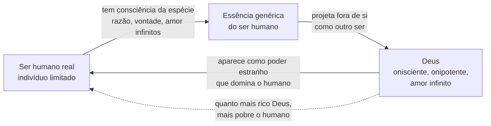
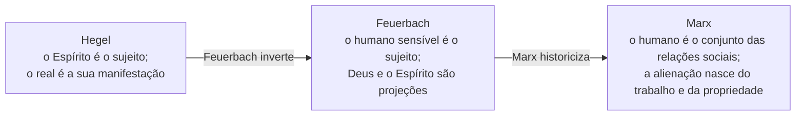

> **Aviso de Idioma:** Este currículo e todos os seus recursos de apoio foram estruturados exclusivamente em **Português (PT-BR)**.

# Aula 6 · Feuerbach: alienação e inversão materialista

**MOD-101 · 10 horas · Leitura principal:** *A Essência do Cristianismo* (1841), Prefácio à segunda edição e Introdução (capítulos 1 e 2); *Teses Provisórias para a Reforma da Filosofia* (1842), seleção

*Ludwig Feuerbach em gravura publicada pela revista* Die Gartenlaube *em 1872, ano da sua morte. Domínio público.*

## O que você vai aprender

- Situar Feuerbach na crise da escola hegeliana depois de 1831.
- Explicar o mecanismo da <abbr title="Alienação (Entfremdung ou Entäusserung, em alemão): processo pelo qual algo que é próprio do ser humano (uma capacidade, um produto, uma relação) se separa dele e passa a aparecer como um poder estranho que o domina.">alienação</abbr> religiosa em *A Essência do Cristianismo*.
- Definir <abbr title="Ser genérico (Gattungswesen, em alemão): para Feuerbach, aquilo que o ser humano é enquanto espécie: razão, vontade e amor, capacidades infinitas que nenhum indivíduo isolado esgota.">ser genérico</abbr> e a diferença entre o indivíduo e a espécie.
- Explicar a <abbr title="Inversão materialista: operação crítica de Feuerbach que troca de lugar sujeito e predicado. Onde a teologia dizia que Deus é amor, Feuerbach mostra que o amor é divino: o sujeito real é o humano, não a abstração.">inversão de sujeito e predicado</abbr> e como ela atinge a filosofia de Hegel.
- Entender por que Feuerbach é a ponte entre Hegel e Marx, e qual será a crítica de Marx a ele.

## Pergunta de abertura

> Quando dizemos "o mercado ficou nervoso" ou "o algoritmo decidiu", atribuímos a uma coisa vontade e emoção que são humanas. Por que fazemos isso? E o que acontece com a nossa capacidade de agir quando passamos a nos ver como obedientes a essas entidades?

## 1. A herança disputada de Hegel

Hegel morreu em 1831, no auge do prestígio. Logo os seus discípulos se dividiram em dois grupos:

| | Hegelianos de direita (velhos) | Hegelianos de esquerda (jovens) |
| :--- | :--- | :--- |
| Leitura da religião | A filosofia de Hegel confirma o cristianismo | A filosofia de Hegel dissolve a religião em mito humano |
| Leitura do Estado | O Estado prussiano é a razão realizada | O Estado existente ainda não é racional e precisa ser criticado |
| Nomes | Hinrichs, Gabler | David Strauss, Bruno Bauer, Ludwig Feuerbach, Arnold Ruge, o jovem Marx |

Na Prússia da década de 1840, onde a Igreja era parte do Estado e a censura era severa, criticar a religião era a forma possível de criticar a política. Em 1841, Feuerbach publica *A Essência do Cristianismo*, e o efeito é enorme. Engels lembraria décadas depois: "O entusiasmo foi geral: de repente, éramos todos feuerbachianos."

## 2. O segredo da teologia é a antropologia

A tese de Feuerbach cabe numa frase: **o que os seres humanos adoram em Deus é a sua própria essência, projetada fora de si**.

O ponto de partida é a diferença entre humanos e animais. O animal tem sentimento de si como indivíduo, mas não tem consciência da sua **espécie**. O ser humano, ao contrário, pode pensar a própria espécie como objeto: pode pensar o que é "o humano" em geral. E a essência humana, tomada como espécie, é **infinita**: razão, vontade e amor (ou coração) sem limites.

Mas cada indivíduo é limitado. Eu não sei tudo, não amo a todos, não posso tudo. Diante dessa limitação, o ser humano faz uma operação involuntária:

1. O ser humano toma consciência das qualidades infinitas da espécie.
2. Separa essas qualidades de si e as atribui a um ser à parte: Deus.
3. Esse ser passa a aparecer como **outro**, independente e superior, que manda no humano.
4. Quanto mais o ser humano enriquece Deus com qualidades, mais se empobrece a si mesmo: "Para enriquecer Deus, o homem precisa se empobrecer."

Esse é o mecanismo da **alienação**. A palavra quer dizer "tornar alheio": algo que é meu se torna estranho a mim e passa a me dominar. Daí a fórmula célebre: o segredo da teologia é a antropologia.

## 3. A inversão de sujeito e predicado

O método crítico de Feuerbach é uma operação gramatical com consequências enormes. A teologia diz: "Deus é amor". O sujeito da frase é Deus; o amor é um predicado, uma qualidade dele. Feuerbach inverte: **o amor é divino**. O sujeito real é a qualidade humana, o amor, e "divino" é só o nome que damos à sua grandeza.

| Frase teológica (sujeito abstrato) | Frase invertida (sujeito real) |
| :--- | :--- |
| Deus é amor | O amor é divino |
| Deus é sábio | A sabedoria humana, como espécie, é infinita |
| Deus criou o homem à sua imagem | O homem criou Deus à sua imagem |

E a crítica atinge Hegel em cheio. Nas *Teses Provisórias para a Reforma da Filosofia* (1842), Feuerbach afirma que a filosofia especulativa de Hegel faz com o pensamento o mesmo que a teologia faz com Deus: transforma uma abstração (a Ideia, o Espírito) em sujeito, e as coisas reais em predicados dela. Para Hegel, o mundo seria a manifestação do Espírito. Para Feuerbach, isso é teologia disfarçada. O ponto de partida deve ser o ser humano **sensível, corporal, concreto**.

> "A relação verdadeira do pensamento com o ser é esta: o ser é sujeito, o pensamento é predicado." (*Teses Provisórias*, tradução livre)

## 4. O limite de Feuerbach: o materialismo contemplativo

Feuerbach abriu a porta do materialismo para uma geração inteira. Mas o jovem Marx, em 1845, apontou o seu limite nas onze *Teses sobre Feuerbach*, que você vai estudar no MOD-103. Em resumo:

1. **O humano de Feuerbach é abstrato.** Ele fala da "essência humana" como algo que habita cada indivíduo isolado. Para Marx, a essência humana é "o conjunto das relações sociais" (tese 6).
2. **O materialismo de Feuerbach é contemplativo.** Ele vê a realidade como objeto a ser contemplado e não como **atividade humana sensível**, como prática (tese 1).
3. **Feuerbach explica a religião, mas não pergunta por que ela existe.** Se as pessoas projetam a sua essência num céu, é porque a vida na terra está dilacerada. A crítica precisa passar da religião às condições sociais que a produzem (tese 4).

O passo decisivo será este: Marx vai pegar o **mecanismo** da alienação descoberto por Feuerbach e aplicá-lo ao **trabalho**. O operário produz uma riqueza que aparece diante dele como poder estranho (o capital) que o domina. Quanto mais ele produz, mais pobre fica. Reconheça a estrutura: é a mesma do Deus de Feuerbach.

> **Conexão com a computação:** volte à pergunta de abertura. Quando dizemos "o algoritmo decidiu", projetamos numa coisa decisões tomadas por pessoas (quem escreveu as regras, quem escolheu os dados, quem definiu o objetivo comercial). O sistema passa a aparecer como poder autônomo, e as pessoas se sentem obrigadas a obedecê-lo. A operação crítica de Feuerbach continua útil: perguntar **de quem são, de fato, os predicados** que atribuímos à máquina.

## Leitura guiada

1. **Prefácio à segunda edição** (1843): Feuerbach responde aos críticos e explica o método. Procure a frase sobre a imagem e a coisa, a cópia e o original.
2. **Introdução, capítulo 1, "A essência do homem em geral"**: a diferença entre animal e humano e a consciência da espécie.
3. **Introdução, capítulo 2, "A essência da religião em geral"**: o mecanismo da projeção. Marque cada passagem em que Feuerbach diz que o objeto de Deus é a essência do próprio humano.

O texto está disponível no [Arquivo Marxista na Internet](https://www.marxists.org/portugues/) e em acervos universitários.

## Exercícios

**1. Compreensão.** Descreva, em quatro passos, o mecanismo da alienação religiosa em Feuerbach.

Gabarito comentado

(1) O ser humano tem consciência da sua espécie e das qualidades infinitas dela; (2) como indivíduo limitado, separa essas qualidades de si; (3) atribui-as a um ser exterior, Deus, que passa a aparecer como outro; (4) esse ser domina o humano, e quanto mais rico Deus fica, mais pobre fica o humano.

**2. Aplicação.** Aplique a inversão de sujeito e predicado à frase "o mercado recompensa os eficientes".

Gabarito comentado

Na frase, "o mercado" é o sujeito que age e recompensa. A inversão pergunta quem são os sujeitos reais: pessoas e empresas que compram, vendem, contratam e demitem segundo certas regras e relações de poder. "O mercado recompensa" esconde decisões humanas sob a forma de uma entidade autônoma. Marx chamará essa operação, aplicada às mercadorias, de fetichismo (MOD-103).

**3. Análise.** Qual é a crítica de Marx a Feuerbach na tese 6? Por que ela importa?

Gabarito comentado

Feuerbach dissolve a essência religiosa na essência humana, mas trata essa essência como uma abstração que mora em cada indivíduo isolado. Para Marx, a essência humana é o conjunto das relações sociais. A crítica importa porque desloca o problema: a alienação deixa de ser um erro de consciência que basta corrigir com uma boa explicação e passa a ser produzida por relações sociais concretas, que precisam ser transformadas.

**4. Escrita.** Em 200 palavras, use a operação de Feuerbach para analisar uma frase comum sobre tecnologia (por exemplo: "a inteligência artificial vai substituir os professores").

Critérios de correção

A resposta deve: (1) identificar o sujeito abstrato da frase (a inteligência artificial); (2) devolver os predicados aos sujeitos reais (empresas, governos, gestores que decidem substituir professores por software para reduzir custos); (3) notar o efeito de dominação da frase, que apresenta como destino inevitável o que é uma decisão política. A melhor resposta aponta, com Marx, que a crítica da frase não basta: é preciso mudar as relações que tornam a decisão vantajosa.

## Resumo da aula

- Feuerbach pertence aos jovens hegelianos, que usaram Hegel para criticar religião e política.
- Em *A Essência do Cristianismo*, Deus é a essência genérica do humano projetada fora de si; a teologia é antropologia disfarçada.
- Alienação é o processo pelo qual algo humano se torna estranho e passa a dominar o humano.
- O método é a inversão de sujeito e predicado, que atinge também a filosofia de Hegel.
- Marx critica o materialismo de Feuerbach como contemplativo e abstrato e transfere o mecanismo da alienação para o trabalho.

## Para ir além

- Friedrich Engels, *Ludwig Feuerbach e o Fim da Filosofia Clássica Alemã* (1886), no [Arquivo Marxista na Internet](https://www.marxists.org/portugues/).
- Ludwig Feuerbach, *Princípios da Filosofia do Futuro* (1843).
