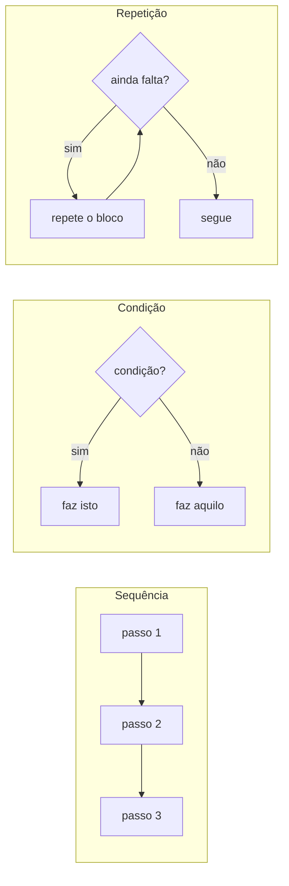
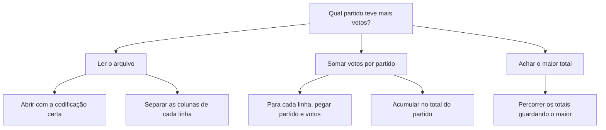

> **Aviso de Idioma:** Este currículo e todos os seus recursos de apoio foram estruturados exclusivamente em **Português (PT-BR)**.

# Aula 2 · Pensar em algoritmos: decomposição, condições e laços

**MOD-102 · 10 horas · Apoio:** CC50, semanas 0 e 1; Tutorial de Python, seções 3 e 4

## O que você vai aprender

- Definir algoritmo e reconhecer as suas propriedades: finitude, precisão, entradas e saídas.
- Escrever <abbr title="Pseudocódigo: descrição de um algoritmo em linguagem quase natural, com estrutura de programa, mas sem as regras rígidas de uma linguagem de programação.">pseudocódigo</abbr> e traduzi-lo para Python.
- Usar as três estruturas básicas de controle: sequência, condição e repetição.
- Decompor um problema grande em subproblemas menores.
- Usar um <abbr title="Invariante de laço: afirmação que é verdadeira antes de cada repetição de um laço. Serve para raciocinar sobre a correção do algoritmo.">invariante de laço</abbr> para se convencer de que um algoritmo está correto.

## Pergunta de abertura

> Explique a alguém que nunca viu uma lista telefônica como achar o telefone de "Maria Souza" numa lista de 1.000 páginas. Escreva as instruções num papel. Agora releia: elas funcionariam para uma pessoa que segue as ordens ao pé da letra, sem bom senso nenhum?

Um computador é exatamente essa pessoa. Ele não tem bom senso: faz o que está escrito, nada mais.

## 1. O que é um algoritmo

Um algoritmo é uma **sequência finita de instruções precisas que, a partir de uma entrada, produz uma saída**. A palavra vem do nome do matemático persa al-Khwarizmi, do século IX, cujos livros ensinaram à Europa o sistema decimal e os métodos de cálculo.

Propriedades que todo algoritmo precisa ter:

| Propriedade | O que significa | Contraexemplo |
| :--- | :--- | :--- |
| **Finitude** | Termina depois de um número finito de passos | "Some 1 até chegar ao infinito" |
| **Precisão** | Cada passo tem um único sentido | "Coloque sal a gosto" |
| **Entrada** | Recebe zero ou mais dados | |
| **Saída** | Produz pelo menos um resultado | Um procedimento que não devolve nada a ninguém |
| **Efetividade** | Cada passo pode ser realmente executado | "Escolha o número primo maior que todos os outros" |

## 2. As três estruturas de controle

Em 1966, os cientistas da computação Corrado Böhm e Giuseppe Jacopini demonstraram um resultado notável: **qualquer algoritmo pode ser escrito usando só três estruturas**.



### Sequência

Instruções executadas uma depois da outra, na ordem escrita.

```python
salario_minimo = 1518
horas_mes = 220
valor_hora = salario_minimo / horas_mes
print(f"Valor da hora: R$ {valor_hora:.2f}")
```

### Condição

O programa escolhe um caminho conforme uma pergunta de sim ou não.

```python
idade = 17
if idade >= 18:
    print("Voto obrigatório")
elif idade >= 16:
    print("Voto facultativo")
else:
    print("Não vota")
```

### Repetição

Um bloco é executado várias vezes. Python tem dois tipos de laço: `for`, que percorre uma coleção, e `while`, que repete enquanto uma condição for verdadeira.

```python
votos = [312, 450, 128, 509]
total = 0
for v in votos:
    total = total + v
print("Total de votos:", total)

contagem = 3
while contagem > 0:
    print("Faltam", contagem)
    contagem = contagem - 1
```

## 3. Decomposição: dividir para entender

Problemas reais são grandes demais para pensar de uma vez. A técnica fundamental é a **decomposição**: quebrar o problema em subproblemas menores até que cada um seja fácil de resolver.

Exemplo: "descobrir qual partido recebeu mais votos para vereador numa cidade, a partir do arquivo do TSE".



Cada folha da árvore é um problema pequeno e concreto. Escreva cada uma como uma **função** separada e junte depois. Esse modo de trabalhar vai acompanhar você no curso todo.

## 4. Pseudocódigo

Antes de escrever código, escreva o algoritmo em pseudocódigo: português estruturado, sem se preocupar com a sintaxe da linguagem. Exemplo para achar o maior valor de uma lista:

```text
função maior(lista):
    se a lista estiver vazia:
        devolva nada
    maior_até_agora ← primeiro elemento da lista
    para cada elemento x da lista:
        se x > maior_até_agora:
            maior_até_agora ← x
    devolva maior_até_agora
```

A tradução para Python é quase direta:

```python
def maior(lista):
    if not lista:
        return None
    maior_ate_agora = lista[0]
    for x in lista:
        if x > maior_ate_agora:
            maior_ate_agora = x
    return maior_ate_agora


print(maior([312, 450, 128, 509]))   # 509
print(maior([]))                     # None
```

## 5. Como saber se o algoritmo está certo: o invariante

Testar com alguns exemplos ajuda, mas não prova nada: o próximo exemplo pode falhar. Uma ferramenta de raciocínio muito útil é o **invariante de laço**: uma afirmação que vale **antes de cada volta** do laço.

Na função `maior`, o invariante é:

> No início de cada volta, `maior_ate_agora` é o maior dos elementos já examinados.

Verificamos três coisas:

1. **Início:** antes da primeira volta, examinamos só o primeiro elemento, e `maior_ate_agora` é ele. Vale.
2. **Manutenção:** se valia antes de examinar `x`, continua valendo depois. Se `x` for maior, ele vira o novo maior; se não, o maior continua o mesmo.
3. **Término:** quando o laço acaba, examinamos todos os elementos. Pelo invariante, `maior_ate_agora` é o maior de todos.

Essa forma de raciocinar parece formal demais no começo, mas é ela que separa quem "acha que funciona" de quem sabe por que funciona. Lembre de Platão (MOD-101, aula 1): é a diferença entre opinião verdadeira e *episteme*.

## 6. Um algoritmo de ponta a ponta

Vamos resolver o problema dos votos, com dados embutidos no próprio programa (no MOD-106 você vai ler os dados de arquivos).

```python
linhas = [
    ("PARTIDO A", 1200),
    ("PARTIDO B", 3400),
    ("PARTIDO A", 2500),
    ("PARTIDO C", 900),
    ("PARTIDO B", 100),
]


def somar_por_partido(registros):
    totais = {}
    for partido, votos in registros:
        if partido in totais:
            totais[partido] = totais[partido] + votos
        else:
            totais[partido] = votos
    return totais


def partido_mais_votado(totais):
    vencedor = None
    maior_total = -1
    for partido, total in totais.items():
        if total > maior_total:
            vencedor = partido
            maior_total = total
    return vencedor, maior_total


totais = somar_por_partido(linhas)
print(totais)                         # {'PARTIDO A': 3700, 'PARTIDO B': 3500, 'PARTIDO C': 900}
print(partido_mais_votado(totais))    # ('PARTIDO A', 3700)
```

Repare que usamos um **dicionário** (`{}`) para acumular os totais. Ele será o protagonista da aula 7.

> **Pergunta para pensar:** o que a função `partido_mais_votado` faz em caso de empate? O resultado depende da ordem dos dados. Em sistemas reais, regras de desempate são decisões políticas escritas em código. O Código Eleitoral brasileiro tem regras de desempate (o candidato mais idoso, por exemplo), e alguém precisou traduzi-las para o software de apuração.

## Exercícios

**1.** Escreva em pseudocódigo um algoritmo que receba uma lista de idades e conte quantas pessoas votam obrigatoriamente (18 a 70 anos).

<details>
<summary>Gabarito</summary>

```text
função contar_obrigatorios(idades):
    contador ← 0
    para cada idade em idades:
        se idade ≥ 18 e idade ≤ 70:
            contador ← contador + 1
    devolva contador
```
</details>

**2.** Traduza o exercício 1 para Python e teste com a lista `[16, 18, 45, 70, 71, 17]`.

<details>
<summary>Gabarito</summary>

```python
def contar_obrigatorios(idades):
    contador = 0
    for idade in idades:
        if 18 <= idade <= 70:
            contador = contador + 1
    return contador


print(contar_obrigatorios([16, 18, 45, 70, 71, 17]))   # 3
```
</details>

**3.** Escreva uma função `menor(lista)` e enuncie o seu invariante de laço.

<details>
<summary>Gabarito comentado</summary>

É a função `maior` com a comparação invertida (`x < menor_ate_agora`). Invariante: no início de cada volta, `menor_ate_agora` é o menor dos elementos já examinados. A verificação segue os mesmos três passos (início, manutenção, término).
</details>

**4.** Decomponha em uma árvore de subproblemas: "descobrir qual município de um estado teve o maior crescimento percentual de população entre dois censos".

<details>
<summary>Gabarito comentado</summary>

Uma boa decomposição: (1) ler os dados dos dois censos; (2) casar cada município entre os censos, pelo código do IBGE e não pelo nome, que pode mudar; (3) calcular o crescimento percentual `(novo - antigo) / antigo * 100`; (4) tratar casos especiais (municípios criados entre os censos não têm valor antigo); (5) achar o maior. O item 4 é o mais importante: é onde a realidade quebra o algoritmo ingênuo.
</details>

**5. Desafio.** Modifique `partido_mais_votado` para devolver **todos** os partidos empatados no primeiro lugar.

<details>
<summary>Gabarito</summary>

```python
def mais_votados(totais):
    if not totais:
        return [], 0
    maior_total = max(totais.values())
    vencedores = [p for p, t in totais.items() if t == maior_total]
    return vencedores, maior_total
```
</details>

## Resumo da aula

- Algoritmo é uma sequência finita de instruções precisas que transforma entradas em saídas.
- Sequência, condição e repetição bastam para escrever qualquer algoritmo.
- Decompor é quebrar o problema em subproblemas até que cada um seja simples.
- Escreva primeiro em pseudocódigo, depois traduza.
- O invariante de laço é a ferramenta para saber por que o algoritmo está correto, e não só achar que está.
- Regras de desempate e casos especiais são onde decisões sociais entram no código.

## Para ir além

- CC50, semana 1: laços e condições em C, para ver as mesmas ideias em outra linguagem.
- Tutorial de Python em português, seção 4: [Mais ferramentas de controle de fluxo](https://docs.python.org/pt-br/3/tutorial/controlflow.html).
