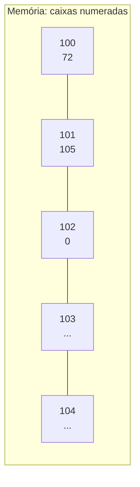
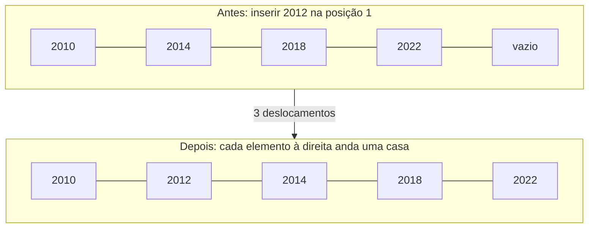
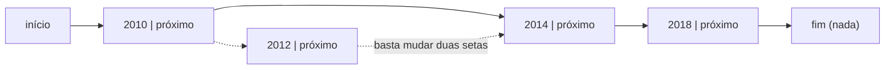

> **Aviso de Idioma:** Este currículo e todos os seus recursos de apoio foram estruturados exclusivamente em **Português (PT-BR)**.

# Aula 3 · Memória, arranjos e listas

**MOD-102 · 10 horas · Apoio:** CC50, semanas 2 e 4

## O que você vai aprender

- Entender a <abbr title="Memória RAM (Random Access Memory): memória de trabalho do computador. Rápida e volátil: perde o conteúdo quando o computador desliga.">memória</abbr> como uma longa fila de caixas numeradas por <abbr title="Endereço de memória: número que identifica uma posição da memória, como o número de uma casa numa rua.">endereços</abbr>.
- Explicar o que é um <abbr title="Arranjo (array): sequência de elementos do mesmo tamanho guardados lado a lado na memória. Permite acessar qualquer posição diretamente pelo índice.">arranjo</abbr> e por que o acesso por índice é imediato.
- Comparar o custo de ler, inserir e remover elementos no início, no meio e no fim de uma lista.
- Conhecer a <abbr title="Lista ligada: estrutura em que cada elemento guarda o endereço do próximo. Inserir no meio é barato; achar o elemento de posição n exige percorrer a lista.">lista ligada</abbr> como alternativa.
- Usar listas em Python com consciência do que acontece por trás.

## Pergunta de abertura

> Numa fila de cinema com 300 pessoas, alguém chega e "fura" a fila na terceira posição. Quantas pessoas precisam dar um passo para trás? E se a pessoa entrar no fim da fila?

## 1. A memória como uma rua de caixas

A memória de trabalho do computador (RAM) pode ser imaginada como uma rua muito longa de caixas, cada uma com um número na porta (o endereço) e capacidade para guardar um byte.



Duas coisas importantes:

1. **Acesso direto:** o computador vai ao endereço 104 tão rápido quanto ao endereço 100. Não precisa passar pelas caixas do meio. É isso que significa "acesso aleatório" (*random access*).
2. **A memória é finita:** um computador com 8 GB tem cerca de 8 bilhões de caixas. Parece muito, mas um único arquivo de microdados do Censo pode ocupar vários gigabytes.

## 2. Arranjos: elementos lado a lado

Um **arranjo** guarda vários elementos do mesmo tamanho em caixas **consecutivas**. Se cada elemento ocupa 4 bytes e o arranjo começa no endereço 1000, então:

| Índice | Endereço calculado | Valor |
| :---: | :--- | :---: |
| 0 | 1000 + 0 × 4 = 1000 | 2010 |
| 1 | 1000 + 1 × 4 = 1004 | 2014 |
| 2 | 1000 + 2 × 4 = 1008 | 2018 |
| 3 | 1000 + 3 × 4 = 1012 | 2022 |

Para achar o elemento de índice `i`, o computador faz uma única conta: `início + i × tamanho`. Por isso **ler qualquer posição de um arranjo leva o mesmo tempo**, seja a primeira ou a milionésima. Repare também por que os índices começam em 0: o primeiro elemento está a 0 passos do início.

## 3. O preço de inserir e remover

Ler é barato. Inserir no meio é caro. Volte à fila do cinema:



Para inserir na posição 1 de um arranjo com 4 elementos, os 3 elementos a partir dali precisam ser movidos uma casa para a direita. Com um milhão de elementos, inserir no início exige um milhão de movimentos. Inserir no **fim**, ao contrário, não move ninguém.

| Operação num arranjo de n elementos | Custo |
| :--- | :--- |
| Ler a posição i | Constante (uma conta) |
| Inserir ou remover no fim | Constante, quase sempre |
| Inserir ou remover no início ou no meio | Proporcional a n (desloca os seguintes) |
| Procurar um valor sem saber a posição | Proporcional a n (aula 4) |

## 4. As listas do Python

A `list` do Python é um arranjo dinâmico: guarda referências aos objetos em posições consecutivas e cresce automaticamente quando enche (reserva um espaço extra para que as próximas inclusões no fim sejam baratas).

```python
anos = [2010, 2014, 2018, 2022]

print(anos[0])      # 2010: leitura direta
print(anos[-1])     # 2022: índices negativos contam do fim
print(len(anos))    # 4

anos.append(2026)   # insere no fim: barato
anos.insert(1, 2012)   # insere na posição 1: desloca os seguintes
print(anos)         # [2010, 2012, 2014, 2018, 2022, 2026]

anos.pop()          # remove do fim: barato
anos.pop(0)         # remove do início: desloca todos
print(anos)         # [2012, 2014, 2018, 2022]
```

Podemos **medir** a diferença. O módulo `timeit` executa um trecho muitas vezes e cronometra:

```python
import timeit

n = 100_000
fim = timeit.timeit("lista.append(0)", setup="lista = []", number=n)
inicio = timeit.timeit("lista.insert(0, 0)", setup="lista = []", number=n)
print(f"{n} inserções no fim:    {fim:.4f} s")
print(f"{n} inserções no início: {inicio:.4f} s")
```

Num computador comum, as inserções no início levam centenas de vezes mais tempo. Rode e anote os seus números: medir é parte do método do curso.

## 5. A alternativa: lista ligada

E se inserirmos no início com frequência? Uma **lista ligada** guarda cada elemento num lugar qualquer da memória, junto com o endereço do próximo.



Para inserir 2012 entre 2010 e 2014, basta mudar duas setas: não é preciso deslocar ninguém. Em compensação, para achar o elemento de posição 500 é preciso seguir 500 setas, porque os elementos não estão lado a lado.

| | Arranjo (lista do Python) | Lista ligada |
| :--- | :--- | :--- |
| Ler a posição i | Imediato | Percorre i elementos |
| Inserir no início | Desloca todos | Imediato |
| Uso de memória | Compacto | Cada elemento guarda também uma seta |

Não existe estrutura melhor em tudo. **Escolher uma estrutura de dados é escolher quais operações serão baratas**, de acordo com o uso que o sistema terá. Essa ideia de compromisso (*trade-off*) volta em todas as aulas seguintes.

Em Python, quando precisar inserir e remover nas duas pontas, use `collections.deque`, que você vai ver na aula 7.

## 6. Listas de listas: tabelas

Dados públicos geralmente vêm em tabelas. Uma forma simples de representá-las é uma lista de linhas, em que cada linha é uma lista (ou tupla) de campos:

```python
municipios = [
    ("3550308", "São Paulo", "SP", 11451999),
    ("3304557", "Rio de Janeiro", "RJ", 6211223),
    ("5300108", "Brasília", "DF", 2817068),
]

for codigo, nome, uf, populacao in municipios:
    print(f"{nome} ({uf}): {populacao:,} habitantes".replace(",", "."))
```

Os números de população são do Censo de 2022 do IBGE. O código de 7 dígitos é o código oficial do município, e é ele, e não o nome, que deve ser usado para cruzar bases.

## Exercícios

**1.** Num arranjo que começa no endereço 2000, com elementos de 8 bytes, qual é o endereço do elemento de índice 25?

<details>
<summary>Gabarito</summary>

2000 + 25 × 8 = **2200**.
</details>

**2.** Numa lista do Python com 1.000.000 de elementos, quantos elementos precisam ser deslocados em `lista.insert(0, x)`? E em `lista.append(x)`?

<details>
<summary>Gabarito</summary>

No `insert(0, x)`, **1.000.000** (todos andam uma casa). No `append(x)`, **nenhum** (exceto nas raras vezes em que a lista enche e é copiada para um espaço maior).
</details>

**3.** Rode o experimento do `timeit` com `n = 10_000`, `n = 50_000` e `n = 100_000`. Monte uma tabela. O tempo de `insert(0, ...)` cresce na mesma proporção que `n`?

<details>
<summary>Gabarito comentado</summary>

O tempo de `append` cresce aproximadamente na mesma proporção que `n` (cada inserção custa uma constante). O de `insert(0, ...)` cresce mais rápido que `n`, porque cada inserção custa proporcionalmente ao tamanho atual da lista: com n inserções, o total fica proporcional a n². Dobrar `n` tende a quadruplicar o tempo. Você vai formalizar isso na aula 6.
</details>

**4.** Um sistema de atendimento recebe pedidos que devem ser atendidos na ordem de chegada. Novos pedidos entram no fim e o atendido sai do início. Por que uma lista comum do Python é má escolha? Qual seria melhor?

<details>
<summary>Gabarito comentado</summary>

Remover do início (`pop(0)`) desloca todos os elementos restantes; com muitos pedidos, o custo cresce. Uma estrutura que permite remover do início em tempo constante, como `collections.deque` ou uma lista ligada, é a escolha certa. Essa estrutura de "primeiro a chegar, primeiro a sair" é a fila, assunto da aula 7.
</details>

## Resumo da aula

- A memória é uma sequência de caixas com endereços; o acesso a qualquer endereço é direto.
- Num arranjo, os elementos ficam lado a lado e a posição i é calculada com uma conta: leitura imediata.
- Inserir ou remover no início ou no meio exige deslocar elementos; no fim é barato.
- Listas ligadas invertem esses custos: inserir é barato, achar a posição i é caro.
- Escolher uma estrutura é escolher quais operações serão baratas.

## Para ir além

- CC50, semana 2 (arranjos) e semana 5 (estruturas de dados).
- Documentação do Python em português sobre [listas](https://docs.python.org/pt-br/3/tutorial/datastructures.html).
