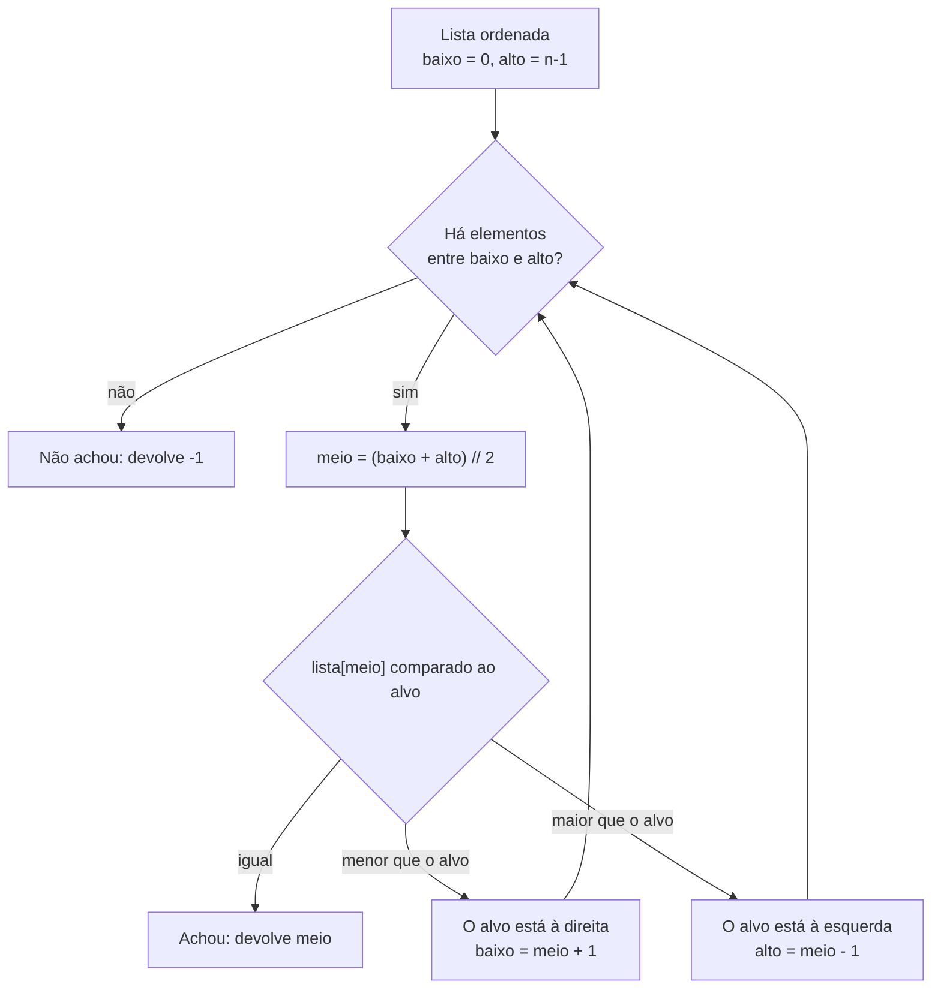

> **Aviso de Idioma:** Este currículo e todos os seus recursos de apoio foram estruturados exclusivamente em **Português (PT-BR)**.

# Aula 4 · Busca linear e busca binária

**MOD-102 · 10 horas · Apoio:** CC50, semana 3

## O que você vai aprender

- Implementar a <abbr title="Busca linear (ou sequencial): examina os elementos um por um, do início ao fim, até achar o procurado ou acabar a lista. Funciona em qualquer lista, ordenada ou não.">busca linear</abbr> e contar quantas comparações ela faz no melhor e no pior caso.
- Implementar a <abbr title="Busca binária: em uma lista ordenada, compara o procurado com o elemento do meio e descarta a metade onde ele não pode estar, repetindo até achar ou esvaziar.">busca binária</abbr>, iterativa e recursiva.
- Explicar por que a busca binária exige uma lista ordenada.
- Calcular quantos passos a busca binária precisa para 1.000, 1 milhão e 200 milhões de elementos, usando o <abbr title="Logaritmo na base 2: quantas vezes é preciso dividir um número por 2 até chegar a 1. O logaritmo de 1.024 na base 2 é 10.">logaritmo</abbr>.

## Pergunta de abertura

> Pense num número de 1 a 1.000. Eu adivinho, e você só pode responder "maior", "menor" ou "acertou". Qual é o menor número de perguntas que garante que eu acerto, qualquer que seja o seu número?

## 1. Busca linear: olhar um por um

A estratégia mais simples para achar um decreto numa pilha de papéis é olhar um por um.

```python
def busca_linear(lista, alvo):
    """Devolve a posição de alvo em lista, ou -1 se não estiver."""
    for i in range(len(lista)):
        if lista[i] == alvo:
            return i
    return -1


decretos = [9412, 10024, 8890, 11002, 9901]
print(busca_linear(decretos, 11002))   # 3
print(busca_linear(decretos, 1234))    # -1
```

Quantas comparações ela faz numa lista de `n` elementos?

| Caso | Comparações | Quando acontece |
| :--- | :---: | :--- |
| Melhor | 1 | O alvo é o primeiro |
| Pior | n | O alvo é o último ou não está na lista |
| Médio | cerca de n/2 | O alvo está numa posição qualquer |

A busca linear tem uma grande virtude: **funciona em qualquer lista**, ordenada ou não. E um grande defeito: com 200 milhões de registros (a população do Brasil, por exemplo), o pior caso exige 200 milhões de comparações.

## 2. Busca binária: dividir pela metade

Agora suponha que a lista está **ordenada**. Aí podemos fazer o que você faz numa lista telefônica (ou no jogo da pergunta de abertura): abrir no meio, ver se o nome procurado vem antes ou depois, e descartar a metade inteira onde ele não pode estar.



```python
def busca_binaria(lista, alvo):
    """Lista precisa estar em ordem crescente."""
    baixo = 0
    alto = len(lista) - 1
    while baixo <= alto:
        meio = (baixo + alto) // 2
        if lista[meio] == alvo:
            return meio
        if lista[meio] < alvo:
            baixo = meio + 1
        else:
            alto = meio - 1
    return -1


ordenados = [8890, 9412, 9901, 10024, 11002, 11510, 12001]
print(busca_binaria(ordenados, 11002))   # 4
print(busca_binaria(ordenados, 9000))    # -1
```

### Acompanhando passo a passo

Procurando 11002 em `[8890, 9412, 9901, 10024, 11002, 11510, 12001]`:

| Passo | baixo | alto | meio | lista[meio] | Decisão |
| :---: | :---: | :---: | :---: | :---: | :--- |
| 1 | 0 | 6 | 3 | 10024 | 10024 < 11002: vai para a direita |
| 2 | 4 | 6 | 5 | 11510 | 11510 > 11002: vai para a esquerda |
| 3 | 4 | 4 | 4 | 11002 | Achou na posição 4 |

Três comparações em vez das cinco da busca linear. A diferença parece pequena aqui; veja o que acontece com listas grandes.

### O invariante

Por que a busca binária está correta? Invariante:

> Se o alvo está na lista, ele está entre as posições `baixo` e `alto`.

No início vale (o intervalo é a lista toda). Cada passo descarta só a metade onde o alvo **não pode** estar, porque a lista é ordenada. Se o intervalo fica vazio, o alvo não estava na lista. É por isso que **a ordenação é indispensável**: sem ela, descartar uma metade poderia jogar fora o alvo.

## 3. Quantos passos? O logaritmo

A cada comparação, a busca binária corta o problema pela metade. Quantas vezes é preciso dividir `n` por 2 até sobrar 1? Esse número é o **logaritmo de n na base 2**, escrito log₂ n.

| Tamanho da lista | Busca linear (pior caso) | Busca binária (pior caso) |
| :--- | :---: | :---: |
| 1.000 | 1.000 | 10 |
| 1.000.000 | 1.000.000 | 20 |
| 200.000.000 | 200.000.000 | 28 |
| 8.000.000.000 | 8.000.000.000 | 33 |

Com **28 comparações** acha-se uma pessoa entre 200 milhões, desde que os registros estejam ordenados. Essa diferença é o que torna possível consultar instantaneamente um CPF num cadastro nacional. E é também o que torna barata a vigilância em massa: encontrar uma pessoa num banco de dados do tamanho de um país custa quase nada.

```python
import math

for n in [1_000, 1_000_000, 200_000_000]:
    print(n, "→", math.ceil(math.log2(n)), "passos no máximo")
```

A resposta da pergunta de abertura: **10 perguntas** bastam para qualquer número de 1 a 1.000, porque 2¹⁰ = 1.024.

## 4. A versão recursiva

Uma função é <abbr title="Recursão: técnica em que uma função resolve um problema chamando a si mesma para resolver uma versão menor do mesmo problema, até chegar a um caso simples que se resolve direto.">recursiva</abbr> quando chama a si mesma para um problema menor. A busca binária tem uma formulação recursiva natural: "procurar na lista inteira" vira "procurar numa das metades".

```python
def busca_binaria_rec(lista, alvo, baixo=0, alto=None):
    if alto is None:
        alto = len(lista) - 1
    if baixo > alto:
        return -1                       # caso base: intervalo vazio
    meio = (baixo + alto) // 2
    if lista[meio] == alvo:
        return meio                     # caso base: achou
    if lista[meio] < alvo:
        return busca_binaria_rec(lista, alvo, meio + 1, alto)
    return busca_binaria_rec(lista, alvo, baixo, meio - 1)


print(busca_binaria_rec([1, 3, 5, 7, 9, 11], 7))   # 3
```

Toda recursão precisa de pelo menos um **caso base**, que se resolve sem chamar a função de novo. Sem ele, a função chamaria a si mesma para sempre.

## 5. O preço de ordenar

A busca binária só funciona em listas ordenadas, e ordenar tem um custo (aula 5). Então vale a pena?

- Se você vai fazer **uma busca só**, a busca linear ganha: ordenar custa mais do que olhar tudo uma vez.
- Se vai fazer **muitas buscas** na mesma lista, ordenar uma vez e depois fazer buscas binárias compensa largamente.

Essa é a lógica de todo índice de banco de dados: gastar tempo e memória **antes**, para que as consultas **depois** sejam rápidas.

O Python já traz uma busca binária pronta, no módulo `bisect`:

```python
import bisect

ordenados = [8890, 9412, 9901, 10024, 11002]
pos = bisect.bisect_left(ordenados, 10024)
print(pos, ordenados[pos] == 10024)   # 3 True
```

## Exercícios

**1.** Faça à mão a tabela passo a passo da busca binária por 9000 em `[8890, 9412, 9901, 10024, 11002, 11510, 12001]`.

<details>
<summary>Gabarito</summary>

| Passo | baixo | alto | meio | lista[meio] | Decisão |
| :---: | :---: | :---: | :---: | :---: | :--- |
| 1 | 0 | 6 | 3 | 10024 | maior que 9000: alto = 2 |
| 2 | 0 | 2 | 1 | 9412 | maior que 9000: alto = 0 |
| 3 | 0 | 0 | 0 | 8890 | menor que 9000: baixo = 1 |
| 4 | 1 | 0 | | | baixo > alto: devolve -1 |
</details>

**2.** Quantas comparações, no máximo, a busca binária faz numa lista com os 5.570 municípios brasileiros?

<details>
<summary>Gabarito</summary>

2¹² = 4.096 < 5.570 ≤ 8.192 = 2¹³. No máximo **13** comparações.
</details>

**3.** O que acontece se você aplicar `busca_binaria` à lista não ordenada `[9412, 10024, 8890, 11002, 9901]` procurando 8890? Rode e explique.

<details>
<summary>Gabarito comentado</summary>

O meio é a posição 2, que contém exatamente 8890, então a função acerta por sorte. Procure 9412: o meio (8890) é menor, a função descarta a metade esquerda, que contém 9412, e devolve -1. O algoritmo não "quebra" com erro; ele dá uma **resposta errada silenciosa**, o pior tipo de defeito. É por isso que as pré-condições (a lista estar ordenada) precisam ser documentadas e, idealmente, verificadas.
</details>

**4.** Escreva uma função que conte quantas comparações a busca linear e a busca binária fazem para achar cada elemento de uma lista ordenada de 1.000 números, e calcule a média de cada uma.

<details>
<summary>Gabarito</summary>

```python
def comparacoes_linear(lista, alvo):
    for i, x in enumerate(lista):
        if x == alvo:
            return i + 1
    return len(lista)


def comparacoes_binaria(lista, alvo):
    baixo, alto, cont = 0, len(lista) - 1, 0
    while baixo <= alto:
        cont += 1
        meio = (baixo + alto) // 2
        if lista[meio] == alvo:
            return cont
        if lista[meio] < alvo:
            baixo = meio + 1
        else:
            alto = meio - 1
    return cont


dados = list(range(1000))
media_lin = sum(comparacoes_linear(dados, x) for x in dados) / len(dados)
media_bin = sum(comparacoes_binaria(dados, x) for x in dados) / len(dados)
print(media_lin, media_bin)   # cerca de 500.5 e cerca de 9
```
</details>

## Resumo da aula

- A busca linear examina um por um: funciona em qualquer lista e faz até n comparações.
- A busca binária descarta metade a cada passo e faz até log₂ n comparações, mas exige lista ordenada.
- O invariante "se o alvo está na lista, está entre baixo e alto" explica por que a ordenação é obrigatória.
- 28 comparações bastam para achar alguém entre 200 milhões: a eficiência que viabiliza cadastros nacionais também barateia a vigilância.
- Ordenar compensa quando haverá muitas buscas: é a lógica dos índices.

## Para ir além

- CC50, semana 3: busca e ordenação, com a famosa demonstração da lista telefônica rasgada ao meio.
- Animações de busca no [Visualgo](https://visualgo.net/pt).
