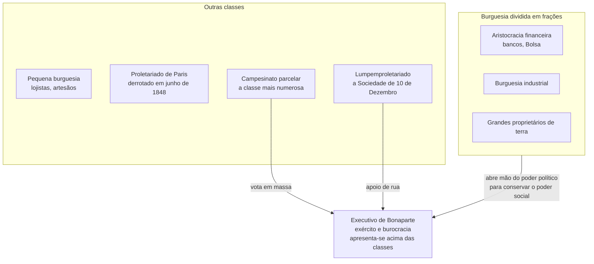

> **Aviso de Idioma:** Este currículo e todos os seus recursos de apoio foram estruturados exclusivamente em **Português (PT-BR)**.

# Aula 3 · Classes, Estado e política: o *Manifesto* e o *18 de Brumário*

**MOD-103 · 10 horas · Leitura principal:** Marx e Engels, *Manifesto do Partido Comunista* (1848), capítulos I e II; Marx, *O 18 de Brumário de Luís Bonaparte* (1852), capítulos I e VII

*Capa da primeira edição do* Manifesto do Partido Comunista*, publicada em alemão em Londres em fevereiro de 1848. Wikimedia Commons, CC BY-SA 3.0.*

## O que você vai aprender

- Situar o *Manifesto* nas revoluções de 1848.
- Explicar a tese da luta de classes e o retrato que o *Manifesto* faz da <abbr title="Burguesia: em Marx, a classe proprietária dos meios de produção modernos (fábricas, máquinas, capital), que vive do trabalho assalariado de outros.">burguesia</abbr> como classe revolucionária.
- Definir <abbr title="Proletariado: em Marx, a classe dos trabalhadores assalariados modernos, que não possuem meios de produção e precisam vender a sua força de trabalho para viver.">proletariado</abbr> e explicar por que, para Marx, ele tem um papel histórico particular.
- Usar as categorias do *18 de Brumário* (<abbr title="Frações de classe: subdivisões internas de uma classe com interesses próprios, como a burguesia financeira, a industrial e a agrária, que podem entrar em conflito entre si.">frações de classe</abbr>, representação, <abbr title="Bonapartismo: forma de governo em que o Executivo se autonomiza das classes em luta e se apresenta como árbitro acima delas, apoiado no exército, na burocracia e numa massa sem organização própria.">bonapartismo</abbr>) para analisar conjunturas políticas.
- Distinguir a "análise de classe" vulgar (quem é rico vota assim) da análise concreta de Marx.

## Pergunta de abertura

> Por que, em tantas eleições, grandes contingentes de trabalhadores votam em candidatos que defendem políticas contrárias aos seus interesses econômicos imediatos? A resposta "eles são enganados" basta?

## 1. 1848: a primavera dos povos

No fim de 1847, a Liga dos Comunistas, uma pequena organização de artesãos e trabalhadores alemães exilados, encomendou a Marx e Engels um programa. O texto saiu em fevereiro de 1848, em Londres, poucos dias antes de estourar em Paris a revolução que derrubou o rei Luís Filipe. Em semanas, a revolta se espalhou por Viena, Berlim, Milão, Budapeste. Foi a "primavera dos povos".

O *Manifesto* não causou as revoluções: era um panfleto quase desconhecido em 1848. Mas tornou-se, nas décadas seguintes, o texto político mais lido da história depois da Bíblia, traduzido em centenas de línguas.

## 2. "A história de todas as sociedades é a história das lutas de classes"

O capítulo I começa com a tese mais famosa:

> "A história de todas as sociedades até hoje existentes é a história das lutas de classes. Homem livre e escravo, patrício e plebeu, barão e servo, mestre de corporação e companheiro, numa palavra, opressores e oprimidos estiveram em constante oposição." (tradução livre)

(Engels acrescentou em 1888 uma nota: a frase vale para a história escrita; as comunidades primitivas, sem propriedade privada da terra, não se dividiam em classes.)

Uma **classe**, para Marx, não é uma faixa de renda. É um grupo definido pela sua **posição nas relações de produção**: quem é dono dos meios de produção e quem precisa trabalhar para eles. A sociedade moderna simplificou os antagonismos: cada vez mais, ela se divide em dois grandes campos, **burguesia** e **proletariado**.

## 3. O elogio da burguesia

Muita gente se surpreende ao ler o *Manifesto*: as páginas mais entusiasmadas são sobre a burguesia. Marx e Engels a descrevem como a classe mais revolucionária da história:

- Destruiu as relações feudais e patriarcais, e "afogou nas águas geladas do cálculo egoísta" o fervor religioso e o sentimentalismo pequeno-burguês.
- Não pode existir sem **revolucionar constantemente os instrumentos de produção** e, com eles, todas as relações sociais.
- Criou, em menos de cem anos, forças produtivas mais colossais do que todas as gerações anteriores juntas: máquinas, navegação a vapor, ferrovias, telégrafos.
- Criou o **mercado mundial** e deu um caráter cosmopolita à produção e ao consumo de todos os países.

E a frase célebre:

> "Tudo o que era sólido e estável se desmancha no ar, tudo o que era sagrado é profanado, e os homens são finalmente obrigados a encarar com sobriedade as suas condições de existência e as suas relações recíprocas." (tradução livre)

Leia essa passagem pensando na indústria de tecnologia: a "disrupção" celebrada pelas empresas digitais é o mesmo movimento descrito em 1848.

## 4. O Estado e o proletariado

Sobre o Estado, o *Manifesto* é seco:

> "O poder executivo do Estado moderno não passa de um comitê para gerir os negócios comuns de toda a classe burguesa." (tradução livre)

Note a palavra "comuns". O Estado não serve a cada burguês individualmente: ele organiza o interesse **comum** da classe, muitas vezes contra burgueses particulares. O *18 de Brumário* vai matizar muito essa fórmula.

O proletariado, por sua vez, é produzido pela própria burguesia: ela cria a massa de trabalhadores que só vivem enquanto encontram trabalho e só encontram trabalho enquanto o seu trabalho aumenta o capital. Concentrados nas fábricas, eles começam a se organizar. Para Marx e Engels, o proletariado tem uma posição singular: não tem propriedade a defender, e por isso a sua emancipação só é possível abolindo a apropriação privada dos meios de produção, e não substituindo-a por outra forma de propriedade de classe.

O capítulo II responde às acusações contra os comunistas (que querem abolir a família, a pátria, a liberdade) e termina com dez medidas de transição, entre elas o imposto fortemente progressivo, a educação pública e gratuita para todas as crianças e a abolição do trabalho infantil nas fábricas. Muitas delas se tornaram, no século XX, políticas comuns de Estados capitalistas.

## 5. O *18 de Brumário*: a análise concreta

Se o *Manifesto* traça grandes linhas, *O 18 de Brumário de Luís Bonaparte* (1852) mostra o método de Marx aplicado a uma conjuntura precisa: como a República francesa nascida em 1848 terminou no golpe de Estado de 2 de dezembro de 1851, dado por Luís Bonaparte, sobrinho de Napoleão, que logo se proclamaria imperador. (O título faz ironia com o 18 de Brumário do ano VIII do calendário revolucionário, data do golpe do primeiro Napoleão em 1799.)

O livro começa com duas das frases mais citadas de Marx:

> "Hegel observa em algum lugar que todos os grandes fatos e personagens da história universal aparecem, por assim dizer, duas vezes. Ele se esqueceu de acrescentar: a primeira vez como tragédia, a segunda como farsa." (tradução livre)

> "Os homens fazem a sua própria história, mas não a fazem como querem; não a fazem sob circunstâncias de sua escolha, e sim sob aquelas com que se defrontam diretamente, legadas e transmitidas pelo passado. A tradição de todas as gerações mortas oprime como um pesadelo o cérebro dos vivos." (tradução livre)

### As classes no *18 de Brumário*

A análise é muito mais fina que a dicotomia do *Manifesto*. Marx identifica:

O resultado da análise é surpreendente: a burguesia, com medo do proletariado depois de junho de 1848, e dividida em frações que não conseguiam governar juntas, **renunciou ao poder político** para preservar o seu poder social e econômico. Preferiu "o fim com terror a um terror sem fim". E o Executivo, apoiado no exército, na burocracia e nos votos camponeses, ganhou autonomia diante de todas as classes.

### Os camponeses e o problema da representação

Por que milhões de pequenos camponeses votaram em Bonaparte? A resposta de Marx é uma lição de sociologia política. Os camponeses parcelares viviam em condições semelhantes, mas isolados uns dos outros, cada família na sua parcela, sem relações múltiplas entre si. Eram, diz Marx, como batatas num saco: formavam uma classe pelas condições de vida, mas não formavam uma classe pela organização política.

> "Eles não podem representar a si mesmos; precisam ser representados." (tradução livre)

E o seu representante aparece como um senhor, uma autoridade acima deles, que lhes manda do alto a chuva e o sol. Daí o bonapartismo.

## 6. Análise de classe não é aritmética de renda

Volte à pergunta de abertura. O *18 de Brumário* mostra que o comportamento político das classes não sai automaticamente da sua posição econômica. Ele depende de:

- **Organização:** uma classe dispersa precisa de quem a represente, e pode ser representada por quem não defende os seus interesses.
- **Tradição e memória:** o nome de Napoleão valia votos; o "pesadelo das gerações mortas" pesa sobre as escolhas.
- **Conjuntura e medo:** frações de classe fazem alianças inesperadas quando se sentem ameaçadas.
- **Autonomia relativa do Estado:** o aparelho estatal pode ganhar interesses e força próprios.

Dizer que trabalhadores "são enganados" é uma explicação preguiçosa. A análise marxista séria pergunta pelas condições de organização, pelas tradições, pelos medos e pelas alternativas reais em jogo.

> **Conexão com o curso:** no MOD-302 você vai analisar discursos parlamentares com processamento de linguagem natural, e no MOD-303 vai mapear redes de financiamento eleitoral. As categorias do *18 de Brumário* (frações de classe, representação, autonomia do Executivo) são ferramentas para interpretar o que os dados mostrarem.

## Leitura guiada

1. ***Manifesto*, capítulo I, "Burgueses e proletários"** (cerca de 15 páginas): sublinhe todas as conquistas atribuídas à burguesia e todas as características atribuídas ao proletariado.
2. ***Manifesto*, capítulo II, "Proletários e comunistas"** (cerca de 10 páginas): copie as dez medidas e marque as que hoje existem em países capitalistas.
3. ***18 de Brumário*, capítulo I** (cerca de 10 páginas): tragédia e farsa, as gerações mortas, a sequência de 1848 a 1851.
4. ***18 de Brumário*, capítulo VII** (cerca de 15 páginas): os camponeses parcelares, o saco de batatas e a autonomia do Executivo.

## Exercícios

**1.** Qual é a diferença entre definir classe por renda e defini-la pela posição nas relações de produção? Dê um exemplo em que as duas definições levam a conclusões diferentes.

Gabarito comentado

Pela renda, uma programadora assalariada bem paga e um pequeno empresário dono de uma padaria podem estar na mesma faixa. Pela posição nas relações de produção, ela vende a sua força de trabalho e ele é proprietário de meios de produção e emprega trabalho alheio. As duas posições geram interesses diferentes em temas como direitos trabalhistas e tributação. Por outro lado, um motorista de aplicativo dono do próprio carro pode parecer "empreendedor" pela forma jurídica, mas depende da plataforma como um assalariado. A definição relacional exige olhar o conteúdo da relação, não a sua aparência.

**2.** Explique a frase "os homens fazem a sua própria história, mas não a fazem como querem".

Gabarito comentado

A frase recusa dois extremos. Contra o fatalismo, afirma que a história é feita por pessoas, pela ação humana. Contra o voluntarismo, afirma que essa ação acontece em circunstâncias não escolhidas, herdadas do passado: estruturas econômicas, instituições, tradições. É a síntese do materialismo histórico aplicada à política: liberdade de agir dentro de condições objetivas.

**3.** Aplique o conceito de bonapartismo a um caso histórico brasileiro ou latino-americano.

Critérios de correção

A resposta deve identificar: (1) uma crise em que as classes dominantes não conseguem governar diretamente; (2) um Executivo que se apresenta acima das classes; (3) a base de apoio desse Executivo (exército, burocracia, massas pouco organizadas). Exemplos discutidos na literatura incluem o Estado Novo de Getúlio Vargas (1937 a 1945) e o peronismo na Argentina. A melhor resposta aponta também as diferenças em relação ao caso francês, evitando aplicar o conceito como rótulo.

**4.** O *Manifesto* elogia a burguesia por revolucionar os meios de produção. Escreva um parágrafo comparando essa descrição com o discurso das empresas de tecnologia sobre "disrupção".

Critérios de correção

A resposta deve notar a semelhança (a destruição constante de formas estabelecidas de produção e de vida é uma característica do capitalismo desde o início) e a diferença de ponto de vista: o *Manifesto* mostra também quem paga o custo da revolução constante (o trabalhador cujo ofício é destruído) e aponta as contradições que ela produz. A "disrupção" apresenta como progresso neutro o que, para o *Manifesto*, é um processo de classe.

## Resumo da aula

- O *Manifesto* (1848) define a história como história da luta de classes e as classes pela posição nas relações de produção.
- A burguesia é descrita como a classe mais revolucionária da história: revoluciona sem parar os meios de produção e cria o mercado mundial.
- O Estado organiza os negócios comuns da burguesia; o proletariado é produzido pelo próprio capitalismo.
- O *18 de Brumário* mostra uma análise concreta: frações de classe, renúncia da burguesia ao poder político, campesinato sem organização própria e Executivo autônomo.
- Comportamento político não decorre automaticamente da posição econômica: organização, tradição, medo e conjuntura contam.

## Para ir além

- Karl Marx, *As Lutas de Classes na França de 1848 a 1850* (1850), a análise que antecede o *18 de Brumário*.
- Karl Marx, *A Guerra Civil na França* (1871), sobre a Comuna de Paris, que você vai reencontrar no MOD-107.
