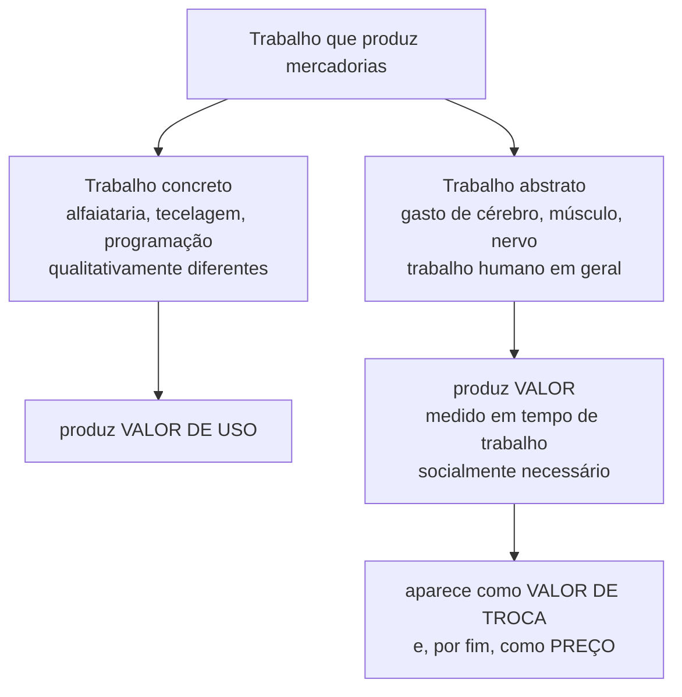
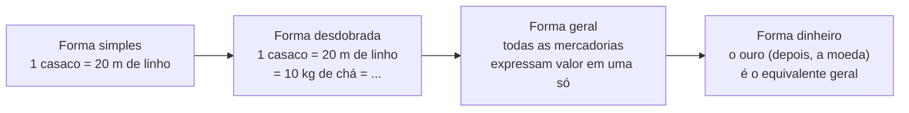
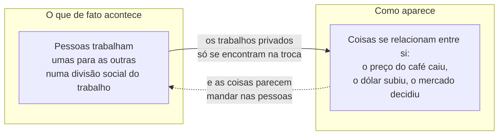

> **Aviso de Idioma:** Este currículo e todos os seus recursos de apoio foram estruturados exclusivamente em **Português (PT-BR)**.

# Aula 4 · A mercadoria e o seu fetiche

**MOD-103 · 10 horas · Leitura principal:** *O Capital*, Livro I (1867), capítulo 1, "A mercadoria", seções 1, 2 e 4

## O que você vai aprender

- Explicar por que *O Capital* começa pela <abbr title="Mercadoria: produto do trabalho feito para ser trocado, e não para uso de quem o produz. Tem ao mesmo tempo valor de uso e valor.">mercadoria</abbr>.
- Distinguir <abbr title="Valor de uso: a utilidade concreta de uma coisa, a sua capacidade de satisfazer uma necessidade. Um casaco aquece, um programa calcula.">valor de uso</abbr>, <abbr title="Valor de troca: a proporção em que uma mercadoria se troca por outras. É a forma de manifestação do valor.">valor de troca</abbr> e valor.
- Explicar o duplo caráter do trabalho: <abbr title="Trabalho concreto: o trabalho na sua forma útil e específica (costurar, programar, plantar), que produz valores de uso diferentes.">trabalho concreto</abbr> e <abbr title="Trabalho abstrato: o trabalho humano considerado só como gasto de energia humana em geral, sem levar em conta a sua forma específica. É a substância do valor.">trabalho abstrato</abbr>.
- Definir <abbr title="Tempo de trabalho socialmente necessário: o tempo exigido para produzir uma mercadoria nas condições normais de produção de uma sociedade, com grau médio de habilidade e intensidade. É a medida da grandeza do valor.">tempo de trabalho socialmente necessário</abbr>.
- Explicar o <abbr title="Fetichismo da mercadoria: fenômeno em que as relações sociais entre as pessoas que produzem aparecem como relações entre coisas (preços, mercadorias, dinheiro), dotadas de poder próprio.">fetichismo da mercadoria</abbr> e relacioná-lo com a alienação e com a ideologia.

## Pergunta de abertura

> Um celular custa o mesmo que 200 quilos de arroz. O que essas duas coisas, tão diferentes, têm em comum para que se possa dizer que "valem o mesmo"?

## 1. Por que começar pela mercadoria

*O Capital* começa assim:

> "A riqueza das sociedades onde reina o modo de produção capitalista aparece como uma 'enorme coleção de mercadorias', e a mercadoria individual como a sua forma elementar. A nossa investigação começa, por isso, com a análise da mercadoria." (tradução livre)

Repare no verbo: a riqueza **aparece** como coleção de mercadorias. Marx vai partir da aparência mais cotidiana (as coisas à venda) para descobrir as relações sociais que ela esconde. É o método que ele aprendeu com Hegel: partir do imediato e mostrar as mediações.

A mercadoria é a "célula" do capitalismo. Em sociedades anteriores, a maior parte do que se produzia era consumida por quem produzia ou entregue a um senhor como tributo. No capitalismo, quase tudo se produz **para vender**, inclusive a capacidade de trabalhar.

## 2. Os dois fatores da mercadoria

Toda mercadoria tem duas faces:

| Face | O que é | Exemplo |
| :--- | :--- | :--- |
| **Valor de uso** | A utilidade da coisa, as suas propriedades concretas | O casaco aquece; o arroz alimenta; o programa calcula |
| **Valor** | O que permite trocá-la por outras em certa proporção | 1 casaco = 20 metros de linho = 2 quilos de café |

O **valor de troca** é a proporção em que as mercadorias se trocam. Mas se um casaco se troca por linho, por café, por ferro, em proporções diferentes, deve haver algo comum, de mesma natureza, presente em todas elas, que permite compará-las.

Não pode ser uma propriedade física: o casaco e o café não têm nada em comum como coisas. Abstraindo tudo o que é físico e útil, resta só uma propriedade: **todas são produtos do trabalho humano**.

## 3. O duplo caráter do trabalho

Marx considerou esta a sua descoberta mais importante. O trabalho que produz mercadorias tem também duas faces:

- O **trabalho concreto** do alfaiate é diferente do trabalho concreto do tecelão: cada um produz um valor de uso diferente.
- O **trabalho abstrato** é o que todos têm em comum: dispêndio de força humana de trabalho. É ele que forma o valor.

### Como se mede o valor

A grandeza do valor é medida pela quantidade de trabalho abstrato, e a quantidade de trabalho se mede pelo **tempo**. Mas não pelo tempo de um trabalhador individual (senão o mais lento produziria a mercadoria mais valiosa). O que conta é o **tempo de trabalho socialmente necessário**: o tempo exigido em condições normais de produção, com grau médio de habilidade e intensidade.

Marx dá um exemplo histórico: quando o tear mecânico chegou à Inglaterra, o tecelão manual que continuou tecendo da maneira antiga precisava do mesmo tempo de antes, mas o produto da sua hora de trabalho passou a representar só **meia hora** de trabalho social, e o seu valor caiu à metade.

> **Conexão com a computação:** a automação faz exatamente isso em escala. Quando um software reduz de 40 para 4 horas o tempo socialmente necessário para traduzir um documento, o valor do trabalho de tradução cai, e quem continua traduzindo à mão vê o preço do seu trabalho despencar, ainda que se esforce igual.

## 4. A forma-valor e o dinheiro (em resumo)

A seção 3 do capítulo 1, a mais difícil do livro, mostra como o valor, que é social e invisível, precisa se expressar no corpo de outra mercadoria. Em 1 casaco = 20 metros de linho, o valor do casaco aparece no linho. Seguindo o desenvolvimento dessa expressão, Marx chega a uma mercadoria que serve de equivalente para todas as outras: o **dinheiro** (historicamente, o ouro).

Para esta aula basta guardar a ideia: **o preço é a expressão em dinheiro de uma relação social**, a relação entre trabalhos privados que só se encontram no mercado.

## 5. O fetichismo da mercadoria

A seção 4 do capítulo 1 é uma das páginas mais influentes da teoria social. Marx começa com uma provocação: à primeira vista, uma mercadoria parece uma coisa trivial. Mas, analisada, revela-se "uma coisa muito complicada, cheia de sutilezas metafísicas e manhas teológicas".

A tese:

> "É somente uma relação social determinada entre os próprios homens que aqui assume, para eles, a forma fantasmagórica de uma relação entre coisas." (tradução livre)

Como isso acontece? Numa sociedade produtora de mercadorias, os produtores trabalham **isolados**, cada um por conta própria. O caráter social do seu trabalho (o fato de que trabalham uns para os outros, numa enorme divisão do trabalho) só aparece **no mercado**, na troca dos produtos. Por isso as relações entre as pessoas aparecem a elas como relações entre coisas: preços que sobem e descem, mercadorias que "valem" mais ou menos, dinheiro que "rende".

Marx busca a analogia "na região nebulosa do mundo religioso": lá, os produtos do cérebro humano parecem dotados de vida própria e se relacionam entre si e com os humanos. Reconheça Feuerbach (MOD-101, aula 6). A diferença é decisiva: o fetichismo não é um erro de percepção que se corrige com uma boa explicação. A aparência é **objetiva**: no capitalismo, as pessoas de fato se relacionam por meio das coisas, e as coisas de fato exercem poder sobre elas. Explicar o mecanismo não o desfaz; só transformar as relações de produção o desfaria.

### Por que "fetiche"

Fetiche vem do português "feitiço": a palavra foi usada pelos navegadores portugueses para objetos de culto na costa da África, e passou ao vocabulário europeu como nome de objetos aos quais se atribui poder sobrenatural. Marx a usa com ironia: os europeus que desprezavam os "fetichistas" africanos adoravam, sem perceber, o poder mágico das mercadorias e do dinheiro.

## 6. O fetichismo hoje

O conceito se aplica com uma precisão desconcertante ao mundo digital:

| Aparência fetichista | Relação social escondida |
| :--- | :--- |
| "O algoritmo decidiu cortar o seu benefício" | Gestores definiram regras e metas de corte; programadores as implementaram |
| "O mercado reagiu mal à proposta" | Detentores de grandes fortunas venderam títulos para pressionar o governo |
| "Os dados mostram que..." | Alguém decidiu o que medir, como medir e o que deixar de fora |
| "O aplicativo me deu uma nota baixa" | Clientes avaliaram, e a empresa transformou as avaliações em sanção |

No MOD-203, Lukács vai generalizar o conceito como **reificação**: a forma-mercadoria passa a estruturar a consciência, a ciência, o direito e a burocracia.

## Leitura guiada

1. **Capítulo 1, seção 1** (cerca de 10 páginas): os dois fatores da mercadoria. Faça uma lista dos passos do argumento que leva do valor de troca ao trabalho.
2. **Capítulo 1, seção 2** (cerca de 6 páginas): o duplo caráter do trabalho.
3. **Capítulo 1, seção 3**: leia rapidamente só as formas I e IV (simples e dinheiro). Volte a ela quando terminar o livro.
4. **Capítulo 1, seção 4** (cerca de 15 páginas): o fetichismo. Leia duas vezes. Na segunda, procure a passagem sobre a "associação de homens livres" que trabalham com meios de produção coletivos e comparam os seus trabalhos de modo consciente: é o contraponto que Marx oferece ao fetichismo.

## Exercícios

**1.** Responda à pergunta de abertura com os conceitos da aula.

Gabarito comentado

Como valores de uso, o celular e o arroz não têm nada em comum. O que os torna comparáveis é que ambos são produtos de trabalho humano, e o seu valor mede a quantidade de trabalho abstrato socialmente necessário para produzi-los (incluindo o trabalho contido nos materiais e nos meios de produção). Uma resposta completa nota que o preço de mercado oscila em torno do valor e pode se afastar dele por oferta e procura, monopólio e outros fatores, que Marx analisa nos Livros II e III.

**2.** Por que o valor não é medido pelo tempo que um trabalhador individual leva para produzir a mercadoria?

Gabarito comentado

Porque então o trabalhador mais lento ou com piores ferramentas produziria a mercadoria mais valiosa, o que é absurdo. O valor é social: mede o tempo necessário nas condições médias de produção de uma sociedade. Quando a tecnologia média muda, o valor de cada unidade muda para todos, inclusive para quem não mudou o seu modo de produzir.

**3.** Explique por que o fetichismo não é só um erro de consciência.

Gabarito comentado

Porque a aparência corresponde a algo real: numa sociedade de produtores privados que só se relacionam pela troca, as relações sociais de fato se realizam por meio das coisas, e os movimentos dos preços de fato determinam a vida das pessoas (um produtor quebra quando o preço do seu produto cai). Por isso explicar o fetichismo não o elimina: ele só desaparece com outra forma de organizar socialmente o trabalho.

**4.** Escolha uma notícia econômica recente e reescreva-a "desfetichizada", substituindo as coisas que agem (o mercado, o dólar, o algoritmo) pelas pessoas e relações sociais que estão por trás.

Critérios de correção

A resposta deve citar a notícia original, identificar cada sujeito-coisa e substituí-lo por agentes sociais concretos, com uma justificativa para cada substituição. A melhor resposta reconhece os limites do exercício: alguns movimentos de preço resultam de milhões de decisões descoordenadas, e é justamente isso que faz o mercado aparecer como força impessoal.

## Resumo da aula

- *O Capital* começa pela mercadoria, a forma elementar da riqueza capitalista.
- A mercadoria tem valor de uso e valor; o valor de troca é a forma em que o valor aparece.
- O trabalho tem duplo caráter: concreto (produz valor de uso) e abstrato (produz valor).
- A grandeza do valor é o tempo de trabalho socialmente necessário.
- No fetichismo, as relações sociais entre pessoas aparecem como relações entre coisas. A aparência é objetiva e só desaparece com outra organização social do trabalho.

## Para ir além

- Isaak Rubin, *A Teoria Marxista do Valor* (1924), o estudo clássico sobre fetichismo e valor.
- No MOD-203, György Lukács, *História e Consciência de Classe*, capítulo sobre a reificação.
