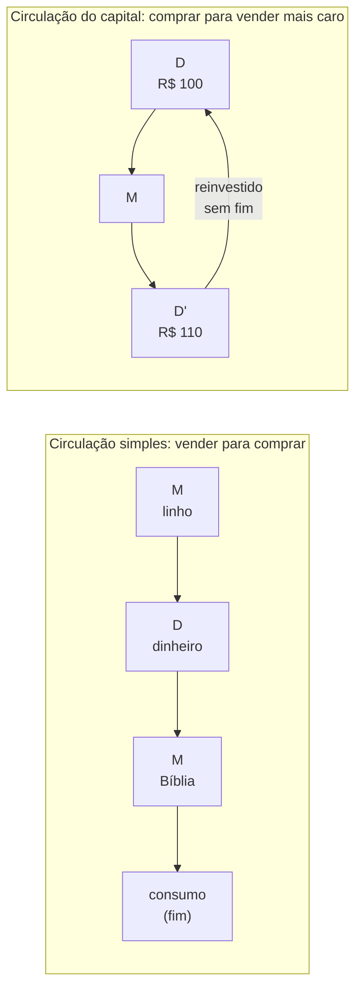
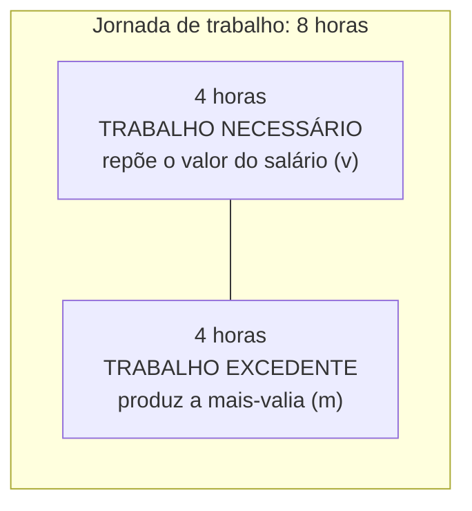
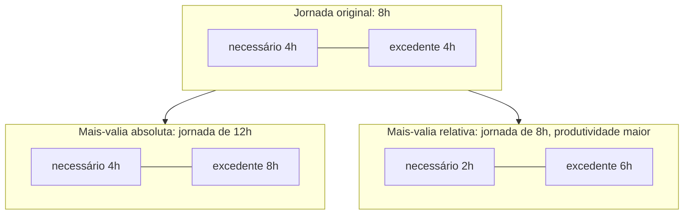

> **Aviso de Idioma:** Este currículo e todos os seus recursos de apoio foram estruturados exclusivamente em **Português (PT-BR)**.

# Aula 5 · Mais-valia: de onde vem o lucro

**MOD-103 · 10 horas · Leitura principal:** *O Capital*, Livro I, capítulos 4 (transformação do dinheiro em capital), 5 (processo de trabalho e de valorização), 6 (capital constante e variável), 7 (taxa de mais-valia), 8 (a jornada de trabalho, seleção) e 10 (o conceito de mais-valia relativa)

## O que você vai aprender

- Contrastar a circulação simples (M, D, M) com a fórmula geral do capital (D, M, D').
- Explicar por que a <abbr title="Força de trabalho: a capacidade de trabalhar, o conjunto das capacidades físicas e mentais de uma pessoa. É o que o trabalhador vende ao capitalista em troca de salário. Diferente do trabalho, que é o uso dessa capacidade.">força de trabalho</abbr> é uma mercadoria especial.
- Definir <abbr title="Mais-valia: o valor novo criado pelo trabalhador além do valor da sua própria força de trabalho (o salário), e apropriado pelo capitalista. É a origem do lucro.">mais-valia</abbr>, <abbr title="Capital constante (c): a parte do capital investida em meios de produção (máquinas, matérias-primas, energia). Transfere o seu valor ao produto, mas não cria valor novo.">capital constante</abbr> e <abbr title="Capital variável (v): a parte do capital investida na compra de força de trabalho (salários). É variável porque o trabalho cria um valor maior do que o seu próprio.">capital variável</abbr>.
- Calcular a taxa de mais-valia (m/v), a <abbr title="Composição orgânica do capital (c/v): a proporção entre capital constante e capital variável. Cresce quando se investe mais em máquinas em relação aos salários.">composição orgânica</abbr> (c/v) e a taxa de lucro (m/(c+v)).
- Distinguir mais-valia absoluta e relativa, e reconhecer as duas no trabalho contemporâneo.

## Pergunta de abertura

> Numa troca justa, cada um entrega o equivalente ao que recebe. Se todas as mercadorias, inclusive o trabalho, fossem compradas e vendidas pelo seu valor justo, de onde viria o lucro? Alguém teria de ganhar na troca o que outro perde, e no conjunto da sociedade os ganhos e perdas se anulariam.

## 1. Dinheiro que vira mais dinheiro

Na circulação simples de mercadorias, alguém vende uma coisa para comprar outra: **M → D → M** (mercadoria, dinheiro, mercadoria). O tecelão vende o linho para comprar uma Bíblia. O fim é o valor de uso; o ciclo termina no consumo.

O capital faz o caminho inverso: **D → M → D'** (dinheiro, mercadoria, mais dinheiro). Compra-se para vender mais caro. Esse ciclo só tem sentido se D' for maior que D. A diferença, ΔD, é o que Marx chama de **mais-valia**. E o movimento não tem fim natural: D' volta a ser investido para virar D''.



Mas de onde vem o ΔD? Marx mostra que ele não pode vir da troca em si (se todos vendem 10% mais caro, todos compram 10% mais caro, e nada muda). Ele precisa vir de uma mercadoria cujo **uso cria valor**.

## 2. A mercadoria especial

Essa mercadoria existe: é a **força de trabalho**, a capacidade humana de trabalhar. Para que ela apareça no mercado, duas condições históricas precisam existir:

1. O trabalhador precisa ser **livre** para vender a sua força de trabalho (não é escravo nem servo).
2. Precisa ser "livre" também no outro sentido: **livre de meios de produção**, sem terra, sem ferramentas, sem outra forma de viver senão vender a sua capacidade de trabalhar.

Como toda mercadoria, a força de trabalho tem um valor: o tempo de trabalho necessário para produzir os bens que mantêm o trabalhador e a sua família (comida, moradia, roupa, educação). Esse valor inclui, observa Marx, um "elemento histórico e moral": o que conta como necessário varia de um país e de uma época para outro, conforme as lutas e conquistas dos trabalhadores.

O ponto decisivo: **o valor da força de trabalho e o valor que ela cria ao ser usada são duas grandezas diferentes**.

## 3. A jornada de trabalho dividida

Suponha que os bens necessários para um dia de vida do trabalhador exijam 4 horas de trabalho social. O capitalista paga o valor desse dia de força de trabalho: o salário equivale a 4 horas. Mas compra o **uso** da força de trabalho pela jornada inteira, digamos 8 horas.



Nas primeiras 4 horas, o trabalhador produz o equivalente ao seu salário. Nas 4 seguintes, produz valor que não lhe é pago. A troca foi "justa" pelas regras do mercado (o capitalista pagou o valor da mercadoria força de trabalho), e mesmo assim houve apropriação de trabalho não pago. Isso responde à pergunta de abertura: **o lucro vem da produção, não da troca**. Marx chama esse processo de <abbr title="Exploração: em Marx, termo técnico para a apropriação do trabalho excedente não pago. Não é um juízo moral sobre o patrão individual, mas a descrição de uma relação estrutural.">exploração</abbr>, em sentido técnico e não moral.

## 4. Capital constante, capital variável e as três taxas

O capitalista investe em duas coisas:

- **Capital constante (c):** meios de produção (máquinas, matérias-primas, energia, licenças de software). O seu valor é transferido ao produto, sem aumentar. É "constante".
- **Capital variável (v):** salários. É "variável" porque o trabalho cria um valor maior do que custa.

O valor de uma mercadoria é então: **c + v + m**.

Três indicadores saem daí:

| Indicador | Fórmula | O que mede |
| :--- | :---: | :--- |
| Taxa de mais-valia (ou de exploração) | m / v | Quanto de trabalho não pago para cada unidade de trabalho pago |
| Composição orgânica do capital | c / v | Quanto se investe em meios de produção para cada unidade investida em trabalho |
| Taxa de lucro | m / (c + v) | Quanto rende o capital total adiantado |

Um exemplo numérico:

```python
def indicadores(c, v, m):
    return {
        "valor_total": c + v + m,
        "taxa_mais_valia": m / v,
        "composicao_organica": c / v,
        "taxa_lucro": m / (c + v),
    }


# Uma oficina hipotética, valores em milhares de reais por mês
oficina = indicadores(c=80, v=20, m=20)
for nome, valor in oficina.items():
    print(f"{nome:20s} {valor:8.2f}")
```

Taxa de mais-valia de 100% (metade da jornada é trabalho excedente), composição orgânica 4 e taxa de lucro de 20%. Repare que a taxa de lucro é **menor** que a de mais-valia, porque é calculada sobre todo o capital, e não só sobre os salários. Por isso a taxa de lucro esconde a taxa de exploração: o capitalista vê o seu lucro como rendimento de todo o capital, como se as máquinas também produzissem valor.

## 5. Mais-valia absoluta: alongar a jornada

Como aumentar a mais-valia? O primeiro caminho é o mais direto: **prolongar a jornada**. Se o trabalho necessário continua sendo de 4 horas e a jornada passa de 8 para 12, o trabalho excedente sobe de 4 para 8 horas. Isso é **mais-valia absoluta**.

O capítulo 8, "A jornada de trabalho", narra com documentos oficiais ingleses a luta de décadas em torno do limite da jornada: crianças trabalhando 15 horas, mortes por exaustão, e a longa luta operária que arrancou as leis fabris e a jornada de 10 horas (1847). Marx conclui que a fixação da jornada "é o resultado de uma luta secular entre capitalista e trabalhador". Entre direitos iguais (o do comprador de usar a mercadoria, o do vendedor de limitar o seu uso), quem decide é a força.

## 6. Mais-valia relativa: encurtar o trabalho necessário

O segundo caminho é mais sutil e é o motor do capitalismo moderno: em vez de alongar a jornada, **reduzir o tempo de trabalho necessário**. Se a produtividade aumenta nos setores que produzem os bens de consumo dos trabalhadores, o valor desses bens cai, e o trabalhador passa a reproduzir o valor do seu salário em menos tempo. Com a mesma jornada de 8 horas, o trabalho necessário cai de 4 para 2 horas, e o excedente sobe de 4 para 6. Isso é **mais-valia relativa**.



```python
def divide_jornada(jornada, necessario):
    excedente = jornada - necessario
    return excedente, excedente / necessario


for nome, jornada, necessario in [
    ("original", 8, 4),
    ("absoluta (jornada maior)", 12, 4),
    ("relativa (produtividade maior)", 8, 2),
]:
    exc, taxa = divide_jornada(jornada, necessario)
    print(f"{nome:32s} excedente={exc}h  taxa de mais-valia={taxa:.0%}")
```

A mais-valia relativa explica por que o capitalismo revoluciona sem parar a técnica (lembre do *Manifesto*): cada capitalista individual tem incentivo para adotar uma técnica mais produtiva antes dos concorrentes, porque durante algum tempo produz abaixo do tempo socialmente necessário e embolsa uma mais-valia extra. Quando a técnica se generaliza, o ganho extra some, e a corrida recomeça.

> **Conexão com o trabalho digital:** as duas formas convivem hoje. A mais-valia absoluta reaparece no trabalho por aplicativo sem limite de jornada, nas mensagens de trabalho fora do expediente e no "sempre conectado". A mais-valia relativa aparece em cada software que reduz o tempo de uma tarefa. A pergunta de Marx continua: com quem fica o tempo economizado pela técnica?

## Leitura guiada

1. **Capítulo 4** (cerca de 20 páginas): D, M, D' e a compra da força de trabalho. Copie as duas condições para que a força de trabalho apareça no mercado.
2. **Capítulo 5**, segunda seção, "O processo de valorização" (cerca de 12 páginas): o exemplo do fio de algodão, em que Marx calcula passo a passo de onde sai a mais-valia.
3. **Capítulos 6 e 7** (cerca de 20 páginas): capital constante e variável, taxa de mais-valia.
4. **Capítulo 8**, seções 1, 2 e 6 (cerca de 25 páginas): a luta pela jornada de trabalho.
5. **Capítulo 10** (cerca de 10 páginas): o conceito de mais-valia relativa.

## Exercícios

**1.** Numa empresa de software, o capital constante mensal (computadores, servidores, licenças, aluguel) é de R$ 300 mil, os salários somam R$ 200 mil e o valor produzido é de R$ 700 mil. Calcule m, m/v, c/v e a taxa de lucro.

<details>
<summary>Gabarito</summary>

m = 700 menos 300 menos 200 = **R$ 200 mil**. m/v = 200/200 = **100%**. c/v = 300/200 = **1,5**. Taxa de lucro = 200/(300+200) = **40%**. Note a hipótese forte: estamos supondo que o preço de venda corresponde ao valor produzido. No Livro III, Marx mostra por que preços e valores divergem em cada empresa, mas se igualam no conjunto da economia.
</details>

**2.** Explique a diferença entre "trabalho" e "força de trabalho" e por que ela é essencial para a teoria da mais-valia.

<details>
<summary>Gabarito comentado</summary>

Força de trabalho é a capacidade de trabalhar; trabalho é o seu uso. O capitalista compra a força de trabalho pelo seu valor (o custo de reprodução do trabalhador) e usa essa força durante a jornada, criando um valor maior. Se o salário pagasse "o trabalho", não haveria diferença entre o que se paga e o que se cria, e a origem do lucro ficaria inexplicável. A distinção permite mostrar a exploração dentro de uma troca de equivalentes.
</details>

**3.** Classifique como mais-valia absoluta ou relativa: (a) uma empresa passa a exigir respostas a mensagens de trabalho no fim de semana; (b) um sistema de automação reduz pela metade o tempo de montagem de um produto barato de consumo popular; (c) o fim da hora de almoço remunerada; (d) a queda do preço dos alimentos graças à mecanização do campo.

<details>
<summary>Gabarito</summary>

(a) Absoluta (prolonga a jornada efetiva). (b) Relativa, se o produto entra no consumo dos trabalhadores e o seu barateamento reduz o valor da força de trabalho; também gera mais-valia extra para a empresa pioneira. (c) Absoluta (mais tempo de trabalho não pago). (d) Relativa (reduz o valor dos bens de consumo dos trabalhadores e, portanto, o trabalho necessário).
</details>

**4. Programação.** Escreva uma função que receba uma lista de anos com valores de c, v e m e devolva os três indicadores para cada ano. Teste com os dados didáticos abaixo e descreva a tendência.

```python
dados_didaticos = [
    (2000, 100, 100, 100),
    (2005, 160, 100, 120),
    (2010, 250, 100, 140),
    (2015, 380, 100, 160),
    (2020, 550, 100, 180),
]
```

<details>
<summary>Gabarito</summary>

```python
def serie_indicadores(dados):
    linhas = []
    for ano, c, v, m in dados:
        linhas.append((ano, m / v, c / v, m / (c + v)))
    return linhas


for ano, mv, cv, lucro in serie_indicadores(dados_didaticos):
    print(f"{ano}  m/v={mv:.0%}  c/v={cv:.1f}  lucro={lucro:.1%}")
```

A taxa de mais-valia sobe (de 100% para 180%), a composição orgânica sobe muito mais (de 1 para 5,5), e a taxa de lucro **cai** (de 50% para cerca de 27,7%). Esse é o padrão que Marx descreve no Livro III como tendência à queda da taxa de lucro: a mecanização aumenta a exploração, mas aumenta ainda mais o capital investido em meios de produção. O projeto do módulo pede que você investigue isso com dados reais.
</details>

## Resumo da aula

- O capital é dinheiro que se valoriza: D, M, D'. O acréscimo não pode vir da troca.
- A força de trabalho é a mercadoria cujo uso cria mais valor do que ela custa.
- A jornada se divide em trabalho necessário (repõe o salário) e trabalho excedente (produz a mais-valia).
- c + v + m; taxa de mais-valia m/v; composição orgânica c/v; taxa de lucro m/(c+v).
- Mais-valia absoluta: alongar a jornada. Mais-valia relativa: reduzir o trabalho necessário pelo aumento da produtividade. A segunda é o motor da revolução técnica permanente.

## Para ir além

- Karl Marx, *Salário, Preço e Lucro* (1865): uma conferência curta e didática que resume a teoria da mais-valia.
- Dados da Pesquisa Industrial Anual (PIA) do IBGE, para o projeto do módulo.
