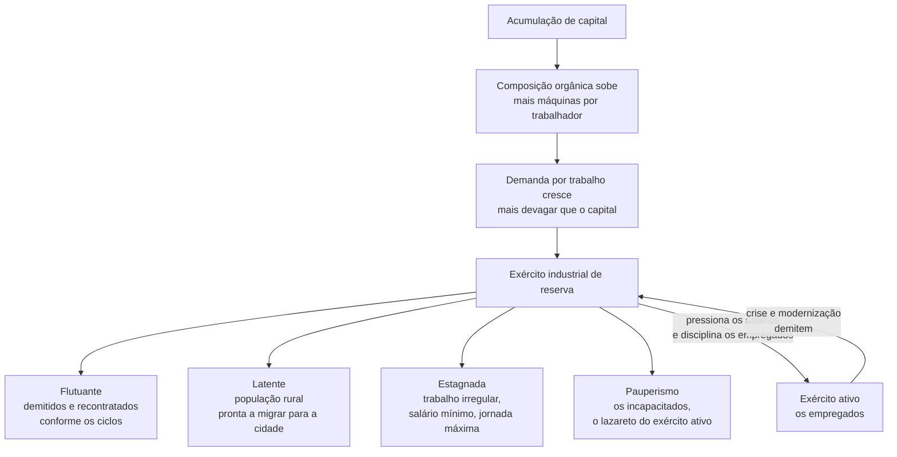
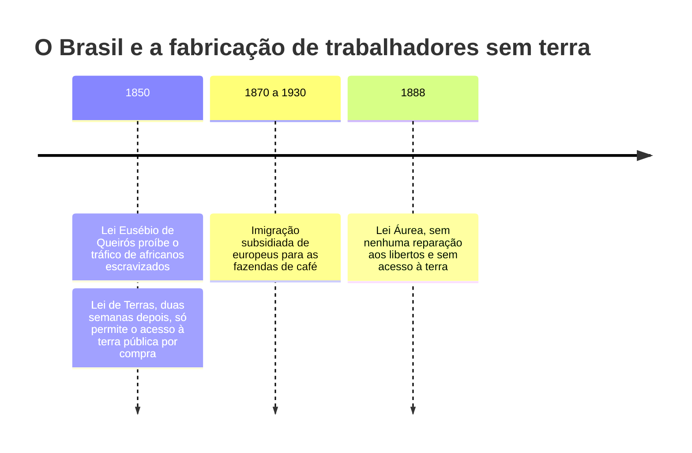

> **Aviso de Idioma:** Este currículo e todos os seus recursos de apoio foram estruturados exclusivamente em **Português (PT-BR)**.

# Aula 7 · Acumulação, exército de reserva e acumulação primitiva

**MOD-103 · 10 horas · Leitura principal:** *O Capital*, Livro I, capítulo 23, "A lei geral da acumulação capitalista" (seções 1 a 4), capítulo 24, "A assim chamada acumulação primitiva", e capítulo 25, "A teoria moderna da colonização"; Engels, *A Origem da Família, da Propriedade Privada e do Estado* (1884), capítulo IX (seleção)

## O que você vai aprender

- Explicar como a acumulação de capital altera a composição orgânica e a demanda por trabalho.
- Definir <abbr title="Exército industrial de reserva: a massa de trabalhadores desempregados ou subempregados que o próprio desenvolvimento capitalista produz. Serve de reserva de mão de obra e pressiona os salários para baixo.">exército industrial de reserva</abbr> e as suas formas (flutuante, latente, estagnada).
- Enunciar a lei geral da acumulação capitalista.
- Explicar a <abbr title="Acumulação primitiva: o processo histórico, violento, que separou os produtores dos seus meios de produção (sobretudo a terra) e concentrou riqueza em poucas mãos, criando as condições para o capitalismo. Inclui cercamentos, colonização e escravidão.">acumulação primitiva</abbr> e o papel da colonização e da escravidão.
- Aplicar o capítulo 25 à história brasileira, com a Lei de Terras de 1850.
- Conhecer em linhas gerais o argumento de Engels sobre a origem do Estado.

## Pergunta de abertura

> Em 2024, o Brasil tinha milhões de pessoas desempregadas, outras tantas desalentadas (que desistiram de procurar emprego) e quase 40% da população ocupada na informalidade, segundo o IBGE. O desemprego é um defeito do sistema que um bom governo pode eliminar, ou é uma peça do seu funcionamento normal?

## 1. Acumular: transformar mais-valia em capital

A mais-valia não é toda consumida pelo capitalista. Uma parte é **reinvestida**: transformada em mais capital, que produzirá mais mais-valia, que será de novo reinvestida. Esse movimento em espiral é a **acumulação**. A concorrência obriga cada capitalista a acumular: quem não investe em técnica mais produtiva é engolido por quem investe.

> "Acumulai, acumulai! Esta é a lei e os profetas." (*O Capital*, capítulo 22, tradução livre) <!-- estilo: ok -->

## 2. Mais máquinas, proporcionalmente menos trabalhadores

Como vimos na aula 5, a mais-valia relativa leva a investir em máquinas. Com a acumulação, a **composição orgânica** do capital (c/v) tende a subir: cada vez mais capital vai para meios de produção e proporcionalmente menos para salários.

O capital total cresce, e por isso a demanda absoluta por trabalho pode até crescer. Mas cresce **mais devagar** do que o capital, e aos saltos: em cada onda de modernização, a mesma produção passa a exigir menos gente.

Dois movimentos aceleram isso:

- **Concentração:** cada capital cresce reinvestindo a sua própria mais-valia.
- **Centralização:** capitais existentes se fundem ou são absorvidos por outros (falências, aquisições, fusões). Marx observa que a centralização permite saltos técnicos que a concentração gradual levaria séculos para produzir: "o mundo ainda estaria sem ferrovias se tivesse de esperar até que a acumulação permitisse a alguns capitais isolados construí-las".

## 3. O exército industrial de reserva

O resultado é uma população trabalhadora **relativamente excedente**: excedente não em relação às necessidades humanas, mas às necessidades de valorização do capital.

O exército de reserva cumpre duas funções para o capital:

1. **Reserva:** fornece mão de obra disponível para os momentos de expansão, sem que os salários subam muito.
2. **Disciplina:** a existência de desempregados pressiona os empregados a aceitar salários menores e jornadas maiores. O trabalho excessivo de uma parte da classe condena a outra parte ao desemprego, e vice-versa.

Responda agora à pergunta de abertura: para Marx, o desemprego não é um acidente, é **produto e condição** da acumulação capitalista. Políticas públicas podem reduzi-lo e amenizá-lo (e isso é muito importante), mas não eliminá-lo sem mudar a lógica que o produz.

### A lei geral

> "Quanto maiores a riqueza social, o capital em funcionamento, o volume e a energia do seu crescimento, (...) tanto maior o exército industrial de reserva. (...) Esta é a lei absoluta, geral, da acumulação capitalista." (tradução livre)

E a conclusão: a acumulação de riqueza num polo é, ao mesmo tempo, acumulação de miséria, tormento de trabalho, ignorância e degradação moral no polo oposto. Compare com o § 245 da *Filosofia do Direito* de Hegel (MOD-101, aula 5): Hegel viu a contradição; Marx explica o seu mecanismo.

> **Conexão com o Brasil e com as plataformas:** a forma "estagnada" descrita por Marx (trabalho irregular, sem garantias, com jornada máxima e salário mínimo) é a condição de grande parte da força de trabalho brasileira desde sempre, e é o reservatório de onde as plataformas digitais recrutam entregadores e motoristas. O conceito será retomado no MOD-305.

## 4. A assim chamada acumulação primitiva

Uma pergunta fica no ar: se o capital vem da mais-valia, e a mais-valia vem do capital, de onde veio o **primeiro** capital? E de onde vieram os primeiros trabalhadores sem meios de produção?

Os economistas clássicos respondiam com uma fábula: num passado remoto, havia uma elite trabalhadora, inteligente e poupadora, e uma massa de vadios que gastavam tudo. Os primeiros acumularam riqueza; os segundos acabaram tendo só a própria pele para vender. Marx chama isso de "pecado original" da economia política e responde com a história:

> "Na história real, como se sabe, a conquista, a subjugação, o assassinato para roubar, numa palavra, a violência, desempenham o papel principal." (tradução livre)

A acumulação primitiva é o processo histórico que **separa os produtores dos meios de produção**. Na Inglaterra, Marx descreve:

- **Os cercamentos:** do século XV ao XIX, terras comunais usadas pelos camponeses foram cercadas e transformadas em pastagens privadas para ovelhas, e depois em grandes propriedades. Os camponeses foram expulsos.
- **A legislação sangrenta:** os expulsos, sem trabalho, foram tratados como vagabundos e punidos com açoites, marca a ferro, escravidão e morte, até aceitarem a disciplina do trabalho assalariado.

E no plano mundial:

> "A descoberta das terras do ouro e da prata na América, o extermínio, a escravização e o soterramento da população nativa nas minas, o começo da conquista e da pilhagem das Índias Orientais, a transformação da África numa reserva para a caça comercial de peles negras assinalam a aurora da era da produção capitalista." (tradução livre)

E a frase final do capítulo 24:

> "O capital vem ao mundo escorrendo sangue e lama por todos os poros, da cabeça aos pés." (tradução livre)

O Brasil está no centro dessa história: o ouro de Minas Gerais e o açúcar produzido por africanos escravizados no Nordeste foram fontes fundamentais da acumulação que financiou a Revolução Industrial inglesa.

## 5. A teoria moderna da colonização e a Lei de Terras

O capítulo 25, o último do Livro I, é curto e genial. Marx comenta o economista inglês Edward Wakefield, que estudou as colônias de povoamento (Austrália, Estados Unidos). Wakefield constatou, perplexo, que ali o capitalismo não "pegava": havia terra livre em abundância, e os trabalhadores levados da Inglaterra, em vez de permanecer assalariados, iam ocupar um pedaço de terra e trabalhar para si mesmos.

A solução de Wakefield: o Estado deveria fixar um **preço artificialmente alto para a terra**, para que os imigrantes tivessem de trabalhar muitos anos como assalariados antes de conseguir comprá-la. Marx comenta que esse é o segredo revelado nas colônias: o modo de produção capitalista exige a expropriação do trabalhador.

No Brasil, a lição de Wakefield foi aplicada com precisão. Em setembro de 1850, duas semanas depois da lei que proibiu o tráfico de africanos escravizados, o Império aprovou a **Lei de Terras**: a partir dali, terras públicas só poderiam ser obtidas por compra. Prevendo o fim da escravidão, a elite agrária garantiu que libertos, pobres livres e imigrantes não pudessem ter terra própria e precisassem trabalhar para os grandes proprietários. A expressão de José de Souza Martins é exata: "no regime de terras livres, o trabalho tinha que ser cativo; num regime de trabalho livre, a terra tinha que ser cativa". Florestan Fernandes (MOD-206) vai mostrar as consequências dessa história para a integração da população negra.

## 6. Engels e a origem do Estado

Em *A Origem da Família, da Propriedade Privada e do Estado* (1884), escrito com base nas anotações de Marx sobre o antropólogo Lewis Morgan, Engels sustenta que o Estado não existiu sempre. Ele surge quando a sociedade se divide em classes com interesses irreconciliáveis: é um poder nascido da sociedade, que se coloca acima dela e dela se afasta cada vez mais, para manter o conflito de classes dentro dos limites da "ordem". O Estado é, como regra, o Estado da classe economicamente dominante, que por meio dele se torna também politicamente dominante.

Engels relaciona ainda a origem da propriedade privada com a subordinação das mulheres na família patriarcal, uma tese que foi muito discutida e criticada pela antropologia e pelo feminismo posteriores, mas que inaugurou a pergunta sobre as raízes históricas, e não naturais, da opressão das mulheres. Lênin retomará a teoria do Estado de Engels em *O Estado e a Revolução* (MOD-201).

## Leitura guiada

1. ***O Capital*, capítulo 23, seções 1 a 4** (cerca de 40 páginas): siga o argumento do aumento da composição orgânica até a lei geral. Copie a definição das três formas da superpopulação relativa.
2. **Capítulo 24** (cerca de 40 páginas): leia inteiro. Monte uma linha do tempo com os acontecimentos citados por Marx.
3. **Capítulo 25** (cerca de 10 páginas): Wakefield e a colonização.
4. **Engels, *A Origem da Família*, capítulo IX, "Barbárie e civilização"** (cerca de 20 páginas): procure a definição de Estado.

## Exercícios

**1.** Por que, segundo Marx, a acumulação de capital produz uma população trabalhadora excedente?

Gabarito comentado

Porque a acumulação, movida pela concorrência e pela busca de mais-valia relativa, eleva a composição orgânica do capital: proporcionalmente mais investimento em máquinas, menos em salários. A demanda por trabalho cresce mais devagar do que o capital e cai a cada onda de modernização. Parte dos trabalhadores se torna excedente em relação às necessidades de valorização do capital, embora não em relação às necessidades humanas.

**2.** Classifique nas formas do exército de reserva: (a) um operário metalúrgico demitido numa crise e recontratado dois anos depois; (b) um pequeno agricultor do semiárido que migra para a periferia de São Paulo; (c) uma diarista sem carteira assinada que trabalha em três casas por semana.

Gabarito

(a) Flutuante. (b) Latente (a população rural pronta a migrar). (c) Estagnada (ocupação irregular, sem garantias, jornada longa e renda baixa).

**3.** O que é a "fábula" da acumulação primitiva contada pelos economistas e qual é a resposta de Marx?

Gabarito comentado

A fábula atribui a origem da riqueza à poupança de uma elite laboriosa e a pobreza à preguiça de uma massa perdulária. Marx responde com a história documentada: cercamentos, expulsão de camponeses, legislação sangrenta contra os "vagabundos", colonização, escravidão e pilhagem. A separação entre trabalhadores e meios de produção foi produzida pela violência, inclusive pela violência do Estado.

**4.** Explique a relação entre a Lei de Terras de 1850 e o capítulo 25 d'*O Capital*.

Gabarito comentado

O capítulo 25 mostra que, onde há terra livre, os trabalhadores não aceitam ser assalariados, e que a solução proposta por Wakefield era tornar a terra artificialmente cara. A Lei de Terras fez isso no Brasil: com o fim do tráfico de escravizados, proibiu o acesso à terra pública que não fosse por compra, garantindo que ex-escravizados, pobres e imigrantes tivessem de trabalhar para os fazendeiros. É um exemplo nítido de acumulação primitiva conduzida pelo Estado.

**5. Pesquisa com dados.** Na PNAD Contínua do IBGE (disponível no portal do IBGE e no SIDRA), encontre para o último trimestre: a taxa de desocupação, o número de desalentados e a taxa de informalidade. Escreva um parágrafo interpretando os números com as categorias da aula.

Critérios de correção

A resposta deve citar os números com a fonte e o trimestre, associar desocupação e desalento à forma flutuante e à latente, e informalidade à forma estagnada, e discutir os limites dessa correspondência (as categorias do IBGE não foram feitas para medir conceitos marxistas). O exercício antecipa o MOD-207, sobre a operacionalização de conceitos teóricos em variáveis.

## Resumo da aula

- A acumulação transforma mais-valia em capital e eleva a composição orgânica.
- O capitalismo produz uma população trabalhadora relativamente excedente: o exército industrial de reserva, nas formas flutuante, latente e estagnada.
- Lei geral: acumulação de riqueza num polo, de miséria no outro.
- A acumulação primitiva separou violentamente os produtores dos meios de produção: cercamentos, legislação sangrenta, colonização e escravidão.
- No Brasil, a Lei de Terras de 1850 aplicou a receita de Wakefield: tornar a terra cativa quando o trabalho deixava de ser.
- Para Engels, o Estado nasce da divisão da sociedade em classes.

## Para ir além

- José de Souza Martins, *O Cativeiro da Terra* (1979).
- Eric Williams, *Capitalismo e Escravidão* (1944): a escravidão nas Américas e o financiamento da Revolução Industrial.
- Com esta aula você fecha o MOD-103. Volte ao [guia do módulo](../03-critica-economia-politica-marx-engels.md) e comece o projeto.
