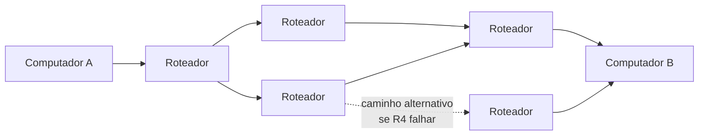
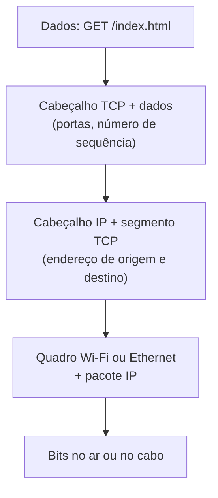
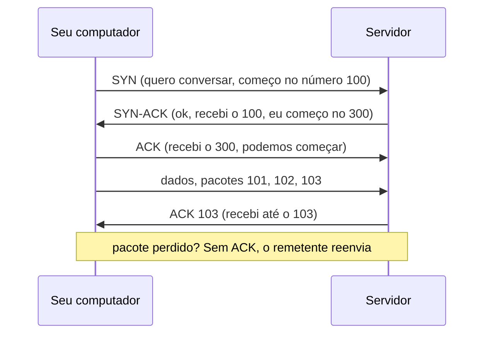
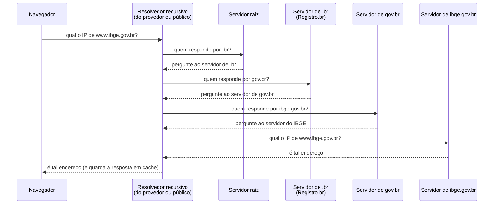
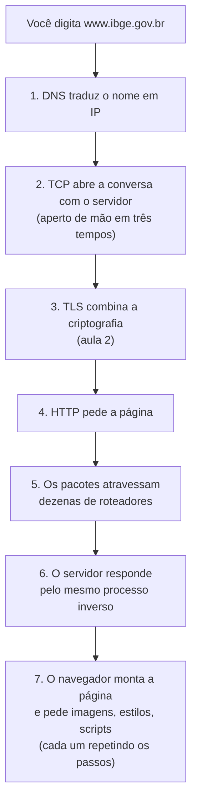

> **Aviso de Idioma:** Este currículo e todos os seus recursos de apoio foram estruturados exclusivamente em **Português (PT-BR)**.

# Aula 1 · Como a Internet funciona: endereços, pacotes e nomes

**MOD-104 · 10 horas · Apoio:** UNIVESP, Redes de Computadores; Cartilha de Segurança do CERT.br

## O que você vai aprender

- Contar a história da Internet, da ARPANET ao Brasil.
- Explicar a ideia de <abbr title="Comutação de pacotes: técnica em que uma mensagem é dividida em pedaços (pacotes) que viajam separados pela rede, possivelmente por caminhos diferentes, e são remontados no destino.">comutação de pacotes</abbr>.
- Descrever as camadas da Internet e o papel do <abbr title="IP (Internet Protocol): protocolo que dá um endereço numérico a cada dispositivo e leva os pacotes de um endereço a outro, passando por roteadores.">IP</abbr>, do <abbr title="TCP (Transmission Control Protocol): protocolo que garante que os pacotes cheguem completos e na ordem certa, reenviando os que se perdem.">TCP</abbr> e do <abbr title="DNS (Domain Name System): sistema que traduz nomes como gov.br em endereços IP. Funciona como uma lista telefônica distribuída e hierárquica.">DNS</abbr>.
- Usar `ping`, `traceroute` e consultas de DNS para observar a rede.
- Entender que tipo de rastro uma conexão deixa e o que o Marco Civil da Internet diz sobre isso.

## Pergunta de abertura

> Você digita `www.ibge.gov.br` no navegador e, em menos de um segundo, a página aparece. Escreva, como conseguir, tudo o que você acha que aconteceu nesse segundo. Guarde a lista: você vai compará-la com o que aprender.

## 1. Uma rede sem centro

A Internet começou como **ARPANET**, um projeto da agência de pesquisa do Departamento de Defesa dos Estados Unidos. A primeira conexão, em 29 de outubro de 1969, ligou um computador da Universidade da Califórnia em Los Angeles a outro em Stanford. A mensagem pretendida era "LOGIN"; o sistema caiu depois das duas primeiras letras, e a primeira mensagem da história da Internet foi "LO".

A ARPANET adotou uma ideia proposta por Paul Baran e Donald Davies no início dos anos 1960: a **comutação de pacotes**. Em vez de reservar uma linha inteira para cada conversa (como no telefone antigo), a mensagem é cortada em pequenos pedaços, cada um com o endereço de destino, e cada pedaço segue pelo caminho que estiver disponível. Se um trecho da rede falha, os pacotes contornam o problema.



Em 1983, a ARPANET adotou o conjunto de protocolos **TCP/IP**, criado por Vint Cerf e Bob Kahn, que permitia interligar redes diferentes: uma "rede de redes", uma inter-net. No Brasil, a primeira conexão acadêmica à Internet aconteceu em 1991, por meio da Rede Nacional de Ensino e Pesquisa (RNP) e da FAPESP, e o acesso comercial começou em 1995.

Um ponto histórico importante: a rede nasceu de financiamento militar e acadêmico **público**, com protocolos abertos que qualquer um podia implementar. A sua concentração em poucas empresas privadas é um fenômeno muito mais recente.

## 2. As camadas

A Internet funciona em **camadas**: cada uma resolve um problema e usa os serviços da camada de baixo, sem precisar saber como ela funciona. É a mesma ideia de abstração da programação.

| Camada | Problema que resolve | Protocolos | Analogia com o correio |
| :--- | :--- | :--- | :--- |
| **Aplicação** | O que se quer dizer | HTTP, DNS, SMTP (e-mail) | O conteúdo da carta |
| **Transporte** | Entregar inteiro e em ordem, para o programa certo | TCP, UDP | Numerar as páginas e o "aos cuidados de" |
| **Rede (Internet)** | Levar de um endereço a outro, atravessando redes | IP | O endereço no envelope e os centros de triagem |
| **Enlace e física** | Transmitir bits por um meio (cabo, fibra, rádio) | Ethernet, Wi-Fi, 4G | O caminhão e a estrada |

Quando você envia algo, cada camada **embrulha** a anterior com as suas próprias informações; no destino, cada camada desembrulha a sua parte.



## 3. Endereços IP e roteadores

Todo dispositivo conectado tem um **endereço IP**. No IPv4, ele tem 32 bits, escritos como quatro números de 0 a 255: `200.160.2.3`. Como 32 bits dão só cerca de 4,3 bilhões de endereços (MOD-102, aula 1), eles se esgotaram, e está em curso a migração para o **IPv6**, com 128 bits: `2001:12ff:0:4::22`.

Os **roteadores** são os centros de triagem: recebem um pacote, olham o endereço de destino e decidem para qual vizinho encaminhá-lo. Nenhum roteador conhece o caminho inteiro; cada um só sabe o próximo passo. Você pode ver esse caminho:

```bash
traceroute www.ibge.gov.br     # Linux e macOS
tracert www.ibge.gov.br        # Windows
```

Cada linha da resposta é um roteador no caminho, com o tempo de ida e volta até ele.

## 4. TCP: conversa confiável

O IP faz o "melhor esforço": pacotes podem se perder, chegar fora de ordem ou duplicados. O **TCP** constrói por cima disso uma conversa confiável:



O TCP também usa **portas**: números que indicam para qual programa do computador os dados vão. O servidor web costuma escutar na porta 443 (HTTPS) ou 80 (HTTP); o e-mail, na 25 ou 587. Um endereço IP é o prédio; a porta é o apartamento.

## 5. DNS: a lista telefônica da Internet

Ninguém decora `200.152.38.150`. Usamos nomes como `ibge.gov.br`. O **DNS** traduz nomes em endereços IP, e faz isso de modo **hierárquico e distribuído**:



O domínio `.br` é administrado pelo **Registro.br**, do Núcleo de Informação e Coordenação do Ponto BR (NIC.br), ligado ao Comitê Gestor da Internet no Brasil (CGI.br), um modelo de governança com participação do governo, de empresas, da academia e da sociedade civil.

Em Python, a biblioteca padrão faz a consulta para você:

```python
import socket

for nome in ["www.ibge.gov.br", "www.gov.br"]:
    try:
        enderecos = {info[4][0] for info in socket.getaddrinfo(nome, 443)}
        print(nome, "→", sorted(enderecos))
    except socket.gaierror as erro:
        print(nome, "→ não resolvido:", erro)
```

E no terminal:

```bash
nslookup www.ibge.gov.br
dig www.ibge.gov.br            # mais detalhado, no Linux e no macOS
```

## 6. Juntando tudo

Volte à pergunta de abertura. Uma versão resumida do que acontece:



## 7. O rastro de uma conexão

Cada passo desse processo deixa rastros:

- O **resolvedor de DNS** sabe quais nomes você consultou e quando.
- O seu **provedor** sabe com quais endereços IP você se conectou, quando e quanto trafegou.
- O **servidor** sabe o seu endereço IP (e, por ele, a sua localização aproximada e o seu provedor).

No Brasil, o **Marco Civil da Internet** (Lei 12.965/2014) obriga os provedores de conexão a guardar os registros de conexão (data, hora, duração, IP) por **um ano** (art. 13), e os provedores de aplicação (sites e aplicativos com fins econômicos) a guardar os registros de acesso por **seis meses** (art. 15). Esses registros só podem ser entregues mediante ordem judicial.

Repare na escolha política: a lei protege o conteúdo e exige ordem judicial, mas **obriga** a guarda dos rastros. Saber ler a infraestrutura é saber onde estão os pontos de controle.

## Exercícios

**1.** Por que a comutação de pacotes torna a rede mais resistente a falhas do que a comutação de circuitos do telefone antigo?

<details>
<summary>Gabarito comentado</summary>

Na comutação de circuitos, uma linha inteira é reservada para a conversa; se um trecho cai, a conversa cai. Na comutação de pacotes, cada pacote é encaminhado de forma independente pelo caminho disponível no momento; se um roteador falha, os pacotes seguintes são desviados por outros caminhos e o TCP reenvia os que se perderam.
</details>

**2.** Rode `traceroute` (ou `tracert`) para `www.ibge.gov.br` e para um site hospedado em outro continente. Compare o número de saltos e os tempos.

<details>
<summary>Gabarito comentado</summary>

Os números dependem da sua conexão. Em geral, o site estrangeiro terá mais saltos e tempos bem maiores a partir do momento em que os pacotes atravessam um cabo submarino (salto de dezenas para mais de cem milissegundos). Alguns roteadores não respondem e aparecem como asteriscos: isso é normal e não indica falha.
</details>

**3.** Monte a tabela de camadas para o envio de um e-mail, indicando o protocolo usado em cada camada.

<details>
<summary>Gabarito</summary>

Aplicação: SMTP para enviar (e DNS para achar o servidor de destino, por meio do registro MX). Transporte: TCP, porta 587 ou 465. Rede: IP. Enlace e física: Wi-Fi, Ethernet ou rede móvel.
</details>

**4.** Leia os artigos 13 a 15 do Marco Civil da Internet. Quem pode acessar os registros de conexão e em que condições? Escreva um parágrafo avaliando o equilíbrio entre investigação criminal e privacidade.

<details>
<summary>Critérios de correção</summary>

A resposta deve informar os prazos (um ano para provedores de conexão, seis meses para aplicações), a exigência de ordem judicial para o fornecimento e a possibilidade de autoridades pedirem guarda por prazo maior. A avaliação deve considerar que a guarda obrigatória cria um grande volume de dados sobre toda a população, mesmo quem não é investigado, e discutir os riscos de vazamento e abuso.
</details>

## Resumo da aula

- A Internet nasceu da ARPANET (1969) com financiamento público e protocolos abertos. Chegou às universidades brasileiras em 1991.
- Comutação de pacotes: mensagens cortadas em pedaços que seguem caminhos independentes.
- Camadas: aplicação, transporte (TCP), rede (IP), enlace e física. Cada uma embrulha a anterior.
- IP leva pacotes entre endereços; TCP garante entrega completa e ordenada; portas indicam o programa.
- DNS traduz nomes em endereços de forma hierárquica.
- Cada conexão deixa rastros em resolvedores, provedores e servidores; o Marco Civil obriga a guarda de registros.

## Para ir além

- [Cartilha de Segurança para Internet do CERT.br](https://cartilha.cert.br/).
- O site do [CGI.br](https://www.cgi.br/), com os princípios para a governança da Internet no Brasil.
