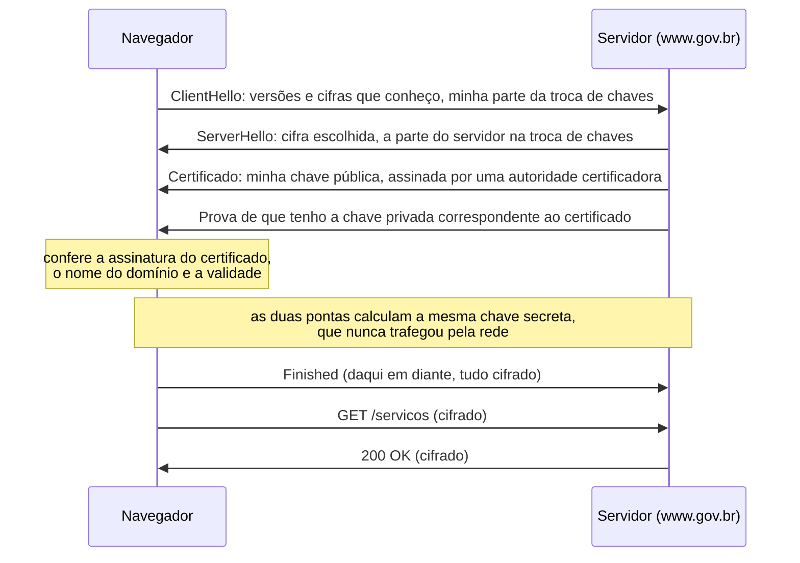
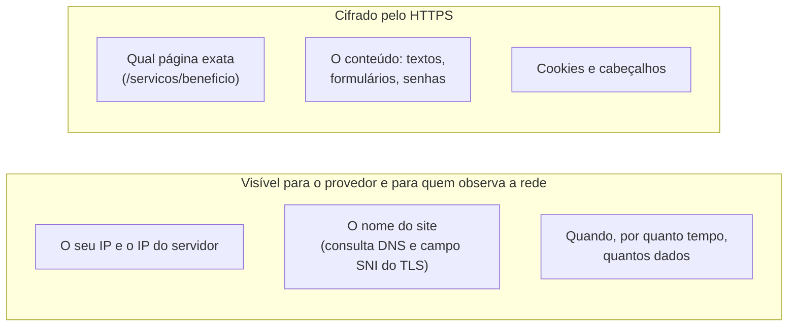

> **Aviso de Idioma:** Este currículo e todos os seus recursos de apoio foram estruturados exclusivamente em **Português (PT-BR)**.

# Aula 2 · A Web e o cadeado: HTTP, HTTPS e TLS

**MOD-104 · 10 horas · Apoio:** Autodefesa Contra Vigilância (EFF), guia "O que deveria saber sobre criptografia"

## O que você vai aprender

- Ler e escrever uma requisição e uma resposta <abbr title="HTTP (Hypertext Transfer Protocol): protocolo de texto usado pela Web. O navegador envia uma requisição (método, endereço, cabeçalhos) e o servidor devolve uma resposta (código de status, cabeçalhos, conteúdo).">HTTP</abbr>.
- Interpretar códigos de status, cabeçalhos e <abbr title="Cookie: pequeno dado que o site pede ao navegador para guardar e devolver em cada visita. Serve para manter a sessão aberta e também para rastrear o usuário entre visitas e entre sites.">cookies</abbr>.
- Explicar o que o <abbr title="TLS (Transport Layer Security): protocolo que cifra a conexão entre o navegador e o servidor e verifica a identidade do servidor por meio de certificados. É o S do HTTPS.">TLS</abbr> faz e como um <abbr title="Certificado digital: documento eletrônico, assinado por uma autoridade certificadora, que associa uma chave pública a um nome de domínio. Prova ao navegador que ele está falando com o site verdadeiro.">certificado digital</abbr> prova a identidade de um site.
- Distinguir o que o HTTPS protege (o conteúdo) do que continua exposto (os metadados).
- Fazer requisições HTTP com `curl` e com Python.

## Pergunta de abertura

> O cadeado na barra do navegador significa que o site é seguro? Que ninguém sabe que você o visitou? Que a empresa por trás dele é confiável? Responda antes de ler.

## 1. A Web é uma conversa de texto

Em 1989, no CERN, o laboratório europeu de física de partículas, Tim Berners-Lee propôs um sistema para os cientistas compartilharem documentos ligados por links. Ele criou três peças que usamos até hoje: o endereço (URL), a linguagem das páginas (HTML) e o protocolo de troca (**HTTP**). Em 1993, o CERN liberou a tecnologia para uso livre, sem patentes nem royalties. Essa decisão permitiu que a Web se espalhasse pelo mundo.

O HTTP é, no fundo, uma conversa em texto legível. O navegador envia uma **requisição**:

```text
GET /estatisticas/sociais/populacao.html HTTP/1.1
Host: www.ibge.gov.br
User-Agent: Mozilla/5.0 (X11; Linux x86_64) Firefox/128.0
Accept-Language: pt-BR,pt;q=0.9
Cookie: sessao=a8f3c2
```

E o servidor devolve uma **resposta**:

```text
HTTP/1.1 200 OK
Content-Type: text/html; charset=utf-8
Content-Length: 48213
Set-Cookie: preferencia=tema-escuro; Max-Age=31536000

<!doctype html>
<html lang="pt-BR"> ...
```

### Métodos

| Método | Para quê | Exemplo |
| :--- | :--- | :--- |
| `GET` | Pedir um recurso | Abrir uma página |
| `POST` | Enviar dados para o servidor processar | Enviar um formulário |
| `PUT` e `PATCH` | Substituir ou alterar um recurso | Atualizar um cadastro por uma API |
| `DELETE` | Apagar um recurso | Remover um item por uma API |

### Códigos de status

| Faixa | Significado | Exemplos |
| :--- | :--- | :--- |
| 2xx | Sucesso | `200 OK`, `201 Created` |
| 3xx | Redirecionamento | `301 Moved Permanently`, `302 Found` |
| 4xx | Erro de quem pediu | `400 Bad Request`, `403 Forbidden`, `404 Not Found`, `429 Too Many Requests` |
| 5xx | Erro do servidor | `500 Internal Server Error`, `503 Service Unavailable` |

Você vai encontrar todos esses códigos no MOD-301, ao raspar portais públicos. O `429` em particular significa "você está pedindo rápido demais": um raspador ético respeita esse aviso.

## 2. O que o seu navegador conta sem você perceber

Releia a requisição acima. Antes de você clicar em qualquer coisa, o site já sabe:

- O seu **endereço IP** (e, por ele, cidade aproximada e provedor).
- O seu **navegador e sistema operacional** (cabeçalho `User-Agent`).
- A sua **língua** (`Accept-Language`).
- De onde você veio, se clicou num link (cabeçalho `Referer`, com essa grafia errada que virou padrão).
- Se você já esteve ali antes (**cookies**).

Os cookies foram criados em 1994 para coisas úteis, como manter um carrinho de compras. Mas um cookie colocado por uma empresa de publicidade presente em milhares de sites (os chamados **cookies de terceiros**) permite seguir uma pessoa por toda a Web e montar um perfil detalhado dos seus interesses. Combinando muitos detalhes do navegador (fontes instaladas, tamanho da tela, fuso horário), é possível até identificar alguém sem cookie nenhum: é a <abbr title="Impressão digital do navegador (browser fingerprinting): técnica que identifica um navegador combinando dezenas de características técnicas que, juntas, são quase únicas.">impressão digital do navegador</abbr>.

## 3. HTTP sem S: uma carta sem envelope

No HTTP puro, tudo viaja em texto aberto. Qualquer pessoa no caminho (a rede Wi-Fi do café, o provedor, um roteador comprometido) pode **ler** e até **alterar** o conteúdo. Senhas, mensagens, formulários: tudo exposto.

O **HTTPS** é o HTTP dentro de um túnel cifrado pelo **TLS**. O TLS garante três coisas:

| Garantia | Significa | Sem ela |
| :--- | :--- | :--- |
| **Confidencialidade** | Só as duas pontas leem o conteúdo | Qualquer um no caminho lê |
| **Integridade** | Ninguém altera o conteúdo sem ser detectado | Alguém injeta propaganda ou código malicioso |
| **Autenticidade** | Você está falando com o site verdadeiro | Um impostor se passa pelo banco |

## 4. O aperto de mão do TLS

Como duas máquinas que nunca se viram combinam uma chave secreta em público, sem que quem escuta a conversa descubra a chave? Com a **criptografia de chave pública**, que você vai estudar na aula 5. O roteiro do TLS 1.3, simplificado:



### Por que confiar no certificado

O certificado é assinado por uma <abbr title="Autoridade certificadora: organização que verifica que alguém controla um domínio e assina digitalmente o certificado. Os navegadores vêm com uma lista de autoridades em que confiam.">autoridade certificadora</abbr>. O navegador já vem de fábrica com uma lista de autoridades confiáveis. É uma **cadeia de confiança**: você confia no navegador, que confia na autoridade, que atesta o site. Se a cadeia falha (certificado vencido, nome errado, assinatura inválida), o navegador mostra um alerta vermelho. Não ignore esse alerta.

Desde 2015, o projeto Let's Encrypt, de uma organização sem fins lucrativos, emite certificados de graça e automaticamente, o que fez o HTTPS se tornar a regra na Web.

## 5. O que o cadeado não diz

Volte à pergunta de abertura. O cadeado garante que a **conexão** é cifrada e que você está falando com o dono do domínio. Ele **não** garante:

- **Que o site é honesto.** Um site de golpe pode ter certificado válido para o seu próprio domínio, como `banco-seguro-login.com`.
- **Que ninguém sabe que você o visitou.** Continuam visíveis para o provedor e para quem observa a rede:



- **Que o site não vai fazer mau uso dos seus dados.** O que acontece depois que os dados chegam ao servidor é questão de lei (LGPD), de governança e de confiança, não de criptografia.

Esses dados de conexão são **metadados**: dados sobre a comunicação, e não o seu conteúdo. A aula 4 mostra por que eles podem revelar tanto quanto o conteúdo.

## 6. Fazendo requisições

No terminal, o `curl` mostra a conversa inteira com a opção `-v`:

```bash
curl -v https://www.gov.br/ -o /dev/null
```

As linhas que começam com `>` são o que você enviou; com `<`, o que recebeu; com `*`, detalhes da conexão e do TLS (versão, cifra, certificado).

Em Python, com a biblioteca padrão:

```python
from urllib.request import Request, urlopen
from urllib.error import URLError

req = Request(
    "https://www.gov.br/",
    headers={"User-Agent": "curso-ultimato/1.0 (atividade de aula)"},
)
try:
    with urlopen(req, timeout=10) as resposta:
        print("Status:", resposta.status)
        print("Tipo:", resposta.headers.get("Content-Type"))
        print("Servidor:", resposta.headers.get("Server"))
except URLError as erro:
    print("Falha na conexão:", erro)
```

Repare que nos identificamos honestamente no `User-Agent`. No MOD-301 você vai usar a biblioteca `httpx`, mais moderna, mas o princípio é o mesmo.

## Exercícios

**1.** Interprete a resposta: `HTTP/1.1 301 Moved Permanently` com o cabeçalho `Location: https://www.exemplo.gov.br/`. O que aconteceu e o que o navegador vai fazer?

<details>
<summary>Gabarito</summary>

O recurso mudou de endereço de forma permanente. O navegador vai fazer automaticamente uma nova requisição ao endereço indicado no cabeçalho `Location`. É o que acontece quando se digita um endereço com `http://` e o site redireciona para `https://`.
</details>

**2.** Rode `curl -v https://www.gov.br/ -o /dev/null` e identifique: a versão do TLS, o emissor do certificado e o código de status da resposta.

<details>
<summary>Gabarito comentado</summary>

Os valores exatos mudam com o tempo. Procure a linha `SSL connection using TLSv1.3` (ou 1.2), a linha `issuer:` no bloco do certificado e a primeira linha que começa com `< HTTP`. Se a resposta for um redirecionamento (3xx), repita com a opção `-L` para seguir o redirecionamento.
</details>

**3.** Uma pessoa acessa, pelo Wi-Fi de uma biblioteca, o site de um serviço de saúde sobre HIV, via HTTPS. O que o administrador da rede da biblioteca consegue saber? O que não consegue?

<details>
<summary>Gabarito comentado</summary>

Consegue saber que aquele dispositivo se conectou àquele domínio (pelo DNS e pelo SNI), em que horário, por quanto tempo e quantos dados trafegou. Não consegue ver quais páginas foram abertas nem o conteúdo de formulários. O exemplo mostra que, em temas sensíveis, só o nome do domínio já é uma informação delicada, e é por isso que ferramentas como o Tor (aula 5) existem.
</details>

**4.** Escreva um programa em Python que receba uma lista de endereços de portais públicos e imprima o status HTTP e o cabeçalho `Content-Type` de cada um, tratando erros de conexão sem interromper o programa.

<details>
<summary>Gabarito</summary>

```python
from urllib.request import Request, urlopen
from urllib.error import HTTPError, URLError

def checar(urls):
    for url in urls:
        req = Request(url, headers={"User-Agent": "curso-ultimato/1.0"})
        try:
            with urlopen(req, timeout=10) as r:
                print(url, r.status, r.headers.get("Content-Type"))
        except HTTPError as e:
            print(url, "erro HTTP", e.code)
        except URLError as e:
            print(url, "falha de conexão:", e.reason)
```
</details>

## Resumo da aula

- A Web foi criada por Tim Berners-Lee no CERN e liberada sem patentes em 1993.
- HTTP é uma conversa de texto: requisição (método, caminho, cabeçalhos) e resposta (status, cabeçalhos, conteúdo).
- O navegador revela IP, sistema, língua, origem e cookies; cookies de terceiros e impressões digitais permitem rastreamento.
- HTTPS é HTTP sobre TLS: confidencialidade, integridade e autenticidade, com uma cadeia de confiança de certificados.
- O cadeado não garante honestidade do site nem esconde que você o visitou: metadados continuam visíveis.

## Para ir além

- [Autodefesa Contra Vigilância, guia sobre criptografia](https://ssd.eff.org/pt-br).
- A documentação da MDN em português sobre [HTTP](https://developer.mozilla.org/pt-BR/docs/Web/HTTP).
