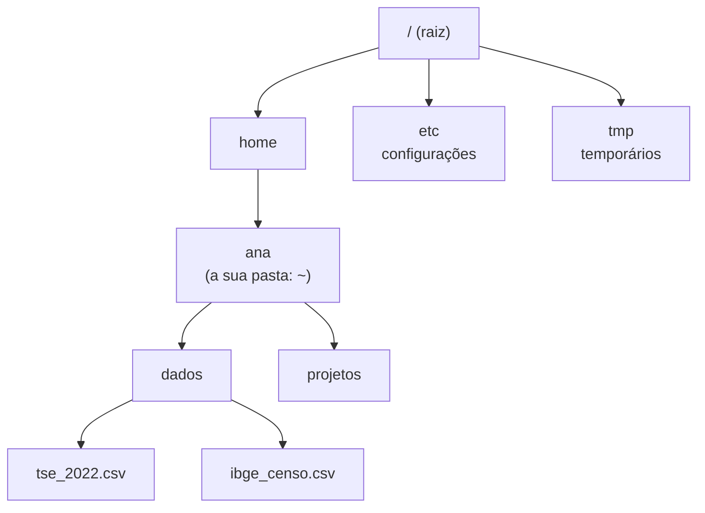
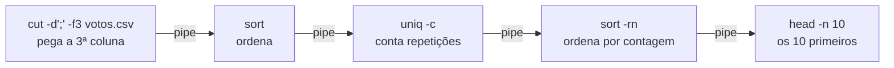

> **Aviso de Idioma:** Este currículo e todos os seus recursos de apoio foram estruturados exclusivamente em **Português (PT-BR)**.

# Aula 3 · O terminal: trabalhar com arquivos como um profissional

**MOD-104 · 10 horas · Apoio:** Guia Foca GNU/Linux, níveis iniciante e intermediário

## O que você vai aprender

- Abrir um terminal no seu sistema e entender o que é o <abbr title="Shell: programa que lê os comandos digitados no terminal, executa-os e mostra os resultados. Os mais comuns são bash e zsh.">*shell*</abbr>.
- Navegar no <abbr title="Sistema de arquivos: a organização dos arquivos em pastas (diretórios) aninhadas, a partir de uma raiz. No Linux e no macOS, a raiz é /.">sistema de arquivos</abbr> com caminhos absolutos e relativos.
- Criar, copiar, mover, procurar e apagar arquivos com segurança.
- Combinar comandos com <abbr title="Pipe (cano): o símbolo | liga a saída de um comando à entrada do seguinte, permitindo montar cadeias de pequenas ferramentas.">*pipes*</abbr> e redirecionamentos para analisar dados.
- Ler e alterar <abbr title="Permissões: regras que dizem quem pode ler (r), escrever (w) e executar (x) cada arquivo: o dono, o grupo e os demais usuários.">permissões</abbr> de arquivos.
- Escrever um pequeno script de automação.

## Pergunta de abertura

> Você tem uma pasta com 3.000 arquivos CSV baixados de um portal público. Precisa saber quantos mencionam o município de "Juazeiro do Norte", juntar esses arquivos num só e apagar os vazios. Quanto tempo levaria clicando? Ao fim desta aula, você fará isso com três linhas.

## 1. Por que o terminal

Interfaces gráficas são ótimas para tarefas pontuais. O terminal é imbatível para tarefas **repetitivas, em lote e reproduzíveis**: o mesmo comando funciona com 3 ou 3 milhões de arquivos, pode ser salvo num script e repetido amanhã por outra pessoa. Para quem trabalha com dados públicos, isso é decisivo.

O terminal que usaremos segue o padrão <abbr title="POSIX: conjunto de normas que define como sistemas do tipo Unix devem se comportar. Linux e macOS seguem esse padrão; por isso os mesmos comandos funcionam nos dois.">POSIX</abbr>, herdeiro do Unix, criado em 1969 nos Laboratórios Bell por Ken Thompson e Dennis Ritchie. A filosofia do Unix, resumida por Doug McIlroy, guia esta aula: **escreva programas que façam uma coisa e a façam bem; escreva programas que trabalhem juntos; escreva programas que lidem com texto, porque essa é a interface universal**.

| Sistema | Como abrir o terminal |
| :--- | :--- |
| Linux | Procure "Terminal" no menu |
| macOS | Aplicativos, Utilitários, Terminal |
| Windows | Instale o WSL (Subsistema Windows para Linux) e abra o Ubuntu; ou use o Git Bash, que vem com o Git (MOD-106) |

## 2. Onde estou, o que há aqui

O sistema de arquivos é uma árvore de diretórios:



```bash
pwd                  # mostra onde você está: /home/ana
ls                   # lista o conteúdo
ls -l                # lista com detalhes (permissões, tamanho, data)
ls -la               # inclui arquivos ocultos (os que começam com ponto)
cd dados             # entra em dados (caminho relativo)
cd /home/ana/dados   # o mesmo, com caminho absoluto
cd ..                # sobe um nível
cd ~                 # volta para a sua pasta pessoal
```

Um caminho **absoluto** começa na raiz (`/home/ana/dados`). Um caminho **relativo** começa onde você está (`dados/tse_2022.csv`). `.` é o diretório atual e `..` é o de cima.

## 3. Criar, copiar, mover, apagar

```bash
mkdir -p projetos/mod-104/bruto   # cria pastas (e as intermediárias)
touch notas.md                    # cria um arquivo vazio
cp tse_2022.csv copia.csv         # copia
mv copia.csv bruto/               # move (também serve para renomear)
rm bruto/copia.csv                # apaga: NÃO há lixeira
rm -r pasta_velha                 # apaga uma pasta e tudo dentro
```

**Cuidado:** `rm` apaga de verdade. Antes de apagar em lote, liste o que seria apagado com `ls` ou `find` e confira. Profissionais erram menos porque conferem mais.

## 4. Ler e procurar

```bash
cat arquivo.txt            # mostra o arquivo inteiro
head -n 5 dados.csv        # as 5 primeiras linhas
tail -n 5 dados.csv        # as 5 últimas
less dados.csv             # navega pelo arquivo (q para sair)
wc -l dados.csv            # conta linhas
grep "Juazeiro" dados.csv  # mostra as linhas que contêm o texto
grep -i -c "juazeiro" *.csv   # conta, ignorando maiúsculas, em todos os CSV
find . -name "*.csv" -size 0  # acha arquivos CSV vazios
```

O `*` é um curinga: `*.csv` significa "todos os arquivos terminados em .csv".

## 5. Redirecionar e encadear

Todo programa no terminal tem uma **entrada padrão** (o teclado, normalmente) e uma **saída padrão** (a tela). Podemos redirecioná-las:

```bash
grep "Juazeiro do Norte" *.csv > juazeiro.txt    # saída para um arquivo (substitui)
echo "nova linha" >> notas.md                    # acrescenta ao fim do arquivo
```

E o mais poderoso: o **pipe** `|`, que liga a saída de um comando à entrada do próximo.



```bash
cut -d';' -f3 votos.csv | sort | uniq -c | sort -rn | head -n 10
```

Essa linha mostra os 10 valores mais frequentes da terceira coluna de um CSV separado por ponto e vírgula (o padrão de muitos arquivos do governo brasileiro). Cinco ferramentas pequenas, cada uma fazendo uma coisa, compostas para responder a uma pergunta. É a filosofia do Unix em ação.

### Resolvendo a pergunta de abertura

```bash
grep -l "Juazeiro do Norte" *.csv | wc -l              # quantos arquivos mencionam
grep -l "Juazeiro do Norte" *.csv | xargs cat > juazeiro_todos.csv   # junta os que mencionam
find . -name "*.csv" -size 0 -print -delete           # mostra e apaga os vazios
```

(O `-l` do `grep` lista só os nomes dos arquivos; o `xargs` transforma essa lista em argumentos para o `cat`.)

## 6. Permissões

```bash
ls -l entrevistas.md
# -rw-r--r-- 1 ana pesquisa 18234 nov  5 10:12 entrevistas.md
```

Os dez primeiros caracteres se leem assim:

| Posição | `-` | `rw-` | `r--` | `r--` |
| :--- | :--- | :--- | :--- | :--- |
| Significado | tipo (`-` arquivo, `d` diretório) | dono: ler e escrever | grupo: só ler | outros: só ler |

Para uma pesquisa com entrevistas sensíveis, ninguém além de você deveria ler o arquivo:

```bash
chmod 600 entrevistas.md     # dono lê e escreve; ninguém mais faz nada
chmod 700 pasta_sigilosa     # dono tem acesso total à pasta; os outros, nenhum
chmod +x script.sh           # torna um script executável
```

Os números vêm da soma: ler = 4, escrever = 2, executar = 1. Então 6 = ler + escrever e 7 = tudo.

## 7. Um primeiro script

Um script é um arquivo com comandos que o shell executa em sequência:

```bash
#!/usr/bin/env bash
# relatorio.sh: conta linhas de cada CSV de uma pasta e salva um relatório
set -euo pipefail

pasta="${1:-.}"
saida="relatorio_$(date +%Y-%m-%d).txt"

echo "Relatório de $pasta gerado em $(date)" > "$saida"
for arquivo in "$pasta"/*.csv; do
    linhas=$(wc -l < "$arquivo")
    echo "$arquivo: $linhas linhas" >> "$saida"
done
echo "Relatório salvo em $saida"
```

```bash
chmod +x relatorio.sh
./relatorio.sh dados
```

A linha `set -euo pipefail` faz o script parar no primeiro erro, em vez de seguir adiante produzindo resultados errados. É uma boa prática de segurança.

## Exercícios

**1.** Estando em `/home/ana/projetos`, qual comando leva a `/home/ana/dados` usando caminho relativo? E usando caminho absoluto?

<details>
<summary>Gabarito</summary>

Relativo: `cd ../dados`. Absoluto: `cd /home/ana/dados`.
</details>

**2.** Escreva um comando que mostre quantas linhas de um arquivo `beneficiarios.csv` contêm a sigla "CE".

<details>
<summary>Gabarito comentado</summary>

`grep -c "CE" beneficiarios.csv`. Cuidado: isso conta linhas em que "CE" aparece em qualquer lugar (inclusive em nomes como "CECÍLIA"). Para contar só a coluna da UF, combine com `cut`: se a UF está na coluna 4, `cut -d';' -f4 beneficiarios.csv | grep -c "^CE$"`. A diferença entre as duas respostas é uma lição sobre precisão na análise de dados.
</details>

**3.** O que significa a permissão `-rwxr-x---`? Qual o número correspondente para o `chmod`?

<details>
<summary>Gabarito</summary>

Arquivo comum; o dono pode ler, escrever e executar (7); o grupo pode ler e executar (5); os outros não podem nada (0). Número: **750**.
</details>

**4.** Modifique o script `relatorio.sh` para também informar o tamanho em bytes de cada arquivo e o total de linhas de todos os arquivos.

<details>
<summary>Gabarito</summary>

```bash
#!/usr/bin/env bash
set -euo pipefail
pasta="${1:-.}"
total=0
for arquivo in "$pasta"/*.csv; do
    linhas=$(wc -l < "$arquivo")
    bytes=$(wc -c < "$arquivo")
    echo "$arquivo: $linhas linhas, $bytes bytes"
    total=$((total + linhas))
done
echo "Total: $total linhas"
```
</details>

## Resumo da aula

- O terminal é a ferramenta para tarefas repetitivas, em lote e reproduzíveis.
- Filosofia do Unix: programas pequenos, que fazem uma coisa bem, combinados por texto.
- Navegação: `pwd`, `ls`, `cd`; caminhos absolutos e relativos.
- Arquivos: `mkdir`, `cp`, `mv`, `rm` (sem lixeira: confira antes).
- Análise: `head`, `grep`, `cut`, `sort`, `uniq`, `wc`, combinados com `|` e `>`.
- Permissões protegem dados sensíveis: `chmod 600` para arquivos que só você deve ler.

## Para ir além

- [Guia Foca GNU/Linux](https://www.guiafoca.org/), em português.
- No MOD-106 você vai usar o terminal todos os dias com Python e Git.
