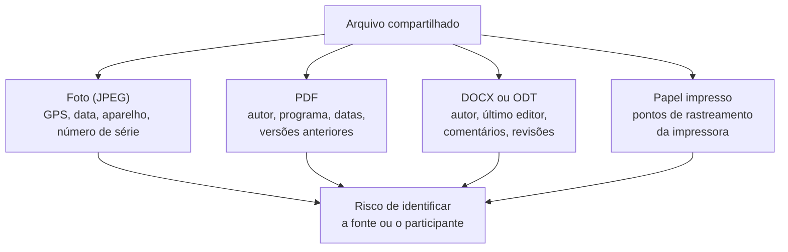

> **Aviso de Idioma:** Este currículo e todos os seus recursos de apoio foram estruturados exclusivamente em **Português (PT-BR)**.

# Aula 4 · Metadados: o que os seus arquivos contam sobre você

**MOD-104 · 10 horas · Apoio:** Autodefesa Contra Vigilância (EFF), "Por que os metadados importam"

## O que você vai aprender

- Definir <abbr title="Metadados: dados sobre dados. Informações que descrevem um conteúdo ou uma comunicação (quem, quando, onde, com que equipamento), sem ser o conteúdo em si.">metadados</abbr> e explicar por que eles podem revelar mais do que o conteúdo.
- Encontrar metadados em fotos (<abbr title="EXIF (Exchangeable Image File Format): padrão que grava dentro das fotos informações como modelo da câmera, data e hora, configurações e, muitas vezes, coordenadas de GPS.">EXIF</abbr>), PDFs e documentos de escritório.
- Ler e remover metadados com ferramentas de terminal e com Python.
- Usar <abbr title="Hash SHA-256: função que gera uma impressão digital de 256 bits de qualquer arquivo. Qualquer alteração no arquivo, por menor que seja, muda completamente o hash.">hash SHA-256</abbr> para provar que um arquivo não foi alterado.
- Aplicar esse conhecimento na proteção de fontes e participantes de pesquisa.

## Pergunta de abertura

> Uma trabalhadora fotografa com o celular um aviso afixado no refeitório da fábrica e o envia, por e-mail, a um pesquisador que estuda condições de trabalho. O pesquisador publica a foto num relatório para mostrar a prática da empresa. O rosto dela não aparece. Ela está protegida?

## 1. Dados sobre dados

Uma carta tem conteúdo (o texto) e metadados (o envelope: remetente, destinatário, carimbo com data e cidade). Uma ligação telefônica tem conteúdo (a conversa) e metadados (quem ligou para quem, quando, por quanto tempo, de onde).

Muita gente acha que os metadados são inofensivos. Pense no que eles revelam sem nenhum conteúdo:

- Você ligou para uma clínica de oncologia, depois para a sua seguradora, depois para um advogado especializado em planos de saúde.
- Você ligou para o disque-denúncia às 23h e depois para um número do Ministério Público.
- O seu celular passou todas as noites de terça num endereço que não é a sua casa.

Em 2014, num debate público na Universidade Johns Hopkins, o general Michael Hayden, que já tinha dirigido a NSA e a CIA, resumiu: "Nós matamos pessoas com base em metadados." Os metadados são estruturados, fáceis de cruzar em massa por computador e difíceis de esconder.

## 2. Metadados nas fotos: EXIF

Quando você tira uma foto, o celular grava dentro do arquivo dezenas de informações:

| Campo EXIF | Exemplo | Risco |
| :--- | :--- | :--- |
| `Make` e `Model` | Samsung, Galaxy A54 | Identifica o aparelho |
| `DateTimeOriginal` | 2026:03:14 07:42:10 | Quando a foto foi tirada |
| `GPSLatitude`, `GPSLongitude` | 3° 43' S, 38° 31' O | **Onde** a foto foi tirada, com precisão de metros |
| `Software` | Versão do sistema ou do editor | Indica o programa usado |
| `BodySerialNumber` | Número de série da câmera | Liga várias fotos ao mesmo equipamento |

Volte à pergunta de abertura. Se o pesquisador publicar a foto original, as coordenadas de GPS podem apontar o lugar exato onde ela estava, a data e a hora mostram o turno, e o modelo do celular, cruzado com a lista de funcionários, pode bastar para identificá-la.

Esse risco não é teórico. Em 2012, uma revista publicou a foto de um empresário norte-americano foragido; o EXIF da imagem continha coordenadas que revelaram em que país ele se escondia. Muitas redes sociais removem o EXIF das fotos publicadas, mas **e-mail, aplicativos de mensagem em modo "documento" e sites próprios geralmente não removem**.

## 3. Metadados nos documentos

### PDFs

Um PDF guarda no seu dicionário de informações campos como `Author`, `Creator` (o programa que gerou o original), `Producer`, `CreationDate` e `ModDate`. Muitos guardam também um bloco <abbr title="XMP (Extensible Metadata Platform): padrão da Adobe para gravar metadados em formato XML dentro de arquivos PDF, imagens e outros.">XMP</abbr> com ainda mais detalhes, e às vezes o histórico de versões anteriores do documento.

### Documentos de escritório

Um arquivo `.docx` (ou `.odt`) é, por dentro, um **arquivo ZIP** com várias peças em XML. Uma delas, `docProps/core.xml`, guarda quem criou o documento, quem o modificou por último, quantas revisões teve e quando. E dentro do próprio texto podem sobrar **comentários** e **alterações controladas** que o autor achou que tinha apagado.

### Documentos impressos

Até o papel tem metadados. Muitas impressoras a laser coloridas imprimem em cada página um padrão de pontinhos amarelos, quase invisíveis, que codifica o número de série da impressora e a data e hora da impressão. Em 2017, a publicação de um documento vazado, digitalizado sem cuidado, deixou esses pontos visíveis e ajudou a identificar quem o havia vazado.



## 4. Inspecionando no terminal

A ferramenta mais completa é o **ExifTool**, software livre que lê e escreve metadados de centenas de formatos:

```bash
exiftool foto.jpg                     # mostra todos os metadados
exiftool -gps:all foto.jpg            # só os de GPS
exiftool -all= -o limpa.jpg foto.jpg  # cria uma cópia sem metadados
pdfinfo relatorio.pdf                 # metadados de um PDF (pacote poppler-utils)
```

## 5. Inspecionando e limpando com Python

Vamos trabalhar com um documento de escritório, porque a biblioteca padrão do Python basta. O exemplo abaixo cria um pequeno arquivo no formato do `.docx` com metadados, lê esses metadados e gera uma cópia limpa.

```python
import hashlib
import io
import re
import zipfile

CORE_ORIGINAL = """<?xml version="1.0" encoding="UTF-8"?>
<cp:coreProperties xmlns:cp="http://schemas.openxmlformats.org/package/2006/metadata/core-properties"
 xmlns:dc="http://purl.org/dc/elements/1.1/" xmlns:dcterms="http://purl.org/dc/terms/">
<dc:creator>Maria da Silva</dc:creator>
<cp:lastModifiedBy>Maria da Silva</cp:lastModifiedBy>
<cp:revision>14</cp:revision>
<dcterms:created>2026-03-14T07:42:10Z</dcterms:created>
</cp:coreProperties>"""


def cria_documento_exemplo():
    buffer = io.BytesIO()
    with zipfile.ZipFile(buffer, "w") as z:
        z.writestr("docProps/core.xml", CORE_ORIGINAL)
        z.writestr("word/document.xml", "<texto>Relato sobre as condições de trabalho</texto>")
    return buffer.getvalue()


def le_metadados(conteudo):
    with zipfile.ZipFile(io.BytesIO(conteudo)) as z:
        core = z.read("docProps/core.xml").decode("utf-8")
    return dict(re.findall(r"<(?:dc|cp|dcterms):(\w+)>([^<]*)<", core))


def limpa_metadados(conteudo):
    entrada = zipfile.ZipFile(io.BytesIO(conteudo))
    saida_buffer = io.BytesIO()
    with zipfile.ZipFile(saida_buffer, "w") as saida:
        for item in entrada.infolist():
            dados = entrada.read(item.filename)
            if item.filename == "docProps/core.xml":
                texto = dados.decode("utf-8")
                texto = re.sub(r"(<(dc|cp|dcterms):(\w+)>)[^<]*(<)", r"\1\4", texto)
                dados = texto.encode("utf-8")
            saida.writestr(item.filename, dados)
    return saida_buffer.getvalue()


def sha256(conteudo):
    return hashlib.sha256(conteudo).hexdigest()


original = cria_documento_exemplo()
limpo = limpa_metadados(original)

print("Antes:", le_metadados(original))
print("Depois:", le_metadados(limpo))
print("SHA-256 original:", sha256(original)[:16], "...")
print("SHA-256 limpo:   ", sha256(limpo)[:16], "...")
```

Três lições do código, que você vai usar no projeto:

1. **Nunca altere o original.** Gere uma cópia limpa e guarde o original num lugar seguro.
2. **Confira depois de limpar.** Leia os metadados da cópia para provar que sumiram.
3. **Registre os hashes.** O SHA-256 do original prova, mais tarde, que você não o modificou; o da cópia identifica exatamente o que foi publicado.

Para fotos, a biblioteca **Pillow** (`pip install Pillow`) permite ler o EXIF e salvar uma cópia sem ele:

```text
from PIL import Image
img = Image.open("foto.jpg")
print(img.getexif())                       # metadados EXIF
limpa = Image.new(img.mode, img.size)
limpa.putdata(list(img.getdata()))         # copia só os pixels
limpa.save("foto_limpa.jpg")
```

## 6. Hash: a impressão digital de um arquivo

Uma **função de hash criptográfica** recebe qualquer quantidade de dados e devolve um número de tamanho fixo (256 bits no SHA-256), com três propriedades:

| Propriedade | Significa |
| :--- | :--- |
| Determinística | O mesmo arquivo gera sempre o mesmo hash |
| Efeito avalanche | Mudar um único bit muda o hash por completo |
| Resistência a colisões | É inviável, na prática, achar dois arquivos diferentes com o mesmo hash |

```python
import hashlib

print(hashlib.sha256(b"Relatorio final").hexdigest())
print(hashlib.sha256(b"Relatorio fina1").hexdigest())   # um caractere diferente
```

No terminal: `sha256sum arquivo.pdf` (Linux) ou `shasum -a 256 arquivo.pdf` (macOS). Jornalistas e arquivistas publicam o hash de documentos para que qualquer pessoa possa verificar que recebeu exatamente o mesmo arquivo. Você vai fazer o mesmo no MOD-301, para cada documento raspado.

## 7. Ética da pesquisa e metadados

A Resolução 510/2016 do Conselho Nacional de Saúde, que regula a ética em pesquisas nas ciências humanas e sociais no Brasil, exige a proteção da identidade dos participantes. E a Lei Geral de Proteção de Dados (LGPD, Lei 13.709/2018) trata a localização e outros dados que identificam uma pessoa como dados pessoais. Remover metadados é uma obrigação ética e legal de quem pesquisa, não um capricho técnico.

## Exercícios

**1.** Responda à pergunta de abertura listando os metadados que poderiam identificar a trabalhadora e o que o pesquisador deveria ter feito.

<details>
<summary>Gabarito comentado</summary>

A foto pode conter GPS (o local exato), data e hora (o turno), modelo e número de série do aparelho. O e-mail tem metadados próprios (endereço de origem, horário, servidor). O pesquisador deveria: (1) remover o EXIF e gerar uma cópia limpa; (2) conferir a cópia; (3) avaliar se o próprio conteúdo da imagem (o tipo de aviso, um detalhe da parede) permite identificar o local e, por ele, a fonte; (4) guardar o original cifrado (aula 5) ou destruí-lo, conforme o acordo com a participante; (5) ter combinado antes um canal mais seguro para o envio.
</details>

**2.** Rode o código da seção 5 e explique por que os hashes do original e do limpo são diferentes.

<details>
<summary>Gabarito</summary>

Porque o conteúdo do arquivo mudou (os campos de metadados foram esvaziados). Qualquer alteração, por menor que seja, gera um hash completamente diferente: é o efeito avalanche.
</details>

**3.** Usando o ExifTool, examine três fotos tiradas pelo seu celular e três fotos baixadas de uma rede social. Monte uma tabela comparando os metadados encontrados.

<details>
<summary>Critérios de correção</summary>

A tabela deve mostrar que as fotos originais do celular costumam ter GPS (se a localização da câmera estiver ativada), data e modelo do aparelho, e que as fotos baixadas de redes sociais geralmente têm os metadados removidos ou reduzidos. A resposta excelente nota que a plataforma removeu os metadados do arquivo público, mas os recebeu no envio e pode tê-los guardado.
</details>

**4.** Estenda a função `le_metadados` para também listar os nomes de todos os arquivos internos do pacote e indicar se existe um arquivo de comentários (`word/comments.xml`).

<details>
<summary>Gabarito</summary>

```python
def inspeciona_pacote(conteudo):
    with zipfile.ZipFile(io.BytesIO(conteudo)) as z:
        nomes = z.namelist()
    return {
        "arquivos": nomes,
        "tem_comentarios": "word/comments.xml" in nomes,
    }
```
</details>

## Resumo da aula

- Metadados são dados sobre dados: quem, quando, onde, com que equipamento. Cruzados em massa, revelam muito.
- Fotos têm EXIF (inclusive GPS); PDFs têm autor, programa e datas; documentos de escritório têm autor, editor, revisões e comentários; até impressões em papel podem ter rastreadores.
- ExifTool, `pdfinfo` e Python permitem inspecionar e remover metadados. Nunca altere o original; confira a cópia.
- O hash SHA-256 é a impressão digital do arquivo e prova a integridade.
- Proteger metadados é obrigação ética (Resolução CNS 510/2016) e legal (LGPD).

## Para ir além

- [Autodefesa Contra Vigilância](https://ssd.eff.org/pt-br), seção sobre metadados.
- Resolução CNS 510/2016, sobre ética em pesquisa nas ciências humanas e sociais.
