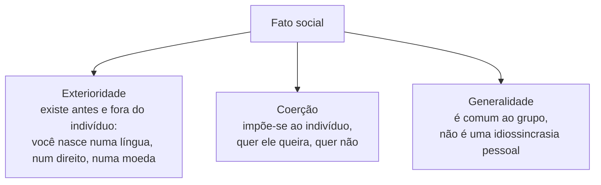

> **Aviso de Idioma:** Este currículo e todos os seus recursos de apoio foram estruturados exclusivamente em **Português (PT-BR)**.

# Aula 1 · O fato social e as regras do método

**MOD-105 · 10 horas · Leitura principal:** Durkheim, *As Regras do Método Sociológico* (1895), Prefácio da segunda edição, capítulo I ("O que é um fato social?") e capítulo II ("Regras relativas à observação dos fatos sociais")

## O que você vai aprender

- Situar Durkheim na França da Terceira República e no projeto de uma ciência da sociedade.
- Definir <abbr title="Fato social: para Durkheim, toda maneira de agir, pensar e sentir que é exterior ao indivíduo, exerce sobre ele uma coerção e é geral na sociedade. Exemplos: a língua, o direito, a moeda, a moda.">fato social</abbr> pelas três características: exterioridade, coerção e generalidade.
- Explicar a regra de "tratar os fatos sociais como coisas" e o que ela pede ao pesquisador.
- Distinguir o normal do patológico segundo Durkheim.
- Usar o conceito para pensar regras sociais que operam por meio de sistemas digitais.

## Pergunta de abertura

> Ninguém lhe obrigou a falar português, a usar o real como moeda ou a cumprimentar as pessoas de certo jeito. Ainda assim, experimente pagar o pão com outra moeda, responder a uma entrevista de emprego em outra língua ou cumprimentar o seu chefe como cumprimenta um amigo íntimo. O que acontece? De onde vem essa força?

## 1. Uma ciência para a República

Émile Durkheim nasceu em 1858 em Épinal, na Lorena, filho e neto de rabinos. Escolheu outro caminho: estudou na Escola Normal Superior de Paris e dedicou a vida a fundar uma ciência da sociedade. Em 1887 começou a lecionar ciência social na Universidade de Bordeaux; em 1902 foi para a Sorbonne. Em 1898 fundou a revista *L'Année Sociologique*, que formou uma escola inteira, inclusive o seu sobrinho, Marcel Mauss.

O contexto importa. A França da Terceira República (1870 a 1940) vivia a derrota para a Prússia, a Comuna de Paris (que você verá no MOD-107), o caso Dreyfus e a separação entre Igreja e Estado (1905). Os republicanos procuravam uma moral laica capaz de manter a sociedade unida sem a religião tradicional. Durkheim queria que a sociologia oferecesse essa base, com rigor científico. A pergunta que atravessa a sua obra é: **o que mantém uma sociedade unida?**

## 2. O que é um fato social

Durkheim precisava mostrar que a sociologia tinha um objeto próprio, diferente do da psicologia (o indivíduo) e do da biologia (o organismo). Esse objeto é o **fato social**, que se reconhece por três características:

**Exterioridade.** As regras do direito, os costumes, a língua, o sistema monetário existiam antes de você nascer e continuarão depois. Você não os inventou; encontrou-os prontos.

**Coerção.** Esses modos de agir se impõem. Às vezes a coerção é explícita (a multa, a prisão); às vezes é difusa (o riso, o olhar de reprovação, o isolamento). Durkheim observa que muitas vezes não sentimos a coerção porque nos conformamos a ela; ela se revela quando tentamos resistir. Responda agora à pergunta de abertura: a força que você sente é a coerção do fato social.

**Generalidade.** Um fato social é geral **porque** é coletivo, e não coletivo porque é geral. Não é a soma de comportamentos individuais parecidos; é uma maneira de agir que pertence ao grupo e por isso aparece em cada indivíduo.

A definição final do capítulo I:

> "É fato social toda maneira de fazer, fixada ou não, suscetível de exercer sobre o indivíduo uma coerção exterior; ou ainda, que é geral na extensão de uma sociedade dada, tendo ao mesmo tempo uma existência própria, independente das suas manifestações individuais." (tradução livre)

## 3. Tratar os fatos sociais como coisas

A regra mais famosa (e mais mal entendida) do livro é: **"considerar os fatos sociais como coisas"**. Durkheim não diz que os fatos sociais são objetos materiais. Diz que o pesquisador deve abordá-los **como se** fossem coisas desconhecidas, que precisam ser observadas de fora, e não como ideias que já conhecemos por introspecção.

Na prática, a regra se desdobra em três exigências:

| Exigência | O que significa | Exemplo |
| :--- | :--- | :--- |
| **Afastar as pré-noções** | Desconfiar das ideias do senso comum sobre o objeto | Não começar o estudo da família pela ideia que temos do que uma família "deve ser" |
| **Definir pelo observável** | Definir o objeto por características exteriores e verificáveis | Definir o crime como todo ato que provoca uma pena, e não como "ato imoral" |
| **Buscar indicadores objetivos** | Estudar o fato onde ele se cristaliza: leis, estatísticas, regras escritas | Estudar a solidariedade pelo tipo de direito (aula 2) e a integração social pelas taxas de suicídio (aula 3) |

Essa terceira exigência é o ancestral direto de tudo o que você vai fazer no Ciclo 3: medir fenômenos sociais por meio de registros públicos.

## 4. O normal e o patológico

O capítulo III propõe uma distinção polêmica. Um fato social é **normal** quando é geral numa sociedade de certo tipo, num certo estágio de desenvolvimento; é **patológico** quando foge a essa média.

A consequência mais provocadora: **o crime é normal**. Não existe sociedade sem crime. Uma sociedade sem nenhum crime seria uma sociedade em que a consciência coletiva fosse tão forte que nenhuma divergência seria possível, e isso impediria também a inovação moral. Durkheim lembra Sócrates (MOD-101, aula 1): pelo direito ateniense, ele era um criminoso, e o seu "crime" (a independência de pensamento) preparou uma moral nova.

Isso não quer dizer que o crime seja bom, mas que a sua existência, numa certa taxa, faz parte do funcionamento normal da sociedade. O patológico é uma taxa anormalmente alta, ou uma forma que não corresponde ao tipo de sociedade.

## 5. Uma leitura crítica

Durkheim deu à sociologia um objeto e um método. Mas a sua abordagem tem limites que os outros autores do curso vão apontar:

- **O peso da ordem:** a pergunta "o que mantém a sociedade unida?" tende a ver o conflito como desvio. Marx partia da pergunta oposta: que conflitos movem a sociedade?
- **O critério da média:** chamar de "normal" o que é geral pode naturalizar situações injustas, mas generalizadas (como o racismo estrutural que Florestan Fernandes analisará no MOD-206).
- **O sentido da ação:** tratar fatos sociais como coisas deixa de lado o sentido que as pessoas dão ao que fazem. Weber vai propor o caminho inverso (aula 5).

> **Conexão com a computação:** os sistemas digitais criaram novos fatos sociais no sentido exato de Durkheim. A nota mínima exigida por um aplicativo de transporte, o limite de caracteres de uma rede social, o formato obrigatório de um formulário do gov.br: são maneiras de agir **exteriores** (você não as escolheu), **coercitivas** (quem não se conforma é bloqueado ou não consegue o serviço) e **gerais** (valem para todos os usuários). A diferença é que a coerção é executada automaticamente pelo código, sem o olhar de reprovação: é a coerção que não precisa de ninguém para se exercer.

## Leitura guiada

1. **Prefácio da segunda edição** (cerca de 10 páginas): Durkheim responde aos críticos e explica o que quis dizer com "coisa".
2. **Capítulo I** (cerca de 12 páginas): o que é um fato social. Copie a definição final e dê três exemplos seus.
3. **Capítulo II** (cerca de 20 páginas): as regras de observação. Anote cada regra com um exemplo.
4. **Capítulo III, parte sobre o crime** (cerca de 8 páginas): o crime como fato normal.

## Exercícios

**1.** Mostre que a obrigação de ter CPF para quase tudo no Brasil é um fato social, aplicando as três características.

Gabarito comentado

Exterioridade: o sistema de CPF existia antes de cada pessoa e não depende da vontade de nenhuma. Coerção: sem CPF, não se abre conta, não se recebe salário formal nem benefício social, não se compra pela internet; a coerção é difusa (exclusão) e às vezes explícita. Generalidade: vale para toda a população, como regra coletiva. Uma resposta excelente nota que a coerção é exercida cada vez mais por sistemas automáticos que simplesmente recusam o cadastro.

**2.** Por que "tratar os fatos sociais como coisas" não significa dizer que eles são objetos materiais?

Gabarito comentado

Porque a regra é de método, e não uma afirmação sobre a natureza do fato. Ela pede ao pesquisador que se aproxime do objeto como de algo desconhecido, que precisa ser observado de fora, sem confiar nas suas próprias ideias prévias. É uma atitude de distanciamento: tratar o casamento, a religião ou o crime como algo que se estuda a partir de indicadores, e não a partir do que o pesquisador acha que eles são.

**3.** Explique por que, para Durkheim, o crime é um fato normal. Você concorda? Justifique.

Gabarito comentado

Porque está presente em todas as sociedades conhecidas e porque uma sociedade sem nenhum crime exigiria uma uniformidade de consciências que impediria qualquer mudança moral. Uma resposta crítica pode discordar mostrando que o que conta como crime é definido por quem faz as leis (o "crime" de vadiagem, usado no Brasil pós-abolição contra a população negra, é um exemplo) e que a normalidade estatística pode esconder relações de poder.

**4.** Escolha um fenômeno social que lhe interesse e proponha uma definição "pelo observável" e dois indicadores objetivos para medi-lo com dados públicos brasileiros.

Critérios de correção

A definição deve se basear em características exteriores e verificáveis, e não em juízos de valor. Os indicadores devem existir de fato em bases públicas (IBGE, DataSUS, TSE, INEP, Portal da Transparência), com o nome da base. Exemplo: "evasão escolar" definida como a não matrícula no ano seguinte de um aluno matriculado, medida pelos indicadores de fluxo do Censo Escolar do INEP.

## Resumo da aula

- Durkheim quer uma ciência da sociedade que dê à República uma moral laica; a sua pergunta é o que mantém a sociedade unida.
- Fato social: maneira de agir, pensar e sentir exterior, coercitiva e geral.
- Tratar os fatos sociais como coisas: afastar pré-noções, definir pelo observável, buscar indicadores objetivos.
- Normal é o que é geral num tipo de sociedade; o crime, numa certa taxa, é normal.
- O método tem limites: tende a ver o conflito como desvio e deixa de lado o sentido da ação.

## Para ir além

- Tania Quintaneiro e outras, *Um Toque de Clássicos*, capítulo sobre Durkheim.
- Marcel Mauss, *Ensaio sobre a Dádiva* (1925), a obra mais célebre do discípulo de Durkheim.
