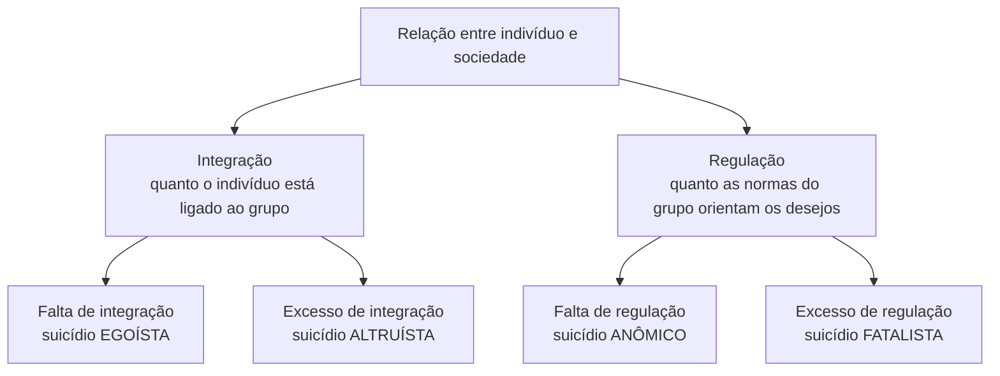

> **Aviso de Idioma:** Este currículo e todos os seus recursos de apoio foram estruturados exclusivamente em **Português (PT-BR)**.

# Aula 3 · *O Suicídio*: estatística e anomia

**MOD-105 · 10 horas · Leitura principal:** Durkheim, *O Suicídio* (1897), Introdução e livro II (capítulos 2 a 5)

> **Cuidado com o tema.** Esta aula trata de suicídio como fenômeno social, com dados agregados. Se você ou alguém próximo estiver em sofrimento, procure ajuda: o Centro de Valorização da Vida (CVV) atende de graça, 24 horas, pelo telefone **188** e pelo site [cvv.org.br](https://cvv.org.br/).

## O que você vai aprender

- Explicar por que Durkheim escolheu o suicídio, o ato aparentemente mais individual, para provar a existência dos fatos sociais.
- Calcular e comparar <abbr title="Taxa padronizada: número de casos dividido pela população do grupo, multiplicado por uma base fixa (por exemplo, por 100 mil habitantes). Permite comparar grupos de tamanhos diferentes.">taxas padronizadas</abbr>.
- Explicar a tipologia de Durkheim (egoísta, altruísta, anômico, fatalista) a partir de dois eixos: <abbr title="Integração social: o grau em que os indivíduos estão ligados a um grupo, participam da sua vida e partilham as suas crenças.">integração</abbr> e <abbr title="Regulação social: o grau em que as normas do grupo limitam e orientam os desejos e as ações dos indivíduos.">regulação</abbr>.
- Definir anomia e explicar o suicídio anômico.
- Reconhecer a <abbr title="Falácia ecológica: erro de tirar conclusões sobre indivíduos a partir de dados agregados de grupos. Uma correlação entre regiões não prova que a mesma relação valha para as pessoas.">falácia ecológica</abbr> e outros limites do uso de dados agregados.

## Pergunta de abertura

> Se o suicídio dependesse só de causas individuais (doenças, desilusões, tragédias pessoais), as taxas de cada país deveriam variar ao acaso de um ano para outro. Mas Durkheim observou que elas são notavelmente estáveis ano após ano e diferem de modo constante entre países, religiões e estados civis. O que essa estabilidade sugere?

## 1. O desafio

Em 1897, Durkheim escolheu provar a força da sociologia com o caso mais difícil: o suicídio, o ato que parece o mais solitário e pessoal de todos. Se até o suicídio tiver causas sociais, a existência dos fatos sociais estará demonstrada.

A distinção decisiva: Durkheim não estuda **os suicídios** (cada caso, com os seus motivos, que cabe à psicologia e à medicina), mas a **taxa de suicídio** de uma sociedade, que é um fato social. A taxa é estável, é própria de cada grupo e muda junto com as transformações sociais. Ela expressa uma tendência coletiva.

## 2. O método: taxas e comparações

Durkheim reuniu estatísticas oficiais de vários países europeus e as comparou sistematicamente. O primeiro passo é sempre transformar números absolutos em **taxas**, porque grupos têm tamanhos diferentes.

```python
def taxa_por_100_mil(casos, populacao):
    return casos / populacao * 100_000


# Dados didáticos (fictícios), só para ilustrar o método
grupos = {
    "Região A": (120, 1_500_000),
    "Região B": (300, 6_000_000),
    "Região C": (45, 300_000),
}

for nome, (casos, pop) in grupos.items():
    print(f"{nome}: {casos:4d} casos, taxa = {taxa_por_100_mil(casos, pop):5.1f} por 100 mil")
```

A Região B tem mais casos, mas a menor taxa; a Região C tem menos casos e a maior taxa. Sem padronizar, a conclusão seria o inverso da verdade. É a primeira lição de quem trabalha com dados sociais.

Em seguida, Durkheim **elimina explicações concorrentes**. No livro I, testa e descarta as explicações da época: doença mental (as taxas não acompanham as de internação), raça e hereditariedade (as taxas mudam quando os grupos migram), clima e estações do ano (a variação acompanha o ritmo da vida social, não a temperatura) e imitação. Restam as causas sociais.

## 3. Integração e regulação

No livro II, Durkheim compara grupos e encontra regularidades. Entre elas:

- Protestantes se suicidavam mais que católicos, e católicos mais que judeus.
- Solteiros mais que casados; casados sem filhos mais que casados com filhos.
- Em tempos de guerra ou de grande comoção política nacional, as taxas caíam.
- Em crises econômicas, e também em períodos de prosperidade súbita, as taxas subiam.
- Militares se suicidavam mais que civis da mesma idade.

Para explicar essas regularidades, Durkheim usa duas dimensões da relação entre indivíduo e sociedade: a **integração** (quanto o indivíduo está ligado ao grupo) e a **regulação** (quanto as normas do grupo orientam os seus desejos). O excesso e a falta de cada uma produzem um tipo de suicídio.



Em detalhe:

| Eixo | Falta | Excesso |
| :--- | :--- | :--- |
| **Integração** | **Egoísta**: o indivíduo está isolado, desligado dos grupos (família, religião, comunidade política) que dariam sentido à vida | **Altruísta**: o indivíduo está tão absorvido pelo grupo que a sua vida perde valor próprio (o caso do militar, de certas tradições de honra) |
| **Regulação** | **Anômico**: as normas que limitam os desejos se desfazem; as aspirações ficam sem limite e sem orientação | **Fatalista**: a regulação é opressiva, o futuro está bloqueado (Durkheim cita o caso de pessoas escravizadas, numa nota curta) |

### Por que protestantes e católicos?

A explicação de Durkheim não é teológica: as duas religiões condenam o suicídio igualmente. A diferença está na **integração**. O protestantismo valoriza o livre exame individual da Bíblia e tem menos crenças e práticas comuns obrigatórias; a comunidade católica é mais integrada por rituais e dogmas partilhados. A comunidade judaica, minoritária e perseguida na Europa, era fortemente integrada. É o suicídio egoísta em diferentes graus.

## 4. A anomia

O conceito mais influente do livro é a **anomia**. Durkheim parte de uma ideia sobre a natureza humana: os desejos humanos, ao contrário das necessidades animais, não têm limite natural. Quanto mais se tem, mais se quer. Só uma força **moral e social** pode estabelecer limites razoáveis às aspirações de cada um, dizendo o que é legítimo esperar.

Quando essa regulação se desfaz bruscamente, as aspirações ficam sem medida, e o resultado é a angústia e a frustração permanentes. Por isso as taxas sobem não só nas crises econômicas (quando as pessoas perdem o lugar a que estavam acostumadas), mas também nas **prosperidades súbitas** (quando o limite do que é possível desejar desaparece).

Durkheim identifica no mundo econômico moderno uma **anomia crônica**: o comércio e a indústria se libertaram de toda regulação moral, e a "sede do infinito" passou a ser apresentada como virtude.

## 5. Os limites do método

*O Suicídio* é um clássico e também um ótimo laboratório de erros possíveis no uso de dados. Leia-o com olhos críticos:

| Problema | Descrição | Lição para o Ciclo 3 |
| :--- | :--- | :--- |
| **Falácia ecológica** | Durkheim compara regiões protestantes e católicas. Que a região protestante tenha taxa maior não prova que sejam os protestantes, individualmente, que se suicidam mais | Correlação entre agregados não é relação entre indivíduos |
| **Qualidade dos registros** | As estatísticas oficiais dependem de quem registra; o estigma religioso podia levar famílias católicas a esconder suicídios | Todo dado público tem um processo social de produção que precisa ser examinado |
| **Variáveis confundidas** | Religião, região, urbanização e escolaridade variavam juntas | É preciso controlar outras variáveis antes de atribuir causa |
| **O sentido da ação** | As taxas não dizem o que o ato significou para quem o praticou | Weber (aula 5) e as abordagens qualitativas complementam a estatística |

## Leitura guiada

1. **Introdução** (cerca de 15 páginas): a definição de suicídio e a distinção entre os casos e a taxa.
2. **Livro II, capítulos 2 e 3** (cerca de 50 páginas): o suicídio egoísta. Anote as tabelas de Durkheim e a interpretação de cada uma.
3. **Livro II, capítulo 4** (cerca de 25 páginas): o suicídio altruísta.
4. **Livro II, capítulo 5** (cerca de 30 páginas): o suicídio anômico. Copie a passagem sobre a ausência de limites naturais para os desejos.

## Exercícios

**1.** Por que Durkheim trabalha com taxas, e não com números absolutos de casos? Mostre com um exemplo numérico.

<details>
<summary>Gabarito comentado</summary>

Porque grupos têm tamanhos diferentes, e números absolutos refletem sobretudo o tamanho da população. Exemplo do código da aula: a Região B tem 300 casos em 6 milhões (5 por 100 mil) e a Região C tem 45 casos em 300 mil (15 por 100 mil). A Região C, com menos casos, tem a taxa três vezes maior. Comparar números absolutos levaria à conclusão oposta à correta.
</details>

**2.** Classifique cada situação no tipo de suicídio correspondente, segundo a teoria de Durkheim (os exemplos são do próprio livro ou baseados nele): (a) a taxa sobe entre pessoas que enriqueceram de repente; (b) a taxa é mais alta entre solteiros sem vínculos comunitários; (c) a taxa é mais alta entre militares de carreira; (d) a taxa sobe numa crise econômica que derruba as pessoas do seu padrão de vida.

<details>
<summary>Gabarito</summary>

(a) Anômico (desregulação por prosperidade súbita). (b) Egoísta (falta de integração). (c) Altruísta (integração excessiva ao grupo militar). (d) Anômico (desregulação por crise).
</details>

**3.** Explique a falácia ecológica com um exemplo que não seja o da religião.

<details>
<summary>Gabarito comentado</summary>

Exemplo: municípios com maior proporção de idosos votaram mais num certo candidato. Isso não prova que os idosos votaram nele; pode ser que, nesses municípios, os jovens tenham votado nele em massa por razões locais. Para saber como os idosos votaram, seria preciso um dado individual (uma pesquisa de opinião, por exemplo). Dados por município só autorizam conclusões sobre municípios.
</details>

**4.** Durkheim fala de "anomia crônica" no mundo econômico. Escreva um parágrafo relacionando esse diagnóstico com a cultura das redes sociais e da comparação permanente com vidas exibidas.

<details>
<summary>Critérios de correção</summary>

A resposta deve definir anomia como desregulação dos desejos, ligar a exposição constante a padrões de consumo e sucesso à ausência de limites legítimos para as aspirações, e tratar o tema com cuidado (sem sugerir causalidade simples entre redes sociais e suicídio, o que os dados não permitem afirmar). A melhor resposta lembra os limites metodológicos da seção 5.
</details>

## Resumo da aula

- Durkheim estuda a taxa de suicídio, que é estável e própria de cada grupo, como fato social.
- O método compara taxas padronizadas e elimina explicações concorrentes.
- Integração e regulação, por falta ou excesso, geram quatro tipos: egoísta, altruísta, anômico e fatalista.
- Anomia: a desregulação dos desejos, que não têm limite natural. O mundo econômico moderno vive uma anomia crônica.
- O livro é também um laboratório de limites: falácia ecológica, qualidade dos registros, variáveis confundidas e ausência do sentido da ação.

## Para ir além

- Dados do Sistema de Informações sobre Mortalidade (SIM/DataSUS), para o projeto do módulo, com o cuidado ético indicado no guia.
- No MOD-207, você vai estudar como controlar variáveis e evitar a falácia ecológica.
