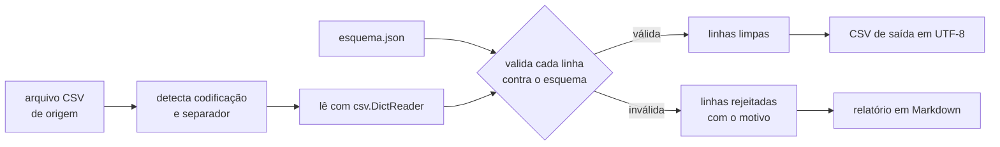

> **Aviso de Idioma:** Este currículo e todos os seus recursos de apoio foram estruturados exclusivamente em **Português (PT-BR)**.

# Aula 4 · Arquivos de dados: CSV, JSON e codificações

**MOD-106 · 10 horas · Apoio:** Tutorial de Python, seção 7; documentação dos módulos `csv`, `json` e `pathlib`

## O que você vai aprender

- Abrir arquivos com segurança, sempre declarando a codificação.
- Ler e escrever <abbr title="CSV (Comma-Separated Values): formato de tabela em texto puro, uma linha por registro, com os campos separados por vírgula ou, nos dados brasileiros, muitas vezes por ponto e vírgula.">CSV</abbr> com o módulo `csv`, inclusive com ponto e vírgula e campos com aspas.
- Ler e escrever <abbr title="JSON (JavaScript Object Notation): formato de texto para dados estruturados, com objetos (chave e valor), listas, textos, números e booleanos. É o formato padrão das APIs da Web.">JSON</abbr>.
- Usar `pathlib` para trabalhar com caminhos de arquivos em qualquer sistema.
- Escrever uma função que detecta a codificação de um arquivo de dados públicos.
- Gerar um relatório em Markdown a partir de dados.

## Pergunta de abertura

> Por que um arquivo baixado de um portal do governo abre com acentos estragados no seu programa, mas perfeito no editor de planilhas da repartição? E por que, ao abrir em outra planilha, todas as colunas aparecem juntas numa só?

## 1. Abrir arquivos: sempre com codificação

```python
from pathlib import Path

caminho = Path("exemplo.txt")
caminho.write_text("Relatório de Conceição do Coité\n", encoding="utf-8")

with open(caminho, encoding="utf-8") as arquivo:
    for linha in arquivo:
        print(linha.strip())
```

Duas boas práticas nesse código:

- **`with`** garante que o arquivo será fechado mesmo se ocorrer um erro no meio.
- **`encoding="utf-8"`** declara a codificação. Se você não declarar, o Python usa o padrão do sistema operacional, que no Windows muitas vezes **não** é UTF-8. Um programa que funciona no seu Linux quebra no Windows de uma colega. Declare sempre.

Responda à primeira parte da pergunta de abertura (com a aula 1 do MOD-102): o arquivo provavelmente foi gravado em Latin-1 ou Windows-1252, e o seu programa o leu como UTF-8, ou o contrário.

## 2. Detectando a codificação

Não há como saber com certeza a codificação de um arquivo só olhando os bytes, mas há uma heurística que resolve quase todos os casos brasileiros: **UTF-8 é exigente** (sequências de bytes inválidas geram erro), enquanto Latin-1 aceita qualquer byte. Então tentamos UTF-8 primeiro; se der erro, usamos Latin-1.

```python
from pathlib import Path

def detecta_codificacao(caminho, candidatas=("utf-8-sig", "utf-8", "cp1252", "latin-1")):
    """Devolve a primeira codificação que decodifica o arquivo sem erro."""
    dados = Path(caminho).read_bytes()
    for cod in candidatas:
        try:
            dados.decode(cod)
            return cod
        except UnicodeDecodeError:
            continue
    raise ValueError(f"nenhuma codificação candidata funcionou para {caminho}")


Path("antigo.csv").write_bytes("município;uf\nSão João;PB\n".encode("latin-1"))
Path("novo.csv").write_text("município;uf\nSão João;PB\n", encoding="utf-8")
print(detecta_codificacao("antigo.csv"))   # cp1252
print(detecta_codificacao("novo.csv"))     # utf-8-sig
```

Por que `utf-8-sig` primeiro? Muitos programas do Windows gravam no início de arquivos UTF-8 três bytes invisíveis (a "marca de ordem de bytes", ou BOM). O `utf-8-sig` lê UTF-8 normal e também remove essa marca se ela existir; sem isso, o nome da primeira coluna vem com um caractere fantasma. E `cp1252` antes de `latin-1` porque o Windows-1252 é o que a maioria dos sistemas brasileiros antigos realmente usou.

## 3. CSV: o formato dos dados públicos

Um CSV parece simples, mas tem armadilhas. Os dados abertos brasileiros costumam usar **ponto e vírgula** como separador, porque a vírgula é o separador decimal em português. Responda à segunda parte da pergunta de abertura: o programa esperava vírgula e encontrou ponto e vírgula, então juntou tudo numa coluna.

Nunca leia CSV com `linha.split(";")`: um campo pode conter o próprio separador entre aspas (`"Silva; Souza"`) ou uma quebra de linha. Use o módulo `csv`.

```python
import csv
from pathlib import Path

conteudo = '''codigo;municipio;uf;populacao
2307304;Juazeiro do Norte;CE;286120
2304202;Crato;CE;131050
2611606;"Recife; capital";PE;1488920
'''
Path("municipios.csv").write_text(conteudo, encoding="utf-8")

with open("municipios.csv", encoding="utf-8", newline="") as arquivo:
    leitor = csv.DictReader(arquivo, delimiter=";")
    for linha in leitor:
        print(linha["municipio"], "→", int(linha["populacao"]))
```

O `DictReader` transforma cada linha num **dicionário** cujas chaves são os nomes das colunas (aula 2). O `newline=""` é exigido pela documentação do módulo `csv` para tratar corretamente quebras de linha dentro de campos.

Para escrever:

```python
import csv

linhas = [
    {"municipio": "Juazeiro do Norte", "uf": "CE", "taxa": 1.5},
    {"municipio": "Crato", "uf": "CE", "taxa": 2.1},
]
with open("saida.csv", "w", encoding="utf-8", newline="") as arquivo:
    escritor = csv.DictWriter(arquivo, fieldnames=["municipio", "uf", "taxa"], delimiter=";")
    escritor.writeheader()
    escritor.writerows(linhas)

print(open("saida.csv", encoding="utf-8").read())
```

### Detectando o separador

O módulo `csv` tem um "farejador" que tenta adivinhar o separador a partir de uma amostra:

```python
import csv

amostra = "codigo;municipio;uf\n2307304;Juazeiro do Norte;CE\n"
dialeto = csv.Sniffer().sniff(amostra, delimiters=";,\t|")
print(repr(dialeto.delimiter))   # ';'
```

## 4. JSON: dados estruturados

JSON é o formato das APIs da Web (você vai usá-lo muito no MOD-202 e no MOD-301) e dos arquivos de configuração. Ele mapeia quase diretamente para os tipos do Python:

| JSON | Python |
| :--- | :--- |
| objeto `{"a": 1}` | `dict` |
| lista `[1, 2]` | `list` |
| texto `"abc"` | `str` |
| número `1.5` | `int` ou `float` |
| `true`, `false` | `True`, `False` |
| `null` | `None` |

```python
import json
from pathlib import Path

esquema = {
    "colunas_obrigatorias": ["codigo", "municipio", "uf", "populacao"],
    "tipos": {"populacao": "int"},
    "valores_permitidos": {"uf": ["CE", "PE", "BA"]},
}

Path("esquema.json").write_text(json.dumps(esquema, ensure_ascii=False, indent=2), encoding="utf-8")
lido = json.loads(Path("esquema.json").read_text(encoding="utf-8"))
print(lido["valores_permitidos"]["uf"])
```

O `ensure_ascii=False` grava os acentos como são, em vez de códigos como `ã`, e o `indent=2` deixa o arquivo legível para humanos.

## 5. Juntando tudo: um validador simples



```python
import csv
from pathlib import Path

def valida_linha(linha, esquema):
    """Devolve a lista de problemas encontrados numa linha (vazia se estiver tudo certo)."""
    problemas = []
    for coluna in esquema["colunas_obrigatorias"]:
        if not (linha.get(coluna) or "").strip():
            problemas.append(f"coluna '{coluna}' vazia")
    for coluna, tipo in esquema["tipos"].items():
        valor = (linha.get(coluna) or "").strip()
        if tipo == "int" and valor and not valor.isdigit():
            problemas.append(f"'{coluna}' não é inteiro: {valor!r}")
    for coluna, permitidos in esquema["valores_permitidos"].items():
        if linha.get(coluna) not in permitidos:
            problemas.append(f"'{coluna}' fora dos valores permitidos: {linha.get(coluna)!r}")
    return problemas


esquema = {
    "colunas_obrigatorias": ["codigo", "municipio", "uf", "populacao"],
    "tipos": {"populacao": "int"},
    "valores_permitidos": {"uf": ["CE", "PE", "BA"]},
}
Path("entrada.csv").write_text(
    "codigo;municipio;uf;populacao\n"
    "2307304;Juazeiro do Norte;CE;286120\n"
    "2304202;Crato;CE;cento e trinta mil\n"
    "9999999;;SP;100\n",
    encoding="utf-8",
)

validas, rejeitadas = [], []
with open("entrada.csv", encoding="utf-8", newline="") as arquivo:
    for numero, linha in enumerate(csv.DictReader(arquivo, delimiter=";"), start=2):
        problemas = valida_linha(linha, esquema)
        if problemas:
            rejeitadas.append((numero, problemas))
        else:
            validas.append(linha)

relatorio = ["# Relatório de validação", "", f"- Linhas válidas: {len(validas)}",
             f"- Linhas rejeitadas: {len(rejeitadas)}", "", "| Linha | Problemas |", "| ---: | :--- |"]
for numero, problemas in rejeitadas:
    relatorio.append(f"| {numero} | {'; '.join(problemas)} |")
Path("relatorio.md").write_text("\n".join(relatorio) + "\n", encoding="utf-8")
print(Path("relatorio.md").read_text(encoding="utf-8"))
```

Repare no `enumerate(..., start=2)`: a linha 1 do arquivo é o cabeçalho, então a primeira linha de dados é a 2. O relatório aponta o número **da linha no arquivo original**, para que alguém possa abrir e conferir. Um relatório de validação que não permite localizar o erro não serve para nada.

Esse é o núcleo do projeto do módulo. Falta transformá-lo em módulos, acrescentar a detecção de codificação e separador, a linha de comando e as correções automáticas.

## Exercícios

**1.** Por que nunca se deve ler um CSV com `linha.split(";")`?

<details>
<summary>Gabarito</summary>

Porque campos podem conter o separador entre aspas (`"Silva; Souza"`) ou quebras de linha. O `split` cortaria esses campos no lugar errado e desalinharia todas as colunas. O módulo `csv` trata essas regras do formato corretamente.
</details>

**2.** Baixe um CSV real de dados abertos (por exemplo, do Portal Brasileiro de Dados Abertos, dados.gov.br, ou do repositório de dados eleitorais do TSE). Descubra a codificação e o separador usando as funções da aula. Registre o resultado.

<details>
<summary>Critérios de correção</summary>

A resposta deve informar a fonte exata (endereço e nome do arquivo), a codificação detectada, o separador e as primeiras três linhas lidas corretamente, com os acentos certos. Muitos arquivos do TSE, por exemplo, usam `latin-1` (ou `cp1252`) e ponto e vírgula, com campos entre aspas.
</details>

**3.** Estenda `valida_linha` para aceitar um tipo `"float_br"`, que valida números no formato brasileiro (`1.234,56`), reutilizando a função `para_numero` da aula 3.

<details>
<summary>Gabarito</summary>

```python
def eh_float_br(valor):
    try:
        float(valor.strip().replace(".", "").replace(",", "."))
        return True
    except ValueError:
        return False

# dentro de valida_linha, no laço dos tipos:
#     if tipo == "float_br" and valor and not eh_float_br(valor):
#         problemas.append(f"'{coluna}' não é número: {valor!r}")
```
</details>

**4.** Escreva uma função que converta um CSV em Latin-1 com ponto e vírgula num JSON em UTF-8, com uma lista de objetos.

<details>
<summary>Gabarito</summary>

```python
import csv
import json

def csv_para_json(origem, destino, codificacao="latin-1", separador=";"):
    with open(origem, encoding=codificacao, newline="") as arquivo:
        dados = list(csv.DictReader(arquivo, delimiter=separador))
    with open(destino, "w", encoding="utf-8") as saida:
        json.dump(dados, saida, ensure_ascii=False, indent=2)
    return len(dados)
```
</details>

## Resumo da aula

- Abra arquivos com `with` e declare sempre a codificação.
- Detecte a codificação tentando `utf-8-sig`, `utf-8`, `cp1252` e `latin-1`, nessa ordem.
- Use o módulo `csv` (com `delimiter=";"` para dados brasileiros e `newline=""`), nunca `split`.
- JSON mapeia para dicionários e listas; use `ensure_ascii=False` e `indent=2`.
- Um bom validador separa linhas válidas e rejeitadas e aponta o número da linha original e o motivo.

## Para ir além

- [Documentação do módulo csv](https://docs.python.org/pt-br/3/library/csv.html) e do [módulo json](https://docs.python.org/pt-br/3/library/json.html).
- [Portal Brasileiro de Dados Abertos](https://dados.gov.br/).
