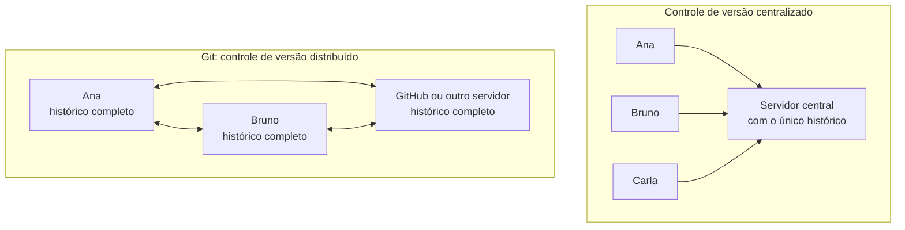
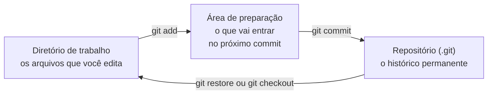
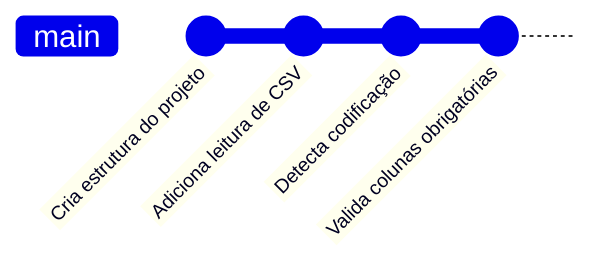

> **Aviso de Idioma:** Este currículo e todos os seus recursos de apoio foram estruturados exclusivamente em **Português (PT-BR)**.

# Aula 5 · Git: o histórico do seu trabalho

**MOD-106 · 10 horas · Apoio:** [Pro Git em português](https://git-scm.com/book/pt-br/v2), capítulos 1 e 2

## O que você vai aprender

- Explicar o que é <abbr title="Controle de versão: sistema que registra as mudanças de um conjunto de arquivos ao longo do tempo, permitindo voltar a qualquer versão anterior, comparar versões e trabalhar em equipe.">controle de versão</abbr> e por que ele é útil também para quem escreve textos.
- Contar a origem do Git e a sua relação com o software livre.
- Entender o modelo mental do Git: diretório de trabalho, <abbr title="Área de preparação (staging): etapa intermediária do Git onde você escolhe quais mudanças vão entrar no próximo commit.">área de preparação</abbr> e repositório.
- Criar um repositório, fazer <abbr title="Commit: registro permanente de um conjunto de mudanças no repositório, com autor, data, mensagem e um identificador único (hash).">commits</abbr>, ver o histórico e comparar versões.
- Escrever boas mensagens de commit em português e usar o `.gitignore`.

## Pergunta de abertura

> Quantos arquivos com nomes como `ensaio_final.docx`, `ensaio_final_v2.docx`, `ensaio_final_AGORA_VAI.docx` e `ensaio_final_revisado_orientador.docx` você já teve? Qual era a versão certa? O que mudou de uma para outra?

## 1. Por que controle de versão

O problema da pergunta de abertura tem uma solução que os programadores usam há décadas: um sistema que **registra cada mudança**, com quem a fez, quando e por quê, e permite voltar a qualquer ponto. Isso serve para código e serve igualmente para fichamentos, ensaios, dados e a monografia final do curso. A partir desta aula, **todo o seu trabalho no curso deve estar num repositório Git**.

## 2. Uma história de software livre


*Linus Torvalds na LinuxCon Europe de 2014. Foto de Krd, CC BY-SA 3.0.*

O núcleo do sistema operacional **Linux**, criado em 1991 pelo estudante finlandês Linus Torvalds, é desenvolvido por milhares de pessoas no mundo todo. Durante alguns anos, o projeto usou um sistema de controle de versão proprietário, o BitKeeper, cuja empresa permitia o uso gratuito. Em 2005, a empresa retirou essa permissão. Em poucas semanas, Torvalds escreveu um substituto livre: o **Git**.

O episódio é uma lição que o curso retoma no MOD-107: uma comunidade que depende de uma ferramenta proprietária depende da boa vontade de quem é dono dela. O Git foi desenhado para que **ninguém** fosse dono: é **distribuído**, e cada cópia de um repositório é completa, com todo o histórico.



## 3. O modelo mental

O Git tem **três lugares** por onde os seus arquivos passam. Entender isso resolve 90% da confusão de quem começa:



1. **Diretório de trabalho:** a pasta normal, onde você edita os arquivos.
2. **Área de preparação:** onde você monta o próximo commit, escolhendo exatamente quais mudanças entram. Isso permite fazer commits **pequenos e coerentes**, mesmo que você tenha mexido em várias coisas.
3. **Repositório:** a pasta oculta `.git`, onde fica o histórico.

Cada **commit** é uma fotografia completa do projeto naquele momento, com um identificador único (um hash SHA-1 de 40 caracteres, como os que você estudou no MOD-104, aula 4), o autor, a data, a mensagem e um ponteiro para o commit anterior. O histórico é uma cadeia de fotografias:



## 4. Primeiros passos

Configure o Git uma vez por computador:

```bash
git config --global user.name "Seu Nome"
git config --global user.email "seu@email.com"
git config --global init.defaultBranch main
```

Crie um repositório e faça o primeiro commit:

```bash
cd mod-106-validador
git init                          # cria o repositório (a pasta .git)
git status                        # mostra o estado dos arquivos
git add leitura.py validacao.py   # coloca na área de preparação
git status                        # agora aparecem como "a serem commitados"
git commit -m "Cria a estrutura inicial do validador"
git log --oneline                 # mostra o histórico resumido
```

O ciclo de trabalho diário é sempre o mesmo:

```bash
# edite os arquivos
git status                 # o que mudou?
git diff                   # exatamente quais linhas mudaram?
git add arquivo.py         # escolha o que entra
git commit -m "Mensagem clara"
```

## 5. Ver o passado e desfazer

```bash
git log                          # histórico completo
git log --oneline --graph        # histórico resumido, com o desenho dos ramos
git show a3f9c21                 # o que mudou num commit específico
git diff a3f9c21 HEAD            # diferença entre um commit antigo e o atual
git restore arquivo.py           # descarta mudanças não commitadas de um arquivo
git restore --staged arquivo.py  # tira da área de preparação (sem perder a edição)
git revert a3f9c21               # cria um commit novo que desfaz aquele commit
```

`HEAD` é o nome do commit em que você está agora. O `git revert` é a forma segura de desfazer algo que já foi compartilhado: em vez de apagar a história, registra a correção.

## 6. O `.gitignore`

Nem tudo deve ir para o repositório. Crie um arquivo chamado `.gitignore` na raiz do projeto:

```text
# Ambiente virtual e arquivos gerados pelo Python
.venv/
__pycache__/

# Dados brutos grandes ou sensíveis: nunca no repositório
dados/brutos/
*.sqlite

# Segredos
.env
```

> **Atenção redobrada:** nunca faça commit de senhas, chaves de API, dados pessoais de participantes de pesquisa ou microdados sigilosos. Uma vez no histórico, o dado continua lá mesmo que você apague o arquivo depois, e se o repositório for público, ele estará exposto para sempre. Isso é parte do modelo de ameaças do MOD-104.

## 7. Boas mensagens de commit

O histórico é um texto que você e outras pessoas vão ler. Boas mensagens:

| Prática | Ruim | Boa |
| :--- | :--- | :--- |
| Dizer **o que** mudou, no presente, com verbo | "mudanças" | "Detecta codificação Latin-1 nos CSV do TSE" |
| Um assunto por commit | "arruma tudo e adiciona relatório" | dois commits separados |
| Explicar **por que**, quando não for óbvio | "muda limite" | "Aumenta limite de linhas para 1 milhão: o arquivo do Censo tem 870 mil" |
| Escrever em português | "fix bug" | "Corrige leitura de campos com aspas" |

Este próprio curso segue essas regras: veja o histórico do repositório do Último Curso com `git log`.

## Exercícios

**1.** Explique a diferença entre `git add` e `git commit`.

<details>
<summary>Gabarito</summary>

`git add` coloca mudanças na área de preparação, escolhendo o que vai entrar no próximo commit. `git commit` registra no histórico, de forma permanente, tudo o que está na área de preparação, com uma mensagem.
</details>

**2.** Crie um repositório para os seus fichamentos do curso. Faça pelo menos três commits: um com o fichamento da aula 1 do MOD-101, outro com uma correção nele, outro com um fichamento novo. Mostre a saída de `git log --oneline`.

<details>
<summary>Critérios de correção</summary>

Três commits ou mais, cada um com mensagem clara em português descrevendo o que mudou. A saída do `git log --oneline` deve mostrar os três, do mais recente para o mais antigo.
</details>

**3.** Você fez commit de um arquivo `.env` com uma senha num repositório local que ainda não foi enviado a nenhum servidor. O que fazer? E se já tivesse sido enviado a um repositório público?

<details>
<summary>Gabarito comentado</summary>

Se ainda não foi enviado: remova o arquivo do commit (por exemplo, `git rm --cached .env`, acrescente `.env` ao `.gitignore` e use `git commit --amend` para refazer o último commit) e confira com `git log -p` que a senha sumiu do histórico. Se já foi enviado a um repositório público: **considere a senha comprometida e troque-a imediatamente**, porque alguém pode tê-la copiado. Reescrever o histórico depois ajuda, mas não desfaz a exposição.
</details>

**4.** Reescreva estas mensagens de commit segundo as boas práticas: (a) "update"; (b) "arrumei o bug do csv e tbm mudei o readme e adicionei testes"; (c) "WIP".

<details>
<summary>Gabarito comentado</summary>

(a) Depende do conteúdo; algo como "Atualiza a lista de UFs válidas no esquema". (b) Três commits: "Corrige leitura de CSV com campos entre aspas", "Atualiza instruções de uso no README", "Adiciona testes da função de validação". (c) "WIP" (trabalho em andamento) não diz nada; ou se descreve o que foi feito até ali, ou se espera terminar uma unidade coerente antes de fazer o commit.
</details>

## Resumo da aula

- Controle de versão registra cada mudança com autor, data e motivo, para código e para textos.
- O Git nasceu em 2005, escrito por Linus Torvalds, quando a comunidade do Linux perdeu o acesso gratuito a uma ferramenta proprietária. É distribuído: cada cópia tem o histórico completo.
- Três lugares: diretório de trabalho, área de preparação e repositório.
- Ciclo diário: `status`, `diff`, `add`, `commit`. `log`, `show` e `revert` para o passado.
- `.gitignore` para o que não deve entrar; nunca faça commit de segredos ou dados pessoais.
- Mensagens claras, em português, um assunto por commit.

## Para ir além

- [Pro Git em português](https://git-scm.com/book/pt-br/v2), capítulos 1, 2 e 3.
