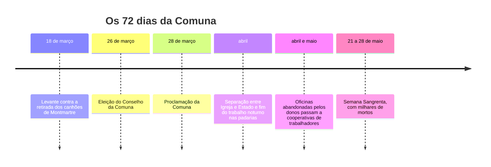
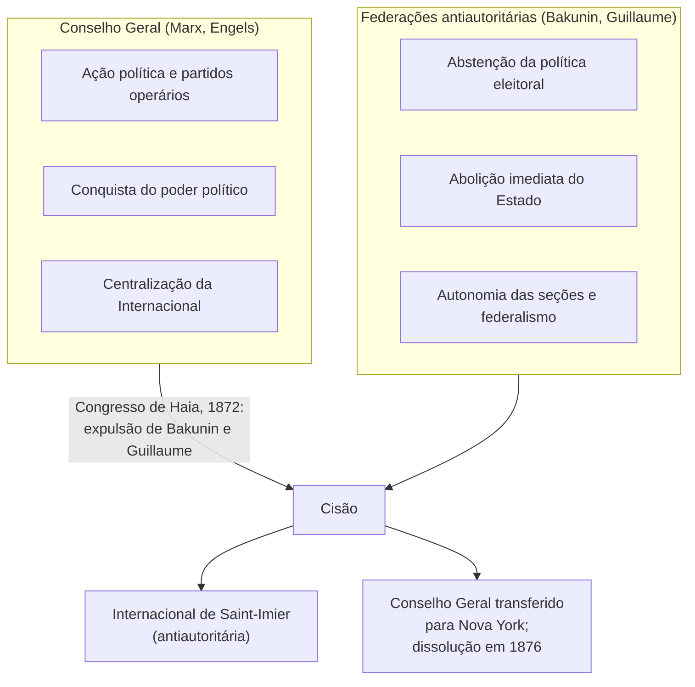

> **Aviso de Idioma:** Este currículo e todos os seus recursos de apoio foram estruturados exclusivamente em **Português (PT-BR)**.

# Aula 1 · A Internacional, a Comuna e a grande cisão

**MOD-107 · 10 horas · Leitura principal:** Marx, *A Guerra Civil na França* (1871), capítulo III; Bakunin, *A Comuna de Paris e a Noção de Estado* (1871)

## O que você vai aprender

- Situar o nascimento do <abbr title="Anarquismo: corrente do movimento socialista que recusa toda dominação não justificada, em especial o Estado e a propriedade capitalista, e propõe a organização da sociedade por associações livres e federadas.">anarquismo</abbr> no movimento operário europeu do século XIX, de Proudhon a Bakunin.
- Contar a história da Primeira Internacional e da Comuna de Paris.
- Comparar as leituras de Marx e de Bakunin sobre a Comuna.
- Explicar as razões da cisão de 1872 e as suas consequências de longo prazo.

## Pergunta de abertura

> Se os trabalhadores tomassem o poder numa cidade, deveriam usar as instituições do Estado (polícia, tribunais, ministérios) para defender a sua conquista, ou deveriam dissolvê-las imediatamente e substituí-las por outra coisa? O que seria essa outra coisa?

## 1. Antes de Bakunin: Proudhon

Em 1840, o tipógrafo francês Pierre-Joseph Proudhon publicou *O Que É a Propriedade?* e respondeu na primeira página: "A propriedade é um roubo." Proudhon foi o primeiro a se declarar, com orgulho, **anarquista**, dando à palavra o sentido de "sem governo" (do grego *an-arkhé*, ausência de comando) e não de desordem.

Proudhon defendia o <abbr title="Mutualismo: proposta de Proudhon de uma economia de pequenos produtores associados, que trocariam o seu trabalho por meio de bancos de crédito mútuo, sem lucro nem juro.">mutualismo</abbr> e o <abbr title="Federalismo (no sentido anarquista): organização da sociedade de baixo para cima, por associações locais autônomas que se federam livremente em níveis mais amplos, podendo sair da federação.">federalismo</abbr>: pequenas associações de produtores, ligadas por contratos livres e federadas de baixo para cima. Marx o respeitou no início e depois o atacou duramente em *Miséria da Filosofia* (1847). Muitos operários franceses, porém, continuaram proudhonianos por décadas.

## 2. A Associação Internacional dos Trabalhadores

Em 28 de setembro de 1864, num salão em Londres, sindicalistas ingleses e operários franceses fundaram a **Associação Internacional dos Trabalhadores** (AIT), a Primeira Internacional. Marx redigiu os seus estatutos e o discurso inaugural, que termina com a frase do *Manifesto*: "Proletários de todos os países, uni-vos." O lema dos estatutos dizia: "a emancipação da classe trabalhadora deve ser obra da própria classe trabalhadora".

A Internacional reunia correntes muito diversas: sindicalistas ingleses moderados, proudhonianos franceses, socialistas alemães, republicanos italianos. Em 1868, entrou nela um revolucionário russo já famoso em toda a Europa: **Mikhail Bakunin**.

*Mikhail Bakunin (1814 a 1876), fotografia de Nadar. Domínio público.*

Bakunin tinha uma biografia de romance: nobre russo, participou das revoluções de 1848 em Paris, Praga e Dresden; foi preso, condenado à morte duas vezes, entregue à Rússia, encarcerado anos na Fortaleza de Pedro e Paulo e deportado para a Sibéria, de onde fugiu em 1861 atravessando o Japão e os Estados Unidos até chegar a Londres. Na Internacional, tornou-se o polo de atração das seções da Itália, da Espanha e da Suíça francesa.

## 3. A Comuna de Paris

Em 1870, a França de Napoleão III (o sobrinho do *18 de Brumário*, MOD-103, aula 3) declarou guerra à Prússia e foi derrotada em semanas. Paris resistiu a um cerco de quatro meses. Quando o novo governo conservador, instalado em Versalhes, tentou desarmar a Guarda Nacional parisiense e retirar os seus canhões, em **18 de março de 1871**, a população se levantou. Nascia a **Comuna de Paris**, que durou 72 dias.

Em pouco tempo, a Comuna tomou medidas que pareciam impossíveis: separou Igreja e Estado, aboliu o exército permanente substituindo-o pelo povo armado, fixou o salário dos funcionários públicos no nível do salário operário, tornou os representantes revogáveis a qualquer momento, aboliu o trabalho noturno dos padeiros e entregou a cooperativas de trabalhadores as oficinas abandonadas pelos patrões. Mulheres como Louise Michel e Élisabeth Dmitrieff tiveram papel destacado.

Em maio, o exército de Versalhes invadiu Paris. Na **Semana Sangrenta** (21 a 28 de maio), milhares de communards foram mortos em combate ou fuzilados sem julgamento; outros milhares foram presos e deportados para a Nova Caledônia.

## 4. Duas leituras da mesma Comuna

Os dois lados da Internacional viram na Comuna a confirmação das suas ideias, e é isso que torna o episódio tão instrutivo.

| | Marx, *A Guerra Civil na França* | Bakunin, *A Comuna de Paris e a Noção de Estado* |
| :--- | :--- | :--- |
| O que a Comuna foi | "A forma política finalmente descoberta" para a emancipação econômica do trabalho | A negação do Estado: a revolução feita pela federação espontânea das comunas |
| O que ela ensinou | A classe operária não pode simplesmente se apossar da máquina do Estado e usá-la; precisa quebrá-la e substituí-la por outra forma (representantes revogáveis, salário operário, povo armado) | Nenhum Estado, nem revolucionário, deve ser construído; a organização vem de baixo, por livre federação |
| Por que caiu | Faltou centralização, ofensiva militar sobre Versalhes e controle do Banco da França | Os communards ainda estavam presos a ideias de governo, delegação e centralismo jacobino |

Repare numa coisa surpreendente: a leitura de Marx em 1871 está muito perto da dos anarquistas. Ele elogia exatamente a destruição do aparelho estatal existente. A divergência está no que vem depois: para Marx e Engels, a classe operária ainda precisaria de uma forma de poder político, a "ditadura do proletariado", até que as classes desaparecessem; para Bakunin, qualquer poder central reconstruiria a dominação.

Responda à pergunta de abertura com cada um dos dois autores antes de seguir.

## 5. A cisão de 1872

O conflito na Internacional misturou divergências teóricas reais e disputas de poder e de personalidade.

No Congresso de Haia, em setembro de 1872, a maioria aprovou a expulsão de Bakunin e de James Guillaume, acusados de manter dentro da Internacional uma organização secreta. Poucos dias depois, as federações antiautoritárias se reuniram em Saint-Imier, na Suíça, e criaram a sua própria Internacional. A organização de Marx, transferida para Nova York, se dissolveu em 1876.

A cisão marcou todo o século seguinte. De um lado, os partidos social-democratas e, depois, comunistas; de outro, o anarquismo e o <abbr title="Sindicalismo revolucionário (anarcossindicalismo): corrente que via nos sindicatos, e não nos partidos, o instrumento da luta e o embrião da sociedade futura, com a greve geral como arma decisiva.">sindicalismo revolucionário</abbr>, que foi muito forte na Espanha, na Itália, na França e na América Latina, inclusive no Brasil (aula 6).

## Leitura guiada

1. **Marx, *A Guerra Civil na França*, capítulo III** (cerca de 15 páginas): a descrição das medidas da Comuna. Faça uma lista de todas.
2. **Bakunin, *A Comuna de Paris e a Noção de Estado*** (cerca de 15 páginas): a leitura antiautoritária. Marque as passagens em que Bakunin critica os próprios communards.
3. **Opcional:** Engels, introdução de 1891 a *A Guerra Civil na França*, com a frase final sobre a Comuna como modelo de "ditadura do proletariado".

## Exercícios

**1.** Liste cinco medidas da Comuna de Paris e diga qual delas lhe parece mais radical para a época, justificando.

Gabarito comentado

Exemplos: separação entre Igreja e Estado; povo armado no lugar do exército permanente; representantes revogáveis; salário dos funcionários igual ao salário operário; fim do trabalho noturno nas padarias; oficinas abandonadas entregues a cooperativas. A justificativa deve relacionar a medida ao contexto de 1871 (por exemplo, a revogabilidade dos representantes contrastava com todos os parlamentos da época).

**2.** Em que ponto as leituras de Marx e de Bakunin sobre a Comuna convergem, e em que ponto divergem?

Gabarito comentado

Convergem em que a Comuna destruiu a máquina estatal existente e criou formas novas de poder vindas de baixo. Divergem sobre o que fazer depois: Marx vê na Comuna uma nova forma de poder político da classe operária, necessária durante a transição; Bakunin vê nela a negação de todo Estado e critica os elementos de governo central que os communards ainda mantinham.

**3.** Responda à pergunta de abertura do ponto de vista de Marx e do ponto de vista de Bakunin, em um parágrafo para cada um.

Critérios de correção

Marx: não usar a máquina estatal existente, mas quebrá-la e substituí-la por órgãos de poder operário (representantes revogáveis, povo armado), mantendo um poder político centralizado durante a transição. Bakunin: dissolver o Estado e organizar a defesa e a vida econômica por federações livres de comunas e associações, sem centro de comando. A resposta excelente aponta os riscos que cada um via na posição do outro: para Marx, a fragilidade militar e a dispersão; para Bakunin, o nascimento de uma nova casta dirigente.

## Resumo da aula

- Proudhon foi o primeiro a se dizer anarquista e propôs mutualismo e federalismo.
- A Primeira Internacional (1864) reuniu correntes diversas; Bakunin entrou em 1868.
- A Comuna de Paris (1871) destruiu o aparelho estatal existente e criou formas novas de poder, até ser esmagada na Semana Sangrenta.
- Marx e Bakunin leram a Comuna como confirmação das suas ideias: convergência sobre a destruição da máquina estatal, divergência sobre o poder de transição.
- O Congresso de Haia (1872) expulsou Bakunin e dividiu o movimento socialista por um século.

## Para ir além

- Prosper-Olivier Lissagaray, *História da Comuna de 1871* (1876), escrita por um communard.
- Louise Michel, *A Comuna* (1898), memórias de uma das suas principais figuras.
