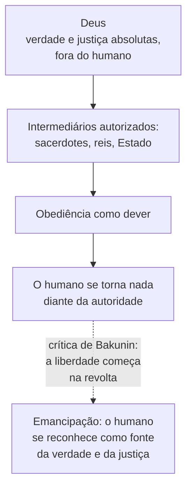
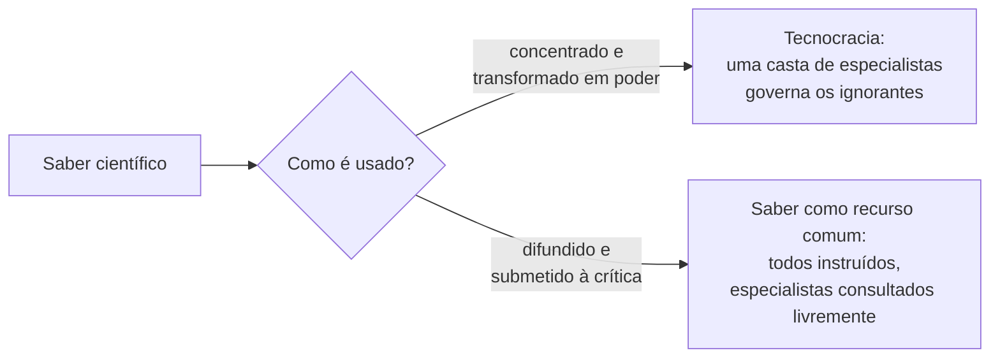

> **Aviso de Idioma:** Este currículo e todos os seus recursos de apoio foram estruturados exclusivamente em **Português (PT-BR)**.

# Aula 2 · Bakunin: Deus, o Estado e o governo dos cientistas

**MOD-107 · 10 horas · Leitura principal:** Bakunin, *Deus e o Estado* (escrito em 1871, publicado postumamente em 1882), texto integral

## O que você vai aprender

- Reconstruir o argumento de Bakunin contra a autoridade divina e a sua ligação com a autoridade do Estado.
- Distinguir, com Bakunin, a autoridade que se aceita livremente (a do especialista consultado) da autoridade imposta.
- Explicar a crítica ao "governo dos cientistas" e relacioná-la com a <abbr title="Tecnocracia: governo exercido por especialistas técnicos, em nome do conhecimento e da eficiência, e não por representantes escolhidos ou pela deliberação coletiva.">tecnocracia</abbr> contemporânea.
- Formular a síntese de Bakunin entre liberdade e socialismo.

## Pergunta de abertura

> Quando você vai ao médico, segue as orientações dele. Quando um engenheiro diz que uma ponte não aguenta mais peso, você acredita. Isso significa que médicos e engenheiros deveriam governar? Onde termina a autoridade do saber e começa a dominação?

## 1. Um texto inacabado e explosivo

*Deus e o Estado* é um fragmento de uma obra maior que Bakunin nunca terminou. Foi encontrado entre os seus papéis e publicado em 1882 por Carlo Cafiero e Élisée Reclus. Tornou-se o texto anarquista mais traduzido do mundo.

O livro começa invertendo a história bíblica do Éden. Para Bakunin, quando Adão e Eva desobedecem a Deus e comem do fruto da árvore do conhecimento, cometem o primeiro ato de liberdade humana. A revolta contra a autoridade é o começo da humanidade.

## 2. Deus e o Estado: a mesma lógica

O argumento central tem a forma de uma inversão famosa da frase de Voltaire ("se Deus não existisse, seria preciso inventá-lo"):

> "Se Deus existisse realmente, seria preciso aboli-lo." (tradução livre)

Por quê? Porque a ideia de um Deus que é tudo (verdade, justiça, bem) implica que o ser humano não é nada por si mesmo. E a ideia de Deus precisa de intermediários: sacerdotes, reis "pela graça de Deus", Estados que falam em nome de uma verdade superior. A autoridade divina é o modelo de toda autoridade que se impõe de cima.

Compare com Feuerbach (MOD-101, aula 6), que Bakunin leu com entusiasmo: o ser humano empobrece a si mesmo ao projetar as suas qualidades em Deus. Bakunin acrescenta a consequência política: essa projeção sustenta a dominação de quem fala em nome do absoluto.

## 3. A autoridade do sapateiro

A passagem mais citada do livro responde diretamente à pergunta de abertura:

> "Quando se trata de botas, recorro à autoridade do sapateiro; quando se trata de uma casa, de um canal ou de uma ferrovia, consulto a do arquiteto ou do engenheiro. (...) Mas não permito que nem o sapateiro, nem o arquiteto, nem o sábio me imponham a sua autoridade. Escuto-os livremente e com todo o respeito que merecem a sua inteligência, o seu caráter, o seu saber, reservando sempre o meu direito incontestável de crítica e de controle." (tradução livre)

Bakunin não é contra o saber nem contra os especialistas. Distingue dois tipos de autoridade:

| Autoridade aceita livremente | Autoridade imposta |
| :--- | :--- |
| Eu escolho consultar o especialista | O especialista decide por mim |
| Posso consultar vários e comparar | Há uma única autoridade oficial |
| Mantenho o direito de crítica e de controle | A crítica é proibida ou inútil |
| O saber é **recurso** | O saber é **título de poder** |
| Influência recíproca, móvel | Hierarquia fixa e permanente |

## 4. O governo dos cientistas

Daí vem a crítica mais atual do livro. No tempo de Bakunin, o filósofo Auguste Comte (fundador do positivismo) e outros pensadores propunham que a sociedade fosse governada por uma elite de cientistas, que saberia o que é melhor para todos. Bakunin responde com três argumentos:

1. **A ciência é abstrata; a vida é concreta.** A ciência conhece leis gerais, mas não conhece cada pessoa viva, com a sua situação única. Governar pessoas pela ciência é tratá-las como casos de uma regra, como se faz com coelhos num laboratório. (Lembre de Aristóteles e da *phronesis*, MOD-101, aula 3.)
2. **O poder corrompe também os sábios.** Uma academia de cientistas com poder de governo deixaria de buscar a verdade e passaria a defender a sua própria posição. O privilégio, diz Bakunin, "mata o espírito e o coração dos homens".
3. **A ciência como monopólio cria uma nova classe.** Se o saber dá direito a mandar, os que sabem se tornam uma casta separada dos que trabalham. A solução não é abolir a ciência, mas **difundi-la**: dar a todos acesso à instrução integral, para que ninguém tenha o monopólio do saber.

> **Conexão com a computação:** a crítica de Bakunin ao governo dos cientistas é talvez o texto do século XIX mais diretamente aplicável ao governo por algoritmos. Quando se diz que uma decisão foi tomada "pelo sistema" ou "pelos dados", o saber técnico está sendo usado como título de poder, não como recurso. A pergunta de Bakunin vale para cada sistema automatizado que você vai auditar no MOD-305: as pessoas afetadas mantêm o direito de crítica e de controle? Podem consultar outros especialistas? O código e os dados estão abertos para exame? Repare que a resposta de Bakunin (difundir o saber, em vez de concentrá-lo) é exatamente a lógica do software livre e do acesso aberto.

## 5. Liberdade e socialismo

Bakunin é às vezes lido como um individualista. É um erro. Para ele, a liberdade é um produto **social**: ninguém é livre sozinho, e a minha liberdade só se completa com a liberdade dos outros. A liberdade de cada um não termina onde começa a do outro; ao contrário, ela se **amplia** com a do outro.

E daí vem a fórmula que resume a posição de Bakunin no debate com Marx (aula 3), escrita em 1867:

> "A liberdade sem o socialismo é o privilégio e a injustiça; o socialismo sem a liberdade é a escravidão e a brutalidade." (tradução livre)

## Leitura guiada

1. **Início do texto até a crítica da ideia de Deus** (cerca de 20 páginas): o Éden, a revolta e a inversão da frase de Voltaire.
2. **A passagem do sapateiro e a crítica ao governo dos cientistas** (cerca de 20 páginas): leia duas vezes. Faça uma lista dos argumentos contra o governo da ciência.
3. **O restante do texto** (leitura mais rápida): a relação entre religião, Estado e privilégio.

## Exercícios

**1.** Responda à pergunta de abertura com as categorias de Bakunin.

Gabarito comentado

Seguir o médico ou acreditar no engenheiro é aceitar livremente uma autoridade de saber, consultada por nossa escolha, com o direito de buscar outras opiniões e de criticar. Isso não autoriza médicos e engenheiros a governar, porque governar seria transformar o saber em título de poder permanente, sem controle de quem é afetado. A fronteira entre autoridade do saber e dominação está na liberdade de consultar, criticar e recusar.

**2.** Quais são os três argumentos de Bakunin contra o governo dos cientistas?

Gabarito

(1) A ciência conhece leis gerais e abstratas, mas governar envolve pessoas vivas e situações concretas. (2) O poder corrompe também os sábios, que passariam a defender a sua posição em vez da verdade. (3) O monopólio do saber cria uma nova classe dominante; a solução é difundir o saber a todos.

**3.** Escolha um sistema automatizado de decisão usado pelo poder público no Brasil e avalie-o com as perguntas de Bakunin: os afetados podem criticar e controlar? Podem consultar outros especialistas? O funcionamento é aberto?

Critérios de correção

A resposta deve descrever um sistema real (com fonte), responder às três perguntas com evidências (existe recurso? o código e os critérios são públicos? há auditoria independente?) e concluir se o saber técnico funciona ali como recurso ou como título de poder. Este exercício antecipa o laudo do MOD-305.

## Resumo da aula

- *Deus e o Estado* critica a autoridade divina como modelo de toda autoridade imposta: "se Deus existisse, seria preciso aboli-lo".
- Bakunin distingue a autoridade do saber aceita livremente (o sapateiro consultado) da autoridade imposta.
- O governo dos cientistas é recusado porque a ciência é abstrata, porque o poder corrompe e porque o monopólio do saber cria uma nova classe.
- A resposta é difundir o saber, e não concentrá-lo: a lógica do conhecimento aberto.
- Liberdade e socialismo são inseparáveis para Bakunin.

## Para ir além

- Bakunin, *Federalismo, Socialismo e Antiteologismo* (1867), onde está a fórmula sobre liberdade e socialismo.
- No MOD-205, a crítica de Habermas à "técnica e ciência como ideologia" retoma o problema por outro caminho.
