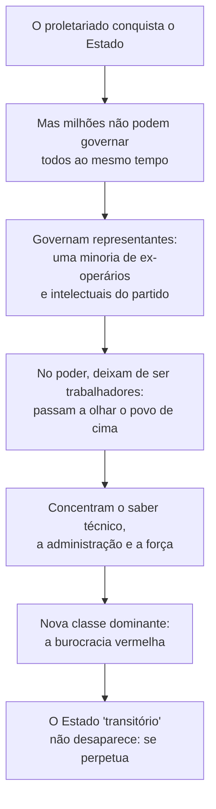
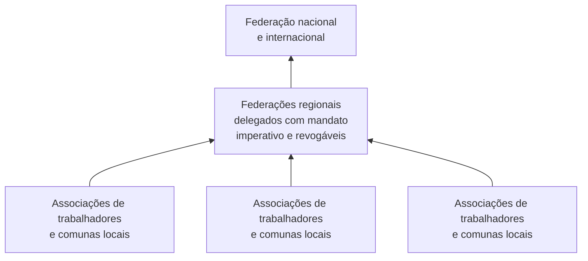

> **Aviso de Idioma:** Este currículo e todos os seus recursos de apoio foram estruturados exclusivamente em **Português (PT-BR)**.

# Aula 3 · Bakunin: *Estatismo e Anarquia* e a burocracia vermelha

**MOD-107 · 10 horas · Leitura principal:** Bakunin, *Estatismo e Anarquia* (1873), seleção (a crítica ao "Estado popular" e à ditadura do proletariado); Marx, notas sobre *Estatismo e Anarquia* (1874 a 1875), seleção

## O que você vai aprender

- Reconstruir a crítica de Bakunin ao "Estado popular" e à ditadura do proletariado.
- Explicar a previsão da <abbr title="Burocracia vermelha: expressão de Bakunin para a nova classe dirigente que, segundo ele, surgiria de um Estado governado em nome dos trabalhadores por um pequeno grupo de ex-operários e intelectuais.">burocracia vermelha</abbr>.
- Ler a resposta de Marx nas suas anotações ao livro.
- Avaliar o debate à luz da história do século XX, que você estudará no MOD-201.
- Explicar a proposta de Bakunin: <abbr title="Autogestão: organização em que os próprios trabalhadores ou membros de uma comunidade administram coletivamente a produção e a vida comum, sem patrões nem dirigentes permanentes.">autogestão</abbr> e federação de baixo para cima.

## Pergunta de abertura

> Um movimento de trabalhadores chega ao poder e nomeia, para dirigir o Estado, os seus melhores militantes, ex-operários honestos. Dez anos depois, esses dirigentes vivem de modo muito diferente dos trabalhadores que representam e tomam decisões sem consultá-los. Isso é traição individual ou há algo na própria posição que produz esse resultado?

## 1. O livro

*Estatismo e Anarquia* foi escrito em russo em 1873 e publicado clandestinamente, para circular entre jovens revolucionários da Rússia. É o único livro que Bakunin completou. Grande parte trata da política europeia depois da vitória da Prússia e da unificação alemã: Bakunin via no Estado alemão centralizado o grande inimigo da liberdade na Europa, e via no programa dos socialistas alemães (e de Marx) uma versão "popular" do mesmo estatismo.

## 2. O argumento contra o Estado popular

Os socialistas alemães falavam num "Estado popular livre": o proletariado conquistaria o Estado, pelas eleições ou pela revolução, e o usaria para socializar a economia. Marx e Engels, depois da Comuna, falavam numa ditadura do proletariado transitória. Bakunin pergunta:

> "Se o proletariado se torna a classe dominante, sobre quem vai dominar?" (tradução livre)

O argumento se desdobra em etapas:

Bakunin dirige a crítica sobretudo à combinação entre **poder de Estado** e **monopólio do saber** (a aula 2): uma minoria de "sábios" socialistas governaria em nome de uma ciência da sociedade que só ela domina. O resultado seria, diz ele, o governo mais aristocrático, despótico e arrogante de todos, justamente porque se apresentaria como governo do povo e da ciência.

E uma imagem que ficou célebre:

> "O povo não se sentirá melhor se o bastão com que é espancado se chamar bastão do povo." (tradução livre)

## 3. A resposta de Marx

Em 1874 e 1875, Marx leu *Estatismo e Anarquia* em russo e encheu cadernos de resumos e comentários, que só foram publicados no século XX. As respostas mais importantes:

| Bakunin pergunta | Marx responde (nas notas) |
| :--- | :--- |
| Sobre quem o proletariado vai dominar? | Sobre as outras classes, enquanto elas existirem: a velha classe dominante não desaparece no dia da revolução e resiste |
| Os representantes não se tornam uma nova classe? | Depende das relações econômicas. Se a base econômica muda (fim da propriedade privada dos meios de produção), as funções de direção deixam de ser posições de classe; os representantes podem ser eleitos e revogados, como na Comuna |
| Por que não abolir o Estado de uma vez? | Porque é preciso transformar as condições econômicas que produzem a divisão em classes; enquanto não forem transformadas, alguma forma de poder político é necessária. O Estado se extingue à medida que as classes desaparecem |

Marx acusa Bakunin de voluntarismo: de achar que a vontade revolucionária basta, sem considerar as condições econômicas. Bakunin acusa Marx de autoritarismo: de não ver que o poder político cria interesses próprios.

## 4. O teste da história

No MOD-201 você vai estudar a Revolução Russa de 1917, *O Estado e a Revolução* de Lênin e *A Revolução Traída* de Trótski. Este debate de 1873 é o pano de fundo de tudo isso. Guarde três observações para lá:

1. O próprio Lênin, em *O Estado e a Revolução* (1917), parte da Comuna de Paris e da extinção do Estado, muito perto de certas formulações anarquistas.
2. A Revolução Russa acabou produzindo um Estado de partido único com uma burocracia poderosa e privilegiada. Trótski, em *A Revolução Traída* (1936), analisa essa burocracia como casta parasitária. Muitos anarquistas viram nisso a confirmação da previsão de Bakunin.
3. Os anarquistas russos (inclusive Kropotkin, que voltou à Rússia em 1917) foram perseguidos pelo novo Estado a partir de 1918 a 1921.

Mas a história não fecha o debate a favor de ninguém de modo simples: experiências anarquistas também foram derrotadas, muitas vezes pela força militar (como na Ucrânia de 1918 a 1921 e na Espanha de 1936 a 1939), o que é o argumento dos marxistas sobre a necessidade de um poder organizado. O curso pede que você avalie os dois lados com rigor, sem torcida.

## 5. A proposta de Bakunin: de baixo para cima

O que Bakunin propõe no lugar do Estado? Uma organização **federalista**:

- A base são as **associações produtivas** (os trabalhadores administram coletivamente os meios de produção: autogestão) e as **comunas** locais.
- As associações se **federam livremente** em níveis mais amplos, para coordenar o que exige escala (ferrovias, trocas, defesa).
- Os delegados têm **mandato imperativo** (levam a decisão da base, não decidem por ela) e são **revogáveis** a qualquer momento.
- A federação vai de baixo para cima, e cada nível mantém o direito de sair.

Repare como a estrutura lembra a arquitetura da Internet (MOD-104, aula 1): uma rede de redes autônomas, ligadas por protocolos comuns, sem centro de comando. A aula 7 explora essa semelhança e os seus limites.

## Leitura guiada

1. ***Estatismo e Anarquia***, as páginas finais sobre o "Estado popular" e a ditadura do proletariado (cerca de 20 páginas). Copie a pergunta "sobre quem vai dominar?" e a passagem sobre o bastão.
2. **Marx, notas sobre *Estatismo e Anarquia*** (cerca de 10 páginas, na seleção disponível no Arquivo Marxista). Monte uma tabela de perguntas e respostas como a da aula.

## Exercícios

**1.** Responda à pergunta de abertura com o argumento de Bakunin e, em seguida, com a resposta de Marx.

Gabarito comentado

Bakunin: não é traição individual; é a posição de poder que transforma quem a ocupa. Governando em nome de milhões, uma minoria concentra saber, administração e força e se torna uma nova classe. Marx: o resultado depende das relações econômicas; se os meios de produção forem socializados e os representantes forem eleitos, revogáveis e pagos como trabalhadores (como na Comuna), as funções de direção não precisam se tornar posições de classe. A resposta excelente discute que mecanismos concretos poderiam impedir a formação da camada privilegiada.

**2.** O que é mandato imperativo e por que ele é central na proposta federalista?

Gabarito

É o mandato em que o delegado leva a decisão tomada pela base e não pode decidir de outro modo; se o fizer, pode ser revogado. É central porque impede que os delegados se tornem representantes com poder próprio, mantendo a decisão nas associações de base.

**3.** Escreva 300 palavras avaliando o debate entre Marx e Bakunin à luz de um acontecimento histórico do século XX à sua escolha (com fontes).

Critérios de correção

A resposta deve apresentar corretamente as duas posições, descrever o acontecimento com fontes e mostrar em que ele confirma ou contradiz cada posição. Respostas que só confirmam um lado, sem considerar os argumentos do outro, perdem pontos.

## Resumo da aula

- *Estatismo e Anarquia* (1873) critica o "Estado popular" e a ditadura do proletariado.
- Para Bakunin, quem governa em nome do povo forma uma nova classe, a burocracia vermelha, sobretudo quando une poder de Estado e monopólio do saber.
- Marx responde que tudo depende das relações econômicas e que o Estado se extingue à medida que as classes desaparecem.
- O debate é o pano de fundo da Revolução Russa e de toda a história do socialismo no século XX.
- A proposta anarquista: autogestão, federação de baixo para cima, mandato imperativo e delegados revogáveis.

## Para ir além

- No MOD-201: Lênin, *O Estado e a Revolução*, e Trótski, *A Revolução Traída*.
- Daniel Guérin, *O Anarquismo: da Doutrina à Ação* (1965), introdução histórica curta e clara.
