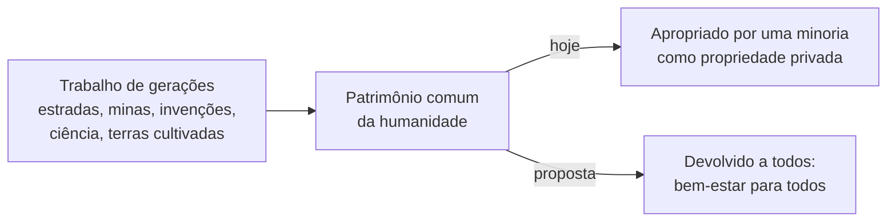
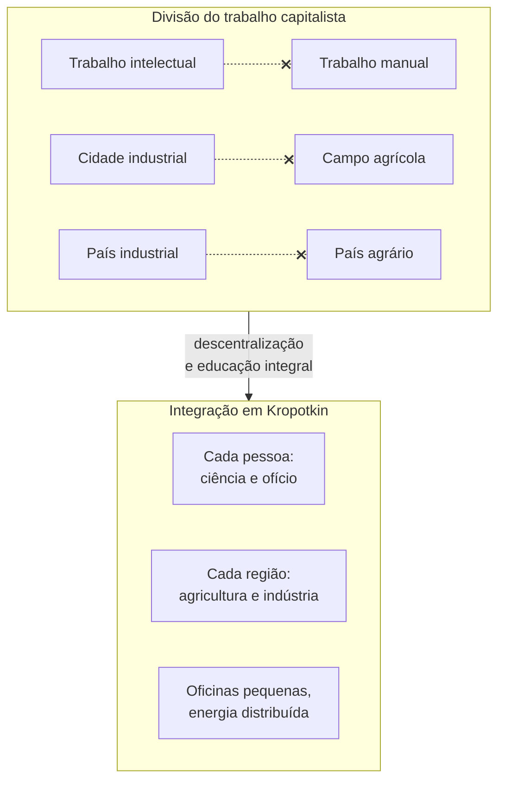

> **Aviso de Idioma:** Este currículo e todos os seus recursos de apoio foram estruturados exclusivamente em **Português (PT-BR)**.

# Aula 5 · Kropotkin: pão, fábricas e oficinas para todos

**MOD-107 · 10 horas · Leitura principal:** Kropotkin, *A Conquista do Pão* (1892), capítulos 1 a 4 e capítulo sobre o trabalho agradável; *Campos, Fábricas e Oficinas* (1899), capítulo final ("Trabalho cerebral e trabalho manual") e Conclusão

## O que você vai aprender

- Explicar o argumento de *A Conquista do Pão*: a riqueza é produto coletivo de todas as gerações.
- Definir o <abbr title="Comunismo libertário (ou anarcocomunismo): proposta de Kropotkin de uma sociedade sem Estado nem propriedade privada dos meios de produção, em que os bens seriam distribuídos segundo as necessidades de cada um.">comunismo libertário</abbr> e a diferença em relação ao salário por trabalho realizado.
- Explicar a proposta de integração entre trabalho manual e intelectual e entre campo e cidade em *Campos, Fábricas e Oficinas*.
- Defender ou criticar a ideia de descentralização produtiva com argumentos técnicos.
- Relacionar as propostas de Kropotkin com a produção distribuída contemporânea.

## Pergunta de abertura

> Um engenheiro de software escreve um programa novo em seis meses. Mas ele usa uma linguagem criada por outros, bibliotecas escritas por milhares de voluntários, um computador fabricado por operários de vários países, e um conhecimento acumulado por gerações de matemáticos. De quem é, de fato, o programa?

## 1. A riqueza é obra de todos

*A Conquista do Pão* começa com uma constatação. A humanidade nunca foi tão rica: os meios de produção acumulados (estradas, ferrovias, máquinas, terras cultivadas, conhecimento científico) permitiriam que todos vivessem com conforto. E no entanto a maioria vive na miséria. Por quê?

A resposta de Kropotkin parte da origem da riqueza. Cada máquina, cada invenção, cada fábrica é o resultado do trabalho de **gerações inteiras**: os que abriram as estradas, os que drenaram os pântanos, os mineiros que morreram nas minas, os inventores anônimos que aperfeiçoaram cada peça. É impossível dizer quanto de uma riqueza qualquer pertence a cada um. E, no entanto, uma minoria se apropriou desse patrimônio comum.

Responda à pergunta de abertura com Kropotkin: o programa é produto de um imenso trabalho coletivo, e o engenheiro acrescentou a sua parte. Compare com o *General Intellect* do Fragmento sobre as Máquinas (MOD-103, aula 6): Marx e Kropotkin chegam, por caminhos diferentes, à ideia de que o saber social acumulado é a principal força produtiva.

## 2. Bem-estar para todos e expropriação

A conclusão de Kropotkin é que o objetivo da revolução deve ser imediato e concreto: **o bem-estar para todos**, a começar pelo pão, a moradia e a roupa. Para isso, propõe a **expropriação**: tomar os meios de produção e as moradias e colocá-los à disposição de todos.

E aqui está a diferença em relação a outros socialistas. Muitos (inclusive coletivistas como Bakunin) propunham que cada um recebesse de acordo com o **trabalho realizado**. Kropotkin recusa isso: como medir a contribuição de cada um num trabalho coletivo? Quanto vale uma hora do mineiro comparada a uma hora do engenheiro? Qualquer sistema de salários, diz ele, reproduziria hierarquias. A proposta é distribuir **segundo as necessidades**: "tomar do monte" o que é abundante, e racionar com igualdade o que é escasso.

| | Coletivismo (salário por trabalho) | Comunismo libertário de Kropotkin |
| :--- | :--- | :--- |
| Meios de produção | Coletivos | Coletivos |
| Distribuição dos bens | Segundo o trabalho realizado | Segundo as necessidades |
| Problema que resolve | Acaba com o lucro do proprietário | Acaba também com a medição e a hierarquia do trabalho |
| Objeção típica | Reproduz desigualdades de salário | Quem vai trabalhar se não for obrigado? |

## 3. Quem vai trabalhar?

Kropotkin enfrenta a objeção clássica. A resposta tem duas partes:

1. **O trabalho não é naturalmente odioso.** O que o torna insuportável são as condições: jornadas longas, ambientes insalubres, tarefas monótonas, subordinação. Com jornadas curtas (ele calcula que cinco horas por dia bastariam, com a técnica da época), trabalho variado e livre associação, trabalhar seria uma necessidade humana como qualquer outra.
2. **A sociedade já funciona assim em muitos lugares.** Bibliotecas públicas, museus, pontes e estradas sem pedágio, bombeiros voluntários: Kropotkin mostra que já existem muitos serviços acessíveis segundo a necessidade, e não segundo o pagamento.

## 4. *Campos, Fábricas e Oficinas*

Em 1899, Kropotkin publicou um livro mais técnico, baseado em estatísticas agrícolas e industriais de vários países. Ele contesta três ideias dominantes da economia da época:

- **Que cada país deve se especializar** (uns em agricultura, outros em indústria). Kropotkin mostra que a agricultura intensiva, com técnicas modernas, podia alimentar populações muito maiores em pequenas áreas, e propõe que cada região produza boa parte do que consome.
- **Que a indústria precisa se concentrar em fábricas gigantes.** Com a eletricidade, que permite distribuir energia por cabos, a produção pode se descentralizar em pequenas oficinas espalhadas pelo campo e pela cidade.
- **Que o trabalho deve se dividir entre os que pensam e os que fazem.** O capítulo final defende a **integração do trabalho**: todos deveriam ter formação manual e intelectual, trabalhar no campo e na oficina, estudar ciência e praticar um ofício.

Repare como essa proposta responde à crítica de Bakunin ao monopólio do saber (aula 2): se todos tiverem formação científica e técnica, ninguém poderá governar em nome do saber.

## 5. Kropotkin hoje

As propostas de Kropotkin parecem utópicas, mas várias delas reaparecem em debates técnicos atuais:

| Kropotkin (1899) | Debates atuais |
| :--- | :--- |
| Eletricidade permite descentralizar a indústria | Energia solar distribuída, microrredes, impressão 3D e fabricação digital em pequena escala (*fab labs*) |
| Cada região produz o que consome | Circuitos curtos de alimentos, agroecologia, soberania alimentar |
| Integração do trabalho manual e intelectual | Críticas à divisão entre "quem projeta" e "quem executa" no trabalho de plataforma |
| Riqueza é patrimônio comum | Bens comuns digitais, acesso aberto à ciência, software livre (aula 7) |

> **Conexão com a computação:** um repositório de software livre é uma pequena "conquista do pão" do conhecimento: o código está ali, disponível para quem precisa, sem que ninguém meça quanto cada um contribuiu. Ao mesmo tempo, a pergunta "quem vai trabalhar?" tem uma versão atual muito concreta: muitos projetos livres essenciais à infraestrutura da Internet são mantidos por uma ou duas pessoas sem pagamento, e quando elas se cansam, a infraestrutura inteira fica em risco. A aula 7 discute isso.

## Leitura guiada

1. ***A Conquista do Pão*, capítulos 1 a 4** (cerca de 40 páginas): a riqueza comum, o bem-estar para todos, o comunismo anárquico e a expropriação.
2. **O capítulo sobre o trabalho agradável** (cerca de 10 páginas): a resposta à objeção "quem vai trabalhar?".
3. ***Campos, Fábricas e Oficinas*, capítulo final e Conclusão** (cerca de 30 páginas): a integração do trabalho.

## Exercícios

**1.** Explique por que, para Kropotkin, é impossível medir a contribuição individual de cada pessoa para a riqueza social.

Gabarito comentado

Porque toda riqueza resulta do trabalho de gerações e de milhões de pessoas: a máquina depende de invenções anteriores, das matérias-primas extraídas por outros, das estradas que a transportam, do conhecimento acumulado. Separar o que cabe a cada um é arbitrário. Daí a recusa de distribuir segundo o trabalho realizado e a proposta de distribuir segundo as necessidades.

**2.** Compare a ideia de riqueza como patrimônio comum em Kropotkin com o *General Intellect* de Marx.

Gabarito comentado

Os dois veem o saber e a técnica acumulados pela humanidade como a principal fonte de riqueza e apontam a contradição de que esse patrimônio social é apropriado privadamente. Marx chega a isso analisando a maquinaria e a contradição com a medida do valor pelo tempo de trabalho; Kropotkin, pela história da produção e pela impossibilidade de medir contribuições individuais. Divergem sobre o caminho: Marx pensa na transformação das relações de produção, com uma fase de transição; Kropotkin, na expropriação imediata e na distribuição segundo as necessidades, sem Estado.

**3.** Avalie a proposta de descentralização industrial de Kropotkin com um exemplo atual (energia solar distribuída, fabricação digital, agricultura urbana). Quais são as vantagens e os limites técnicos?

Critérios de correção

A resposta deve apresentar o exemplo com dados ou fontes, mostrar em que ele realiza a proposta de Kropotkin (produção perto do consumo, autonomia local) e discutir limites reais: economias de escala, dependência de componentes produzidos em grandes fábricas (painéis solares, chips), necessidade de coordenação entre regiões.

## Resumo da aula

- A riqueza moderna é produto do trabalho de gerações; a sua apropriação privada é o problema central.
- O objetivo é o bem-estar para todos, pela expropriação dos meios de produção e das moradias.
- O comunismo libertário distribui segundo as necessidades, e não segundo o trabalho realizado.
- O trabalho se torna agradável com jornadas curtas, variedade e livre associação.
- *Campos, Fábricas e Oficinas* propõe descentralizar a produção e integrar trabalho manual e intelectual, campo e cidade.

## Para ir além

- Kropotkin, *A Ciência Moderna e o Anarquismo* (1901).
- Colin Ward, edição comentada de *Campos, Fábricas e Oficinas Amanhã* (1974), que atualiza as propostas para o fim do século XX.
