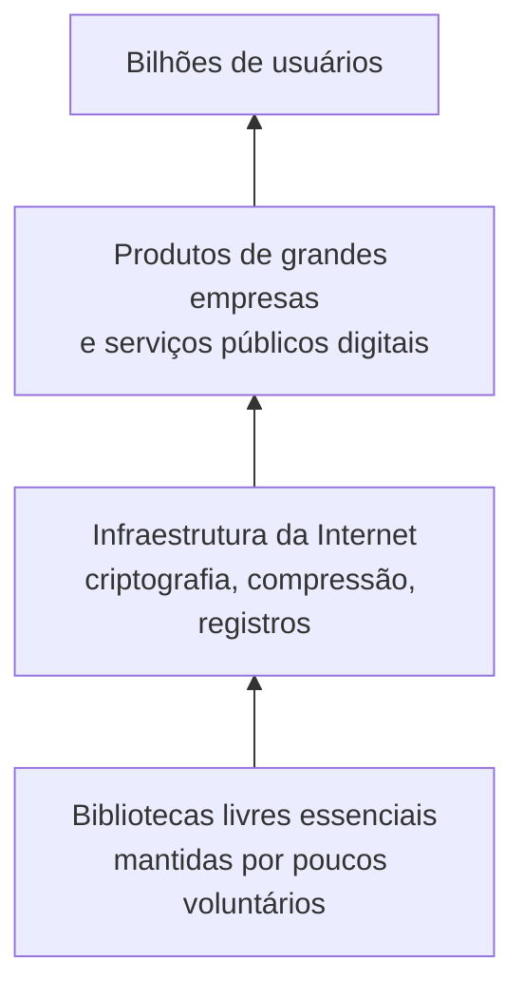
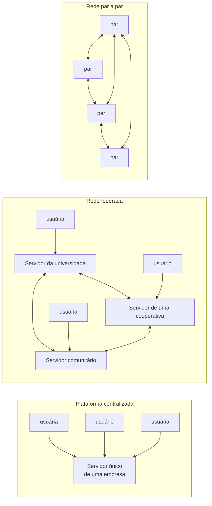

> **Aviso de Idioma:** Este currículo e todos os seus recursos de apoio foram estruturados exclusivamente em **Português (PT-BR)**.

# Aula 7 · Bens comuns, software livre e redes distribuídas

**MOD-107 · 10 horas · Leitura principal:** Kropotkin, *Apoio Mútuo*, capítulo 8; Richard Stallman, "O que é o software livre?" e "Por que o software livre é melhor que o código aberto" (em [gnu.org](https://www.gnu.org/philosophy/philosophy.pt-br.html)); Elinor Ostrom, *Governando os Comuns* (1990), capítulo 3 (seleção)

## O que você vai aprender

- Definir <abbr title="Bens comuns (commons): recursos (terra, água, florestas, conhecimento, software) geridos coletivamente por uma comunidade segundo regras que ela mesma estabelece, sem serem nem propriedade privada nem propriedade do Estado.">bens comuns</abbr> e conhecer a crítica de Elinor Ostrom à "tragédia dos comuns".
- Distinguir software livre e código aberto e entender o que está em jogo nessa diferença.
- Explicar redes <abbr title="Rede federada: rede formada por muitos servidores independentes, administrados por pessoas ou organizações diferentes, que se comunicam por um protocolo comum. O e-mail é o exemplo mais antigo; o Mastodon é um exemplo recente.">federadas</abbr> e <abbr title="Rede par a par (P2P): rede em que os participantes se comunicam diretamente entre si, cada um sendo ao mesmo tempo cliente e servidor, sem depender de um servidor central.">par a par</abbr>, e o <abbr title="Endereçamento por conteúdo: identificar um arquivo pelo hash do seu conteúdo, e não pelo lugar onde está guardado. Quem tem o hash pode pedir o arquivo a qualquer um e verificar que recebeu o arquivo certo.">endereçamento por conteúdo</abbr>.
- Implementar em Python o núcleo do sincronizador federado do projeto do módulo.
- Avaliar criticamente os limites dessas experiências: captura por empresas, trabalho invisível, exclusões.

## Pergunta de abertura

> A Wikipédia é escrita por voluntários, não tem dono, não vende anúncios e é um dos sites mais visitados do mundo. O e-mail funciona entre provedores diferentes sem que nenhuma empresa controle a rede. Por que essas coisas funcionam? E por que tantas outras áreas da Internet acabaram concentradas em poucas empresas?

## 1. A tragédia que não era tragédia

Em 1968, o biólogo Garrett Hardin publicou um artigo famoso, "A tragédia dos comuns". Imagine um pasto comum: cada pastor ganha individualmente ao pôr mais uma ovelha, e o custo do desgaste é dividido por todos. Resultado: todos põem ovelhas demais e o pasto é destruído. Conclusão de Hardin: bens comuns estão condenados; é preciso privatizá-los ou entregá-los ao Estado.

A cientista política **Elinor Ostrom** passou décadas estudando comunidades reais que gerem bens comuns: pescadores, irrigadores, pastores de montanha, florestas comunitárias, inclusive no Nepal, no Japão, na Suíça e na Espanha. Encontrou muitas que funcionavam há séculos sem tragédia. Em *Governando os Comuns* (1990), mostrou que Hardin descrevia um pasto **sem regras e sem comunidade**, e não um bem comum de verdade. Os comuns que funcionam têm regras feitas pelos próprios usuários. Em 2009, Ostrom foi a primeira mulher a receber o prêmio de economia em memória de Alfred Nobel.

Alguns dos princípios que Ostrom encontrou nos comuns duradouros:

| Princípio | Exemplo num projeto de software livre |
| :--- | :--- |
| Fronteiras claras: quem participa e qual é o recurso | Quem tem permissão de commit; o que faz parte do projeto |
| Regras adaptadas às condições locais | Guia de contribuição próprio de cada projeto |
| Quem é afetado pelas regras participa da sua criação | Discussões abertas sobre mudanças de regras |
| Monitoramento pelos próprios usuários | Revisão de código por pares |
| Sanções graduais | Do aviso ao bloqueio, conforme o código de conduta |
| Mecanismos baratos de resolução de conflitos | Discussão pública, mediação por mantenedores |
| Reconhecimento do direito de se organizar | A licença livre garante que a comunidade pode continuar mesmo sem o fundador |

Kropotkin teria reconhecido nos achados de Ostrom as comunidades de aldeia e as guildas do *Apoio Mútuo*.

## 2. Software livre e código aberto

Na aula 6 do MOD-106 você conheceu as quatro liberdades do software livre, formuladas por Richard Stallman nos anos 1980. Em 1998, um grupo de programadores e empresários criou o termo **código aberto** (*open source*) para apresentar a mesma prática às empresas sem o discurso ético e político de Stallman.

| | Software livre | Código aberto |
| :--- | :--- | :--- |
| Ênfase | Liberdade e ética: o usuário deve controlar o programa, e não o contrário | Método de desenvolvimento: código aberto produz software melhor |
| Discurso | Político e social | Técnico e empresarial |
| Licenças preferidas | *Copyleft* (GPL) | Também permissivas (MIT, Apache) |

Na prática, quase todo software livre é código aberto e vice-versa. A diferença está no **porquê** e, por isso, no que se aceita: o discurso do código aberto permitiu que grandes empresas usassem maciçamente o trabalho comum, muitas vezes sem devolver nada. Hoje, as maiores empresas de tecnologia do mundo construíram os seus produtos sobre o Linux, o Python e milhares de bibliotecas livres, e algumas usam esse trabalho para fazer produtos fechados e serviços que vigiam os próprios usuários.

### O trabalho invisível



Em 2014, descobriu-se uma falha grave (apelidada de Heartbleed) na OpenSSL, a biblioteca livre de criptografia que protegia boa parte das conexões HTTPS do mundo (MOD-104, aula 2). O projeto era mantido por um punhado de pessoas, com doações mínimas. Em 2021, outra falha grave numa biblioteca de registros chamada Log4j atingiu milhares de sistemas corporativos e governamentais. O padrão se repete: um bem comum de que todos dependem, mantido pelo trabalho mal reconhecido de poucos, e apropriado por muitos. É a pergunta de Kropotkin, "quem vai trabalhar?", e a de Marx, "quem se apropria?", ao mesmo tempo.

## 3. Redes sem centro

A Internet foi desenhada como rede de redes, sem centro (MOD-104, aula 1). O **e-mail** é o exemplo mais antigo de rede **federada**: provedores diferentes, administrados por organizações diferentes, trocam mensagens por um protocolo comum (SMTP). Uma universidade, um provedor comercial e uma cooperativa podem ter os seus próprios servidores, e todos se comunicam.



| Modelo | Exemplos | Quem controla | Fragilidade |
| :--- | :--- | :--- | :--- |
| Centralizado | Grandes redes sociais comerciais | Uma empresa | A empresa decide regras, coleta dados e pode fechar o serviço |
| Federado | E-mail, Mastodon e o protocolo ActivityPub (padrão do W3C desde 2018), Matrix | Cada servidor decide as suas regras; a rede é de todos | Servidores pequenos dependem de voluntários; grandes provedores podem dominar a federação |
| Par a par | BitTorrent, Git (cada cópia é completa), IPFS | Ninguém em particular | Difícil de moderar; exige que os pares fiquem conectados |

Repare na correspondência com a proposta de Bakunin (aula 3): associações locais autônomas, federadas por acordos comuns, com direito de sair. Uma pessoa insatisfeita com o seu servidor de e-mail ou de Mastodon pode mudar de servidor sem perder o acesso à rede.

## 4. Endereçamento por conteúdo: o núcleo do projeto

Numa rede sem centro, como saber se o arquivo que recebi de um par desconhecido é o arquivo certo? A resposta usa o hash (MOD-104, aula 4): em vez de identificar o arquivo pelo **lugar** onde está (um endereço de servidor), identificamos pelo **hash do conteúdo**. Quem tem o hash pode pedir o arquivo a qualquer um e verificar, recalculando o hash, que recebeu exatamente o que pediu. É assim que funcionam o Git (cada commit é identificado pelo hash), o BitTorrent e o IPFS.

```python
import hashlib


def hash_conteudo(texto):
    return hashlib.sha256(texto.encode("utf-8")).hexdigest()


def cria_catalogo(documentos):
    """documentos: dicionário {título: conteúdo}. Devolve {hash: título}."""
    return {hash_conteudo(conteudo): titulo for titulo, conteudo in documentos.items()}


def compara(catalogo_a, catalogo_b):
    so_a = set(catalogo_a) - set(catalogo_b)
    so_b = set(catalogo_b) - set(catalogo_a)
    return so_a, so_b


def junta(catalogo_a, catalogo_b):
    """Une dois catálogos e aponta conflitos: mesmo título com conteúdos diferentes."""
    unido = dict(catalogo_a)
    unido.update(catalogo_b)
    titulos = {}
    for h, titulo in unido.items():
        titulos.setdefault(titulo, []).append(h)
    conflitos = {t: hs for t, hs in titulos.items() if len(hs) > 1}
    return unido, conflitos


def verifica(conteudo_recebido, hash_esperado):
    return hash_conteudo(conteudo_recebido) == hash_esperado


acervo_ana = {
    "Apoio Mútuo, cap. 1": "Os animais que adquirem hábitos de ajuda mútua são os mais aptos...",
    "Deus e o Estado, trecho": "Quando se trata de botas, recorro à autoridade do sapateiro...",
}
acervo_bruno = {
    "Deus e o Estado, trecho": "Quando se trata de botas, recorro à autoridade do sapateiro...",
    "A Conquista do Pão, cap. 1": "A humanidade percorreu um longo caminho...",
    "Apoio Mútuo, cap. 1": "Versão com erro de digitação...",
}

cat_ana, cat_bruno = cria_catalogo(acervo_ana), cria_catalogo(acervo_bruno)
so_ana, so_bruno = compara(cat_ana, cat_bruno)
print("Só a Ana tem:", [cat_ana[h] for h in so_ana])
print("Só o Bruno tem:", [cat_bruno[h] for h in so_bruno])

unido, conflitos = junta(cat_ana, cat_bruno)
print("Documentos distintos no catálogo unido:", len(unido))
print("Conflitos:", list(conflitos))

h = hash_conteudo(acervo_bruno["A Conquista do Pão, cap. 1"])
print("Cópia íntegra?", verifica(acervo_bruno["A Conquista do Pão, cap. 1"], h))
print("Cópia adulterada?", verifica("A humanidade percorreu um curto caminho...", h))
```

Repare em três coisas:

1. O documento comum ("Deus e o Estado, trecho") aparece **uma vez só** no catálogo unido, porque o hash é o mesmo: não importa de quem veio.
2. As duas versões diferentes de "Apoio Mútuo, cap. 1" são detectadas como **conflito**: o programa não decide sozinho qual está certa. Como no merge do Git (MOD-106, aula 6), conflitos pedem decisão humana.
3. Qualquer alteração no conteúdo muda o hash e é detectada na verificação. Ninguém precisa confiar em quem enviou: basta confiar na matemática.

O projeto do módulo pede que você transforme esse núcleo numa ferramenta que lê pastas de verdade, grava o catálogo em JSON (MOD-106, aula 4) e troca catálogos entre computadores.

## 5. Sem ilusões

Seria fácil terminar o módulo com a conclusão de que a técnica certa resolve os problemas políticos. Bakunin e Kropotkin não aceitariam isso, e você também não deve aceitar:

- **Redes descentralizadas tendem a se recentralizar.** O e-mail é federado, mas a maior parte das caixas de correio do mundo está em poucos provedores. O Git é distribuído, mas a maior parte dos repositórios está numa única plataforma (MOD-106, aula 6).
- **Código aberto pode servir à concentração.** Empresas usam o trabalho comum para construir produtos fechados e sistemas de vigilância.
- **Comunidades também excluem.** Muitos projetos de software livre são pouco diversos, com barreiras de linguagem, gênero e tempo livre (quem pode trabalhar de graça?).
- **A técnica não substitui a organização social.** Uma rede federada é uma condição técnica para a autonomia, mas a autonomia depende de gente organizada para manter servidores, criar regras e resolver conflitos, como Ostrom mostrou.

A tradição de Bakunin e Kropotkin ensina a perguntar sempre: **quem controla, quem decide, quem se apropria, quem trabalha e quem fica de fora?**

## Exercícios

**1.** Explique a "tragédia dos comuns" de Hardin e a crítica de Ostrom.

<details>
<summary>Gabarito comentado</summary>

Hardin argumenta que um recurso comum é destruído porque cada usuário ganha individualmente ao explorá-lo mais e divide o custo com todos; a saída seria privatizar ou estatizar. Ostrom mostra empiricamente que comunidades reais geram recursos comuns por séculos com regras próprias, monitoramento e sanções graduais. A "tragédia" descreve um recurso de acesso livre e sem regras, não um bem comum organizado.
</details>

**2.** Rode o código da seção 4. Acrescente um terceiro acervo, da Carla, com um documento novo e um documento igual a um da Ana, e junte os três catálogos.

<details>
<summary>Gabarito</summary>

```python
acervo_carla = {
    "Campos, Fábricas e Oficinas, conclusão": "A integração do trabalho...",
    "Deus e o Estado, trecho": "Quando se trata de botas, recorro à autoridade do sapateiro...",
}
cat_carla = cria_catalogo(acervo_carla)
unido_ab, _ = junta(cat_ana, cat_bruno)
unido_abc, conflitos_abc = junta(unido_ab, cat_carla)
print(len(unido_abc), list(conflitos_abc))
```

O documento repetido entra uma vez só; o novo é acrescentado; o conflito do "Apoio Mútuo" continua apontado.
</details>

**3.** Escolha um projeto de bem comum digital (Wikipédia, OpenStreetMap, Linux, uma instância de Mastodon) e avalie-o com os princípios de Ostrom da seção 1.

<details>
<summary>Critérios de correção</summary>

A resposta deve percorrer pelo menos cinco princípios, com evidências do projeto (páginas de regras, processos de decisão, códigos de conduta), e apontar onde o projeto se afasta dos princípios. Este exercício é a base da Parte 2 do projeto do módulo.
</details>

**4.** Responda à pergunta de abertura usando os conceitos de toda a aula.

<details>
<summary>Gabarito comentado</summary>

A Wikipédia e o e-mail funcionam porque combinam uma base técnica aberta (licença livre, protocolo comum) com instituições comunitárias (regras, revisão, moderação) e porque o seu valor cresce com a cooperação. Outras áreas se concentraram porque a economia das plataformas favorece efeitos de rede e coleta de dados, porque o financiamento por publicidade recompensa a centralização e porque a manutenção de alternativas exige trabalho que poucos podem fazer de graça. A resposta excelente usa Ostrom, Kropotkin e a crítica à apropriação do trabalho comum.
</details>

## Resumo da aula

- Ostrom mostrou que bens comuns podem ser geridos por séculos com regras próprias; a "tragédia" de Hardin descrevia o acesso livre sem regras.
- Software livre enfatiza a liberdade do usuário; código aberto, o método. Grandes empresas se apropriam do trabalho comum, mantido muitas vezes por poucos voluntários.
- Redes federadas e par a par realizam tecnicamente a ideia de associações autônomas federadas.
- O endereçamento por conteúdo permite trocar e verificar arquivos sem confiar em quem os envia: é o núcleo do projeto.
- A técnica não substitui a organização social: redes tendem a se recentralizar, e comunidades também excluem.

## Para ir além

- Elinor Ostrom, *Governando os Comuns* (1990).
- Com esta aula você fecha o MOD-107 e o Ciclo 1. Volte ao [guia do módulo](../07-anarquismo-apoio-mutuo-bakunin-kropotkin.md) e faça o projeto. Depois, siga para o Ciclo 2.
