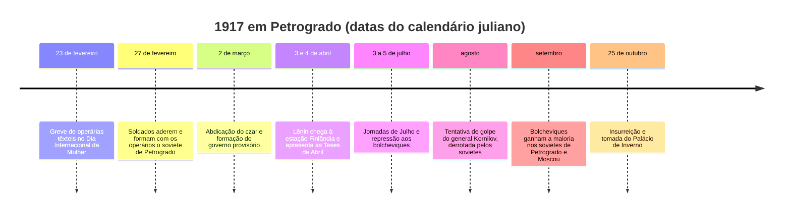
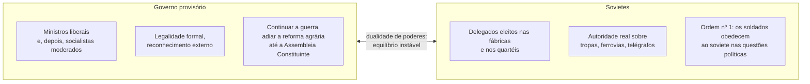
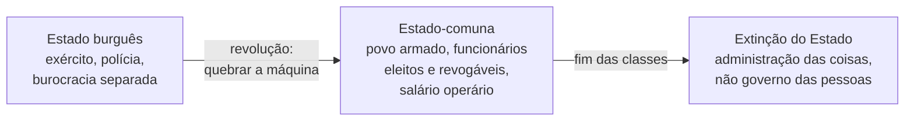

> **Aviso de Idioma:** Este currículo e todos os seus recursos de apoio foram estruturados exclusivamente em **Português (PT-BR)**.

# Aula 5 · 1917: dualidade de poderes e *O Estado e a Revolução*

**MOD-201 · 10 horas · Leitura principal:** Lênin, *Teses de Abril* (1917) e *O Estado e a Revolução* (1917), capítulos I a III e V; Trótski, *História da Revolução Russa*, capítulo 11, "A dualidade de poderes"

*Petrogrado, 4 (17) de julho de 1917: manifestantes se dispersam sob tiros na avenida Nevsky. Fotografia de Viktor Bulla, domínio público.*

## O que você vai aprender

- Narrar a sequência de 1917, de fevereiro a outubro.
- Explicar o conceito de <abbr title="Dualidade de poderes: situação de crise revolucionária em que dois poderes rivais coexistem num mesmo país, cada um apoiado numa classe e com instituições próprias, até que um elimine o outro.">dualidade de poderes</abbr> em Lênin e em Trótski.
- Resumir as *Teses de Abril* e a virada que elas representaram.
- Reconstruir a teoria do Estado de *O Estado e a Revolução*: o Estado como produto dos antagonismos de classe, a destruição da máquina estatal e a extinção do Estado.
- Comparar o programa de 1917 com o que de fato aconteceu depois de outubro.

## Pergunta de abertura

> Em março de 1917, quem mandava na Rússia? O governo provisório, formado por ministros respeitáveis, ou os sovietes de operários e soldados, sem cuja ordem nenhum trem andava e nenhum regimento se movia? Pode um país ter dois governos ao mesmo tempo?

## 1. De fevereiro a outubro

A Rússia estava em guerra havia dois anos e meio, com milhões de mortos, fome nas cidades e exército desmoralizado. Em **fevereiro**, uma greve iniciada por operárias no Dia Internacional da Mulher se transformou, em cinco dias, numa insurreição: os soldados da guarnição de Petrogrado se recusaram a atirar e se juntaram aos manifestantes. O czar abdicou. A monarquia de três séculos caiu quase sem resistência.

Em **outubro**, o soviete de Petrogrado, agora de maioria bolchevique, organizou por meio do seu Comitê Militar Revolucionário (presidido por Trótski) a tomada dos pontos estratégicos da capital. O Segundo Congresso dos Sovietes aprovou a transferência do poder aos sovietes e os decretos sobre a paz e sobre a terra.

## 2. Dois poderes

Depois de fevereiro, a Rússia tinha dois centros de autoridade:

Lênin chamou essa situação de **dualidade de poderes** em abril de 1917. Trótski, na *História da Revolução Russa*, generalizou o conceito: em toda revolução, a classe ascendente constrói os seus próprios órgãos de poder antes de tomar o Estado, e por um tempo os dois poderes coexistem. A dualidade é instável por natureza: dois poderes não podem coexistir por muito tempo, e um precisa eliminar o outro.

Responda à pergunta de abertura com esse conceito: a Rússia de março a outubro tinha dois governos, um com a forma legal e outro com a força real.

## 3. As *Teses de Abril*

Quando Lênin chegou a Petrogrado em 3 de abril, os próprios dirigentes bolcheviques locais (entre eles Stálin e Kamenev) apoiavam criticamente o governo provisório. Lênin apresentou dez teses que chocaram até o seu partido:

- Nenhum apoio ao governo provisório.
- A guerra continua imperialista; é preciso explicar isso pacientemente às massas.
- A revolução deve passar da primeira etapa (que deu o poder à burguesia) à segunda, que deve dar o poder ao proletariado e aos camponeses pobres.
- Não uma república parlamentar, mas uma **república dos sovietes**.
- Confisco das terras dos latifundiários; controle dos bancos e da produção pelos sovietes.

As teses afastavam Lênin do esquema bolchevique de 1905 e o aproximavam da revolução permanente de Trótski (aula 3), que pouco depois entrou no partido bolchevique. O lema "todo o poder aos sovietes" se tornou a palavra de ordem central.

## 4. *O Estado e a Revolução*

Escondido na Finlândia depois das Jornadas de Julho, Lênin escreveu um livro que deixou inacabado, porque, como explicou no posfácio, "é mais agradável e útil viver a experiência da revolução do que escrever sobre ela". *O Estado e a Revolução* é uma releitura de Marx e Engels sobre o Estado, contra os socialistas moderados.

O argumento, passo a passo:

1. **O Estado é produto do caráter inconciliável dos antagonismos de classe.** Retomando Engels (MOD-103, aula 7), o Estado surge quando a sociedade se divide em classes irreconciliáveis, e é, em regra, o Estado da classe dominante.
2. **A máquina estatal não pode ser simplesmente tomada; precisa ser quebrada.** Retomando Marx sobre a Comuna de Paris (MOD-107, aula 1), o exército permanente, a polícia e a burocracia separada do povo devem ser destruídos e substituídos.
3. **O modelo é a Comuna:** povo armado em vez de exército permanente; funcionários eleitos, revogáveis e pagos com salário operário; órgãos ao mesmo tempo executivos e legislativos.
4. **O novo Estado já é "um Estado que não é mais propriamente um Estado".** Para Lênin, as funções de administração do capitalismo moderno estavam tão simplificadas (registro, controle, contabilidade) que poderiam ser exercidas por qualquer pessoa alfabetizada, por rodízio. Pouco depois, no texto *Os Bolcheviques Conservarão o Poder de Estado?* (outubro de 1917), Lênin defendeu que cada cozinheira deveria começar imediatamente a aprender a administrar o Estado.
5. **O Estado se extingue** à medida que as classes desaparecem. Na fase superior do comunismo, vale o princípio "de cada um segundo as suas capacidades, a cada um segundo as suas necessidades".

Repare como o texto se aproxima, em vários pontos, das propostas anarquistas (MOD-107): destruição da máquina estatal, revogabilidade, salário operário, extinção do Estado. A diferença decisiva, que Lênin sublinha contra os anarquistas, é a necessidade de um poder centralizado de transição, a "ditadura do proletariado".

## 5. O programa e a realidade

O contraste entre *O Estado e a Revolução* e o que aconteceu depois de outubro é um dos problemas centrais da história do século XX:

| Programa de 1917 | O que aconteceu entre 1918 e 1921 |
| :--- | :--- |
| Povo armado no lugar do exército permanente | Criação do Exército Vermelho, com oficiais do antigo exército, organizado por Trótski |
| Funcionários eleitos e revogáveis | Crescimento acelerado de uma burocracia de Estado e de partido |
| Poder dos sovietes, com vários partidos | Dissolução da Assembleia Constituinte (janeiro de 1918); a partir de 1918 a 1921, eliminação progressiva dos outros partidos socialistas e anarquistas |
| Liberdade para os trabalhadores | Criação da polícia política (a Tcheka, dezembro de 1917) e do "terror vermelho" na guerra civil |

As explicações para esse contraste dividem os historiadores e as tradições políticas: a guerra civil e a intervenção estrangeira (a explicação de Lênin e Trótski); a lógica do partido centralizado e da ditadura de transição (a explicação de Rosa Luxemburgo e dos anarquistas); o isolamento num país atrasado e destruído (que Trótski vai desenvolver em *A Revolução Traída*, aula 8). A aula 6 trata disso.

## Leitura guiada

1. ***Teses de Abril*** (4 páginas): leia todas as dez teses.
2. ***O Estado e a Revolução*, capítulos I a III** (cerca de 50 páginas): o Estado em Engels, a experiência de 1848 a 1851 e a Comuna de Paris.
3. **Capítulo V** (cerca de 20 páginas): a extinção do Estado e as duas fases do comunismo.
4. **Trótski, *História da Revolução Russa*, capítulo 11** (cerca de 10 páginas): a dualidade de poderes como conceito geral das revoluções.

## Exercícios

**1.** Explique o conceito de dualidade de poderes e por que, para Trótski, ela é instável.

Gabarito comentado

É a coexistência de dois poderes rivais num mesmo país, cada um apoiado numa classe e com instituições próprias (em 1917, o governo provisório e os sovietes). É instável porque dois poderes que reivindicam a autoridade sobre o mesmo território e as mesmas forças armadas não podem conviver indefinidamente: ou um absorve o outro, ou o conflito se resolve pela força.

**2.** Por que, para Lênin, a máquina estatal precisa ser "quebrada", e não simplesmente conquistada?

Gabarito comentado

Porque o Estado existente (exército permanente, polícia, burocracia de carreira separada da população) foi construído para garantir a dominação de uma classe e tem uma estrutura própria que reproduz essa dominação. Conquistar o comando dessa máquina sem transformá-la deixaria intacta a separação entre governantes e governados. A lição vem da Comuna de Paris, segundo Marx.

**3.** Compare a teoria do Estado de *O Estado e a Revolução* com a posição de Bakunin em *Estatismo e Anarquia* (MOD-107, aula 3). Onde convergem e onde divergem?

Gabarito comentado

Convergem na destruição da máquina estatal existente, na revogabilidade dos representantes, na desconfiança da burocracia separada e no objetivo de uma sociedade sem Estado. Divergem na necessidade de um poder centralizado de transição: para Lênin, a ditadura do proletariado é indispensável enquanto houver classes; para Bakunin, todo poder desse tipo cria uma nova classe dominante. A resposta excelente usa o quadro da seção 5 para discutir qual previsão os acontecimentos confirmaram.

**4.** A ideia de que qualquer pessoa alfabetizada poderia exercer as funções de administração, porque estas tinham se tornado simples, é plausível hoje? Responda com o que você estudou sobre burocracia (MOD-105, aula 7) e sobre sistemas digitais.

Critérios de correção

A resposta deve reconhecer o argumento de Lênin (a racionalização simplifica tarefas) e confrontá-lo com Weber (a burocracia concentra saber especializado e poder técnico) e com a complexidade dos sistemas de informação do Estado atual. A melhor resposta discute se a transparência e o software aberto poderiam aproximar a administração do controle popular, ou se a complexidade técnica cria uma nova camada de especialistas, como temiam Bakunin e Weber.

## Resumo da aula

- Fevereiro de 1917 derrubou o czar; outubro deu o poder aos sovietes de maioria bolchevique.
- Entre fevereiro e outubro houve dualidade de poderes: governo provisório e sovietes.
- As *Teses de Abril* propuseram a passagem do poder aos sovietes, aproximando Lênin da revolução permanente.
- *O Estado e a Revolução*: o Estado nasce dos antagonismos de classe, a máquina precisa ser quebrada, o modelo é a Comuna e o Estado deve se extinguir.
- O que aconteceu depois de outubro contrariou o programa em pontos decisivos; as explicações dividem as tradições.

## Para ir além

- John Reed, *Dez Dias que Abalaram o Mundo* (1919), reportagem de um jornalista norte-americano que viveu a insurreição.
- Trótski, *História da Revolução Russa*, volume 2, capítulos sobre a insurreição de outubro.
