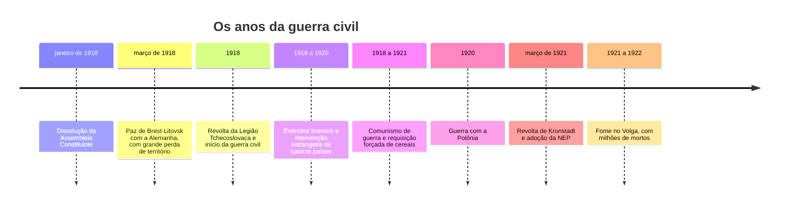
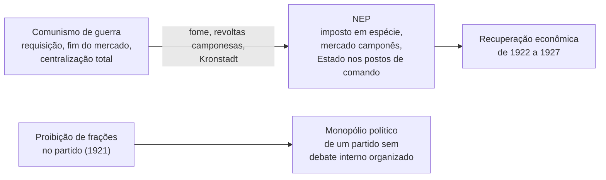
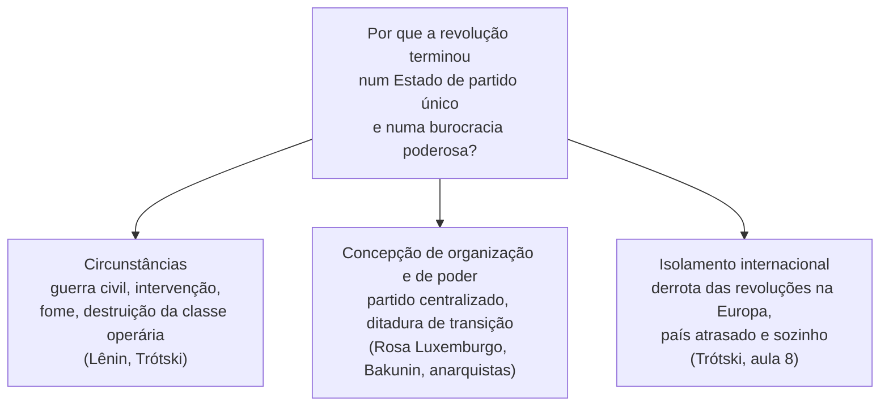

> **Aviso de Idioma:** Este currículo e todos os seus recursos de apoio foram estruturados exclusivamente em **Português (PT-BR)**.

# Aula 6 · Guerra civil, NEP, Kronstadt e o *Esquerdismo*

**MOD-201 · 10 horas · Leitura principal:** Lênin, *Esquerdismo, Doença Infantil do Comunismo* (1920), capítulos 2, 6, 7 e 10 (seleção); Rosa Luxemburgo, *A Revolução Russa* (escrito em 1918, publicado em 1922), seções sobre a Assembleia Constituinte e sobre a democracia

## O que você vai aprender

- Narrar os anos de 1918 a 1921: a paz de Brest-Litovsk, a guerra civil, o <abbr title="Comunismo de guerra: política econômica soviética de 1918 a 1921, com nacionalização ampla, requisição forçada dos cereais dos camponeses e proibição do comércio privado, adotada sob a pressão da guerra civil.">comunismo de guerra</abbr> e a Tcheka.
- Explicar a revolta de Kronstadt e a <abbr title="NEP (Nova Política Econômica): política adotada em 1921 que substituiu a requisição de cereais por um imposto, permitiu o comércio privado e pequenas empresas e manteve sob o Estado os bancos, a grande indústria e o comércio exterior.">NEP</abbr>.
- Reconstruir os argumentos táticos de *Esquerdismo*: compromissos, parlamento e sindicatos.
- Ler a crítica de Rosa Luxemburgo à supressão das liberdades.
- Formar um juízo próprio, com fontes, sobre a relação entre circunstâncias e escolhas políticas.

## Pergunta de abertura

> Um governo revolucionário cercado por exércitos estrangeiros, sabotagem e fome suspende eleições, fecha jornais e prende opositores "provisoriamente", até a vitória. Quando a vitória chega, as liberdades voltam? O que a história do século XX responde?

## 1. Paz, guerra civil e fome

Os bolcheviques prometeram "paz, pão e terra". A **paz** custou caro: no tratado de Brest-Litovsk (março de 1918), a Rússia entregou à Alemanha a Ucrânia, os países bálticos e parte da Bielorrússia. Muitos, inclusive dentro do partido, viram nisso uma traição; Lênin defendeu que era preciso ganhar tempo a qualquer preço.

Em seguida veio a **guerra civil**. Os exércitos "brancos" (generais monarquistas e liberais), apoiados por tropas e dinheiro da Inglaterra, da França, dos Estados Unidos, do Japão e de outros países, avançaram de vários lados. Trótski, comissário da guerra, construiu do nada o **Exército Vermelho**, que chegou a mais de cinco milhões de soldados, usando milhares de oficiais do antigo exército czarista vigiados por comissários políticos.

O preço foi enorme. Para abastecer as cidades e o exército, o governo adotou o **comunismo de guerra**: nacionalização de quase toda a indústria, proibição do comércio privado e requisição forçada dos cereais dos camponeses, muitas vezes à força armada. A **Tcheka**, polícia política criada em dezembro de 1917, conduziu o "terror vermelho", com execuções sumárias; os brancos praticaram o seu "terror branco", com pogroms contra judeus e massacres de operários. A produção industrial caiu a uma pequena fração da de antes da guerra, e as cidades se esvaziaram.

## 2. Kronstadt e a NEP

Em março de 1921, os marinheiros da base naval de **Kronstadt**, perto de Petrogrado, heróis de 1917, se rebelaram. As suas reivindicações incluíam eleições livres e secretas para os sovietes, liberdade de palavra e de imprensa para operários, camponeses, anarquistas e partidos socialistas de esquerda, libertação dos presos políticos socialistas e fim das requisições. O governo os chamou de contrarrevolucionários a serviço dos brancos; o Exército Vermelho, sob a direção de Trótski e do comandante Tukhatchevski, atacou a fortaleza sobre o gelo e esmagou a revolta. Muitos prisioneiros foram fuzilados.

Kronstadt é, até hoje, um divisor entre tradições: os anarquistas e muitos socialistas a veem como o momento em que a revolução se voltou contra os próprios trabalhadores; Lênin e Trótski a apresentaram como uma necessidade militar diante do risco de uma nova intervenção.

No mesmo mês, o X Congresso do partido adotou a **NEP**: a requisição foi substituída por um imposto em espécie, e os camponeses puderam vender o excedente no mercado; o pequeno comércio e a pequena indústria privados voltaram; o Estado manteve os "postos de comando" (bancos, grande indústria, comércio exterior). Lênin a descreveu como um recuo necessário, uma forma de "capitalismo de Estado" sob controle do poder soviético. O mesmo congresso **proibiu as frações** dentro do partido, apresentado como medida temporária.

Repare na combinação, que vai pesar no futuro: **liberalização econômica** e **fechamento político** ao mesmo tempo.

## 3. *Esquerdismo, Doença Infantil do Comunismo*

Em 1920, com a guerra civil quase vencida e partidos comunistas surgindo em toda a Europa (na Terceira Internacional, fundada em 1919), Lênin escreveu um manual de tática contra os comunistas "de esquerda" que recusavam qualquer compromisso. Os argumentos centrais:

| Posição "esquerdista" | Resposta de Lênin |
| :--- | :--- |
| Nenhum compromisso com outras forças | Há compromissos e compromissos: é preciso distinguir o compromisso que trai do que permite avançar. O próprio bolchevismo fez muitos (Brest-Litovsk) |
| Não participar de parlamentos burgueses | Enquanto as massas acreditam no parlamento, é preciso estar nele para desmascará-lo por dentro |
| Sair dos sindicatos reacionários | Recusar os sindicatos é abandonar as massas aos dirigentes reacionários; é preciso trabalhar onde as massas estão |
| Fidelidade aos princípios basta | Política é análise concreta da situação concreta; a tática muda com as circunstâncias |

O livro é um texto sobre **flexibilidade tática**, e muitos o leem como a obra mais útil de Lênin para a política cotidiana. É também, para os críticos, a sistematização de uma política em que os fins justificam variações de meios cada vez mais amplas.

## 4. A crítica de Rosa Luxemburgo

Em 1918, presa na Alemanha, Rosa Luxemburgo escreveu um texto sobre a revolução russa que só foi publicado depois do seu assassinato, em 1919. Ela **defende** a revolução de outubro e a coragem dos bolcheviques de tomar o poder, mas critica:

- A dissolução da Assembleia Constituinte: se a assembleia eleita não refletia mais a vontade popular, o remédio seria convocar novas eleições, e não suprimir as eleições.
- A supressão das liberdades de imprensa, reunião e associação.

E escreve a frase que se tornou célebre:

> "A liberdade apenas para os partidários do governo, apenas para os membros de um partido, por mais numerosos que sejam, não é liberdade. A liberdade é sempre a liberdade de quem pensa de modo diferente." (tradução livre)

O argumento é político, e não só moral: sem eleições gerais, liberdade de imprensa e de reunião, a vida pública se apaga, e só a burocracia permanece ativa. A ditadura do proletariado, para Rosa, devia ser obra da classe, com a mais ampla democracia, e não de uma minoria em nome da classe.

## 5. Circunstâncias e escolhas

Volte à pergunta de abertura. Há três grandes linhas de explicação para o rumo autoritário da revolução, e elas não se excluem totalmente:

Um bom juízo histórico exige considerar as três, com fontes, sem reduzir tudo a uma única causa. O curso não pede que você escolha uma tradição; pede que você saiba reconstruir os argumentos de cada uma e avaliá-los com a evidência.

## Leitura guiada

1. ***Esquerdismo***, capítulos 2 ("Uma das condições fundamentais do êxito dos bolcheviques"), 6 e 7 (sindicatos e parlamentos) e 10 (conclusões). Cerca de 40 páginas.
2. **Rosa Luxemburgo, *A Revolução Russa***, seções sobre a Assembleia Constituinte, o direito de voto e a democracia (cerca de 20 páginas).
3. **Documento:** a resolução dos marinheiros de Kronstadt (março de 1921), disponível em coleções de documentos sobre a revolução russa. Leia-a com o mesmo cuidado com que lê Lênin.

## Exercícios

**1.** O que foi a NEP e por que Lênin a chamou de recuo?

Gabarito comentado

Foi a política econômica adotada em 1921 que substituiu a requisição forçada de cereais por um imposto, permitiu aos camponeses vender o excedente e restabeleceu o pequeno comércio e a pequena indústria privados, mantendo sob o Estado os bancos, a grande indústria e o comércio exterior. Lênin a chamou de recuo porque reintroduzia o mercado e elementos capitalistas, depois do comunismo de guerra, como concessão necessária para reconstruir a economia e restabelecer a aliança com os camponeses.

**2.** Resuma o argumento de *Esquerdismo* sobre os sindicatos reacionários.

Gabarito

Recusar participar de sindicatos dirigidos por reformistas ou reacionários significa abandonar as massas trabalhadoras a esses dirigentes. Os comunistas devem trabalhar onde as massas estão, inclusive nos sindicatos mais atrasados, para disputar a sua orientação.

**3.** Explique a frase de Rosa Luxemburgo sobre a liberdade de quem pensa de modo diferente e o argumento político que a sustenta.

Gabarito comentado

A liberdade que vale só para os partidários do governo não é liberdade. O argumento político: sem eleições gerais, imprensa livre e direito de reunião, a vida pública morre e só a burocracia permanece ativa; o socialismo precisa da experiência e da iniciativa das massas, que dependem da liberdade de discordar. Por isso a supressão das liberdades, além de errada moralmente, destrói a própria revolução.

**4.** Escreva 400 palavras respondendo à pergunta de abertura com base no caso soviético, usando pelo menos duas das três linhas de explicação da seção 5 e a resolução de Kronstadt como fonte.

Critérios de correção

O texto deve usar fontes primárias (Lênin, Rosa Luxemburgo, a resolução de Kronstadt), apresentar com honestidade as circunstâncias (guerra, fome, intervenção) e as escolhas (proibição de partidos e frações, repressão a Kronstadt), e chegar a um juízo argumentado. Textos que só condenam ou só justificam, sem considerar os argumentos contrários, não atendem ao critério.

## Resumo da aula

- Brest-Litovsk (1918), guerra civil e intervenção estrangeira levaram ao comunismo de guerra, ao Exército Vermelho e ao terror da Tcheka.
- Em março de 1921, a revolta de Kronstadt pediu sovietes livres e foi esmagada; no mesmo mês, a NEP reintroduziu o mercado e o partido proibiu as frações.
- *Esquerdismo* (1920) defende flexibilidade tática: compromissos, participação em parlamentos e sindicatos.
- Rosa Luxemburgo defendeu outubro e criticou a supressão das liberdades: a liberdade é a de quem pensa diferente.
- O rumo autoritário tem explicações nas circunstâncias, na concepção de poder e no isolamento internacional.

## Para ir além

- Victor Serge, *Memórias de um Revolucionário* (1951), testemunho de um anarquista que aderiu aos bolcheviques e depois se tornou opositor.
- Paul Avrich, *Kronstadt 1921* (1970), o estudo histórico de referência.
