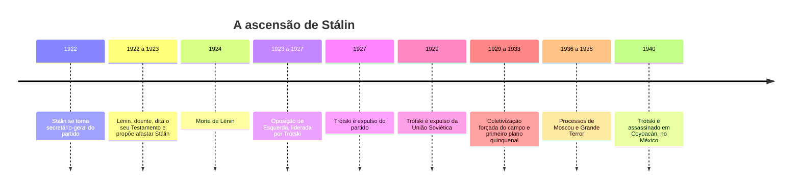
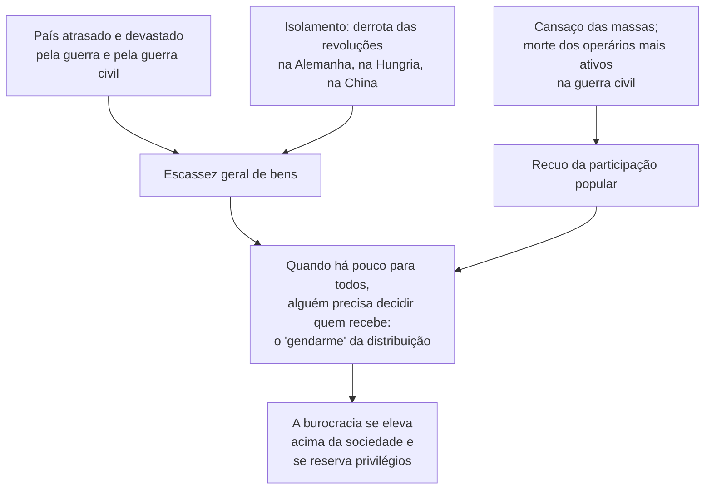

> **Aviso de Idioma:** Este currículo e todos os seus recursos de apoio foram estruturados exclusivamente em **Português (PT-BR)**.

# Aula 8 · *A Revolução Traída* e o balanço de uma época

**MOD-201 · 10 horas · Leitura principal:** Trótski, *A Revolução Traída: O Que É e Para Onde Vai a URSS?* (1936), capítulos 5 ("O Termidor soviético"), 9 ("O que é a URSS?") e 11 ("Para onde vai a URSS?")

## O que você vai aprender

- Narrar a ascensão de Stálin e a derrota da Oposição de Esquerda.
- Explicar a análise de Trótski sobre a burocracia soviética: casta, <abbr title="Termidor: referência ao mês do calendário revolucionário francês em que Robespierre foi derrubado (julho de 1794). Trótski usa o termo para a reação conservadora dentro da revolução, sem volta ao antigo regime.">Termidor</abbr> e bonapartismo.
- Explicar a tese do "Estado operário degenerado" e o programa de revolução política.
- Conhecer as interpretações rivais da natureza da União Soviética.
- Fazer um balanço do módulo e preparar o projeto.

## Pergunta de abertura

> Uma organização é criada para acabar com os privilégios. Vinte anos depois, os seus dirigentes têm carros, casas de campo, lojas especiais e o poder de prender quem os critica. Essa camada dirigente é uma nova classe dominante? E como explicar o que aconteceu sem culpar apenas a maldade de um indivíduo?

## 1. De Lênin a Stálin

Nos seus últimos textos, entre o fim de 1922 e o início de 1923, Lênin, já doente, preocupou-se com a burocratização do Estado e do partido. Numa carta ao congresso, conhecida como o seu Testamento, escreveu que Stálin concentrava um poder imenso e era "rude demais", e propôs que fosse afastado do cargo de secretário-geral. A recomendação não foi seguida.

Depois da morte de Lênin, a Oposição de Esquerda, liderada por Trótski, defendeu mais democracia no partido, industrialização planejada e a extensão internacional da revolução. Foi derrotada por Stálin, que controlava o aparelho do partido e defendia o "socialismo num só país". Trótski foi expulso, exilado na Turquia, na França, na Noruega e, por fim, no México. A partir de 1929, Stálin impôs a coletivização forçada da agricultura (com milhões de mortos pela fome, em especial na Ucrânia) e a industrialização acelerada pelos planos quinquenais. Entre 1936 e 1938, os **Processos de Moscou** condenaram quase toda a velha guarda bolchevique por "traição", com confissões arrancadas; centenas de milhares foram executados no Grande Terror, e milhões passaram pelos campos de trabalho (o Gulag).

## 2. A análise de *A Revolução Traída*

Em 1936, no exílio na Noruega, Trótski escreveu o primeiro grande estudo marxista sobre a sociedade soviética. A pergunta: como uma revolução feita para abolir os privilégios produziu uma camada privilegiada todo-poderosa?

### As raízes materiais

Trótski não explica a burocracia pela personalidade de Stálin, mas por **condições materiais**:

A imagem mais famosa do livro: quando há mercadorias suficientes nas lojas, os compradores podem chegar quando quiserem. Quando há poucas, forma-se uma fila; quando a fila é muito longa, é preciso colocar um policial para manter a ordem. Esse é o ponto de partida do poder da burocracia soviética: ela "sabe" quem deve receber e quem deve esperar.

### Termidor e bonapartismo

Trótski usa analogias com a Revolução Francesa:

- **Termidor:** em julho de 1794 (mês de termidor no calendário revolucionário), Robespierre foi derrubado por outros revolucionários. A revolução não voltou à monarquia, mas entrou numa fase conservadora, em que os novos ricos consolidaram as suas posições. O Termidor soviético seria a vitória da burocracia sobre a vanguarda revolucionária, sem volta ao capitalismo.
- **Bonapartismo:** como no *18 de Brumário* (MOD-103, aula 3), Stálin se eleva acima das forças sociais em conflito e governa como árbitro, apoiado no aparelho, na polícia e no exército.

### Casta, e não classe

A tese central, e a mais discutida: a burocracia **não é uma nova classe dominante**, porque não é proprietária dos meios de produção, que continuam estatizados. Ela não pode transmiti-los por herança. É uma **casta** parasitária, que se apropria de uma parte desproporcional da riqueza por meio do seu controle político. A União Soviética seria um **Estado operário degenerado**: as bases econômicas criadas pela revolução (propriedade estatal, planejamento) persistem, mas o poder político foi usurpado.

Daí o programa: não uma nova revolução social (a economia já estava estatizada), mas uma **revolução política** que derrubasse a burocracia e restabelecesse a democracia dos sovietes, com liberdade para os partidos soviéticos e sindicatos independentes. E a advertência: se isso não acontecesse, a própria burocracia acabaria restaurando o capitalismo para transformar os seus privilégios em propriedade. Muitos leitores veem no colapso de 1991, em que parte da antiga burocracia se tornou dona das empresas privatizadas, a confirmação dessa previsão.

## 3. Interpretações rivais

A pergunta "o que era a União Soviética?" dividiu a esquerda por décadas:

| Interpretação | Autores | Tese |
| :--- | :--- | :--- |
| Estado operário degenerado | Trótski | A burocracia é casta, não classe; a base econômica é socialista em potência |
| Capitalismo de Estado | Tony Cliff e outros | A burocracia age como capitalista coletivo, explorando o trabalho assalariado para acumular |
| Coletivismo burocrático | Max Shachtman, Bruno Rizzi | Uma nova sociedade de classes, nem capitalista nem socialista, com a burocracia como classe dominante |
| Nova classe | Milovan Djilas (1957), dissidente iugoslavo | A burocracia comunista se tornou uma nova classe proprietária coletiva |
| Previsão anarquista | Bakunin (1873) | A "burocracia vermelha" anunciada em *Estatismo e Anarquia* (MOD-107, aula 3) |

O curso não pede que você escolha; pede que você saiba reconstruir cada argumento e testar com evidência histórica.

## 4. Balanço do módulo

Ao longo das oito aulas, Lênin e Trótski apareceram em vários papéis: sociólogos empíricos, teóricos da organização, teóricos do capitalismo mundial, dirigentes de uma revolução, governantes de um Estado em guerra e críticos (Trótski) da burocracia que eles mesmos ajudaram a construir.

Para um curso sobre técnica e sociedade, três legados são especialmente importantes:

1. **O método:** análise concreta da situação concreta, com dados (aula 1) e com atenção às mediações (aula 4).
2. **As categorias:** imperialismo, desenvolvimento desigual e combinado, dualidade de poderes, frente única. Você vai usá-las no Ciclo 3.
3. **A advertência:** organizações criadas para emancipar podem produzir novas formas de dominação, e a concentração de poder técnico e político num aparelho separado da sociedade é um risco permanente. Essa advertência vale para Estados, partidos e também para plataformas digitais.

## Leitura guiada

1. **Capítulo 5, "O Termidor soviético"** (cerca de 25 páginas): a imagem da fila e a análise da ascensão da burocracia.
2. **Capítulo 9, "O que é a URSS?"** (cerca de 15 páginas): casta ou classe.
3. **Capítulo 11, "Para onde vai a URSS?"** (cerca de 15 páginas): as alternativas e o programa de revolução política.

## Exercícios

**1.** Explique a imagem da fila e do policial em *A Revolução Traída*.

Gabarito comentado

Quando há bens suficientes, não é preciso ninguém para controlar a distribuição. Quando há escassez, forma-se uma fila, e alguém precisa manter a ordem e decidir quem recebe. Esse "policial" da distribuição (a burocracia) adquire poder e acaba se servindo primeiro. Trótski usa a imagem para mostrar a raiz material da burocracia: a escassez num país atrasado e isolado.

**2.** Por que Trótski considera a burocracia uma casta, e não uma classe? Apresente uma objeção.

Gabarito comentado

Porque ela não é proprietária dos meios de produção, que continuam estatizados, nem pode transmiti-los por herança; os seus privilégios vêm do controle político, não da propriedade. Objeção (Djilas, Shachtman, Cliff): quem controla de fato os meios de produção e decide sobre o excedente é, na prática, o seu proprietário coletivo, ainda que a forma jurídica seja estatal; a burocracia se reproduzia como grupo social e explorava os trabalhadores.

**3.** Responda à pergunta de abertura usando a análise de Trótski e a previsão de Bakunin.

Critérios de correção

A resposta deve mostrar que, para Trótski, a camada dirigente privilegiada nasce de condições materiais (escassez, isolamento, recuo das massas) e não só da maldade de um indivíduo; e que, para Bakunin, ela nasce da própria concentração de poder político e de saber num aparelho separado. A melhor resposta compara as duas explicações e diz qual parece mais forte à luz da evidência, sem descartar a outra.

**4. Projeto.** Escreva o plano da monografia do módulo: pergunta de pesquisa, hipóteses, categorias de Lênin e Trótski que vai usar, dados que vai coletar e as fontes de cada um.

Critérios de correção

O plano deve ter uma pergunta precisa (por exemplo, "em que medida a concentração do mercado brasileiro de computação em nuvem corresponde às características do imperialismo de Lênin?"), hipóteses verificáveis, categorias definidas com citação, dados existentes e acessíveis com as suas fontes, e um cronograma.

## Resumo da aula

- Depois da morte de Lênin, Stálin derrotou a Oposição de Esquerda; seguiram-se a coletivização forçada, os Processos de Moscou e o Grande Terror. Trótski foi assassinado em 1940.
- Para Trótski, a burocracia nasce da escassez, do isolamento e do cansaço das massas: é o "policial da fila".
- A burocracia seria uma casta, e não uma classe; a URSS, um Estado operário degenerado; o programa, uma revolução política.
- Interpretações rivais: capitalismo de Estado, coletivismo burocrático, nova classe, e a previsão de Bakunin.
- O legado do módulo: método de análise concreta, categorias para o Ciclo 3 e a advertência sobre a concentração de poder num aparelho separado.

## Para ir além

- Isaac Deutscher, a trilogia biográfica *O Profeta Armado*, *O Profeta Desarmado* e *O Profeta Banido* (1954 a 1963).
- Leonardo Padura, *O Homem que Amava os Cachorros* (2009), romance sobre Trótski e o seu assassino.
- Com esta aula você fecha o MOD-201. Volte ao [guia do módulo](../01-teoria-praxis-revolucionaria-lenin-trotsky.md) e faça o projeto.
