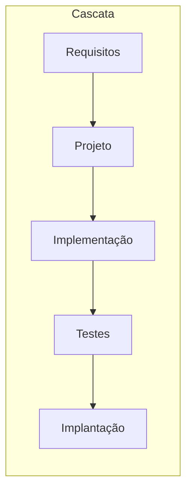
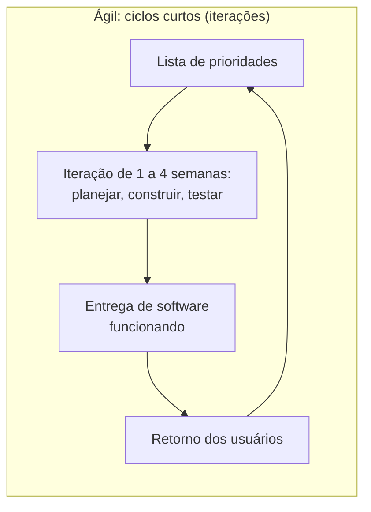

> **Aviso de Idioma:** Este currículo e todos os seus recursos de apoio foram estruturados exclusivamente em **Português (PT-BR)**.

# Aula 1 · O que é engenharia de software

**MOD-202 · 10 horas · Leitura principal:** Marco Tulio Valente, *Engenharia de Software Moderna*, capítulos 1 ("Introdução"), 2 ("Processos") e 3 ("Requisitos")

## O que você vai aprender

- Explicar a diferença entre programar e fazer engenharia de software.
- Conhecer a "crise do software" e a origem do termo em 1968.
- Comparar processos em <abbr title="Modelo em cascata: processo de desenvolvimento em fases sequenciais (requisitos, projeto, implementação, testes, implantação), cada uma terminada antes da seguinte.">cascata</abbr> e <abbr title="Métodos ágeis: famílias de processos (Scrum, XP, Kanban) que desenvolvem o software em ciclos curtos, com entregas frequentes, contato próximo com os usuários e adaptação contínua.">ágeis</abbr>.
- Distinguir <abbr title="Requisito funcional: o que o sistema deve fazer (por exemplo, listar os deputados de um estado). Requisito não funcional: como o sistema deve ser (rápido, seguro, acessível, auditável).">requisitos funcionais e não funcionais</abbr> e escrever histórias de usuário.
- Relacionar a divisão do trabalho na produção de software com as categorias do Ciclo 1.

## Pergunta de abertura

> Um script de 50 linhas escrito numa tarde resolve um problema. Um sistema de 500 mil linhas, como o que calcula benefícios da Previdência para milhões de pessoas, é mantido por centenas de pessoas durante décadas. O que muda, além do tamanho?

## 1. Programar e fazer engenharia

O professor Marco Tulio Valente resume a diferença com uma comparação: programar é como construir uma casinha de cachorro; fazer engenharia de software é como construir um prédio. Para a casinha, basta saber pregar tábuas. Para o prédio, é preciso projeto, cálculo, normas, divisão do trabalho, inspeção, manutenção ao longo de décadas.

Os problemas que aparecem quando o software cresce:

| Problema | Exemplo |
| :--- | :--- |
| **Complexidade** | Ninguém consegue manter o sistema inteiro na cabeça |
| **Mudança** | A lei muda, e o cálculo do benefício precisa mudar sem quebrar o resto |
| **Trabalho coletivo** | Centenas de pessoas mexem no mesmo código, muitas sem se conhecer |
| **Tempo** | Quem escreveu o código foi embora há dez anos |
| **Consequências** | Um erro afeta milhões de pessoas, ou vidas |

A engenharia de software é o conjunto de práticas, princípios e ferramentas para lidar com esses problemas.

## 2. A crise do software

Nos anos 1960, os computadores ficaram mais poderosos, e os projetos de software, muito maiores. Começaram os desastres: projetos anos atrasados, orçamentos estourados, sistemas que não faziam o que deviam. Em 1968, a OTAN reuniu especialistas em Garmisch, na Alemanha, numa conferência chamada provocativamente de **Engenharia de Software**: a ideia era que o software precisava se tornar uma disciplina de engenharia, como a civil ou a elétrica. O diagnóstico da conferência ficou conhecido como **crise do software**.

Na mesma época, a equipe de **Margaret Hamilton** no Laboratório Draper do MIT escrevia o software de voo das missões Apollo. Hamilton, a quem se atribui a popularização do termo "engenharia de software", insistia que o software merecia o mesmo rigor que o hardware. Durante a descida da Apollo 11 na Lua, em 1969, o computador de bordo ficou sobrecarregado; graças a um projeto que priorizava as tarefas mais importantes e descartava as menos importantes, o sistema se recuperou e o pouso continuou.

Em 1975, Fred Brooks, que tinha gerenciado um enorme sistema operacional da IBM, publicou *O Mítico Homem-Mês*, com uma lei que leva o seu nome: **acrescentar pessoas a um projeto atrasado o atrasa ainda mais**, porque as novas pessoas precisam aprender e porque o número de canais de comunicação cresce muito mais rápido que o número de pessoas.

```python
def canais_de_comunicacao(pessoas):
    """Número de pares possíveis numa equipe de n pessoas: n(n-1)/2."""
    return pessoas * (pessoas - 1) // 2


for n in [3, 5, 10, 20, 50]:
    print(f"{n:3d} pessoas → {canais_de_comunicacao(n):5d} canais")
```

Repare: a mesma conta da ordenação por seleção (MOD-102, aula 5). Dobrar a equipe quase quadruplica a comunicação necessária. É por isso que a engenharia de software se preocupa tanto em dividir o sistema em partes com pouca dependência entre si (aula 5).

## 3. Processos: cascata e ágil

Um **processo** é a forma como uma equipe organiza o trabalho, do pedido ao software em uso.





| | Cascata | Ágil |
| :--- | :--- | :--- |
| Requisitos | Definidos por completo no início | Descobertos e ajustados ao longo do caminho |
| Entregas | Uma grande entrega no fim | Entregas pequenas e frequentes |
| Mudança | Cara, porque exige refazer fases | Esperada e incorporada |
| Funciona bem quando | Os requisitos são estáveis e conhecidos (software embarcado, regulamentações rígidas) | O problema é novo, os usuários aprendem com o uso |

O **Manifesto Ágil** (2001) resumiu a proposta em quatro valores: indivíduos e interações mais que processos e ferramentas; software funcionando mais que documentação abrangente; colaboração com o cliente mais que negociação de contratos; responder a mudanças mais que seguir um plano.

> **Uma leitura crítica.** Os métodos ágeis nasceram como reação de programadores à burocracia dos grandes projetos e prometiam mais autonomia às equipes. Na prática, em muitas empresas, viraram instrumentos de controle: reuniões diárias de acompanhamento, metas por "pontos" e painéis que medem a produtividade de cada um. Compare com a subsunção real do trabalho (MOD-103, aula 6) e com a racionalização de Weber (MOD-105, aula 6): uma técnica de organização pode servir à autonomia ou ao controle, conforme as relações em que é usada.

## 4. Requisitos

**Requisitos** dizem o que o sistema deve fazer e como deve ser. Errar nos requisitos é o erro mais caro: um programa perfeito que resolve o problema errado não serve para nada.

| Tipo | Pergunta | Exemplos no SDK de transparência |
| :--- | :--- | :--- |
| **Funcional** | O que o sistema faz? | Listar os deputados em exercício de um estado; buscar as despesas de um deputado num mês |
| **Não funcional** | Como o sistema deve ser? | Responder em menos de 2 segundos com cache; não fazer mais de uma requisição por segundo ao servidor público; funcionar sem internet com dados em cache; ter documentação em português |

### Histórias de usuário

Nos métodos ágeis, requisitos costumam ser escritos como **histórias de usuário**, no formato: *Como [tipo de usuário], quero [ação], para [objetivo]*.

- Como **jornalista de dados**, quero obter as despesas da cota parlamentar de todos os deputados de um estado num ano, para comparar os gastos entre eles.
- Como **pesquisadora**, quero que os resultados venham em objetos tipados, para não precisar adivinhar os nomes dos campos da API.
- Como **mantenedor de um servidor público**, quero que a biblioteca identifique quem está fazendo as requisições e respeite os limites, para que o serviço não caia.

Repare na terceira história: o servidor da API também é um "usuário" do sistema, no sentido de ser afetado por ele. Bons requisitos consideram todas as partes afetadas, não só quem paga.

## 5. A divisão do trabalho no software

Uma equipe de software tem papéis: quem levanta requisitos, quem projeta a arquitetura, quem programa, quem testa, quem opera. A divisão aumenta a produtividade e também cria hierarquias: entre quem decide (arquitetura, produto) e quem executa (implementação de tarefas pequenas). Lembre de Durkheim (divisão do trabalho e solidariedade, MOD-105, aula 2), de Marx (a separação entre concepção e execução, MOD-103, aula 6) e de Kropotkin (a integração do trabalho, MOD-107, aula 5). O projeto deste módulo pede que você faça todos os papéis, justamente para entender o sistema por inteiro.

## Exercícios

**1.** Calcule o número de canais de comunicação numa equipe de 8 pessoas e numa de 16. Explique a Lei de Brooks com esses números.

<details>
<summary>Gabarito</summary>

8 pessoas: 8 × 7 / 2 = **28** canais. 16 pessoas: 16 × 15 / 2 = **120** canais. Dobrar a equipe multiplicou a comunicação por mais de 4. Somando o tempo para os novos aprenderem o sistema, colocar mais gente num projeto atrasado tende a atrasá-lo mais.
</details>

**2.** Para cada situação, diga se um processo em cascata ou ágil é mais adequado, e por quê: (a) o software de controle de um marca-passo; (b) um aplicativo para uma associação de moradores organizar mutirões; (c) a adaptação de um sistema de folha de pagamento a uma nova lei com prazo fixo.

<details>
<summary>Gabarito comentado</summary>

(a) Predominantemente cascata (ou processos com fases rigorosas de verificação), porque os requisitos são estáveis e o erro pode matar; há também exigências regulatórias de documentação. (b) Ágil: os usuários vão descobrir o que precisam usando versões iniciais. (c) Misto: os requisitos legais são fixos (cascata nessa parte), mas a implementação pode ser feita em entregas curtas e testadas. A resposta excelente nota que a escolha depende da estabilidade dos requisitos e do custo do erro.
</details>

**3.** Escreva cinco histórias de usuário para o SDK de transparência, incluindo pelo menos uma de um usuário que não é programador e uma de um requisito não funcional.

<details>
<summary>Critérios de correção</summary>

As histórias devem seguir o formato, ter objetivos concretos e verificáveis e cobrir pelo menos dois tipos de usuário. Exemplo de usuário não programador: "Como servidora de uma câmara municipal, quero um exemplo pronto que gere uma planilha das proposições do meu estado, para usar sem saber programar." Exemplo não funcional: "Como usuário com internet lenta, quero que as respostas fiquem em cache, para não precisar baixar os mesmos dados de novo."
</details>

**4.** Escreva um parágrafo sobre como os métodos ágeis podem servir à autonomia ou ao controle do trabalho, usando um conceito do Ciclo 1.

<details>
<summary>Critérios de correção</summary>

O parágrafo deve descrever práticas ágeis concretas (reunião diária, quadro de tarefas, métricas de velocidade) e mostrar como podem ser usadas pela equipe para se organizar ou pela gerência para controlar o ritmo de trabalho. Deve usar com precisão um conceito do Ciclo 1 (subsunção real, racionalização, crosta de aço, autogestão).
</details>

## Resumo da aula

- Engenharia de software lida com complexidade, mudança, trabalho coletivo, tempo e consequências.
- A crise do software dos anos 1960 levou à conferência de 1968; Margaret Hamilton e a Apollo são marcos da disciplina.
- Lei de Brooks: mais pessoas num projeto atrasado o atrasam mais, porque a comunicação cresce com n(n-1)/2.
- Cascata serve a requisitos estáveis; ágil, a problemas que se descobrem com o uso. Técnicas de organização podem servir à autonomia ou ao controle.
- Requisitos funcionais e não funcionais; histórias de usuário consideram todas as partes afetadas.

## Para ir além

- *Engenharia de Software Moderna*, capítulo 2, sobre Scrum, XP e Kanban.
- Fred Brooks, "Não existe bala de prata" (1986), ensaio sobre a complexidade essencial do software.
