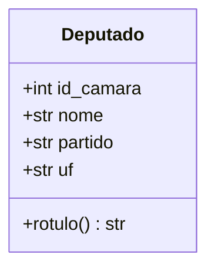
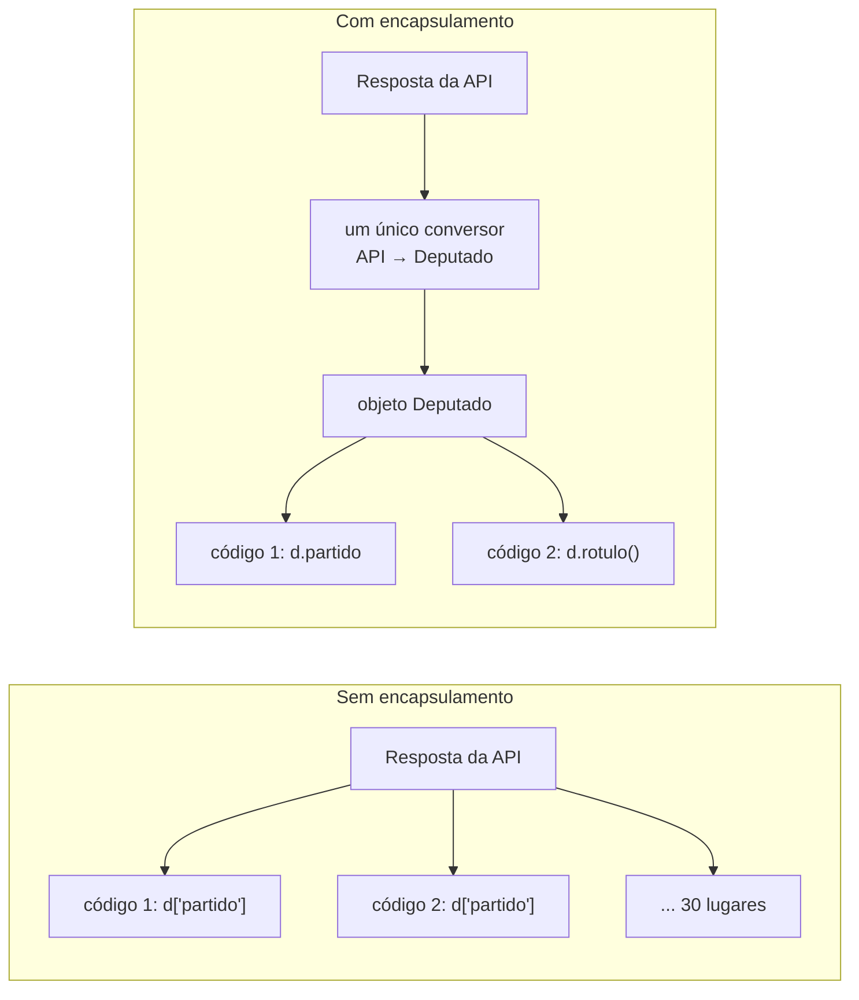
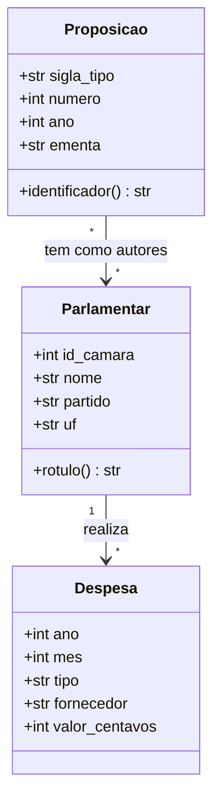

> **Aviso de Idioma:** Este currículo e todos os seus recursos de apoio foram estruturados exclusivamente em **Português (PT-BR)**.

# Aula 2 · Classes e objetos: modelando o domínio

**MOD-202 · 10 horas · Apoio:** Tutorial de Python, capítulo 9 ("Classes"); *Engenharia de Software Moderna*, capítulo 5, seção sobre ocultação de informação

## O que você vai aprender

- Explicar o que são <abbr title="Classe: molde que define os dados (atributos) e os comportamentos (métodos) de um tipo de objeto. Por exemplo, a classe Deputado.">classes</abbr> e <abbr title="Objeto (instância): um exemplar concreto criado a partir de uma classe, com os seus próprios valores. Por exemplo, um deputado específico.">objetos</abbr> e por que eles ajudam a organizar sistemas grandes.
- Escrever classes com atributos, métodos e o construtor `__init__`.
- Aplicar o <abbr title="Encapsulamento: esconder os detalhes internos de um objeto e expor só uma interface controlada, para que quem usa o objeto não dependa de como ele foi feito por dentro.">encapsulamento</abbr> e a ocultação de informação.
- Usar <abbr title="Dataclass: recurso do Python (módulo dataclasses) que gera automaticamente o construtor, a representação e a comparação de classes que servem principalmente para guardar dados.">dataclasses</abbr> para representar entidades do domínio.
- Modelar o domínio do SDK de transparência: deputados, despesas e proposições.

## Pergunta de abertura

> Um programa guarda os dados de um deputado num dicionário: `{"nome": "...", "partido": "...", "uf": "..."}`. Em 30 lugares diferentes do código, alguém escreve `deputado["partido"]`. Um dia a API passa a chamar o campo de `"siglaPartido"`. Quantos lugares você precisa mudar? E como saber se esqueceu algum?

## 1. Do dicionário ao objeto

Até agora você representou registros com dicionários e tuplas (MOD-106, aula 2). Funciona para programas pequenos. Em sistemas grandes, aparecem problemas:

- Nada garante que o dicionário tenha os campos certos.
- O conhecimento sobre o registro (como calcular a idade, como formatar o nome) fica espalhado pelo código.
- Mudar a representação interna obriga a mudar todos os lugares que a usam.

A **programação orientada a objetos** (POO) junta, num só lugar, os **dados** e as **operações** sobre esses dados. O molde é a **classe**; cada exemplar é um **objeto**.

```python
class Deputado:
    """Um deputado federal em exercício."""

    def __init__(self, id_camara, nome, partido, uf):
        self.id_camara = id_camara
        self.nome = nome
        self.partido = partido
        self.uf = uf

    def rotulo(self):
        return f"{self.nome} ({self.partido}/{self.uf})"


d = Deputado(id_camara=1, nome="Maria Exemplo", partido="PARTIDO A", uf="CE")
print(d.rotulo())          # Maria Exemplo (PARTIDO A/CE)
print(d.uf)                # CE
```

- `__init__` é o **construtor**: roda quando o objeto é criado e define os seus **atributos**.
- `self` é o próprio objeto: dentro dos métodos, `self.nome` é o nome *deste* deputado.
- `rotulo` é um **método**: uma função que pertence à classe e trabalha com os dados do objeto.



## 2. Encapsulamento e ocultação de informação

Em 1972, o pesquisador David Parnas publicou um artigo que mudou a forma de dividir sistemas: cada módulo deve **esconder uma decisão de projeto que pode mudar**, expondo só uma interface estável. Se a decisão mudar, só aquele módulo é alterado.

Volte à pergunta de abertura. Se o código inteiro acessa `deputado["partido"]`, a decisão "o campo se chama partido" está espalhada em 30 lugares. Se só a classe `Deputado` conhece essa decisão, e o resto do código usa `d.partido` ou `d.rotulo()`, a mudança da API afeta **um único lugar**: o código que cria o objeto a partir da resposta da API.



Em Python, a convenção é marcar com sublinhado (`_atributo`) o que é interno e não deve ser usado de fora. A linguagem não proíbe o acesso (é uma convenção entre adultos), mas quem usa um atributo com sublinhado sabe que está dependendo de um detalhe que pode mudar.

### Propriedades: controlar o acesso sem mudar a interface

```python
class Despesa:
    def __init__(self, descricao, valor_centavos):
        self.descricao = descricao
        self._valor_centavos = valor_centavos   # guardamos em centavos (inteiro), não em float

    @property
    def valor_reais(self):
        return self._valor_centavos / 100

    def formatada(self):
        reais, centavos = divmod(self._valor_centavos, 100)
        return f"R$ {reais:,}".replace(",", ".") + f",{centavos:02d}"


gasto = Despesa("Passagem aérea", 123456)
print(gasto.valor_reais)    # 1234.56
print(gasto.formatada())    # R$ 1.234,56
```

A decisão de guardar em centavos inteiros (por causa da imprecisão do `float`, MOD-102, aula 1) fica escondida dentro da classe. Quem usa só vê `valor_reais` e `formatada()`.

## 3. Dataclasses

Muitas classes de um sistema servem principalmente para **guardar dados**. Escrever `__init__`, a representação para impressão e a comparação toda vez é repetitivo. O módulo `dataclasses` gera isso automaticamente:

```python
from dataclasses import dataclass, field
from datetime import date


@dataclass(frozen=True)
class Parlamentar:
    id_camara: int
    nome: str
    partido: str
    uf: str
    email: str | None = None

    def rotulo(self) -> str:
        return f"{self.nome} ({self.partido}/{self.uf})"


@dataclass
class Proposicao:
    sigla_tipo: str
    numero: int
    ano: int
    ementa: str
    autores: list[Parlamentar] = field(default_factory=list)
    apresentacao: date | None = None

    @property
    def identificador(self) -> str:
        return f"{self.sigla_tipo} {self.numero}/{self.ano}"


autora = Parlamentar(1, "Maria Exemplo", "PARTIDO A", "CE")
pl = Proposicao("PL", 1234, 2025, "Dispõe sobre transparência ativa", [autora])
print(pl.identificador)          # PL 1234/2025
print(autora)                    # representação gerada automaticamente
print(autora == Parlamentar(1, "Maria Exemplo", "PARTIDO A", "CE"))   # True
```

Detalhes importantes:

- As anotações de tipo (`nome: str`) definem os campos. Você vai aprofundar os tipos na aula 4.
- `frozen=True` torna o objeto **imutável**: depois de criado, não pode ser alterado. Isso evita a armadilha da aula 2 do MOD-106 (objetos compartilhados alterados sem querer) e permite usar o objeto como chave de dicionário.
- Para listas como valor padrão, use `field(default_factory=list)`: um valor padrão mutável compartilhado entre todos os objetos seria um erro clássico.

## 4. Modelando o domínio

O **domínio** é a parte do mundo que o sistema representa. Modelar bem o domínio é a decisão mais importante de um sistema: as classes do domínio devem usar a linguagem de quem conhece o assunto (aqui, a linguagem do processo legislativo), e não a linguagem da API ou do banco de dados.



> **Conexão com a teoria:** modelar um domínio é decidir o que existe para o sistema. É exatamente o que o MOD-101 chamou de ontologia e o que Durkheim chamou de representações coletivas cristalizadas em classificações (MOD-105, aula 4). Uma classe `Parlamentar` sem o campo "suplente" ou sem o histórico de mudanças de partido torna invisíveis fenômenos politicamente importantes (como o troca-troca partidário). Pergunte sempre: o que o meu modelo deixa de fora?

## Exercícios

**1.** Escreva uma classe `Partido` com sigla, nome e uma lista de parlamentares, e um método `tamanho_bancada()`.

<details>
<summary>Gabarito</summary>

```python
@dataclass
class Partido:
    sigla: str
    nome: str
    parlamentares: list[Parlamentar] = field(default_factory=list)

    def tamanho_bancada(self) -> int:
        return len(self.parlamentares)


p = Partido("PA", "Partido A", [autora])
print(p.tamanho_bancada())   # 1
```
</details>

**2.** Explique, com a pergunta de abertura, por que o encapsulamento reduz o custo de mudanças.

<details>
<summary>Gabarito comentado</summary>

Sem encapsulamento, a decisão sobre o nome do campo está repetida em todos os lugares que acessam o dicionário, e uma mudança na API exige achar e alterar todos eles, com risco de esquecer algum. Com encapsulamento, só o conversor que cria o objeto a partir da API conhece o nome do campo; o resto do código usa a interface estável da classe. A mudança fica restrita a um lugar.
</details>

**3.** O que acontece se você tentar alterar `autora.partido = "PARTIDO B"` num `Parlamentar` com `frozen=True`? Por que isso pode ser desejável?

<details>
<summary>Gabarito comentado</summary>

O Python lança `dataclasses.FrozenInstanceError`. É desejável porque um registro vindo de uma fonte oficial não deveria ser alterado por acidente em algum ponto do programa. Se o parlamentar mudar de partido, isso é um fato novo, que deve ser representado por um novo objeto (ou por um histórico), e não por uma alteração silenciosa.
</details>

**4.** Estenda o modelo do domínio para representar a mudança de partido de um parlamentar ao longo do tempo. Desenhe o diagrama de classes em Mermaid.

<details>
<summary>Critérios de correção</summary>

Uma boa solução cria uma classe `Filiacao` (parlamentar, partido, data de início, data de fim opcional) e faz o `Parlamentar` ter uma lista de filiações, com um método que devolve o partido numa data. O diagrama deve mostrar a relação de um para muitos. A resposta excelente comenta que essa modelagem permite estudar a fidelidade partidária, algo invisível no modelo simples.
</details>

## Resumo da aula

- Classes juntam dados e operações; objetos são exemplares concretos.
- Encapsulamento e ocultação de informação (Parnas, 1972): cada módulo esconde uma decisão que pode mudar.
- Propriedades permitem controlar o acesso sem mudar a interface; guarde dinheiro em centavos inteiros.
- Dataclasses geram construtor, representação e comparação; `frozen=True` torna o objeto imutável.
- Modelar o domínio é decidir o que existe para o sistema: pergunte sempre o que o modelo deixa de fora.

## Para ir além

- David Parnas, "On the criteria to be used in decomposing systems into modules" (1972), um dos artigos mais influentes da área.
- *Engenharia de Software Moderna*, capítulo 5, seção 5.2 sobre ocultação de informação.
