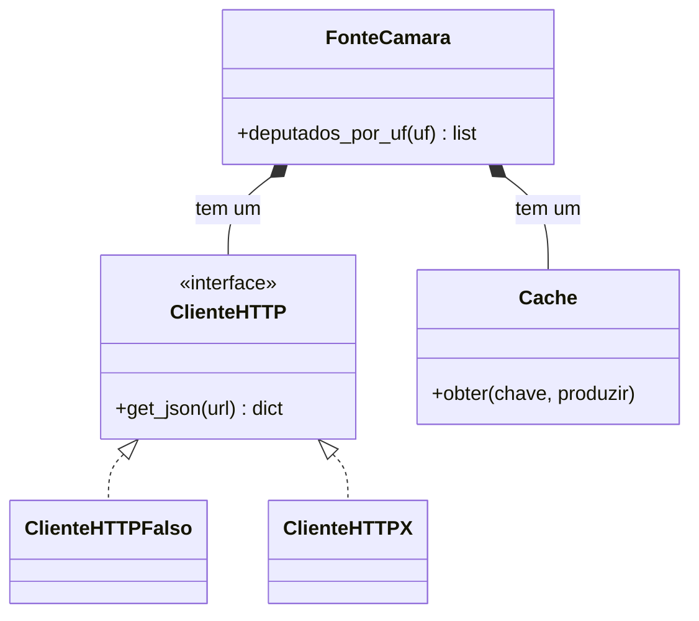

> **Aviso de Idioma:** Este currículo e todos os seus recursos de apoio foram estruturados exclusivamente em **Português (PT-BR)**.

# Aula 3 · Herança, composição e polimorfismo

**MOD-202 · 10 horas · Apoio:** Tutorial de Python, seção 9.5 ("Herança"); *Engenharia de Software Moderna*, capítulo 5, seção sobre composição e herança

## O que você vai aprender

- Usar <abbr title="Herança: mecanismo em que uma classe (filha) reaproveita e especializa os atributos e métodos de outra (mãe). Expressa uma relação do tipo é um.">herança</abbr> para especializar classes e entender os seus riscos.
- Usar <abbr title="Composição: construir um objeto a partir de outros objetos que ele contém e aos quais delega tarefas. Expressa uma relação do tipo tem um.">composição</abbr> e entender por que ela é preferida na maior parte dos casos.
- Explicar o <abbr title="Polimorfismo: capacidade de tratar objetos de classes diferentes pela mesma interface. O mesmo código chama o mesmo método, e cada objeto responde do seu jeito.">polimorfismo</abbr> e o <abbr title="Tipagem pato (duck typing): em Python, o que importa é se o objeto tem os métodos necessários, e não a sua classe. Se anda como pato e grasna como pato, é tratado como pato.">duck typing</abbr> do Python.
- Declarar contratos com `typing.Protocol` e `abc.ABC`.
- Aplicar a regra "prefira composição a herança" ao SDK de transparência.

## Pergunta de abertura

> O SDK precisa falar com a API da Câmara e com a do Senado. As duas devolvem parlamentares, mas com formatos, endereços e regras diferentes. Como escrever o resto do programa (relatórios, análises) uma vez só, sem saber de qual casa vieram os dados?

## 1. Herança: é um

A herança permite criar uma classe nova a partir de outra, reaproveitando o que ela tem e acrescentando ou mudando o que for preciso.

```python
class Documento:
    def __init__(self, titulo, ano):
        self.titulo = titulo
        self.ano = ano

    def citacao(self):
        return f"{self.titulo} ({self.ano})"


class Lei(Documento):
    def __init__(self, titulo, ano, numero):
        super().__init__(titulo, ano)     # reaproveita o construtor da classe mãe
        self.numero = numero

    def citacao(self):                    # sobrescreve o método
        return f"Lei nº {self.numero}/{self.ano}: {self.titulo}"


docs = [Documento("Relatório anual", 2024), Lei("Acesso à Informação", 2011, 12527)]
for d in docs:
    print(d.citacao())
```

Uma `Lei` **é um** `Documento`. O laço chama `citacao()` sem saber se cada item é documento ou lei, e cada objeto responde do seu jeito: isso é **polimorfismo**.

### Os riscos da herança

A herança cria o acoplamento mais forte que existe entre duas classes: a filha depende de detalhes internos da mãe. Problemas típicos:

- **Classe base frágil:** uma mudança na mãe quebra filhas que ninguém lembrou de testar.
- **Hierarquias rígidas:** o mundo real raramente cabe numa árvore. Uma proposição pode ser ao mesmo tempo "do Executivo" e "urgente"; um parlamentar pode ser deputado e depois senador.
- **Herança para reaproveitar código, não para expressar "é um":** herdar de `list` só para ganhar `append` faz a sua classe expor dezenas de métodos que não fazem sentido para ela.

## 2. Composição: tem um

Na composição, um objeto **contém** outros e **delega** a eles parte do trabalho.

```python
class ClienteHTTPFalso:
    """Simula respostas de uma API, para não depender da internet nos exemplos."""

    def __init__(self, respostas):
        self.respostas = respostas
        self.chamadas = 0

    def get_json(self, url):
        self.chamadas += 1
        return self.respostas[url]


class Cache:
    def __init__(self):
        self._dados = {}

    def obter(self, chave, produzir):
        if chave not in self._dados:
            self._dados[chave] = produzir()
        return self._dados[chave]


class FonteCamara:
    BASE = "https://dadosabertos.camara.leg.br/api/v2"

    def __init__(self, cliente, cache):
        self.cliente = cliente      # tem um cliente HTTP
        self.cache = cache          # tem um cache

    def deputados_por_uf(self, uf):
        url = f"{self.BASE}/deputados?siglaUf={uf}"
        dados = self.cache.obter(url, lambda: self.cliente.get_json(url))
        return [d["nome"] for d in dados["dados"]]


url = "https://dadosabertos.camara.leg.br/api/v2/deputados?siglaUf=CE"
cliente = ClienteHTTPFalso({url: {"dados": [{"nome": "Maria Exemplo"}, {"nome": "João Exemplo"}]}})
fonte = FonteCamara(cliente, Cache())
print(fonte.deputados_por_uf("CE"))
print(fonte.deputados_por_uf("CE"))
print("Chamadas reais ao cliente:", cliente.chamadas)   # 1: a segunda veio do cache
```

A `FonteCamara` não herda de nada: ela **tem** um cliente e um cache. Isso traz duas vantagens enormes:

1. **Troca de peças:** para os exemplos e os testes, passamos um `ClienteHTTPFalso`; em produção, um cliente real com `httpx`. A `FonteCamara` não muda.
2. **Responsabilidades separadas:** cache, transporte HTTP e conhecimento da API da Câmara estão em classes diferentes, cada uma pequena e testável.



A recomendação clássica do livro *Padrões de Projeto* (1994) é: **prefira composição a herança**. Use herança quando a relação "é um" for verdadeira e estável; use composição para quase todo o resto.

## 3. Polimorfismo sem herança: duck typing

Em Python, para que um objeto possa ser usado no lugar de outro, ele **não precisa herdar** de uma classe comum: basta ter os métodos que o código chama. O `ClienteHTTPFalso` funciona na `FonteCamara` simplesmente porque tem `get_json`. É o **duck typing**: se anda como pato e grasna como pato, é tratado como pato.

### Tornando o contrato explícito: `Protocol`

O duck typing é flexível, mas deixa o contrato implícito. O módulo `typing` permite declará-lo com um **protocolo**, que ferramentas de verificação de tipos (como o mypy, aula 4) conferem sem exigir herança:

```python
from typing import Protocol


class FonteParlamentares(Protocol):
    def parlamentares_por_uf(self, uf: str) -> list[str]: ...


class FonteSenadoFalsa:
    def parlamentares_por_uf(self, uf: str) -> list[str]:
        return ["Ana Exemplo"] if uf == "CE" else []


class FonteCamaraFalsa:
    def parlamentares_por_uf(self, uf: str) -> list[str]:
        return ["Maria Exemplo", "João Exemplo"] if uf == "CE" else []


def bancada_estadual(fontes: list[FonteParlamentares], uf: str) -> list[str]:
    nomes: list[str] = []
    for fonte in fontes:
        nomes.extend(fonte.parlamentares_por_uf(uf))
    return sorted(nomes)


print(bancada_estadual([FonteCamaraFalsa(), FonteSenadoFalsa()], "CE"))
```

Responda à pergunta de abertura: o resto do programa (como `bancada_estadual`) depende só do **protocolo** `FonteParlamentares`. Cada casa legislativa tem a sua implementação, que esconde o formato da sua API. Acrescentar uma terceira fonte (uma assembleia estadual) não muda nenhuma linha de `bancada_estadual`.

### Classes abstratas

A alternativa mais tradicional é uma **classe base abstrata** (`abc.ABC`), que obriga as filhas a implementar certos métodos:

```python
from abc import ABC, abstractmethod


class Exportador(ABC):
    @abstractmethod
    def exportar(self, linhas: list[dict]) -> str: ...


class ExportadorCSV(Exportador):
    def exportar(self, linhas: list[dict]) -> str:
        if not linhas:
            return ""
        cabecalho = ";".join(linhas[0])
        corpo = "\n".join(";".join(str(v) for v in l.values()) for l in linhas)
        return cabecalho + "\n" + corpo


print(ExportadorCSV().exportar([{"nome": "Maria", "uf": "CE"}]))
try:
    Exportador()
except TypeError as erro:
    print("Não se instancia classe abstrata:", erro)
```

| | `Protocol` | `ABC` |
| :--- | :--- | :--- |
| Exige herança | Não (tipagem estrutural) | Sim (tipagem nominal) |
| Verificação | Pelo verificador de tipos, antes de rodar | Em tempo de execução, ao criar o objeto |
| Bom para | Integrar classes de bibliotecas diferentes | Hierarquias controladas pelo próprio projeto |

## Exercícios

**1.** Dê um exemplo de herança bem usada e um de herança mal usada no domínio legislativo.

<details>
<summary>Gabarito comentado</summary>

Bem usada: `MedidaProvisoria(Proposicao)`, se toda medida provisória de fato é uma proposição e acrescenta só atributos próprios (prazo de vigência). Mal usada: `Senador(Deputado)` "para aproveitar os campos de nome e partido": um senador não é um deputado, e qualquer regra específica dos deputados (cota parlamentar da Câmara) seria herdada indevidamente. A solução seria uma classe comum `Parlamentar` ou composição.
</details>

**2.** Escreva uma `FonteAssembleiaFalsa` para a Assembleia Legislativa do Ceará e use-a em `bancada_estadual` sem mudar a função.

<details>
<summary>Gabarito</summary>

```python
class FonteAssembleiaFalsa:
    def parlamentares_por_uf(self, uf: str) -> list[str]:
        return ["Carla Exemplo"] if uf == "CE" else []


print(bancada_estadual([FonteCamaraFalsa(), FonteSenadoFalsa(), FonteAssembleiaFalsa()], "CE"))
```
</details>

**3.** Por que a composição facilita os testes? Use o `ClienteHTTPFalso` como exemplo.

<details>
<summary>Gabarito comentado</summary>

Porque a `FonteCamara` recebe o cliente HTTP de fora: num teste, passamos um cliente falso com respostas fixas, e o teste roda sem internet, sempre igual e rápido, e ainda permite verificar quantas chamadas foram feitas. Com herança de uma classe que faz requisições reais, seria preciso alterar ou contornar o comportamento da classe mãe. O MOD-204 usa essa técnica extensivamente.
</details>

**4.** Modifique o `Cache` para expirar entradas depois de um tempo em segundos, recebendo uma função que devolve a hora atual (para poder testar sem esperar).

<details>
<summary>Gabarito</summary>

```python
import time


class CacheComValidade:
    def __init__(self, validade_s, relogio=time.monotonic):
        self.validade_s = validade_s
        self.relogio = relogio
        self._dados = {}

    def obter(self, chave, produzir):
        agora = self.relogio()
        if chave in self._dados:
            valor, instante = self._dados[chave]
            if agora - instante < self.validade_s:
                return valor
        valor = produzir()
        self._dados[chave] = (valor, agora)
        return valor


instantes = iter([0, 10, 100])
c = CacheComValidade(60, relogio=lambda: next(instantes))
print(c.obter("x", lambda: "v1"), c.obter("x", lambda: "v2"), c.obter("x", lambda: "v3"))
# v1 v1 v3: a terceira consulta, aos 100 segundos, passou da validade
```

Receber o relógio como parâmetro é composição de novo: permite testar o tempo sem esperar.
</details>

## Resumo da aula

- Herança expressa "é um" e permite polimorfismo, mas cria acoplamento forte e hierarquias rígidas.
- Composição expressa "tem um": o objeto contém outros e delega a eles. Prefira composição a herança.
- Em Python, o polimorfismo não exige herança: duck typing.
- `Protocol` declara contratos verificados sem herança; `ABC` obriga as filhas a implementar métodos.
- O resto do programa deve depender do protocolo, não das implementações de cada fonte.

## Para ir além

- [Refactoring.Guru: "Composição sobre herança"](https://refactoring.guru/pt-br/design-patterns).
- PEP 544, que introduziu os protocolos no Python.
