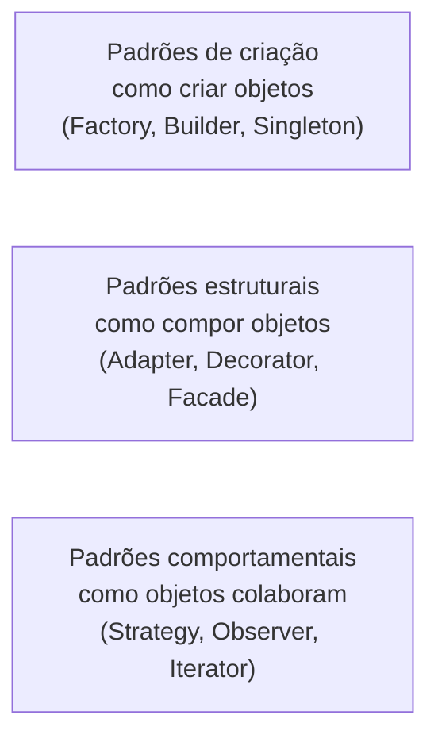

> **Aviso de Idioma:** Este currículo e todos os seus recursos de apoio foram estruturados exclusivamente em **Português (PT-BR)**.

# Aula 6 · Padrões de projeto

**MOD-202 · 10 horas · Leitura principal:** *Engenharia de Software Moderna*, capítulo 6, "Padrões de Projeto"; [Refactoring.Guru em português](https://refactoring.guru/pt-br/design-patterns/python), páginas de Strategy, Adapter, Factory Method e Decorator

## O que você vai aprender

- Explicar o que é um <abbr title="Padrão de projeto: solução reutilizável e nomeada para um problema recorrente de projeto de software, descrita de forma independente de linguagem. O catálogo clássico tem 23 padrões.">padrão de projeto</abbr> e a origem do catálogo clássico.
- Implementar em Python os padrões Strategy, Adapter, Factory, Decorator e Repository.
- Reconhecer quando um padrão ajuda e quando só complica.
- Escolher os padrões adequados para o SDK de transparência.

## Pergunta de abertura

> Três equipes diferentes, em três países, resolveram o mesmo problema: "como trocar o algoritmo de cálculo sem mudar o resto do sistema". Cada uma inventou uma solução parecida, com nomes diferentes. Não seria útil ter um nome comum para essa solução?

## 1. Uma linguagem comum

Em 1977, o arquiteto Christopher Alexander publicou *Uma Linguagem de Padrões*, catalogando soluções recorrentes da arquitetura de cidades e casas (uma janela em cada lado do quarto, um caminho que passa perto das portas). Em 1994, quatro engenheiros de software (Erich Gamma, Richard Helm, Ralph Johnson e John Vlissides, chamados de "Gangue dos Quatro") aplicaram a ideia ao software no livro *Padrões de Projeto*, com 23 padrões.

Um padrão tem: um **nome**, o **problema** que resolve, a **solução** (as classes e as suas relações) e as **consequências** (vantagens e custos). O maior valor de um padrão é o **nome**: dizer "aqui usamos um Adapter" comunica em duas palavras uma estrutura inteira.



## 2. Strategy: trocar o algoritmo

**Problema:** um cálculo pode ser feito de vários jeitos, e o jeito deve poder mudar sem alterar quem o usa.

**Solução:** cada jeito é uma "estratégia" com a mesma interface; o objeto que usa recebe a estratégia.

```python
from typing import Callable

Estrategia = Callable[[list[float]], float]


def media(valores: list[float]) -> float:
    return sum(valores) / len(valores)


def mediana(valores: list[float]) -> float:
    ordenados = sorted(valores)
    meio = len(ordenados) // 2
    if len(ordenados) % 2:
        return ordenados[meio]
    return (ordenados[meio - 1] + ordenados[meio]) / 2


class IndicadorDeGastos:
    def __init__(self, estrategia: Estrategia):
        self.estrategia = estrategia

    def calcular(self, gastos: list[float]) -> float:
        return self.estrategia(gastos)


gastos = [1200, 1500, 1300, 1400, 98000]   # um gasto muito fora da curva
print("média:", IndicadorDeGastos(media).calcular(gastos))
print("mediana:", IndicadorDeGastos(mediana).calcular(gastos))
```

Em Python, como funções são objetos, a estratégia pode ser simplesmente uma função. Repare também que **a escolha da estratégia é uma escolha de interpretação**: a média é puxada para cima por um único gasto enorme, a mediana não. Um relatório sobre gastos parlamentares que só mostra a média pode dar uma impressão muito diferente da realidade. Isso volta no MOD-207.

## 3. Adapter: encaixar o que não encaixa

**Problema:** você tem uma interface que o seu sistema espera (`FonteParlamentares`) e um componente externo com outra interface (a API do Senado, com outros nomes e outra estrutura).

**Solução:** uma classe **adaptadora** que implementa a interface esperada traduzindo para o componente externo, como um adaptador de tomada.

```python
from dataclasses import dataclass


@dataclass(frozen=True)
class Parlamentar:
    nome: str
    partido: str
    uf: str


# Formato (simplificado) que uma API do Senado poderia devolver
RESPOSTA_SENADO = {
    "ListaParlamentarEmExercicio": {"Parlamentares": {"Parlamentar": [
        {"IdentificacaoParlamentar": {"NomeParlamentar": "Ana Exemplo",
                                      "SiglaPartidoParlamentar": "PC", "UfParlamentar": "CE"}},
    ]}}
}

RESPOSTA_CAMARA = {"dados": [{"nome": "Maria Exemplo", "siglaPartido": "PA", "siglaUf": "CE"}]}


class AdaptadorSenado:
    def __init__(self, obter_json):
        self.obter_json = obter_json

    def parlamentares(self) -> list[Parlamentar]:
        bruto = self.obter_json()["ListaParlamentarEmExercicio"]["Parlamentares"]["Parlamentar"]
        return [Parlamentar(p["IdentificacaoParlamentar"]["NomeParlamentar"],
                            p["IdentificacaoParlamentar"]["SiglaPartidoParlamentar"],
                            p["IdentificacaoParlamentar"]["UfParlamentar"]) for p in bruto]


class AdaptadorCamara:
    def __init__(self, obter_json):
        self.obter_json = obter_json

    def parlamentares(self) -> list[Parlamentar]:
        return [Parlamentar(d["nome"], d["siglaPartido"], d["siglaUf"]) for d in self.obter_json()["dados"]]


fontes = [AdaptadorCamara(lambda: RESPOSTA_CAMARA), AdaptadorSenado(lambda: RESPOSTA_SENADO)]
for fonte in fontes:
    print([p.nome for p in fonte.parlamentares()])
```

Os formatos acima são simplificações didáticas. As APIs reais são documentadas nos portais de dados abertos de cada casa, e o projeto deve seguir a documentação oficial.

## 4. Factory: centralizar a criação

**Problema:** criar o objeto certo exige conhecer detalhes (qual classe, com quais parâmetros), e esse conhecimento não deveria se espalhar pelo código.

**Solução:** uma função ou classe **fábrica** que decide o que criar.

```python
def fabrica_de_fonte(casa: str):
    adaptadores = {
        "camara": lambda: AdaptadorCamara(lambda: RESPOSTA_CAMARA),
        "senado": lambda: AdaptadorSenado(lambda: RESPOSTA_SENADO),
    }
    try:
        return adaptadores[casa]()
    except KeyError:
        raise ValueError(f"casa legislativa desconhecida: {casa!r}") from None


print([p.nome for p in fabrica_de_fonte("senado").parlamentares()])
```

## 5. Decorator: acrescentar comportamento por fora

**Problema:** acrescentar comportamentos transversais (cache, registro em log, limite de velocidade) sem mexer em cada adaptador.

**Solução:** um objeto que **envolve** outro com a mesma interface, faz algo antes ou depois e delega o resto.

```python
import time


class ComLimiteDeVelocidade:
    """Garante um intervalo mínimo entre chamadas, para respeitar o servidor público."""

    def __init__(self, fonte, intervalo_s: float, relogio=time.monotonic, dormir=time.sleep):
        self.fonte = fonte
        self.intervalo_s = intervalo_s
        self.relogio = relogio
        self.dormir = dormir
        self._ultima: float | None = None

    def parlamentares(self):
        agora = self.relogio()
        if self._ultima is not None and agora - self._ultima < self.intervalo_s:
            self.dormir(self.intervalo_s - (agora - self._ultima))
        self._ultima = self.relogio()
        return self.fonte.parlamentares()


esperas = []
fonte = ComLimiteDeVelocidade(fabrica_de_fonte("camara"), 1.0, relogio=lambda: 0.0, dormir=esperas.append)
fonte.parlamentares()
fonte.parlamentares()
print("esperas forçadas:", esperas)    # [1.0]: a segunda chamada precisou esperar
```

Os decoradores se empilham: `ComCache(ComLimiteDeVelocidade(AdaptadorCamara(...)))`. Cada um faz uma coisa só (aula 5). Não confunda com os decoradores de função do Python (`@property`, `@dataclass`), que são um recurso da linguagem com uma ideia parecida.

## 6. Repository: esconder o armazenamento

**Problema:** o domínio precisa guardar e buscar objetos, mas não deve saber se eles estão num banco SQLite, em arquivos JSON ou na memória.

**Solução:** um **repositório** com uma interface de coleção (`adicionar`, `buscar`, `listar`), e implementações para cada forma de armazenamento.

```python
class RepositorioParlamentaresMemoria:
    def __init__(self):
        self._itens: dict[str, Parlamentar] = {}

    def adicionar(self, p: Parlamentar) -> None:
        self._itens[p.nome] = p

    def por_uf(self, uf: str) -> list[Parlamentar]:
        return sorted((p for p in self._itens.values() if p.uf == uf), key=lambda p: p.nome)


repo = RepositorioParlamentaresMemoria()
for fonte in fontes:
    for p in fonte.parlamentares():
        repo.adicionar(p)
print([p.nome for p in repo.por_uf("CE")])
```

No MOD-207 você vai escrever um `RepositorioParlamentaresSQLite` com a mesma interface, e o resto do código não vai precisar mudar.

## 7. Quando não usar

Padrões são ferramentas, não troféus. Sinais de excesso:

- Um padrão aplicado "porque é boa prática", sem um problema concreto que ele resolva.
- Uma fábrica para criar um único tipo de objeto que nunca vai variar.
- Quatro camadas de indireção para ler um arquivo.

A pergunta da aula 5 continua valendo: que mudança este padrão torna barata, e ela é provável?

## Exercícios

**1.** Acrescente uma estratégia `media_aparada` que descarta o menor e o maior valor antes de calcular a média, e compare os três resultados com a lista `gastos`.

<details>
<summary>Gabarito</summary>

```python
def media_aparada(valores: list[float]) -> float:
    ordenados = sorted(valores)[1:-1]
    return sum(ordenados) / len(ordenados)


print("média aparada:", IndicadorDeGastos(media_aparada).calcular(gastos))   # 1400.0
```

A média dá 20.680, a mediana 1.400 e a média aparada 1.400. A diferença mostra quanto um único valor extremo distorce a média.
</details>

**2.** Escreva um decorador `ComRegistro` que imprima quantos parlamentares cada chamada devolveu, e empilhe-o sobre `ComLimiteDeVelocidade`.

<details>
<summary>Gabarito</summary>

```python
class ComRegistro:
    def __init__(self, fonte, registrar=print):
        self.fonte = fonte
        self.registrar = registrar

    def parlamentares(self):
        resultado = self.fonte.parlamentares()
        self.registrar(f"{type(self.fonte).__name__}: {len(resultado)} parlamentares")
        return resultado


ComRegistro(ComLimiteDeVelocidade(fabrica_de_fonte("senado"), 1.0, dormir=lambda s: None)).parlamentares()
```
</details>

**3.** Para cada necessidade do SDK, indique o padrão mais adequado: (a) traduzir o formato da API do Portal da Transparência para o domínio; (b) guardar respostas em disco para não repetir requisições; (c) permitir que o usuário escolha entre média e mediana nos relatórios; (d) criar o adaptador certo a partir do nome da casa legislativa.

<details>
<summary>Gabarito</summary>

(a) Adapter. (b) Decorator (cache envolvendo o adaptador) ou um Repository de respostas. (c) Strategy. (d) Factory.
</details>

## Resumo da aula

- Padrões de projeto dão nomes a soluções recorrentes; o catálogo clássico é de 1994, inspirado em Christopher Alexander.
- Strategy troca o algoritmo; Adapter traduz interfaces; Factory centraliza a criação; Decorator acrescenta comportamento por fora; Repository esconde o armazenamento.
- A escolha da estratégia de cálculo é também uma escolha de interpretação dos dados.
- Use padrões para resolver problemas concretos, não por enfeite.

## Para ir além

- [Refactoring.Guru: catálogo de padrões em português](https://refactoring.guru/pt-br/design-patterns/catalog).
- Christopher Alexander, *Uma Linguagem de Padrões* (1977).
