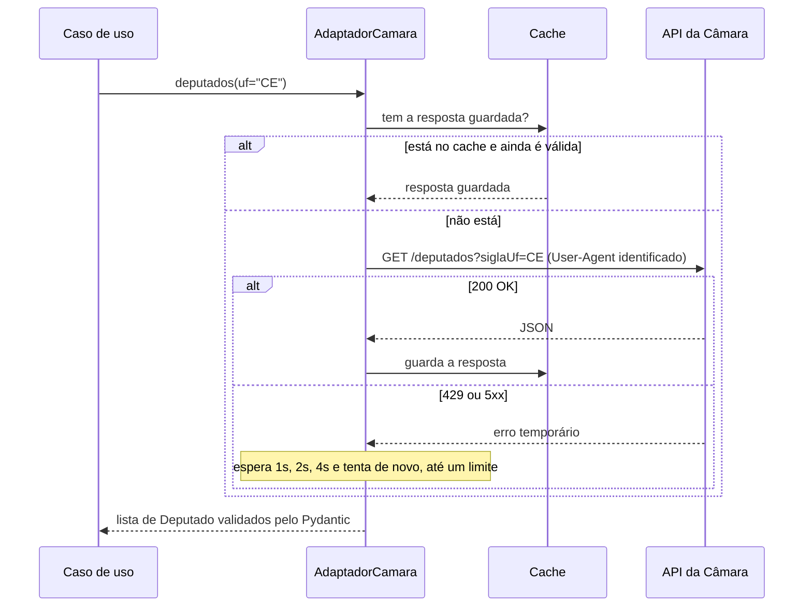
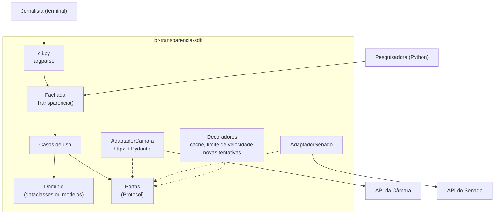

> **Aviso de Idioma:** Este currículo e todos os seus recursos de apoio foram estruturados exclusivamente em **Português (PT-BR)**.

# Aula 8 · Empacotamento e o SDK de transparência

**MOD-202 · 10 horas · Apoio:** [Guia de empacotamento do Python](https://packaging.python.org/pt-br/latest/) e [documentação da API de Dados Abertos da Câmara](https://dadosabertos.camara.leg.br/swagger/api.html)

## O que você vai aprender

- Transformar o projeto num <abbr title="Pacote Python: conjunto de módulos organizados e descritos de modo que possam ser instalados com pip e importados por outros projetos.">pacote</abbr> instalável com <abbr title="pyproject.toml: arquivo padrão que descreve um projeto Python: nome, versão, dependências, ferramentas de build e configurações de outras ferramentas.">pyproject.toml</abbr> e o layout `src/`.
- Escrever o adaptador HTTP real com `httpx`, cliente identificado, limite de velocidade e novas tentativas com espera crescente.
- Usar <abbr title="Versionamento semântico: convenção MAIOR.MENOR.CORREÇÃO. Muda o MAIOR quando a interface pública quebra a compatibilidade; o MENOR quando há funcionalidade nova compatível; a CORREÇÃO quando só há conserto de erros.">versionamento semântico</abbr>.
- Documentar a biblioteca para pessoas que não a escreveram.
- Juntar todas as peças do módulo no projeto avaliativo.

## Pergunta de abertura

> Você escreveu um código excelente para consultar a API da Câmara. Uma pesquisadora de outra universidade quer usá-lo. O que ela precisa para instalar, entender e confiar no seu código, sem ter que ler tudo nem falar com você?

## 1. O pacote

O `pyproject.toml` descreve o projeto para qualquer ferramenta do ecossistema Python:

```toml
[build-system]
requires = ["hatchling"]
build-backend = "hatchling.build"

[project]
name = "br-transparencia-sdk"
version = "0.1.0"
description = "Consulta tipada às APIs de dados abertos do Congresso Nacional."
readme = "README.md"
requires-python = ">=3.11"
license = "MIT"
authors = [{ name = "Seu Nome" }]
dependencies = [
  "httpx>=0.27",
  "pydantic>=2.6",
]

[project.optional-dependencies]
dev = ["pytest", "mypy", "ruff"]

[project.scripts]
br-transparencia = "br_transparencia.cli:principal"
```

Com isso, a instalação em modo de desenvolvimento é um comando: `python -m pip install -e ".[dev]"`. A seção `[project.scripts]` cria o comando `br-transparencia` no terminal, que chama a função `principal` do módulo `cli`.

O **layout `src/`** (código dentro de `src/br_transparencia/`) evita um erro comum: importar sem querer o código da pasta atual em vez do pacote instalado, o que esconde problemas de empacotamento.

### Versionamento semântico

| Versão | O que mudou | Quem usa precisa se preocupar? |
| :--- | :--- | :--- |
| 0.1.0 para 0.1.1 | Correção de erro | Não |
| 0.1.1 para 0.2.0 | Funcionalidade nova, compatível | Não |
| 0.2.0 para 1.0.0 | Mudança que quebra a interface pública | Sim: leia as notas de versão |

Enquanto a versão começa com 0, a interface ainda pode mudar a qualquer momento: avise isso no README.

## 2. O adaptador HTTP real

O adaptador real junta tudo o que você aprendeu: composição (aula 3), validação (aula 4), inversão de dependências (aula 5), Adapter e Decorator (aula 6), e a camada de infraestrutura da arquitetura hexagonal (aula 7). Ele também precisa ser **um bom cidadão** com o servidor público:



A espera crescente entre tentativas (*backoff* exponencial) evita que milhares de clientes sobrecarreguem um servidor que já está com problemas. Uma versão didática, testável sem rede:

```python
import time


class ErroTemporario(Exception):
    pass


def com_novas_tentativas(funcao, tentativas=4, espera_inicial=1.0, dormir=time.sleep):
    """Executa funcao(); em ErroTemporario, espera 1s, 2s, 4s... e tenta de novo."""
    espera = espera_inicial
    for numero in range(1, tentativas + 1):
        try:
            return funcao()
        except ErroTemporario:
            if numero == tentativas:
                raise
            dormir(espera)
            espera *= 2


respostas = iter([ErroTemporario(), ErroTemporario(), {"dados": ["ok"]}])

def chamada_instavel():
    r = next(respostas)
    if isinstance(r, Exception):
        raise r
    return r


esperas = []
print(com_novas_tentativas(chamada_instavel, dormir=esperas.append))   # {'dados': ['ok']}
print("esperas:", esperas)                                             # [1.0, 2.0]
```

No projeto, o adaptador real com `httpx` tem esta forma (texto ilustrativo, que depende da rede e da biblioteca instalada):

```text
import httpx

class AdaptadorCamara:
    BASE = "https://dadosabertos.camara.leg.br/api/v2"

    def __init__(self, cliente: httpx.Client | None = None):
        self.cliente = cliente or httpx.Client(
            timeout=20,
            headers={
                "User-Agent": "br-transparencia-sdk/0.1 (+https://github.com/seu-usuario/br-transparencia-sdk)",
                "Accept": "application/json",
            },
        )

    def _get(self, caminho: str, **params) -> dict:
        def chamada():
            r = self.cliente.get(f"{self.BASE}{caminho}", params=params)
            if r.status_code == 429 or r.status_code >= 500:
                raise ErroTemporario(r.status_code)
            r.raise_for_status()
            return r.json()
        return com_novas_tentativas(chamada)

    def deputados(self, uf: str) -> list[Deputado]:
        dados = self._get("/deputados", siglaUf=uf, itens=100)["dados"]
        return [Deputado.model_validate(d) for d in dados]
```

Repare no `User-Agent`: identificar o cliente com um endereço de contato permite que os administradores do servidor saibam quem está fazendo as requisições e entrem em contato em caso de problema, em vez de simplesmente bloquear. Note também que o cliente HTTP pode ser **injetado**: no MOD-204 você vai passar um cliente falso para testar o adaptador sem rede.

## 3. Documentação

Responda à pergunta de abertura: a pesquisadora precisa de documentação. A boa documentação de uma biblioteca tem quatro partes, que respondem a quatro necessidades diferentes:

| Tipo | Necessidade | No SDK |
| :--- | :--- | :--- |
| **Tutorial** | Aprender, do zero | "Primeiros passos: instale e liste os deputados do seu estado em 5 minutos" |
| **Guias práticos** | Resolver uma tarefa específica | "Como exportar as despesas de um ano para CSV" |
| **Referência** | Consultar um detalhe | Docstrings de cada função e classe, geradas automaticamente |
| **Explicação** | Entender por quê | Os ADRs e um texto sobre a arquitetura |

Um README mínimo de qualidade:

```text
# br-transparencia-sdk

Consulta tipada às APIs de dados abertos da Câmara dos Deputados e do Senado Federal.

## Instalação
    python -m pip install br-transparencia-sdk

## Uso rápido
    from br_transparencia import Transparencia
    t = Transparencia()
    for d in t.deputados(uf="CE"):
        print(d.nome, d.sigla_partido)

## Boas práticas com os servidores públicos
Esta biblioteca guarda respostas em cache e espera entre requisições.
Não desative esses mecanismos em uso automatizado.

## Licença
MIT. Os dados pertencem às casas legislativas e seguem as suas condições de uso.
```

## 4. O projeto, por inteiro



Revise os critérios de avaliação no [guia do módulo](../02-engenharia-software-poo-arquitetura.md) e comece pelo núcleo: domínio, portas e um caso de uso com uma fonte falsa. Só depois escreva os adaptadores reais. Essa ordem garante que a arquitetura saia certa.

## Exercícios

**1.** Uma nova versão do SDK renomeia o método `deputados()` para `listar_deputados()`. Que número de versão ela deve ter, partindo de 1.4.2? E se só acrescentasse um método novo?

<details>
<summary>Gabarito</summary>

Renomear um método público quebra a compatibilidade: **2.0.0**. Acrescentar um método novo, sem quebrar nada: **1.5.0**. Uma boa prática é manter o nome antigo funcionando por uma versão, com um aviso de que será removido.
</details>

**2.** Modifique `com_novas_tentativas` para acrescentar uma pequena variação aleatória à espera (até 10%), recebendo o gerador aleatório como parâmetro. Por que isso ajuda quando muitos clientes falham ao mesmo tempo?

<details>
<summary>Gabarito comentado</summary>

```python
import random


def com_novas_tentativas_variadas(funcao, tentativas=4, espera_inicial=1.0,
                                  dormir=time.sleep, aleatorio=random.random):
    espera = espera_inicial
    for numero in range(1, tentativas + 1):
        try:
            return funcao()
        except ErroTemporario:
            if numero == tentativas:
                raise
            dormir(espera * (1 + 0.1 * aleatorio()))
            espera *= 2
```

Se muitos clientes falham juntos (por exemplo, numa queda do servidor), sem variação eles tentariam de novo todos no mesmo instante, derrubando o servidor outra vez. A variação espalha as tentativas no tempo.
</details>

**3.** Escreva o tutorial "Primeiros passos" do SDK em até uma página, para uma jornalista que sabe o básico de Python.

<details>
<summary>Critérios de correção</summary>

O tutorial deve: dizer o que a pessoa vai conseguir fazer ao final; ter comandos que funcionam se copiados; explicar a saída esperada; avisar sobre o cache e o limite de velocidade; e indicar onde encontrar mais (guias e referência). Linguagem direta, sem jargão não explicado.
</details>

## Resumo da aula

- `pyproject.toml` e o layout `src/` transformam o projeto num pacote instalável; `[project.scripts]` cria comandos de terminal.
- Versionamento semântico comunica o impacto de cada mudança.
- O adaptador real usa cliente identificado, cache, limite de velocidade e novas tentativas com espera crescente.
- A documentação tem quatro partes: tutorial, guias, referência e explicação.
- Construa o núcleo primeiro, com fontes falsas, e os adaptadores reais depois.

## Para ir além

- [Guia oficial de empacotamento do Python](https://packaging.python.org/pt-br/latest/).
- Com esta aula você fecha o MOD-202. O MOD-204 vai testar e auditar o SDK que você construiu.
