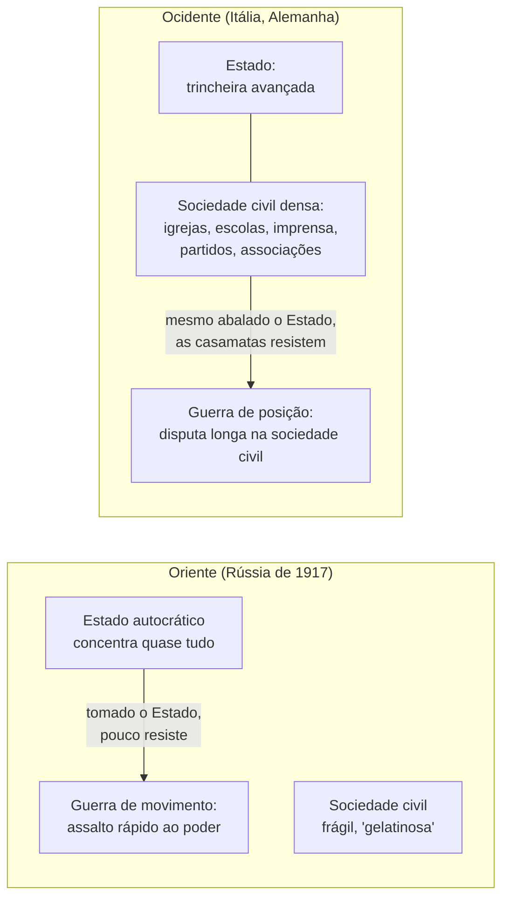
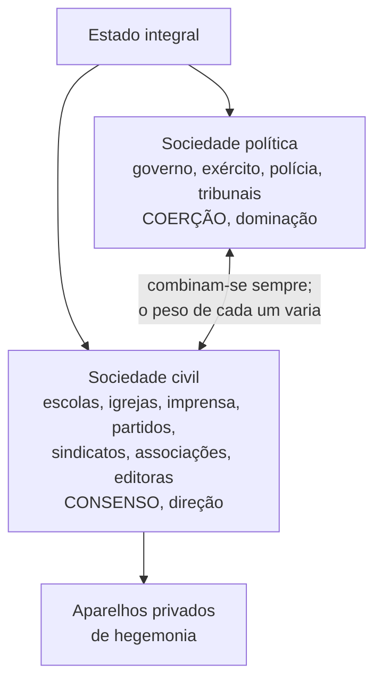
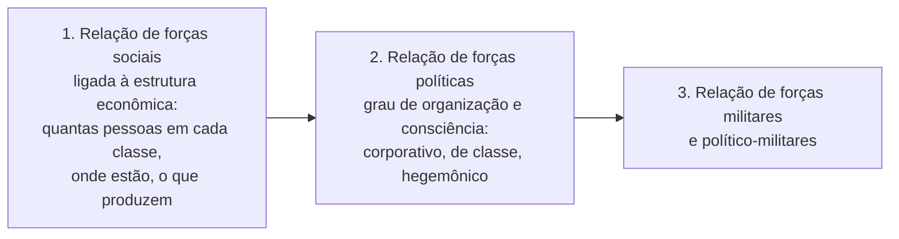

> **Aviso de Idioma:** Este currículo e todos os seus recursos de apoio foram estruturados exclusivamente em **Português (PT-BR)**.

# Aula 2 · Gramsci: Estado integral, hegemonia e guerra de posição

**MOD-203 · 10 horas · Leitura principal:** *Cadernos do Cárcere*, seleção: caderno 6, § 88 (Estado e sociedade civil); caderno 7, § 16 (guerra de posição e de movimento); caderno 13, §§ 17 e 24 (análise das situações, relações de força); caderno 19, § 24 (direção e dominação)

## O que você vai aprender

- Explicar o conceito de <abbr title="Hegemonia: em Gramsci, a capacidade de uma classe de dirigir a sociedade obtendo o consentimento ativo de outros grupos, por meio da cultura, das ideias, das instituições e de concessões, e não só pela força.">hegemonia</abbr> e a distinção entre direção e dominação.
- Definir o <abbr title="Estado integral (ou ampliado): em Gramsci, a soma da sociedade política (o aparelho de coerção: governo, polícia, tribunais) com a sociedade civil (o conjunto de organizações privadas que produzem consenso).">Estado integral</abbr>: sociedade política mais sociedade civil.
- Identificar <abbr title="Aparelhos privados de hegemonia: organizações da sociedade civil (escolas, igrejas, imprensa, partidos, sindicatos, associações, editoras) por meio das quais se forma e se disputa o consenso.">aparelhos privados de hegemonia</abbr>.
- Distinguir <abbr title="Guerra de posição e guerra de movimento: metáforas militares de Gramsci. A guerra de movimento é o assalto frontal e rápido ao poder; a guerra de posição é a disputa longa, trincheira por trincheira, na sociedade civil.">guerra de posição e guerra de movimento</abbr> e a diferença entre Oriente e Ocidente.
- Aplicar o conceito de hegemonia à análise da comunicação contemporânea.

## Pergunta de abertura

> Num país democrático, ninguém é obrigado a assistir a um telejornal, a votar num partido ou a acreditar que "não existe alternativa" à política econômica do governo. Mesmo assim, milhões de pessoas pensam parecido sobre temas decisivos. Como se produz esse acordo sem que ninguém seja forçado?

## 1. Por que a revolução vingou no Oriente e não no Ocidente

Na prisão, Gramsci volta à pergunta que atravessava a esquerda europeia: por que a revolução vingou na Rússia, em 1917, e fracassou na Itália, na Alemanha e na Hungria, países mais industrializados?

A resposta está numa passagem célebre do caderno 7:

> "No Oriente, o Estado era tudo, a sociedade civil era primitiva e gelatinosa; no Ocidente, entre Estado e sociedade civil havia uma justa relação, e, ao oscilar o Estado, podia-se imediatamente reconhecer uma sólida estrutura da sociedade civil. O Estado era apenas uma trincheira avançada, por trás da qual havia uma sólida cadeia de fortalezas e casamatas." (tradução livre)

Na Rússia, o Estado czarista concentrava quase todo o poder, e a sociedade civil era fraca: uma vez tomado o centro do Estado, havia pouco a conquistar. No Ocidente, por trás do Estado, havia uma rede densa de instituições (igrejas, escolas, imprensa, partidos, sindicatos, associações) que organizava o consentimento das massas à ordem existente. Mesmo quando o Estado vacilava (como em 1919 e 1920), essa rede continuava de pé.

Daí a distinção:

- **Guerra de movimento:** o assalto frontal e rápido ao poder do Estado, como em outubro de 1917.
- **Guerra de posição:** a disputa longa, paciente, trincheira por trincheira, nas instituições da sociedade civil, para construir uma nova hegemonia antes (e como condição) da conquista do poder.

## 2. O Estado integral

O conceito de Estado de Gramsci amplia o de Lênin (MOD-201, aula 5) e o de Engels (MOD-103, aula 7). Além do aparelho de coerção (governo, exército, polícia, tribunais), o Estado inclui as instituições que produzem consenso:

> "Estado = sociedade política + sociedade civil, isto é, hegemonia couraçada de coerção." (caderno 6, § 88, tradução livre)

Repare no uso de "sociedade civil": não é o mesmo que em Hegel (MOD-101, aula 5), para quem a sociedade civil era a esfera econômica, o "sistema das carências". Em Gramsci, a sociedade civil é a esfera das **organizações** que produzem cultura, opinião e adesão. Os chamados **aparelhos privados de hegemonia** são "privados" no sentido de que não pertencem formalmente ao Estado, embora cumpram uma função estatal: organizar o consentimento.

## 3. Hegemonia: direção e dominação

A palavra "hegemonia" já era usada pelos marxistas russos, no sentido de direção política da classe operária sobre os camponeses. Gramsci a amplia: uma classe é **hegemônica** quando consegue que outros grupos sociais aceitem a sua visão de mundo como se fosse o senso comum de todos.

| | Dominação | Direção (hegemonia) |
| :--- | :--- | :--- |
| Meio principal | Força, coerção | Consenso, persuasão, cultura |
| Sobre quem | Grupos adversários | Grupos aliados e subalternos |
| Instituições | Sociedade política | Sociedade civil |

Alguns traços decisivos do conceito:

1. **A hegemonia tem base material.** Não é só manipulação de ideias. Uma classe só se torna hegemônica se faz **concessões** reais aos grupos aliados e subalternos, sem tocar no essencial do seu poder econômico. O consentimento se apoia em interesses parcialmente atendidos.
2. **A hegemonia é ativa e instável.** Precisa ser continuamente reconstruída, e é sempre disputada: há **contra-hegemonias**.
3. **A hegemonia vive no senso comum.** As ideias dominantes se sedimentam no "senso comum", um conjunto heterogêneo de crenças que as pessoas tomam como naturais. A luta hegemônica passa por elaborar o "bom senso" que já existe dentro do senso comum.

Volte à pergunta de abertura: o acordo sem coerção é produzido pela hegemonia, organizada por aparelhos privados (meios de comunicação, escolas, igrejas, centros de pesquisa, associações empresariais) e apoiada em concessões reais. Lembre de *A Ideologia Alemã* (MOD-103, aula 2): Gramsci transforma a tese das "ideias dominantes" numa teoria de **como** elas se tornam dominantes, por meio de instituições concretas.

## 4. A análise das relações de força

No caderno 13, Gramsci propõe um método para analisar situações políticas, em três níveis de relações de força:

No segundo nível, Gramsci distingue três momentos de consciência coletiva:

- **Econômico-corporativo:** cada categoria defende só os seus interesses (o comerciante com o comerciante).
- **De classe:** a solidariedade de interesses entre todos os membros da classe, ainda no plano econômico.
- **Hegemônico:** os próprios interesses são superados e se tornam os interesses de outros grupos subordinados; é a passagem da estrutura às superestruturas complexas, a fase "mais estritamente política".

Compare com *Que Fazer?* (MOD-201, aula 2): a consciência sindical de Lênin corresponde aproximadamente ao momento corporativo, e a consciência política, ao hegemônico. Mas em Gramsci a ênfase recai sobre a construção de alianças e de uma visão de mundo, e não só sobre a organização partidária.

> **Conexão com a computação:** os aparelhos privados de hegemonia do século XXI incluem as plataformas digitais, que organizam a circulação de informação para bilhões de pessoas, e os sistemas que decidem o que aparece primeiro numa busca ou num feed. No MOD-302 você vai operacionalizar o conceito: medir, em discursos parlamentares e na imprensa, como certos vocabulários se tornam senso comum. No MOD-303, vai mapear redes de financiamento entre aparelhos de hegemonia (fundações, institutos, associações).

## Leitura guiada

1. **Caderno 6, § 88** (2 páginas): a fórmula do Estado integral.
2. **Caderno 7, § 16** (3 páginas): Oriente e Ocidente, guerra de posição e de movimento. Copie a passagem das casamatas.
3. **Caderno 13, § 17** (cerca de 10 páginas): análise das situações e relações de força. Faça um quadro com os três níveis e os três momentos.
4. **Caderno 19, § 24** (trecho de 3 páginas): a distinção entre direção e dominação.

A numeração (caderno e parágrafo) permite achar as passagens em qualquer edição.

## Exercícios

**1.** Explique a fórmula "Estado = sociedade política + sociedade civil".

Gabarito comentado

O Estado não se reduz ao aparelho de coerção (governo, polícia, tribunais, exército: a sociedade política). Inclui também as instituições da sociedade civil (escolas, igrejas, imprensa, partidos, associações) que organizam o consentimento dos governados. A dominação de classe moderna combina sempre coerção e consenso: "hegemonia couraçada de coerção".

**2.** Por que, segundo Gramsci, a tática de outubro de 1917 não podia ser repetida na Itália?

Gabarito

Porque na Rússia o Estado concentrava quase todo o poder e a sociedade civil era frágil; tomado o Estado, havia pouco a conquistar (guerra de movimento). Na Itália e no Ocidente, a sociedade civil era densa, uma "cadeia de fortalezas e casamatas" que continuava organizando o consentimento mesmo quando o Estado vacilava. Seria preciso uma guerra de posição, a conquista da hegemonia na sociedade civil.

**3.** Classifique as instituições como sociedade política ou aparelho privado de hegemonia: (a) uma rede de televisão; (b) o Supremo Tribunal Federal; (c) um instituto de pesquisa financiado por empresas que publica estudos sobre a previdência; (d) a Polícia Militar; (e) uma igreja; (f) um sindicato.

Gabarito comentado

Sociedade política: (b) e (d). Aparelhos privados de hegemonia: (a), (c), (e) e (f). A resposta excelente nota que um tribunal também produz consenso (pela legitimidade das suas decisões) e que a fronteira não é absoluta; e que o sindicato pode ser aparelho de hegemonia dos trabalhadores, de contra-hegemonia.

**4.** Analise um debate público recente no Brasil (a reforma da previdência, o teto de gastos, a regulação das plataformas digitais) com os conceitos de hegemonia, senso comum e aparelhos privados de hegemonia. Use pelo menos duas fontes.

Critérios de correção

A análise deve identificar os grupos em disputa, os aparelhos que produziram e difundiram cada posição, os argumentos que se tornaram "senso comum" e as concessões feitas a grupos subalternos. Deve evitar a explicação simplista da "manipulação" e mostrar a base material do consentimento.

## Resumo da aula

- No Oriente, o Estado era tudo e a sociedade civil era frágil; no Ocidente, a sociedade civil densa sustenta o Estado como uma rede de casamatas.
- Guerra de movimento é o assalto rápido ao poder; guerra de posição, a disputa longa na sociedade civil.
- Estado integral = sociedade política (coerção) + sociedade civil (consenso): hegemonia couraçada de coerção.
- Hegemonia é direção com consentimento ativo, apoiado em concessões reais e sedimentado no senso comum.
- As relações de força se analisam em três níveis; a consciência passa do corporativo ao hegemônico.

## Para ir além

- Carlos Nelson Coutinho, *Gramsci: Um Estudo sobre o seu Pensamento Político* (1999).
- Guido Liguori e Pasquale Voza (orgs.), *Dicionário Gramsciano* (edição brasileira de 2017).
