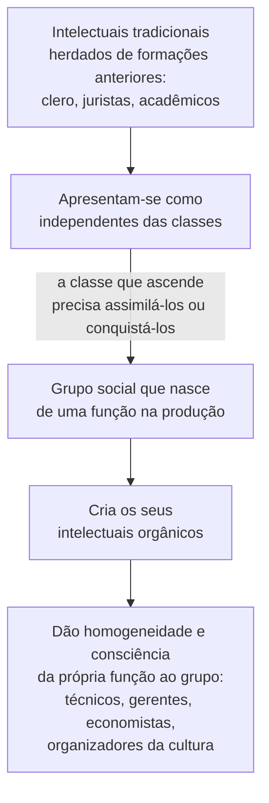
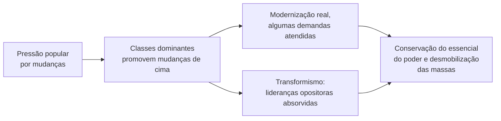

> **Aviso de Idioma:** Este currículo e todos os seus recursos de apoio foram estruturados exclusivamente em **Português (PT-BR)**.

# Aula 3 · Gramsci: intelectuais, revolução passiva e americanismo

**MOD-203 · 10 horas · Leitura principal:** *Cadernos do Cárcere*, caderno 12, § 1 (os intelectuais); caderno 19, § 24 e caderno 15, § 11 (revolução passiva); caderno 13, § 23 (crise orgânica); caderno 22 (*Americanismo e Fordismo*, seleção)

## O que você vai aprender

- Distinguir <abbr title="Intelectual orgânico: em Gramsci, o intelectual que um grupo social cria para si, ligado à sua função na produção, e que lhe dá homogeneidade e consciência. Intelectual tradicional: o que se apresenta como independente das classes, herdado de formações anteriores (o clero, os juristas).">intelectuais orgânicos e tradicionais</abbr>.
- Explicar a <abbr title="Revolução passiva: em Gramsci, a transformação social conduzida de cima, pelas classes dominantes, que incorpora parte das demandas populares sem a participação ativa das massas e para impedir uma revolução de baixo.">revolução passiva</abbr> e o <abbr title="Transformismo: absorção, pelas classes dominantes, de lideranças e grupos da oposição, que são assim neutralizados como alternativa.">transformismo</abbr>.
- Definir <abbr title="Crise orgânica: crise de hegemonia em que a classe dirigente perde o consenso e os partidos tradicionais deixam de representar os seus grupos sociais, abrindo espaço para soluções de força.">crise orgânica</abbr> e <abbr title="Bloco histórico: em Gramsci, a unidade entre estrutura econômica e superestruturas (ideias, instituições) num período histórico, mantida por uma hegemonia.">bloco histórico</abbr>.
- Ler *Americanismo e Fordismo* como análise da racionalização do trabalho e da formação de um novo tipo humano.
- Aplicar as categorias ao Brasil e ao papel de quem desenvolve tecnologia.

## Pergunta de abertura

> Uma engenheira de software trabalha numa grande empresa de tecnologia. O seu trabalho é técnico: escrever código, otimizar sistemas. Ela é uma intelectual? A serviço de quem? E se trabalhasse numa cooperativa ou num órgão público de transparência, mudaria alguma coisa?

## 1. Todos são intelectuais

O caderno 12 abre com uma pergunta: os intelectuais são um grupo social autônomo, ou cada grupo social tem os seus próprios intelectuais? Gramsci começa por uma afirmação desconcertante:

> "Todos os homens são intelectuais, mas nem todos os homens desempenham na sociedade a função de intelectuais." (tradução livre)

Não há atividade humana da qual se possa excluir toda intervenção intelectual: até o trabalho mais manual exige algum saber. O que define o intelectual não é a natureza da atividade, mas a **função social**: organizar, dirigir, educar, produzir e difundir visões de mundo.

### Orgânicos e tradicionais

- **Intelectuais orgânicos:** cada grupo social que nasce de uma função essencial na produção cria para si uma ou mais camadas de intelectuais que lhe dão homogeneidade e consciência. A burguesia criou o técnico da indústria, o economista, o organizador de uma nova cultura e de um novo direito.
- **Intelectuais tradicionais:** os que vêm de formações sociais anteriores e se apresentam como independentes das classes (o clero, os juristas, certos acadêmicos). A classe que ascende precisa assimilá-los ou conquistá-los ideologicamente.

E Gramsci dá ao **técnico** um lugar especial: na indústria moderna, o novo intelectual não é o orador que comove, mas aquele que se mistura ativamente na vida prática, como "construtor, organizador, persuasor permanente". A educação técnica, ligada ao trabalho industrial, é a base do novo tipo de intelectual, que precisa elevar-se da técnica ao "trabalho à ciência e à concepção humanista histórica".

Volte à pergunta de abertura. Pela definição de Gramsci, a engenheira desempenha uma função intelectual: organiza processos, define como o trabalho de outros será feito, materializa visões de mundo em sistemas. A pergunta decisiva é **de quem** ela é intelectual orgânica. É exatamente a pergunta que Walter Benjamin vai formular de outro modo em *O Autor como Produtor* (aula 7) e que o projeto deste módulo pede que você responda.

## 2. Revolução passiva e transformismo

Gramsci estudou o *Risorgimento*, o processo de unificação italiana no século XIX, e percebeu que ele foi conduzido **de cima**: pelos moderados, aliados à monarquia do Piemonte e aos grandes proprietários, sem a participação ativa das massas camponesas e sem reforma agrária. A unificação transformou o país, mas de modo a impedir uma transformação mais profunda vinda de baixo.

Ele chamou esse tipo de processo de **revolução passiva** (expressão tomada de um historiador napolitano, Vincenzo Cuoco): uma "revolução sem revolução", em que as classes dominantes promovem mudanças reais (modernização, novas instituições, até concessões a demandas populares) para **conservar** o essencial do seu poder e desmobilizar as massas.

Um instrumento típico da revolução passiva é o **transformismo**: a absorção gradual, pelas classes dominantes, das lideranças e dos grupos de oposição, que passam a fazer parte da ordem e deixam de ser alternativa. Na Itália do fim do século XIX, deputados de esquerda passavam a apoiar governos conservadores em troca de cargos e verbas.

### A revolução passiva no Brasil

Muitos estudiosos brasileiros, a começar por Carlos Nelson Coutinho e Luiz Werneck Vianna, usaram o conceito para interpretar a formação do Brasil: a Independência proclamada por um príncipe português, a abolição sem reforma agrária (MOD-103, aula 7), a "Revolução de 1930" e o Estado Novo de Vargas, que criou direitos trabalhistas e ao mesmo tempo atrelou os sindicatos ao Estado (MOD-107, aula 6), a modernização conservadora da ditadura de 1964. Em todos esses momentos, mudanças importantes foram feitas "pelo alto", conciliando as elites e mantendo as massas fora das decisões. Florestan Fernandes (MOD-206) vai chegar a conclusões próximas por outro caminho, com o conceito de "autocracia burguesa".

## 3. Crise orgânica e bloco histórico

Quando a classe dirigente perde a capacidade de obter consenso, quando os partidos tradicionais deixam de ser reconhecidos pelos grupos sociais que representavam, abre-se uma **crise orgânica**, uma crise de hegemonia. Nesses momentos, diz Gramsci, abre-se espaço para "soluções de força", para "homens providenciais" ou carismáticos (compare com o bonapartismo, MOD-103, aula 3, e o carisma de Weber, MOD-105, aula 7).

A frase mais citada a respeito está no caderno 3:

> "A crise consiste justamente no fato de que o velho morre e o novo não pode nascer: neste interregno, verificam-se os fenômenos patológicos mais variados." (tradução livre)

O **bloco histórico** é o conceito que une estrutura econômica e superestrutura: num período, as forças produtivas, as relações de produção, as instituições e as ideias formam uma unidade, mantida por uma hegemonia. A crise orgânica é a crise de um bloco histórico.

## 4. *Americanismo e Fordismo*

No caderno 22, Gramsci analisou a novidade que vinha dos Estados Unidos: a linha de montagem de Henry Ford e a **administração científica** do trabalho de Frederick Taylor, que decompunha cada tarefa em movimentos cronometrados.

Para Gramsci, o fordismo era uma técnica de produção e, ao mesmo tempo, a tentativa de criar **um novo tipo humano**, um "novo tipo de trabalhador e de homem", ajustado ao ritmo mecânico da fábrica:

- **Salários altos**, para fixar a força de trabalho e criar consumidores.
- **Controle da vida privada:** Ford tinha inspetores que visitavam as casas dos operários para controlar o consumo de álcool, a vida sexual e a "moralidade". A proibição do álcool nos Estados Unidos (1920 a 1933) aparece como parte desse esforço de disciplinar o trabalhador.
- **Hegemonia nascida da fábrica:** nos Estados Unidos, sem os resíduos parasitários das velhas classes europeias, a hegemonia "nasce da fábrica" e precisa de poucos intermediários políticos e ideológicos.

Gramsci cita a frase de Taylor de que o trabalhador ideal seria um "gorila amestrado", e mostra como a racionalização tenta separar o trabalho manual de toda participação intelectual (compare com a subsunção real, MOD-103, aula 6). Mas observa também que o cérebro do operário, liberado da atenção ao trabalho mecanizado, continua livre para pensar, e isso pode levar a "um curso de pensamentos pouco conformistas".

> **Conexão com a computação:** o gerenciamento algorítmico do trabalho por plataformas (metas por minuto, avaliação contínua, rastreamento) é muitas vezes descrito como um "taylorismo digital". E as grandes empresas de tecnologia também tentaram moldar um "novo tipo humano" de trabalhador: o funcionário que come, se exercita e socializa no campus da empresa, com a vida inteira organizada em torno do trabalho. *Americanismo e Fordismo* é a leitura de referência para o MOD-305.

## Leitura guiada

1. **Caderno 12, § 1** (cerca de 15 páginas): a formação dos intelectuais. Copie a frase "todos os homens são intelectuais" e a passagem sobre o novo intelectual técnico.
2. **Caderno 19, § 24** (trecho sobre o *Risorgimento* e os moderados, cerca de 10 páginas) e **caderno 15, § 11** (revolução passiva, 3 páginas).
3. **Caderno 13, § 23** (crise orgânica, cerca de 8 páginas) e **caderno 3, § 34** (a frase sobre o velho e o novo).
4. **Caderno 22** (seleção de cerca de 20 páginas): racionalização, salários altos, controle da vida privada.

## Exercícios

**1.** Explique a afirmação "todos os homens são intelectuais, mas nem todos desempenham a função de intelectuais".

Gabarito comentado

Toda atividade humana envolve alguma participação intelectual, inclusive o trabalho manual; não há "homo faber" separado do "homo sapiens". O que distingue os intelectuais não é uma qualidade especial da sua atividade, mas a função social que exercem: organizar, dirigir, educar e difundir visões de mundo para um grupo social.

**2.** Responda à pergunta de abertura usando a distinção entre intelectuais orgânicos e tradicionais.

Critérios de correção

A resposta deve reconhecer a função intelectual da engenheira (organizar processos, materializar decisões em sistemas), discutir de qual grupo social ela é orgânica (da empresa, de uma classe, de um projeto coletivo) e mostrar que a mudança de lugar de trabalho não basta por si: é preciso considerar a relação com os grupos sociais e o tipo de saber que se produz e difunde. A melhor resposta antecipa Benjamin (aula 7).

**3.** Dê um exemplo de transformismo na história política brasileira, com fonte.

Critérios de correção

O exemplo deve mostrar a absorção de lideranças ou grupos de oposição pela ordem dominante, com o resultado de neutralizá-los como alternativa. A resposta deve citar fonte histórica ou jornalística e evitar o uso do conceito como simples acusação moral, mostrando o mecanismo.

**4.** Compare *Americanismo e Fordismo* com o gerenciamento algorítmico do trabalho por plataformas. O que é igual, o que é novo?

Critérios de correção

Igual: decomposição e medição do trabalho, separação entre concepção e execução, tentativa de moldar comportamentos fora do trabalho. Novo: o controle exercido por software em tempo real, a ausência de vínculo empregatício e de salários altos (o oposto do fordismo), o trabalhador isolado em vez de concentrado na fábrica. A melhor resposta discute se a hegemonia das plataformas também "nasce" do local de trabalho.

## Resumo da aula

- Todos são intelectuais, mas nem todos exercem a função de intelectuais; os orgânicos dão homogeneidade e consciência a um grupo social, os tradicionais se dizem independentes.
- O técnico moderno é um tipo novo de intelectual: construtor, organizador, persuasor permanente.
- Revolução passiva: transformação conduzida de cima para conservar o poder e desmobilizar as massas; transformismo: absorção das lideranças opositoras. O conceito ilumina a história do Brasil.
- Crise orgânica: o velho morre e o novo não pode nascer; bloco histórico é a unidade de estrutura e superestrutura.
- *Americanismo e Fordismo*: a racionalização do trabalho tenta criar um novo tipo humano.

## Para ir além

- Luiz Werneck Vianna, *A Revolução Passiva: Iberismo e Americanismo no Brasil* (1997).
- Carlos Nelson Coutinho, "As categorias de Gramsci e a realidade brasileira", em *Gramsci: Um Estudo sobre o seu Pensamento Político*.
