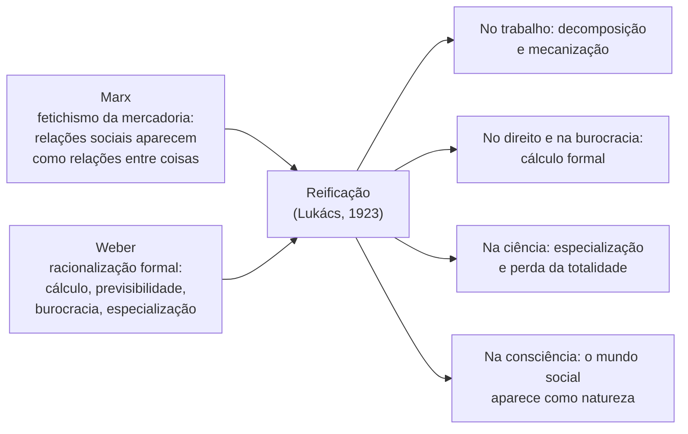

> **Aviso de Idioma:** Este currículo e todos os seus recursos de apoio foram estruturados exclusivamente em **Português (PT-BR)**.

# Aula 4 · Lukács: a reificação e a consciência

**MOD-203 · 10 horas · Leitura principal:** Lukács, *História e Consciência de Classe* (1923), ensaio "A reificação e a consciência do proletariado", parte I ("O fenômeno da reificação")


*György Lukács em 1919, quando era comissário do povo para a educação na República Soviética Húngara. Autor desconhecido, domínio público.*

## O que você vai aprender

- Situar Lukács entre a filosofia alemã, Max Weber e a revolução húngara de 1919.
- Definir <abbr title="Reificação (Verdinglichung): em Lukács, o processo pelo qual relações entre pessoas assumem o caráter de coisas e de leis naturais, e as próprias pessoas passam a se relacionar com o mundo e consigo mesmas como objetos calculáveis.">reificação</abbr> e explicar como ela generaliza o fetichismo da mercadoria.
- Explicar a síntese entre Marx (fetichismo) e Weber (racionalização formal).
- Descrever a reificação no trabalho, no direito, na burocracia e na ciência.
- Aplicar o conceito ao trabalho mediado por métricas e algoritmos.

## Pergunta de abertura

> Um entregador de aplicativo, com 1.200 entregas no mês, nota 4,87 e taxa de aceitação de 92%, recebe uma mensagem automática dizendo que o seu "desempenho" caiu. Quem está falando com ele? O que restou da pessoa nessa descrição?

## 1. De um aluno de Weber a um comissário do povo

György Lukács nasceu em Budapeste em 1885, filho de um rico banqueiro. Estudou filosofia na Alemanha e frequentou em Heidelberg o círculo de **Max Weber** (MOD-105), de quem foi amigo. Escreveu ensaios sobre estética e, em 1916, *A Teoria do Romance*, em que define o romance como "a epopeia de um mundo abandonado por Deus".

A Primeira Guerra e a revolução russa mudaram tudo. Em dezembro de 1918, para surpresa dos amigos, Lukács entrou no Partido Comunista Húngaro. Em 1919, durante os 133 dias da **República Soviética Húngara**, foi comissário do povo para a educação e cultura. Com a derrota, exilou-se em Viena, onde escreveu os ensaios reunidos em *História e Consciência de Classe* (1923), um dos livros mais influentes do marxismo do século XX.

## 2. A forma-mercadoria como forma de toda a sociedade

O ponto de partida é o fetichismo da mercadoria de Marx (MOD-103, aula 4): numa sociedade de produtores de mercadorias, as relações entre pessoas aparecem como relações entre coisas. Lukács faz uma pergunta mais ampla: o que acontece quando a mercadoria deixa de ser uma forma entre outras e se torna a **forma universal** de toda a sociedade, como no capitalismo moderno?

A resposta: a forma-mercadoria passa a estruturar não só a economia, mas a **consciência**, o direito, o Estado, a ciência e a vida inteira. Esse processo é a **reificação** (do latim *res*, coisa: "coisificação"):

> As relações entre pessoas assumem o caráter de uma coisa e, assim, de uma "objetividade fantasmagórica" que, com as suas leis próprias, rigorosas, aparentemente racionais e inteiramente fechadas, dissimula todo traço da sua essência fundamental: a relação entre pessoas. (paráfrase da abertura do ensaio)

## 3. A síntese entre Marx e Weber

A originalidade de Lukács está em juntar dois autores que pareciam opostos:



De Weber, Lukács toma a descrição da racionalidade formal e calculável que avança sobre todas as esferas (MOD-105, aula 6). De Marx, toma a explicação: essa racionalização é a forma-mercadoria se generalizando. O que Weber descrevia como destino da modernidade (a "crosta de aço"), Lukács explica como produto de uma forma social histórica, e portanto transformável.

## 4. A reificação no trabalho

Lukács descreve, com base no taylorismo (aula 3), o que acontece com o trabalho:

1. **Decomposição:** o processo de trabalho é quebrado em operações parciais, cada vez mais simples e especializadas, calculadas com precisão.
2. **Mecanização:** o trabalhador deixa de ser o sujeito do processo e se torna uma peça mecânica incorporada a um sistema que funciona independentemente dele, com leis próprias.
3. **Contemplação:** diante do sistema, a atitude do trabalhador se torna cada vez mais **contemplativa**: ele assiste, sem poder intervir, a um processo que lhe aparece como uma segunda natureza.
4. **Tempo como espaço:** o tempo perde o seu caráter qualitativo, mutável, fluido; congela-se num contínuo quantificável, preenchido por "coisas" mensuráveis. As pessoas viram unidades de tempo de trabalho.

> **Conexão com o trabalho digital:** volte à pergunta de abertura. O entregador é descrito por três números, calculados por um sistema com "leis próprias" que ninguém lhe explica. A mensagem não vem de uma pessoa: vem do sistema, que aparece como uma segunda natureza, contra a qual só resta a contemplação ou a adaptação. É a reificação no sentido exato de Lukács: uma relação social (entre o trabalhador, a empresa e os clientes) assume a forma de um número e de uma regra automática.

Um exemplo em código ajuda a ver o mecanismo:

```python
from dataclasses import dataclass


@dataclass
class Trabalhador:
    nome: str
    entregas: int
    nota_media: float
    taxa_aceitacao: float
    contexto: str          # o que o sistema não vê


def pontuacao(t: Trabalhador) -> float:
    """O 'desempenho' segundo o sistema: uma combinação linear de métricas."""
    return 0.4 * (t.entregas / 1500) + 0.4 * (t.nota_media / 5) + 0.2 * t.taxa_aceitacao


equipe = [
    Trabalhador("Ana", 1200, 4.87, 0.92, "cuida da mãe doente à tarde"),
    Trabalhador("Bruno", 1350, 4.60, 0.80, "recusa corridas para bairros sem iluminação à noite"),
    Trabalhador("Carla", 1500, 4.20, 0.95, "trabalha 14 horas por dia para pagar a moto"),
]

for t in sorted(equipe, key=pontuacao, reverse=True):
    print(f"{t.nome:6s} pontuação={pontuacao(t):.3f}   (fora do modelo: {t.contexto})")
```

O sistema produz uma ordem objetiva, precisa e "racional". O campo `contexto` existe nos dados, mas não entra no cálculo: a pessoa inteira foi reduzida àquilo que é mensurável. E as razões de Bruno para recusar corridas (a segurança) aparecem para o sistema simplesmente como baixa aceitação.

## 5. A reificação no direito, na burocracia e na ciência

Lukács estende a análise para além da fábrica:

| Esfera | Como a reificação aparece |
| :--- | :--- |
| **Direito e burocracia** | Lukács cita Weber: o juiz moderno se parece com um autômato em que se põem os fatos e as taxas e do qual sai a sentença com os fundamentos. O funcionário aplica regras formais, indiferente ao conteúdo humano dos casos |
| **Jornalismo** | O jornalista sem convicções, que vende a sua capacidade de escrever sobre qualquer assunto, é para Lukács o ápice da reificação: a própria subjetividade, as opiniões e a expressão se tornam mercadoria |
| **Ciência** | A especialização crescente fragmenta o conhecimento: cada disciplina domina com precisão o seu pedaço e perde de vista a totalidade social; os fatos parecem "dados" naturais, e não produtos históricos |

O resultado geral: o mundo social, que é produto da ação humana, aparece aos seres humanos como uma "segunda natureza", com leis tão inexoráveis quanto as da física. É por isso que, mesmo na crise, as pessoas tendem a aceitar a ordem existente como inevitável.

Compare com o *Gestell* de Heidegger (MOD-101, aula 7): os dois descrevem o mundo que se torna recurso calculável. Mas Heidegger fala de um destino da história do ser, e Lukács, de uma forma social específica, que pode ser transformada pela ação coletiva. Há quem sustente, aliás, que *Ser e Tempo* (1927) dialoga implicitamente com *História e Consciência de Classe* (1923).

## Leitura guiada

1. **"A reificação e a consciência do proletariado", parte I, "O fenômeno da reificação"** (cerca de 35 páginas): leia em três sessões.
   - Sessão 1: a forma-mercadoria como problema central e a citação de Marx sobre o fetichismo.
   - Sessão 2: a decomposição do trabalho, o trabalhador contemplativo e o tempo transformado em espaço.
   - Sessão 3: a burocracia, o direito, o jornalismo e a ciência; as citações de Weber.

## Exercícios

**1.** Explique a reificação com as suas palavras e mostre em que ela amplia o conceito de fetichismo de Marx.

<details>
<summary>Gabarito comentado</summary>

Reificação é o processo pelo qual relações entre pessoas assumem a forma de coisas e de leis naturais, e as próprias pessoas passam a se tratar como objetos calculáveis. Amplia o fetichismo porque, em Marx, o fenômeno é analisado sobretudo na troca de mercadorias; Lukács mostra que a forma-mercadoria, ao se tornar universal, estrutura também o trabalho, o direito, a burocracia, a ciência e a própria consciência.
</details>

**2.** Por que Lukács precisa de Weber para construir o conceito?

<details>
<summary>Gabarito comentado</summary>

Porque Weber tinha descrito com precisão a racionalização formal e calculável que avança sobre o trabalho, o direito, a administração e a ciência. Lukács usa essa descrição, mas a explica pela generalização da forma-mercadoria: o que em Weber era um destino da modernidade torna-se, em Lukács, produto de uma forma social histórica e transformável.
</details>

**3.** Rode o código da seção 4 e modifique a função `pontuacao` para incluir um peso para a segurança (penalizando menos a recusa de corridas noturnas). Isso resolve o problema da reificação? Justifique.

<details>
<summary>Gabarito comentado</summary>

Incluir a segurança pode tornar o modelo mais justo em casos específicos, mas não resolve o problema de fundo: a pessoa continua sendo reduzida a variáveis definidas por quem controla o sistema, e o que não for mensurável continua fora. A reificação está na relação social que transforma o trabalhador em objeto de cálculo e lhe nega participação na definição das regras. Resolver exigiria mudar essa relação (por exemplo, regras negociadas coletivamente e transparentes), não só a fórmula.
</details>

**4.** Compare a reificação em Lukács com o *Gestell* em Heidegger. Onde se aproximam e onde divergem?

<details>
<summary>Critérios de correção</summary>

Aproximam-se na descrição de um mundo que aparece como recurso calculável, em que as pessoas se tornam objetos de cálculo. Divergem na explicação e na saída: para Heidegger, o *Gestell* é um destino da história do ser, sem agentes sociais definidos; para Lukács, é a generalização da forma-mercadoria, uma forma social histórica que pode ser superada pela ação de uma classe.
</details>

## Resumo da aula

- Lukács, aluno de Weber e comissário na Hungria de 1919, escreveu *História e Consciência de Classe* (1923).
- Reificação: relações entre pessoas assumem forma de coisas e de leis naturais; a forma-mercadoria se torna a forma de toda a sociedade.
- É uma síntese de Marx (fetichismo) e Weber (racionalização formal).
- No trabalho: decomposição, mecanização, atitude contemplativa, tempo que vira espaço. No direito, na burocracia, no jornalismo e na ciência: cálculo formal e perda da totalidade.
- Métricas e algoritmos de gestão do trabalho são uma forma contemporânea de reificação.

## Para ir além

- Axel Honneth, *Reificação* (2005), uma releitura do conceito à luz da teoria do reconhecimento (lembre de Hegel, MOD-101, aula 4).
- Michael Löwy, *A Evolução Política de Lukács* (1979).
