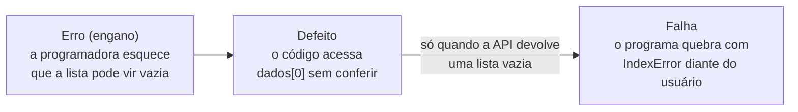
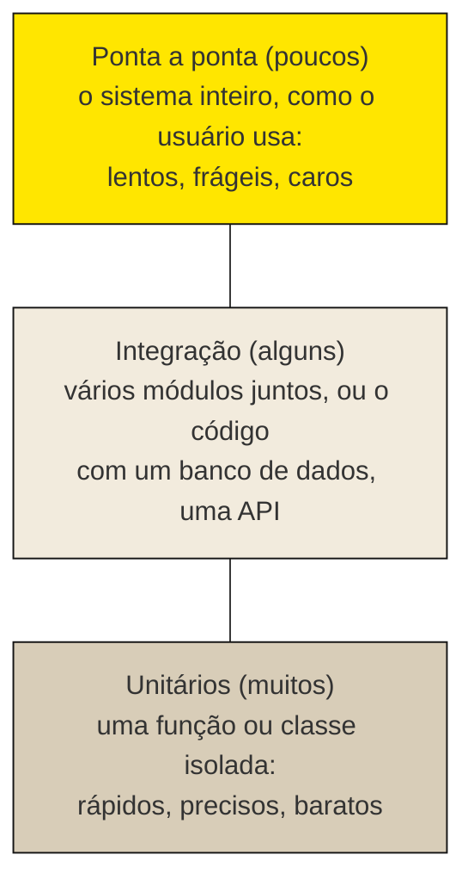

> **Aviso de Idioma:** Este currículo e todos os seus recursos de apoio foram estruturados exclusivamente em **Português (PT-BR)**.

# Aula 1 · Qualidade de software e o custo das falhas

**MOD-204 · 10 horas · Leitura principal:** Marco Tulio Valente, *Engenharia de Software Moderna*, capítulo 8, seções 8.1 a 8.3

## O que você vai aprender

- Definir qualidade de software e as suas características segundo a norma <abbr title="ISO/IEC 25010: norma internacional que define um modelo de qualidade de produto de software com oito características: adequação funcional, eficiência, compatibilidade, usabilidade, confiabilidade, segurança, manutenibilidade e portabilidade.">ISO/IEC 25010</abbr>.
- Distinguir <abbr title="Verificação e validação: verificação pergunta se o produto foi construído corretamente, de acordo com a especificação; validação pergunta se o produto certo foi construído, aquele de que os usuários de fato precisam.">verificação e validação</abbr>, e <abbr title="Falha, defeito e erro: o erro (ou engano) é a ação humana equivocada; ele deixa no código um defeito (o bug); o defeito, quando executado em certas condições, produz uma falha, o comportamento errado que alguém observa.">erro, defeito e falha</abbr>.
- Analisar dois casos clássicos de falha de software: o Therac-25 e o primeiro voo do Ariane 5.
- Explicar a <abbr title="Pirâmide de testes: modelo proposto por Mike Cohn que recomenda muitos testes unitários (rápidos e baratos), menos testes de integração e poucos testes de ponta a ponta (lentos e frágeis).">pirâmide de testes</abbr> e o lugar de cada tipo de teste.
- Reconhecer a dimensão social da qualidade: quem paga pelas falhas.

## Pergunta de abertura

> Um programa funcionou corretamente em milhares de tratamentos de radioterapia. Num dia, uma técnica experiente digita depressa, corrige um campo em menos de oito segundos, e o aparelho dispara uma dose de radiação dezenas de vezes maior que a prescrita. De quem é a culpa: da técnica, do programador, da empresa ou de quem aprovou o aparelho?

## 1. O que é qualidade de software

Um programa de qualidade não é só um programa "sem erros". A norma ISO/IEC 25010 organiza a qualidade de um produto de software em oito características:

| Característica | Pergunta que ela faz | Exemplo no SDK de transparência |
| :--- | :--- | :--- |
| Adequação funcional | Faz o que deveria fazer? | Lista os deputados certos de cada estado |
| Eficiência de desempenho | Usa bem o tempo e os recursos? | Não repete requisições que já estão no cache |
| Compatibilidade | Convive com outros sistemas? | Funciona com diferentes versões do Python |
| Usabilidade | É fácil de aprender e usar? | Uma jornalista consegue usar com o tutorial |
| Confiabilidade | Continua funcionando quando algo dá errado? | Tenta de novo quando a API devolve erro 503 |
| Segurança | Protege dados e acessos? | Não grava a chave de acesso no repositório |
| Manutenibilidade | É fácil de entender e de mudar? | Trocar `httpx` exige mexer só no adaptador |
| Portabilidade | Roda em outros ambientes? | Instala no Linux, no Windows e no macOS |

Valente distingue a **qualidade externa**, que o usuário percebe (o programa funciona, é rápido, não perde dados), da **qualidade interna**, que só quem lê o código percebe (nomes claros, módulos coesos, baixo acoplamento, testes). As duas estão ligadas: um código de baixa qualidade interna fica cada vez mais difícil de mudar sem quebrar, e cedo ou tarde a qualidade externa cai também.

### Erro, defeito e falha

A terminologia técnica separa três momentos que a linguagem comum chama de "bug":



Um defeito pode ficar anos no código sem produzir falha, até que as condições que o ativam apareçam. É por isso que "funcionou até hoje" não prova nada.

### Verificação e validação

Barry Boehm resumiu a diferença em duas perguntas:

- **Verificação:** "estamos construindo o produto corretamente?" O software obedece à especificação?
- **Validação:** "estamos construindo o produto certo?" A especificação atende às necessidades reais de quem vai usar?

Testes automatizados fazem sobretudo verificação. A validação exige conversar com os usuários, observar o uso, rever os requisitos (MOD-202, aula 1). Um sistema perfeitamente verificado pode ser inútil, ou nocivo, se resolve o problema errado.

## 2. O Therac-25

O Therac-25 era um acelerador linear para radioterapia, fabricado pela empresa estatal canadense Atomic Energy of Canada Limited (AECL). Entre junho de 1985 e janeiro de 1987, em hospitais dos Estados Unidos e do Canadá, ocorreram **seis acidentes conhecidos** em que pacientes receberam doses de radiação muito maiores que as prescritas. Ao menos três morreram em consequência. A investigação mais completa é o artigo de Nancy Leveson e Clark Turner, *An Investigation of the Therac-25 Accidents* (1993).

O aparelho tinha dois modos: um feixe de elétrons de baixa intensidade e um feixe de raios X, produzido por um feixe de elétrons cem vezes mais intenso que atingia um alvo metálico. Se o feixe intenso fosse disparado **sem** o alvo na posição, o paciente recebia a radiação diretamente.

Os modelos anteriores, Therac-6 e Therac-20, tinham **travas de hardware**: dispositivos físicos que impediam o disparo nessa situação. No Therac-25, a AECL retirou as travas físicas e confiou a segurança ao software, que em parte foi reaproveitado dos modelos antigos. Só que, nos modelos antigos, os defeitos desse código eram barrados pelas travas físicas. No novo, não havia mais nada para barrá-los.

Leveson e Turner identificaram, entre outros, dois defeitos:

1. Uma <abbr title="Condição de corrida: defeito em que o resultado de um programa depende da ordem ou do tempo relativo de eventos concorrentes, como duas tarefas que leem e escrevem os mesmos dados ao mesmo tempo.">condição de corrida</abbr>: se a operadora mudasse o modo de tratamento e confirmasse em menos de cerca de oito segundos, enquanto o equipamento ainda se ajustava, o software registrava a mudança na tela mas não no posicionamento dos componentes. O aparelho mostrava uma mensagem críptica ("Malfunction 54"), que aparecia com tanta frequência em situações inofensivas que as operadoras se acostumaram a ignorá-la.
2. Um **contador de um byte**: uma variável era incrementada a cada passagem por uma rotina de conferência, e o valor diferente de zero indicava que a conferência devia ser feita. A cada 256 passagens, o byte voltava a zero e a conferência era pulada.

O segundo defeito é simples de reproduzir:

```python
def conferencia_do_therac(passagens):
    """Simula a variável de um byte: o que acontece na passagem número n?"""
    contador = 0
    puladas = []
    for n in range(1, passagens + 1):
        contador = (contador + 1) % 256      # um byte só guarda valores de 0 a 255
        if contador == 0:                    # zero significava "nada a conferir"
            puladas.append(n)
    return puladas


print("Conferências puladas em 1.000 passagens:", conferencia_do_therac(1000))
```

A saída mostra as passagens 256, 512 e 768. Um teste que rodasse a rotina mil vezes encontraria o defeito em segundos. Mas o problema do Therac-25 não era só técnico. Leveson e Turner apontam também que a empresa negou por meses que o aparelho pudesse causar os acidentes, que o software não passou por revisão independente, que não havia testes do conjunto de hardware e software antes da instalação nos hospitais, e que as mensagens de erro não diziam nada de útil a quem operava a máquina.

## 3. O primeiro voo do Ariane 5

Em 4 de junho de 1996, o foguete europeu Ariane 5 fez o seu primeiro voo, a partir de Kourou, na Guiana Francesa, levando os quatro satélites científicos da missão Cluster. Cerca de 37 segundos depois da ignição, o foguete desviou bruscamente da trajetória, começou a se desintegrar e foi destruído. O prejuízo chegou a centenas de milhões de dólares e a missão científica foi perdida.


*Fragmento recuperado da estrutura que sustentava os satélites Cluster no voo 501. Foto: Deadpan, Wikimedia Commons. Domínio público por doação do autor.*

A comissão de inquérito, presidida pelo matemático Jacques-Louis Lions, encontrou a causa no **sistema de referência inercial**, o equipamento que informa ao computador de bordo a posição e a velocidade do foguete. O software desse sistema tinha sido reaproveitado do Ariane 4. Numa rotina de alinhamento, um valor ligado à velocidade horizontal, guardado como número de ponto flutuante de 64 bits, era convertido para um inteiro de 16 bits com sinal, que só comporta valores de -32.768 a 32.767. O Ariane 5 era mais rápido que o Ariane 4, o valor passou do limite e a conversão gerou um erro de operando que ninguém tratava. O sistema de referência desligou; o reserva, idêntico, já tinha desligado pelo mesmo motivo milésimos de segundo antes. O computador de bordo leu a mensagem de diagnóstico como se fosse dado de voo e comandou os bocais dos motores para um desvio extremo.

Três detalhes tornam o caso exemplar:

- A rotina que falhou **nem era necessária** depois da decolagem. No Ariane 4 ela continuava rodando por uns 40 segundos para permitir um reinício rápido em caso de suspensão da contagem; no Ariane 5 isso não servia para nada.
- Os engenheiros tinham protegido outras conversões contra o estouro, mas deixado esta sem proteção, com base na suposição de que o valor nunca seria grande o bastante. A suposição valia para a trajetória do Ariane 4.
- A trajetória do Ariane 5 **não foi incluída** nos testes do sistema de referência. Um teste com os dados reais do novo foguete teria mostrado a falha no chão.

Em Python os inteiros não estouram, mas dá para ver os dois comportamentos possíveis de uma conversão para 16 bits: a conversão que dá a volta em silêncio e a que levanta uma exceção.

```python
import ctypes


def converter_silencioso(valor: float) -> int:
    """Converte para inteiro de 16 bits com sinal, como fariam muitas linguagens: dá a volta sem avisar."""
    return ctypes.c_int16(int(valor)).value


def converter_com_conferencia(valor: float) -> int:
    """Converte, mas recusa valores fora do intervalo, como fazia o código do Ariane."""
    inteiro = int(valor)
    if not -32768 <= inteiro <= 32767:
        raise OverflowError(f"{valor} não cabe em 16 bits")
    return inteiro


for velocidade in (20000.0, 32767.0, 40000.0):
    print(velocidade, "->", converter_silencioso(velocidade), end="   ")
    try:
        print("conferido:", converter_com_conferencia(velocidade))
    except OverflowError as erro:
        print("conferido: exceção,", erro)
```

Na terceira linha, a conversão silenciosa transforma 40.000 em -25.536, um número absurdo que seguiria adiante sem alarme. A conversão conferida levanta uma exceção. No Ariane, a exceção existia: o problema foi que **ninguém decidiu o que fazer quando ela acontecesse**, e o comportamento padrão era desligar o equipamento. Uma conferência só protege se o que vem depois dela também for projetado e testado.

## 4. Testar: o que se pode e o que não se pode esperar

Em 1969, numa conferência sobre engenharia de software da OTAN, Edsger Dijkstra disse uma frase que todo testador deve conhecer:

> "Testes podem mostrar a presença de defeitos, mas nunca a sua ausência." (tradução livre)

Nenhuma suíte de testes prova que um programa está correto: ela só examina os casos que alguém pensou em escrever. O Ariane 5 tinha passado em muitos testes. O que os testes fazem é **reduzir o risco** de forma sistemática, e repetível a cada mudança: um defeito encontrado uma vez pode ser transformado num teste que garante que ele não volta. Esse tipo de defeito que volta depois de corrigido se chama <abbr title="Regressão: defeito que reaparece, ou funcionalidade que deixa de funcionar, depois de uma mudança no código que não tinha relação aparente com ela.">regressão</abbr>, e os testes automatizados são a principal defesa contra ela.

### A pirâmide de testes

Mike Cohn propôs, em 2009, uma imagem que orienta quantos testes de cada tipo escrever:



| Tipo | No SDK de transparência | Tempo típico |
| :--- | :--- | :--- |
| **Unitário** | `com_novas_tentativas` espera 1s, 2s e 4s quando a função falha três vezes | Milésimos de segundo |
| **Integração** | O `AdaptadorCamara` transforma uma resposta HTTP gravada numa lista de `Deputado` validados | Centésimos de segundo |
| **Ponta a ponta** | O comando `br-transparencia deputados --uf CE` consulta a API real e imprime uma tabela | Segundos, e depende da rede |

A pirâmide invertida, com muitos testes manuais ou de ponta a ponta e poucos unitários, às vezes chamada de "casquinha de sorvete", produz suítes lentas, que falham por motivos alheios ao código (a rede caiu, a API mudou) e que, por isso, as pessoas param de rodar. Há também um tipo que atravessa a pirâmide e que você vai usar no projeto: o <abbr title="Teste de contrato: teste que verifica se a comunicação entre dois sistemas obedece ao formato combinado, por exemplo se as respostas de uma API continuam tendo os campos e tipos que o cliente espera.">teste de contrato</abbr>, que confere se a API da Câmara continua devolvendo os campos que o SDK espera.

## 5. Quem paga pelas falhas

Volte à pergunta de abertura. A investigação do Therac-25 mostra que a culpa não cabe numa pessoa: cabe num **sistema de decisões**. Retirar as travas físicas barateava o aparelho. Reaproveitar código sem revisão economizava tempo. Mensagens de erro obscuras e frequentes ensinavam as operadoras a ignorá-las. A negação da empresa atrasou a correção. Cada uma dessas decisões foi tomada por alguém, com uma finalidade (lembre da posição teleológica de Lukács, MOD-203, aula 5), e quem pagou foram os pacientes, que não tinham voz em nenhuma delas.

A qualidade de software é, portanto, também uma questão de **distribuição de riscos**. Testar custa tempo e dinheiro; não testar transfere o custo para quem usa. Num sistema de interesse público (um portal de transparência, um sistema de benefícios sociais, uma urna eletrônica), quem usa é a população inteira. Por isso o projeto deste módulo exige que os testes sejam abertos e rodem sozinhos: qualquer pessoa pode conferir o que foi verificado e o que não foi.

## Leitura guiada

1. ***Engenharia de Software Moderna*, capítulo 8, seções 8.1 a 8.3** (cerca de 20 páginas): a pirâmide de testes e os princípios dos testes unitários. Anote os critérios que Valente dá para um bom teste unitário.
2. **Relatório da comissão de inquérito do Ariane 501** (J.-L. Lions, 1996, cerca de 15 páginas, disponível em inglês na internet): leia a seção sobre a cadeia técnica de eventos e liste as "recomendações" que dizem respeito a testes.

## Exercícios

**1.** Classifique como erro, defeito ou falha: (a) a página do portal mostra "R$ -25.536,00" como valor de um contrato; (b) a linha `valor = ctypes.c_int16(total).value`; (c) a programadora supôs que nenhum contrato passaria de 32 mil reais.

<details>
<summary>Gabarito</summary>

(a) Falha: o comportamento errado observado. (b) Defeito: o trecho de código que produz a falha. (c) Erro (engano): a suposição humana equivocada que levou ao defeito.
</details>

**2.** Dê um exemplo, no SDK de transparência, de um problema de verificação e outro de validação.

<details>
<summary>Gabarito comentado</summary>

Verificação: a especificação diz que a função `deputados(uf)` devolve todos os deputados do estado, mas ela só devolve os 100 primeiros porque ignora a paginação da API. Validação: o SDK funciona como especificado, mas as jornalistas que deveriam usá-lo precisavam, na verdade, das despesas dos gabinetes, que o SDK não cobre. O primeiro problema um teste automatizado encontra; o segundo, só a conversa com os usuários.
</details>

**3.** Modifique `conferencia_do_therac` para que a conferência nunca seja pulada, sem aumentar o tamanho da variável. Depois escreva uma função que confira automaticamente que nenhuma passagem é pulada em 10.000 execuções.

<details>
<summary>Gabarito</summary>

```python
def conferencia_corrigida(passagens):
    contador = 0
    puladas = []
    for n in range(1, passagens + 1):
        contador = min(contador + 1, 255)    # satura em 255 em vez de dar a volta
        if contador == 0:
            puladas.append(n)
    return puladas


assert conferencia_corrigida(10_000) == []
print("Nenhuma conferência pulada em 10.000 passagens.")
```

A lição é que o defeito estava em usar um contador para representar uma informação que, no fundo, é booleana ("é preciso conferir?"). Na correção feita pelo fabricante, a variável passou a receber um valor fixo diferente de zero em vez de ser incrementada.
</details>

**4.** Responda à pergunta de abertura em até 20 linhas, distribuindo as responsabilidades entre os envolvidos com base no relato de Leveson e Turner.

<details>
<summary>Critérios de correção</summary>

A resposta deve recusar a culpa individual da operadora e mostrar as decisões de projeto e de organização envolvidas: retirada das travas físicas, reaproveitamento de código sem revisão, ausência de testes integrados, mensagens de erro obscuras, negação da empresa, fiscalização insuficiente. A melhor resposta liga o caso à distribuição de riscos: quem decidiu economizar não foi quem sofreu as consequências.
</details>

## Resumo da aula

- Qualidade de software tem oito características na ISO/IEC 25010, e a qualidade interna sustenta a externa.
- Erro humano gera defeito no código, que gera falha em certas condições; verificação confere a especificação, validação confere a necessidade.
- O Therac-25 matou pacientes por defeitos de software que antes eram barrados por travas físicas; o Ariane 5 explodiu por uma conversão sem proteção em código reaproveitado e não testado com a nova trajetória.
- Testes mostram a presença de defeitos, nunca a ausência; servem para reduzir riscos e impedir regressões.
- A pirâmide de testes recomenda muitos testes unitários, alguns de integração e poucos de ponta a ponta.
- A qualidade distribui riscos: não testar transfere o custo para quem usa.

## Para ir além

- Nancy Leveson e Clark Turner, *An Investigation of the Therac-25 Accidents*, revista *IEEE Computer*, 1993 (em inglês).
- Glenford Myers, *A Arte de Testar Software* (1979; edições posteriores revistas por outros autores).
