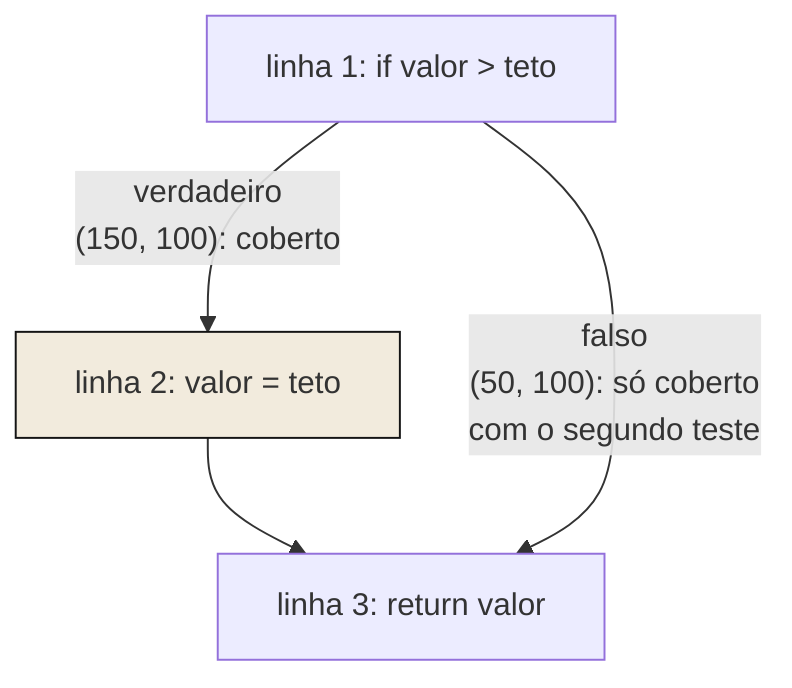
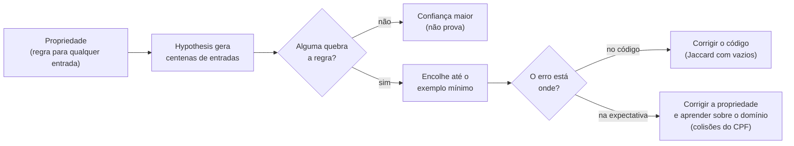
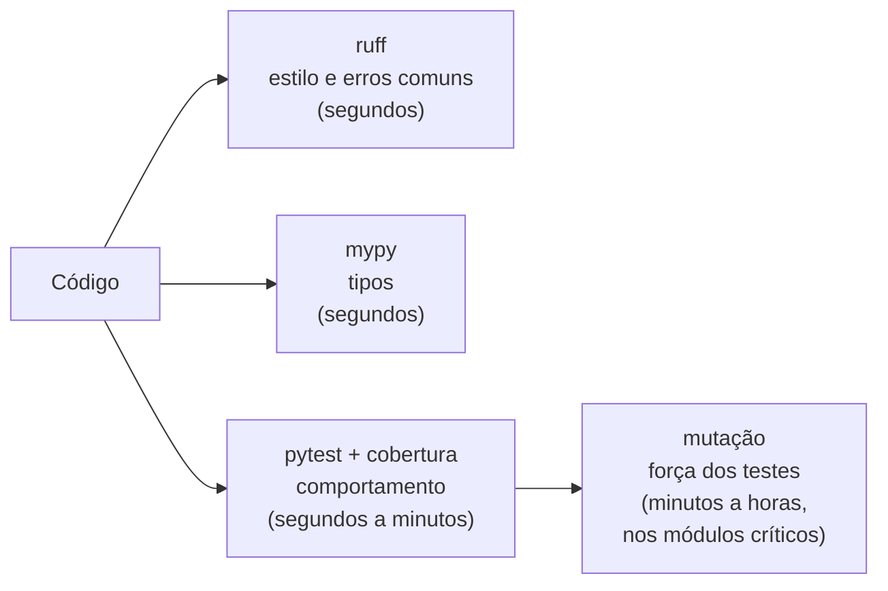

> **Aviso de Idioma:** Este currículo e todos os seus recursos de apoio foram estruturados exclusivamente em **Português (PT-BR)**.

# Aula 4 · Cobertura, mutação, propriedades e análise estática

**MOD-204 · 10 horas · Leitura principal:** Valente, *Engenharia de Software Moderna*, capítulo 8, seção sobre cobertura de testes; documentação do [Hypothesis](https://hypothesis.readthedocs.io/), página "Quick start"; documentação do [ruff](https://docs.astral.sh/ruff/)

## O que você vai aprender

- Medir a <abbr title="Cobertura de código: proporção do código (linhas, ou ramos de decisão) que foi executada pelo menos uma vez durante os testes.">cobertura</abbr> de linhas e de ramos com `pytest-cov` e entender como ela é calculada.
- Reconhecer os limites da cobertura e a lei de Goodhart.
- Avaliar a força de uma suíte com <abbr title="Teste de mutação: técnica que introduz pequenas alterações artificiais no código (mutantes) e confere se a suíte de testes percebe cada uma. Mutantes que sobrevivem revelam testes fracos.">testes de mutação</abbr>.
- Escrever <abbr title="Teste de propriedade: teste que afirma uma regra que deve valer para qualquer entrada (por exemplo, a simetria de uma função) e deixa uma ferramenta gerar centenas de entradas para tentar refutá-la.">testes de propriedade</abbr> com Hypothesis.
- Usar <abbr title="Análise estática: exame do código sem executá-lo, por ferramentas que apontam erros prováveis, violações de estilo, tipos incompatíveis e trechos inseguros.">análise estática</abbr> com ruff e mypy.

## Pergunta de abertura

> A coordenação de um projeto exige 100% de cobertura de testes. Uma semana depois, a meta é atingida. Um colega mostra que vários testes chamam as funções e não conferem nada. A meta foi cumprida? O que ela media antes e o que passou a medir depois?

## 1. Cobertura de linhas e de ramos

A ferramenta `coverage.py`, usada pelo plugin `pytest-cov`, registra quais partes do código foram executadas durante os testes. Considere uma função que aplica um teto a um valor e um único teste:

```text
# teto.py
def aplicar_teto(valor, teto):
    if valor > teto:
        valor = teto
    return valor

# test_teto.py
from teto import aplicar_teto

def test_acima_do_teto():
    assert aplicar_teto(150, 100) == 100
```

```text
$ python -m pytest --cov=teto --cov-branch --cov-report=term-missing
Name      Stmts   Miss Branch BrPart  Cover   Missing
-----------------------------------------------------
teto.py       4      0      2      1    83%   2->4
```

Todas as linhas foram executadas (`Miss` é zero), mas a cobertura de **ramos** acusa um problema: o `if` tem dois caminhos possíveis, e um deles, ir da linha 2 direto para a linha 4 (quando o valor **não** passa do teto), nunca foi percorrido. A coluna `Missing` mostra exatamente esse trecho: `2->4`. Cobertura de linhas sozinha esconderia isso.

### Como a cobertura funciona por dentro

Não há mágica: o Python oferece `sys.settrace`, que chama uma função nossa a cada linha executada. Uma cobertura de ramos em miniatura cabe em poucas linhas: basta anotar cada passagem de uma linha para a seguinte.

```python
import sys


def aplicar_teto(valor, teto):
    if valor > teto:
        valor = teto
    return valor


def rastrear_trechos(funcao, *args):
    """Uma cobertura em miniatura: anota as passagens de uma linha para outra dentro da função."""
    codigo = funcao.__code__
    trechos, anterior = set(), [None]

    def rastreador(quadro, evento, arg):
        if quadro.f_code is codigo and evento == "line":
            linha = quadro.f_lineno - codigo.co_firstlineno     # 1 = primeira linha do corpo
            trechos.add((anterior[0], linha))
            anterior[0] = linha
        return rastreador

    sys.settrace(rastreador)
    try:
        funcao(*args)
    finally:
        sys.settrace(None)
    return trechos


so_acima = rastrear_trechos(aplicar_teto, 150, 100)
so_abaixo = rastrear_trechos(aplicar_teto, 50, 100)
todos = so_acima | so_abaixo
print("Linhas com o teste (150, 100):", sorted({b for _, b in so_acima}), "de", sorted({b for _, b in todos}))
print("Trechos com o teste (150, 100):", sorted(so_acima, key=str))
print("Trecho que só o teste (50, 100) percorre:", sorted(so_abaixo - so_acima, key=str))
```

A ferramenta de verdade faz o mesmo, com muito mais cuidado (vários arquivos, linhas que não contam, desempenho). Saber como funciona ajuda a ler os relatórios: um ramo "parcial" é um par de linhas que o código **poderia** percorrer e os testes nunca percorreram.



*Na numeração do relatório do coverage, que conta a linha do `def`, essas são as linhas 2, 3 e 4.*

## 2. Os limites da cobertura

A cobertura diz o que **não** foi testado com certeza: um trecho nunca executado não foi verificado por nenhum teste. Mas ela não diz que o trecho executado foi bem testado. Um teste sem asserção nenhuma, que só chama a função, produz a mesma cobertura que um teste cuidadoso.

Responda à pergunta de abertura com uma ideia vinda da economia e das ciências sociais. O economista Charles Goodhart observou, em 1975, que indicadores usados como metas de política monetária deixavam de se comportar como antes. A antropóloga Marilyn Strathern resumiu a ideia na forma que ficou conhecida como **lei de Goodhart**: "quando uma medida se torna uma meta, ela deixa de ser uma boa medida". O sociólogo Donald Campbell formulou na mesma época uma observação parecida sobre indicadores sociais: quanto mais um indicador quantitativo é usado para tomar decisões, mais ele fica sujeito a pressões que o corrompem e corrompem o processo que deveria acompanhar.

Antes da meta, a cobertura media, de forma imperfeita, o cuidado com os testes. Depois, passou a medir o esforço para atingir a meta. É um caso pequeno de um fenômeno que o curso estuda em escala maior: a substituição da coisa pelo número que a representa, parente da reificação de Lukács (MOD-203, aula 4). Por isso o projeto deste módulo pede cobertura de ramos acima de 85% **e** uma justificativa escrita para o que ficou de fora: a meta vem acompanhada de um juízo qualitativo.

## 3. Testes de mutação: quem testa os testes?

Se a cobertura não mede a qualidade dos testes, o que mede? Uma resposta é o **teste de mutação**, proposto nos anos 1970 por Richard DeMillo, Richard Lipton e Frederick Sayward. A ideia: introduzir de propósito pequenos defeitos no código (trocar `>` por `>=`, `+` por `-`, um valor por outro), cada um gerando um **mutante**, e rodar a suíte contra cada mutante. Se a suíte falha, o mutante foi **morto**: os testes perceberam o defeito. Se a suíte passa, o mutante **sobreviveu**, e há um comportamento que nenhum teste confere.

```python
FONTE = """
def aplicar_teto(valor, teto):
    if valor > teto:
        valor = teto
    return valor
"""

MUTACOES = [
    ("valor > teto", "valor >= teto"),
    ("valor > teto", "valor < teto"),
    ("valor > teto", "valor <= teto"),
    ("valor = teto", "valor = valor"),
    ("return valor", "return teto"),
]


def suite_fraca(f):
    assert f(150, 100) == 100


def suite_forte(f):
    assert f(150, 100) == 100
    assert f(50, 100) == 50
    assert f(100, 100) == 100


def avaliar_mutantes(suite):
    sobreviventes = []
    for original, mutado in MUTACOES:
        espaco = {}
        exec(FONTE.replace(original, mutado), espaco)       # cria a função mutante
        try:
            suite(espaco["aplicar_teto"])
        except AssertionError:
            continue                                        # mutante morto: a suíte percebeu
        sobreviventes.append(mutado)
    mortos = len(MUTACOES) - len(sobreviventes)
    print(f"{suite.__name__}: {mortos} de {len(MUTACOES)} mutantes mortos; sobreviveram: {sobreviventes}")


avaliar_mutantes(suite_fraca)
avaliar_mutantes(suite_forte)
```

A suíte fraca tem 100% de cobertura de linhas e deixa sobreviver o mutante `return teto`, um defeito grave: a função passaria a devolver sempre o teto. A suíte forte o mata, com o caso `(50, 100)`.

E o mutante `valor >= teto` sobrevive até à suíte forte. Por quê? Porque quando `valor == teto`, trocar `valor` por `teto` não muda nada: o resultado é o mesmo. É um **mutante equivalente**, que nenhum teste pode matar, porque ele não muda o comportamento. Identificar mutantes equivalentes exige raciocínio humano, e é um dos motivos pelos quais o teste de mutação é usado como ferramenta de diagnóstico, não como meta.

Ferramentas como `mutmut` e `cosmic-ray` fazem isso automaticamente, manipulando a árvore sintática do programa em vez do texto, e geram centenas de mutantes. São lentas (cada mutante roda a suíte inteira), por isso costumam ser aplicadas aos módulos mais críticos.

## 4. Testes de propriedade com Hypothesis

Os testes que escrevemos até aqui são **testes de exemplo**: para tal entrada, tal saída. Um teste de propriedade afirma uma **regra geral** e deixa uma ferramenta procurar uma entrada que a quebre. A ideia vem da biblioteca QuickCheck, criada por Koen Claessen e John Hughes em 1999 para a linguagem Haskell; em Python, a ferramenta é o Hypothesis (instale com `python -m pip install hypothesis`).

Vamos testar o índice de Jaccard do Motor de Constelações (MOD-203, aula 9). Que propriedades ele deve ter, para quaisquer dois conjuntos de conceitos? Deve ser **simétrico** (a semelhança de A com B é a de B com A) e ficar **entre 0 e 1**. Com a função escrita exatamente como no MOD-203:

```text
from hypothesis import given, strategies as st

conceitos = st.frozensets(st.sampled_from(["progresso", "técnica", "mercadoria", "história", "cooperação"]))

def jaccard(a, b):
    return len(a & b) / len(a | b)

@given(conceitos, conceitos)
def test_jaccard_simetrico_e_entre_zero_e_um(a, b):
    assert jaccard(a, b) == jaccard(b, a)
    assert 0 <= jaccard(a, b) <= 1
```

```text
$ python -m pytest -q
Falsifying example: test_jaccard_simetrico_e_entre_zero_e_um(
    a=frozenset(),
    b=frozenset(),
)
E       ZeroDivisionError: division by zero
1 failed in 0.16s
```

O Hypothesis gerou dezenas de pares de conjuntos e, quando encontrou um que quebra a função, **encolheu** o exemplo até o mais simples possível: dois conjuntos vazios. Duas fichas sem nenhum conceito fazem a função dividir por zero. Nas fichas de exemplo do MOD-203 isso não acontecia, porque todas tinham conceitos; mas basta uma pessoa cadastrar uma ficha incompleta para o motor quebrar. Nenhum teste de exemplo que escrevemos tinha pensado nesse caso. Corrigida a função, as propriedades passam, e acrescentamos outra: uma ficha comparada consigo mesma vale 1.

```python
import re

from hypothesis import given, strategies as st

conceitos = st.frozensets(st.sampled_from(["progresso", "técnica", "mercadoria", "história", "cooperação"]))


def jaccard(a, b):
    """Índice de Jaccard; duas fichas sem nenhum conceito não têm nada em comum."""
    uniao = a | b
    if not uniao:
        return 0.0
    return len(a & b) / len(uniao)


@given(conceitos, conceitos)
def test_jaccard_simetrico_e_entre_zero_e_um(a, b):
    assert jaccard(a, b) == jaccard(b, a)
    assert 0 <= jaccard(a, b) <= 1


@given(conceitos.filter(bool))
def test_ficha_identica_vale_um(a):
    assert jaccard(a, a) == 1


def validar_cpf(cpf: str) -> bool:
    numeros = re.sub(r"\D", "", cpf)
    if len(numeros) != 11 or numeros == numeros[0] * 11:
        return False
    for tamanho in (9, 10):
        soma = sum(int(d) * peso for d, peso in zip(numeros[:tamanho], range(tamanho + 1, 1, -1)))
        if (soma * 10) % 11 % 10 != int(numeros[tamanho]):
            return False
    return True


def completar_cpf(nove: str) -> str:
    """Calcula os dois dígitos verificadores de outra forma, para servir de referência."""
    digitos = [int(d) for d in nove]
    for _ in range(2):
        pesos = range(len(digitos) + 1, 1, -1)
        resto = sum(d * p for d, p in zip(digitos, pesos)) % 11
        digitos.append(0 if resto < 2 else 11 - resto)
    return "".join(map(str, digitos))


nove_digitos = st.text(alphabet="0123456789", min_size=9, max_size=9).filter(lambda s: len(set(s)) > 1)


@given(nove_digitos)
def test_todo_cpf_completado_e_valido(nove):
    assert validar_cpf(completar_cpf(nove))


@given(nove_digitos, st.integers(min_value=0, max_value=10), st.integers(min_value=1, max_value=9))
def test_mudar_um_digito_invalida(nove, posicao, deslocamento):
    cpf = list(completar_cpf(nove))
    cpf[posicao] = str((int(cpf[posicao]) + deslocamento) % 10)
    assert not validar_cpf("".join(cpf))
```

O segundo grupo de testes aplica a mesma ideia ao CPF da aula 2. A propriedade `test_todo_cpf_completado_e_valido` usa uma técnica preciosa: comparar a função com uma **segunda implementação independente** (`completar_cpf`, que usa a fórmula tradicional do "11 menos o resto"). Se as duas discordarem em algum caso, uma delas está errada.

### Quando a propriedade está errada

Ao escrever esta aula, testamos também uma propriedade que parecia óbvia: "mudar qualquer dígito de um CPF válido o torna inválido". O Hypothesis a refutou:

```text
Falsifying example: test_mudar_um_digito_qualquer_invalida(
    nove='010345778', posicao=0, deslocamento=1,
)
```

Os CPFs `010.345.778-08` e `110.345.778-08` são **ambos válidos**. Não há defeito no código: o defeito estava na nossa expectativa. O algoritmo do CPF transforma os restos 0 e 10 no mesmo dígito verificador (zero), e por isso certas trocas de um único dígito passam despercebidas. Numa simulação com 20 mil CPFs aleatórios e todas as trocas possíveis de um dígito, cerca de 0,18% delas produziram outro CPF válido. Um teste de propriedade ensinou algo sobre o **domínio**, e não só sobre o código: os dígitos verificadores reduzem muito os erros de digitação, mas não os eliminam. Por isso a propriedade que ficou na suíte só altera os dígitos verificadores, e não qualquer dígito:

```python
@given(nove_digitos, st.integers(min_value=9, max_value=10), st.integers(min_value=1, max_value=9))
def test_mudar_um_digito_verificador_invalida(nove, posicao, deslocamento):
    cpf = list(completar_cpf(nove))
    cpf[posicao] = str((int(cpf[posicao]) + deslocamento) % 10)
    assert not validar_cpf("".join(cpf))
```



## 5. Análise estática: ruff e mypy

Testes executam o código. A análise estática o **lê**, sem executar, e aponta problemas prováveis. Duas ferramentas cobrem quase tudo em Python:

- **ruff**: verifica estilo, erros comuns e más práticas (reúne em uma ferramenta muito rápida as regras de outras como flake8, isort e pyupgrade) e também formata o código (`ruff format`).
- **mypy**: confere as anotações de tipo (MOD-202, aula 4) e encontra incompatibilidades.

O arquivo abaixo tem três problemas. Leia com atenção antes de ver o que as ferramentas dizem.

```text
import os


def somar_despesas(despesas, categorias=[]):
    total = 0
    for d in despesas:
        if d["categoria"] in categorias or categorias == []:
            total += d["valor"]
    return total


def maior_despesa(despesas: list[dict]) -> dict | None:
    if not despesas:
        return None
    return max(despesas, key=lambda d: d["valor"])


def nome_do_maior_fornecedor(despesas: list[dict]) -> str:
    return maior_despesa(despesas)["fornecedor"]
```

```text
$ ruff check --select F,E,B despesas.py
despesas.py:1:8: F401 [*] `os` imported but unused
despesas.py:4:41: B006 Do not use mutable data structures for argument defaults
Found 2 errors.

$ mypy despesas.py
despesas.py:19: error: Value of type "dict[Any, Any] | None" is not indexable  [index]
Found 1 error in 1 file (checked 1 source file)
```

| Aviso | O problema | A correção |
| :--- | :--- | :--- |
| F401 | `os` foi importado e nunca usado | Apagar a linha (o `[*]` indica que `ruff check --fix` faz isso sozinho) |
| B006 | A lista vazia usada como valor padrão é criada **uma vez só** e compartilhada entre todas as chamadas; se alguém a modificar, as chamadas seguintes mudam de comportamento | Usar `categorias=None` e criar a lista dentro da função |
| index | `maior_despesa` pode devolver `None` (lista vazia), e `None["fornecedor"]` levantaria `TypeError` | Tratar o caso `None` explicitamente |

O terceiro problema é exatamente o tipo de defeito que um teste esqueceria (quem testaria `nome_do_maior_fornecedor` com uma lista vazia?) e que a anotação `dict | None` permitiu ao mypy encontrar sem executar nada. Tipos são uma forma de especificação que a máquina confere.

A configuração fica no `pyproject.toml` do projeto:

```text
[tool.ruff]
line-length = 100

[tool.ruff.lint]
select = ["E", "F", "B", "I", "UP"]   # erros, falhas lógicas, bugbear, ordem dos imports, sintaxe moderna

[tool.mypy]
strict = true

[tool.coverage.run]
branch = true
source = ["br_transparencia"]

[tool.coverage.report]
fail_under = 85
show_missing = true
```



Cada camada encontra defeitos que as outras deixam passar. Na próxima aula, todas elas vão rodar sozinhas a cada mudança.

## Leitura guiada

1. ***Engenharia de Software Moderna*, seção sobre cobertura de testes** (cerca de 8 páginas): compare a recomendação de Valente sobre metas de cobertura com a lei de Goodhart.
2. **Documentação do Hypothesis, "Quick start guide"** (em inglês): leia sobre estratégias (`st.integers`, `st.text`, `st.lists`) e sobre `@example`, que fixa um caso que sempre deve ser testado.

## Exercícios

**1.** Uma função tem um `if` sem `else` e um `for`. Que casos de teste são necessários para 100% de cobertura de ramos? Use a função abaixo e escreva os testes.

```text
def total_acima_do_minimo(valores, minimo):
    total = 0
    for v in valores:
        if v >= minimo:
            total += v
    return total
```

<details>
<summary>Gabarito comentado</summary>

Os ramos são: entrar no `for` e não entrar (lista vazia); dentro dele, a condição verdadeira e a falsa. Dois testes bastam: `total_acima_do_minimo([], 10) == 0` (não entra no laço) e `total_acima_do_minimo([5, 10, 20], 10) == 30` (5 testa o lado falso; 10 e 20, o verdadeiro, com 10 na fronteira). O valor 10 na fronteira mata o mutante que troca `>=` por `>`.
</details>

**2.** Acrescente à lista `MUTACOES` um mutante que a suíte forte não mata e que **não** seja equivalente. Depois acrescente à suíte o teste que o mata.

<details>
<summary>Gabarito</summary>

Por exemplo, `("valor > teto", "valor > teto + 1")`: com `(101, 100)`, a função original devolve 100 e o mutante devolve 101. A suíte forte não testa esse valor e o mutante sobrevive. O teste `assert f(101, 100) == 100` o mata. Moral: os valores imediatamente ao lado da fronteira (100 e 101) são os que mais revelam.
</details>

**3.** Escreva propriedades com Hypothesis para a função `agrupar_por_partido` da aula 2. Sugestões: a soma das quantidades é igual ao número de deputados; nenhum partido aparece duas vezes; as quantidades estão em ordem decrescente.

<details>
<summary>Gabarito</summary>

```python
from collections import Counter


def agrupar_por_partido_v2(deputados):
    contagem = Counter(d["siglaPartido"] for d in deputados)
    return sorted(contagem.items(), key=lambda par: (-par[1], par[0]))


deputados = st.lists(st.fixed_dictionaries({"siglaPartido": st.sampled_from(["PT", "PL", "PSOL", "MDB", "PP"])}))


@given(deputados)
def test_propriedades_do_agrupamento(lista):
    resultado = agrupar_por_partido_v2(lista)
    assert sum(q for _, q in resultado) == len(lista)
    siglas = [s for s, _ in resultado]
    assert len(siglas) == len(set(siglas))
    quantidades = [q for _, q in resultado]
    assert quantidades == sorted(quantidades, reverse=True)
```
</details>

**4.** Rode `ruff check` e `mypy --strict` no seu SDK. Escolha três avisos, explique o que cada um protege e decida, justificando, se vai corrigir ou desligar a regra.

<details>
<summary>Critérios de correção</summary>

Para cada aviso: o problema real que ele previne, com um exemplo de falha possível, e uma decisão justificada. Desligar uma regra é legítimo quando ela não se aplica ao projeto, mas deve ser feito na configuração, com comentário, e não espalhando `# noqa` pelo código. A melhor resposta mostra um aviso do mypy que revelou um caso de `None` não tratado.
</details>

## Resumo da aula

- A cobertura de ramos revela caminhos de decisão não testados que a cobertura de linhas esconde; ela funciona anotando as passagens de linha a linha.
- Cobertura mostra o que não foi testado, mas não a qualidade do que foi; usada como meta, sofre a lei de Goodhart.
- O teste de mutação avalia a suíte: mutantes que sobrevivem apontam comportamentos não conferidos; mutantes equivalentes exigem juízo humano.
- Testes de propriedade afirmam regras gerais e deixam o Hypothesis buscar contraexemplos, que podem revelar defeitos no código (Jaccard com conjuntos vazios) ou na nossa compreensão do domínio (colisões do CPF).
- A análise estática com ruff e mypy encontra, sem executar, erros comuns e casos de `None` não tratados.

## Para ir além

- Richard DeMillo, Richard Lipton e Frederick Sayward, "Hints on Test Data Selection: Help for the Practicing Programmer", *IEEE Computer*, 1978 (em inglês), o artigo fundador do teste de mutação.
- Jerry Z. Muller, *The Tyranny of Metrics* (2018, em inglês), sobre a lei de Goodhart na gestão pública, na saúde e na educação.
