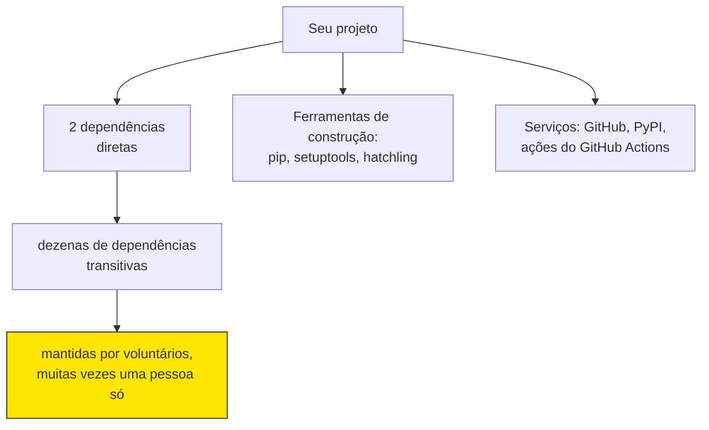
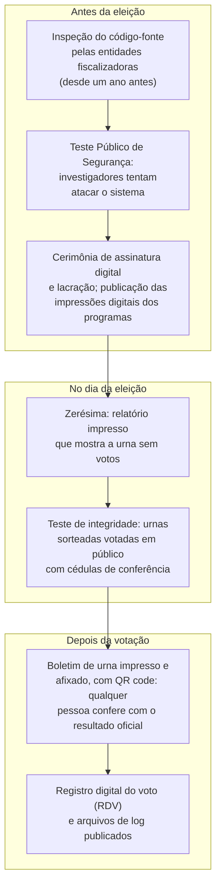
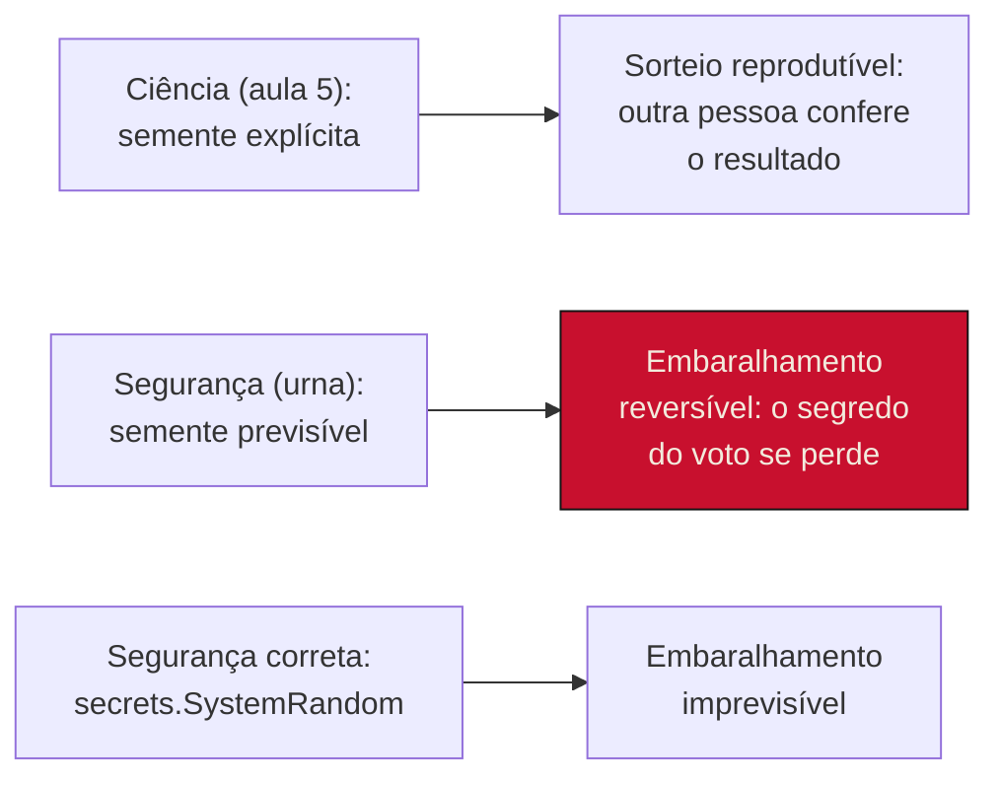

> **Aviso de Idioma:** Este currículo e todos os seus recursos de apoio foram estruturados exclusivamente em **Português (PT-BR)**.

# Aula 6 · Auditoria de código e da cadeia de dependências

**MOD-204 · 10 horas · Leitura principal:** documentação do [pip-audit](https://pypi.org/project/pip-audit/); página do TSE sobre [segurança da urna eletrônica](https://www.tse.jus.br/eleicoes/urna-eletronica); apresentação de Diego Aranha sobre o Teste Público de Segurança de 2012 (Unicamp, disponível na página do autor)

## O que você vai aprender

- Explicar a <abbr title="Cadeia de suprimentos de software: o conjunto de componentes, ferramentas e pessoas de que um programa depende para ser construído e distribuído: bibliotecas, dependências das bibliotecas, compiladores, repositórios de pacotes, serviços de integração contínua.">cadeia de suprimentos de software</abbr> e os riscos das dependências transitivas.
- Analisar três episódios: left-pad (2016), Log4Shell (2021) e a porta dos fundos do xz utils (2024).
- Encontrar <abbr title="Vulnerabilidade (CVE): falha que permite atacar um sistema. CVE (Common Vulnerabilities and Exposures) é o catálogo público que dá a cada vulnerabilidade conhecida um identificador único, como CVE-2021-44228.">vulnerabilidades conhecidas</abbr> com pip-audit e acompanhar as correções.
- Gerar um <abbr title="SBOM (Software Bill of Materials, lista de materiais de software): inventário legível por máquina de todos os componentes de um programa, com versões, licenças e origem. Os formatos mais usados são CycloneDX e SPDX.">SBOM</abbr> e conferir a compatibilidade de licenças.
- Estudar a auditoria pública da urna eletrônica brasileira e reproduzir, numa simulação, a falha encontrada em 2012.
- Escrever o laudo de auditoria do projeto do módulo.

## Pergunta de abertura

> O seu SDK tem duas dependências declaradas. Quantas pessoas, que você não conhece, escreveram código que roda quando alguém usa o SDK? E numa urna eletrônica, que nenhuma eleitora pode abrir: em que se apoia a confiança de que o voto foi contado como foi digitado?

## 1. A cadeia de suprimentos

Quando você instala um pacote, instala também as dependências dele, as dependências das dependências e assim por diante. As **dependências transitivas** costumam ser muito mais numerosas que as diretas, e quase ninguém as lê. O código abaixo percorre a árvore de um pacote instalado, usando só a biblioteca padrão:

```python
import re
from importlib import metadata


def dependencias_diretas(pacote: str) -> list[str]:
    """Lê os requisitos declarados por um pacote instalado, ignorando os opcionais (extras)."""
    requisitos = metadata.requires(pacote) or []
    nomes = []
    for r in requisitos:
        if "extra ==" in r:
            continue
        nomes.append(re.split(r"[\s<>=!~;\[(]", r, maxsplit=1)[0].lower())
    return sorted(set(nomes))


def arvore(pacote: str, nivel: int = 0, vistos=None) -> list[str]:
    vistos = set() if vistos is None else vistos
    linhas = ["    " * nivel + pacote]
    vistos.add(pacote)
    try:
        filhos = dependencias_diretas(pacote)
    except metadata.PackageNotFoundError:
        return linhas
    for filho in filhos:
        if filho not in vistos:
            linhas += arvore(filho, nivel + 1, vistos)
    return linhas


try:
    print("\n".join(arvore("pydantic")))
except metadata.PackageNotFoundError:
    print("Instale o pydantic para ver a árvore: python -m pip install pydantic")
```

```text
pydantic
    annotated-types
    pydantic-core
        typing-extensions
    typing-inspection
```

Uma dependência declarada trouxe quatro outras. Num projeto real de análise de dados, com pandas, Jupyter e uma biblioteca de gráficos, a árvore passa facilmente de cem pacotes. Cada um é mantido por alguém, frequentemente uma pessoa só, frequentemente sem receber nada por isso. A tirinha *Dependency*, de Randall Munroe (xkcd, 2020), muito conhecida entre programadores, mostra a infraestrutura digital moderna como uma torre de blocos que se apoia inteira num bloquinho na base, "um projeto que alguma pessoa aleatória de Nebraska vem mantendo sem agradecimento desde 2003".



### Três episódios

**left-pad (2016).** Em março de 2016, depois de uma disputa com a empresa Kik pelo nome de um pacote, o programador Azer Koçulu retirou do repositório npm, de JavaScript, todos os seus 273 pacotes. Um deles, `left-pad`, tinha onze linhas de código (completava um texto com espaços à esquerda) e era dependência transitiva de ferramentas usadas por milhares de projetos, como o Babel. Durante algumas horas, a construção desses projetos quebrou no mundo inteiro. O npm restaurou o pacote, num gesto sem precedentes, e mudou as regras de remoção. Lição: uma dependência pode **desaparecer**.

**Log4Shell (2021).** Em dezembro de 2021 foi divulgada a vulnerabilidade CVE-2021-44228 na Log4j, uma biblioteca Java de registro de mensagens (*logs*), usada em milhões de sistemas. Bastava fazer o sistema registrar um texto especialmente formatado (num campo de busca, num nome de usuário) para que ele baixasse e executasse código de um servidor do atacante. Recebeu a nota máxima, 10, na escala de gravidade CVSS. Muitas organizações levaram semanas só para descobrir **onde** usavam a Log4j, porque ela estava escondida em dependências de dependências. Lição: é preciso saber **o que** se usa.

**xz utils (2024).** Em 29 de março de 2024, Andres Freund, engenheiro e desenvolvedor do banco de dados PostgreSQL, estranhou que as conexões SSH numa máquina de testes estivessem consumindo processador demais e demorando meio segundo a mais. Investigando, descobriu uma porta dos fundos (CVE-2024-3094) inserida nas versões 5.6.0 e 5.6.1 da biblioteca de compressão xz, usada em quase todas as distribuições Linux. O código malicioso estava escondido em **arquivos binários de teste** do projeto e só era montado no momento da construção do pacote. O autor, sob o nome "Jia Tan", tinha contribuído durante cerca de dois anos com o projeto, ganhado a confiança do mantenedor principal, Lasse Collin, que trabalhava sozinho, sem pagamento e com a saúde abalada, e que foi pressionado por contas de aparência falsa a dividir o controle do projeto. A porta dos fundos foi descoberta antes de chegar às versões estáveis das grandes distribuições, por uma combinação de atenção e sorte. Lição: a cadeia de suprimentos é também uma cadeia de **pessoas**, e o seu elo mais fraco pode ser o cansaço de um voluntário.

### Uma questão de trabalho

Os três episódios têm algo em comum que não é técnico. Empresas que faturam bilhões dependem de infraestrutura mantida por trabalho voluntário, e não financiam proporcionalmente quem a mantém. É uma forma contemporânea de um fenômeno que o curso estudou em Marx (MOD-104): a apropriação privada de um produto social. E é também, como lembraria Kropotkin (MOD-105), uma prova da força do apoio mútuo: a infraestrutura digital funciona, na maior parte do tempo, porque milhares de pessoas cooperam sem que ninguém as obrigue. Auditar dependências é uma tarefa técnica; sustentar quem as mantém é uma tarefa política.

## 2. Vulnerabilidades conhecidas

As vulnerabilidades conhecidas ficam registradas em bases públicas: o catálogo CVE, a base OSV (*Open Source Vulnerabilities*) e a base de alertas do GitHub. A ferramenta `pip-audit`, mantida pela Python Packaging Authority, confere as dependências instaladas contra essas bases:

```text
$ python -m pip install pip-audit
$ pip-audit
Found 1 known vulnerability in 1 package
Name     Version ID                  Fix Versions
-------- ------- ------------------- ------------
requests 2.25.0  GHSA-j8r2-6x86-q33q 2.31.0
```

O exemplo mostra uma versão antiga da biblioteca `requests` com uma falha que podia vazar credenciais de proxy, corrigida na versão 2.31.0. O laudo de auditoria registra, para cada vulnerabilidade: o identificador, a gravidade, se o seu código de fato usa a parte afetada e a decisão tomada (atualizar, substituir a dependência, ou aceitar o risco com justificativa e prazo). O pip-audit pode rodar no CI, num passo depois da instalação, e ferramentas como o Dependabot, do GitHub, abrem sozinhas pedidos de integração quando sai uma correção.

### Fixar e conferir

Na aula 5, o arquivo de travamento servia à reprodutibilidade. Aqui ele serve à segurança, desde que inclua as **impressões digitais** de cada pacote (`--require-hashes`): se alguém substituir um pacote no repositório por uma versão adulterada com o mesmo número, a instalação falha. O mesmo vale para o fluxo de CI: `actions/checkout@v4` aponta para uma etiqueta que o dono da ação pode mover; apontar para o identificador completo do *commit* (`actions/checkout@<40 caracteres>`) garante que o código executado é sempre o mesmo. E a linha `permissions: contents: read` da aula 5 aplica o **princípio do menor privilégio**: se algo malicioso rodar no CI, encontra pouco poder ao seu alcance.

## 3. Lista de materiais e licenças

Depois do Log4Shell, governos e empresas passaram a exigir de fornecedores um SBOM, a lista de materiais do software, nos formatos padronizados CycloneDX ou SPDX. Ferramentas como `cyclonedx-py` e o próprio `pip-audit --format cyclonedx-json` geram esse arquivo. A ideia cabe em poucas linhas:

```python
def licenca(pacote: str) -> str:
    dados = metadata.metadata(pacote)
    expressao = dados.get("License-Expression")
    if expressao:
        return expressao
    classificadores = [c.split(" :: ")[-1] for c in dados.get_all("Classifier") or [] if c.startswith("License ::")]
    if classificadores:
        return "; ".join(classificadores)
    texto = (dados.get("License") or "").strip()
    return texto.splitlines()[0][:40] if texto else "não declarada"


def sbom_minimo(pacotes: list[str]) -> list[dict]:
    """Uma lista de materiais em miniatura: nome, versão e licença declarada de cada componente."""
    componentes = []
    for nome in pacotes:
        try:
            componentes.append({"nome": nome, "versao": metadata.version(nome), "licenca": licenca(nome)})
        except metadata.PackageNotFoundError:
            componentes.append({"nome": nome, "versao": "ausente", "licenca": "?"})
    return componentes


for c in sbom_minimo(["pydantic", "pydantic-core", "typing-extensions", "annotated-types"]):
    print(f"{c['nome']:<20} {c['versao']:<10} {c['licenca']}")
```

```text
pydantic             2.13.5     MIT
pydantic-core        2.46.5     MIT
typing-extensions    4.16.0     PSF-2.0
annotated-types      0.8.0      MIT
```

*Os números de versão dependem do seu ambiente.*

A coluna de licenças importa tanto quanto a de versões. Se o SDK é publicado sob a licença MIT (MOD-107), cada dependência precisa ter uma licença compatível com esse uso:

| Licença da dependência | Tipo | Pode ser usada por um projeto MIT? |
| :--- | :--- | :--- |
| MIT, BSD, Apache-2.0, PSF | Permissiva | Sim, mantendo os avisos de autoria |
| LGPL | Copyleft fraco | Sim, como biblioteca separada; modificações nela seguem a LGPL |
| GPL | Copyleft | A obra combinada distribuída fica sujeita à GPL, segundo a Free Software Foundation; contradiz a intenção de uma licença permissiva |
| AGPL | Copyleft de rede | Como a GPL, e também obriga a oferecer o código a quem usa o programa pela rede |
| Sem licença declarada | Nenhuma | Não: sem licença, todos os direitos são do autor; peça que declare uma |

Nenhuma dessas licenças é "melhor" em abstrato: o copyleft da GPL é uma escolha política deliberada, que impede que o código livre seja fechado por terceiros (MOD-107). A auditoria só garante que a escolha do seu projeto é **coerente** com a das suas dependências.

## 4. A urna eletrônica: auditoria pública de um sistema crítico

O Brasil usa urnas eletrônicas desde as eleições municipais de 1996 e, desde 2000, em todo o território. É um dos maiores sistemas de votação eletrônica do mundo, e um caso exemplar de como se tenta construir confiança num software que a eleitora não pode ver por dentro.


*Urna eletrônica do modelo usado nas eleições de 2022. Foto: Tribunal Superior Eleitoral (2021). Domínio público.*

A Justiça Eleitoral combina várias camadas de auditoria:



O código-fonte fica disponível, numa sala do TSE e mediante agendamento, para inspeção por entidades fiscalizadoras definidas em resolução (partidos, Ordem dos Advogados, Ministério Público, Polícia Federal, universidades e outras), a partir de um ano antes de cada eleição. O **Teste Público de Segurança** (TPS), realizado desde 2009, convida pesquisadores a tentar atacar o sistema; as falhas encontradas devem ser corrigidas e conferidas num teste de confirmação. O **boletim de urna** permite que qualquer pessoa some os resultados das seções e compare com o total divulgado. As auditorias realizadas, inclusive a conduzida pelas Forças Armadas nas eleições de 2022, não encontraram fraude nos resultados.

### O que o TPS de 2012 encontrou

Para proteger o segredo do voto, a urna não guarda os votos na ordem em que foram digitados: o **registro digital do voto** os grava em posições embaralhadas, e esse arquivo é público, para permitir recontagens. No TPS de março de 2012, uma equipe da Universidade de Brasília coordenada pelo professor Diego Aranha mostrou que o embaralhamento usava um gerador de números pseudoaleatórios iniciado com uma **semente previsível**: a hora em que a urna era preparada, registrada na zerésima, um documento impresso e público. Conhecida a semente, bastava refazer o embaralhamento para desfazê-lo. A equipe recuperou, na ordem de votação, 474 dos 475 votos de uma eleição simulada. Cruzada com a ordem de comparecimento dos eleitores, a ordem dos votos revela quem votou em quem.

A simulação abaixo reproduz o mecanismo com dados inventados:

```python
import random
import secrets
from datetime import datetime, timedelta, timezone


def gravar_rdv(votos, gerador):
    """Guarda os votos em posições embaralhadas, para que a ordem de votação não fique registrada."""
    posicoes = list(range(len(votos)))
    gerador.shuffle(posicoes)
    rdv = [None] * len(votos)
    for i, posicao in enumerate(posicoes):
        rdv[posicao] = votos[i]
    return rdv


def recuperar_ordem(rdv, semente):
    """O ataque: refazer o mesmo embaralhamento a partir da semente e desfazê-lo."""
    posicoes = list(range(len(rdv)))
    random.Random(semente).shuffle(posicoes)
    return [rdv[p] for p in posicoes]


# Eleição simulada. A semente é a hora da zerésima, impressa e pública.
zeresima = int(datetime(2012, 10, 7, 8, 0, 0, tzinfo=timezone(timedelta(hours=-3))).timestamp())
candidaturas = ["Candidata 11", "Candidato 22", "Candidata 33", "Branco"]
sorteio = random.Random(7)
votos_em_ordem = [sorteio.choice(candidaturas) for _ in range(30)]
comparecimento = [f"Eleitora {n:02d}" for n in range(1, 31)]          # quem votou, em que ordem

rdv_vulneravel = gravar_rdv(votos_em_ordem, random.Random(zeresima))
recuperados = recuperar_ordem(rdv_vulneravel, zeresima)
print("Arquivo publicado começa com:", rdv_vulneravel[:3])
print("Ordem recuperada:", list(zip(comparecimento, recuperados))[:3], "...")
print("Ataque reconstruiu a ordem inteira?", recuperados == votos_em_ordem)

rdv_seguro = gravar_rdv(votos_em_ordem, secrets.SystemRandom())       # entropia do sistema operacional
print("Com gerador seguro, o mesmo ataque funciona?", recuperar_ordem(rdv_seguro, zeresima) == votos_em_ordem)


def test_semente_previsivel_permite_recuperar_a_ordem():
    assert recuperar_ordem(gravar_rdv(votos_em_ordem, random.Random(zeresima)), zeresima) == votos_em_ordem


def test_embaralhamento_preserva_a_contagem():
    from collections import Counter
    assert Counter(gravar_rdv(votos_em_ordem, secrets.SystemRandom())) == Counter(votos_em_ordem)
```

O ataque não precisa quebrar nenhuma criptografia: ele usa só informação pública e o fato de que `random.Random(semente)` produz **sempre a mesma sequência** para a mesma semente. Na aula 5 essa propriedade era uma virtude, porque tornava um sorteio científico reprodutível. Aqui ela é o defeito. Para segurança, o Python oferece o módulo `secrets` e a classe `secrets.SystemRandom`, que usam a entropia do sistema operacional e não podem ser reproduzidos. O TSE corrigiu a falha depois do teste, e é exatamente para isso que o TPS existe: o sistema ficou mais seguro **porque** foi aberto ao ataque de pesquisadores independentes.



### O debate sobre verificabilidade

O caso de 2012 alimentou um debate técnico legítimo, que não deve ser confundido com as campanhas de desinformação que atacaram o sistema eleitoral brasileiro em anos recentes. Pesquisadores de segurança, no Brasil e fora dele, defendem o princípio da **independência de software**, formulado por Ronald Rivest e John Wack em 2006: um sistema de votação é independente de software se uma alteração não detectada no programa não puder produzir uma alteração não detectável no resultado. Urnas que só registram o voto eletronicamente não atendem a esse critério por definição, e por isso parte da comunidade acadêmica propõe algum registro físico conferível pela eleitora. A Justiça Eleitoral sustenta que as múltiplas camadas de auditoria garantem a confiabilidade, e o registro impresso do voto foi objeto de leis, de decisões do Supremo Tribunal Federal e de votações no Congresso. O ponto para este curso é o método: a confiança num sistema crítico se constrói com **abertura à verificação**, e cada camada de auditoria pode ser avaliada pelas perguntas que você aprendeu neste módulo. O que ela verifica? O que deixa de fora? Quem pode conferir?

Responda à pergunta de abertura: no SDK, a confiança se apoia no trabalho de dezenas de pessoas desconhecidas, que a auditoria de dependências torna visíveis e verificáveis. Na urna, ela se apoia em camadas de auditoria pública e na possibilidade de pesquisadores independentes atacarem o sistema e publicarem o que encontraram. Nos dois casos, a confiança legítima vem da verificação, e não da autoridade de quem afirma que está tudo certo.

## 5. O laudo de auditoria

O projeto do módulo pede um arquivo `AUDITORIA.md` com esta estrutura mínima:

```text
# Laudo de auditoria: br-transparencia-sdk 0.3.0

Data: 2026-11-05 · Commit: 4f2a9c1 · Responsável: (nome)

## 1. Escopo
O que foi auditado (pacote, versão, dependências) e o que não foi.

## 2. Inventário
SBOM em CycloneDX anexado (sbom.json). 2 dependências diretas, 9 transitivas.

## 3. Vulnerabilidades
| ID | Pacote | Gravidade | Afeta o projeto? | Decisão |
Nenhuma vulnerabilidade conhecida em 2026-11-05 (pip-audit 2.x).

## 4. Licenças
Todas permissivas (MIT, BSD-3-Clause, Apache-2.0), compatíveis com a MIT do projeto.

## 5. Práticas de cadeia de suprimentos
Travamento com impressões digitais: sim. Ações do CI fixadas por commit: sim.
Permissões mínimas no CI: sim. Publicação com credencial de curta duração: sim.

## 6. Riscos aceitos e recomendações
Dependência X mantida por uma pessoa só: risco aceito; acompanhamento trimestral.
```

O laudo é um documento **público** e datado. Ele não afirma que o software é seguro (lembre de Dijkstra, aula 1): afirma o que foi verificado, quando, com que ferramentas e o que ficou de fora. Essa honestidade sobre os limites é o que o torna útil para quem vai decidir se confia no projeto.

## Leitura guiada

1. **Página do TSE sobre segurança da urna eletrônica**: leia as seções sobre o Teste Público de Segurança e o teste de integridade e anote, para cada camada de auditoria, quem pode participar.
2. **Diego Aranha e equipe, relatório sobre o TPS de 2012** (em português, disponível na página do autor): leia a descrição da vulnerabilidade do registro digital do voto e compare com a simulação desta aula.

## Exercícios

**1.** Explique a diferença entre os riscos ilustrados pelos episódios do left-pad, do Log4Shell e do xz utils. Para cada um, cite uma prática desta aula que reduz o risco.

<details>
<summary>Gabarito comentado</summary>

left-pad: risco de **disponibilidade** (a dependência some); reduz-se com espelhos e caches de pacotes e arquivos de travamento. Log4Shell: risco de **vulnerabilidade** numa dependência legítima; reduz-se com SBOM (para saber onde se usa) e pip-audit ou Dependabot (para saber que há correção). xz utils: risco de **sabotagem** por alguém de dentro da cadeia; é o mais difícil, e reduz-se com construções reprodutíveis (que permitem conferir que o pacote corresponde ao código-fonte), revisão de código, desconfiança de arquivos binários no repositório e, sobretudo, com o financiamento e o apoio a quem mantém projetos críticos.
</details>

**2.** Gere o SBOM do seu SDK com `pip-audit --format cyclonedx-json` ou com `cyclonedx-py environment`, e confira as licenças de todas as dependências transitivas. Alguma não declara licença?

<details>
<summary>Critérios de correção</summary>

O arquivo deve ser gerado num ambiente virtual limpo, que tenha só o SDK e as suas dependências (sem as ferramentas de desenvolvimento, que não são distribuídas com ele). A conferência deve listar cada licença e a sua compatibilidade com a do projeto. Pacotes sem licença declarada devem ser investigados no repositório de origem.
</details>

**3.** Modifique a simulação do registro digital do voto supondo que o atacante não conhece a semente exata, só que a urna foi preparada entre 7h50 e 8h10, e que ele sabe o voto da primeira eleitora (o seu próprio). O ataque ainda funciona? Quantas sementes ele precisa testar?

<details>
<summary>Gabarito</summary>

```python
def atacar_janela(rdv, inicio, fim, primeiro_voto):
    candidatas = []
    for semente in range(inicio, fim + 1):
        if recuperar_ordem(rdv, semente)[0] == primeiro_voto:
            candidatas.append(semente)
    return candidatas


candidatas = atacar_janela(rdv_vulneravel, zeresima - 600, zeresima + 600, votos_em_ordem[0])
print(len(candidatas), "sementes compatíveis; a verdadeira está entre elas:", zeresima in candidatas)
```

São 1.201 sementes (20 minutos, uma por segundo), testadas em fração de segundo. Saber um só voto já elimina a grande maioria delas: na simulação, sobram cerca de cem. Saber mais dois ou três votos, ou usar os horários registrados no log da urna, isola a semente verdadeira. Uma janela de tempo não protege: a única defesa é uma semente imprevisível.
</details>

**4.** Escreva o laudo de auditoria do seu projeto seguindo a estrutura da seção 5.

<details>
<summary>Critérios de correção</summary>

O laudo deve ser datado e identificar o commit auditado, trazer o SBOM gerado automaticamente, o resultado do pip-audit, a análise de licenças e a lista de práticas de cadeia de suprimentos adotadas. Deve declarar com clareza o que não foi verificado e os riscos aceitos, com justificativa. A melhor resposta inclui o passo do pip-audit no fluxo de CI, para que a auditoria de vulnerabilidades se repita a cada mudança.
</details>

## Resumo da aula

- Um programa depende de uma cadeia de componentes, ferramentas e pessoas muito maior que as suas dependências diretas.
- left-pad mostrou que uma dependência pode sumir; Log4Shell, que é preciso saber o que se usa; xz utils, que a cadeia é feita de pessoas e do seu trabalho, muitas vezes não pago.
- pip-audit confere vulnerabilidades conhecidas; arquivos de travamento com impressões digitais, ações fixadas por commit e permissões mínimas reduzem os riscos.
- O SBOM inventaria componentes, versões e licenças; a auditoria confere a coerência entre a licença do projeto e as das dependências.
- A urna eletrônica brasileira combina inspeção do código, teste público de segurança, lacração, teste de integridade e boletins públicos; em 2012, uma semente previsível permitiu recuperar a ordem dos votos, e a falha foi corrigida porque o sistema foi aberto ao ataque.
- O laudo de auditoria declara o que foi verificado, quando e com quê, e também o que ficou de fora.

## Para ir além

- Nadia Eghbal, *Roads and Bridges: The Unseen Labor Behind Our Digital Infrastructure* (2016, em inglês), sobre o trabalho invisível de quem mantém o software livre.
- Ronald Rivest e John Wack, *On the Notion of "Software Independence" in Voting Systems* (2006, em inglês).
