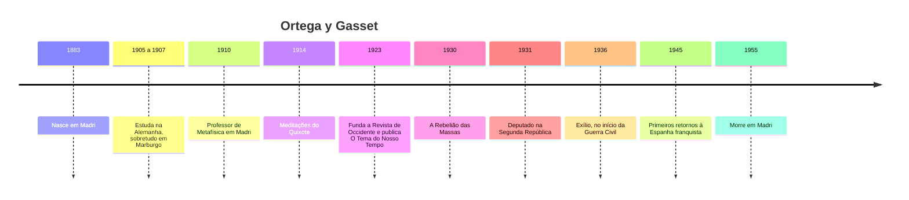
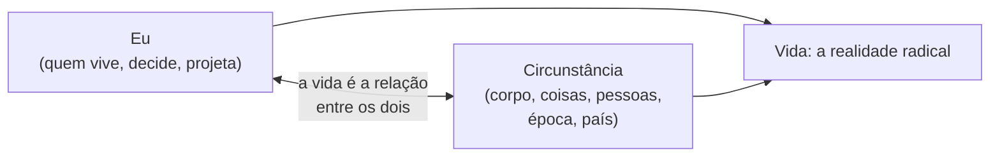
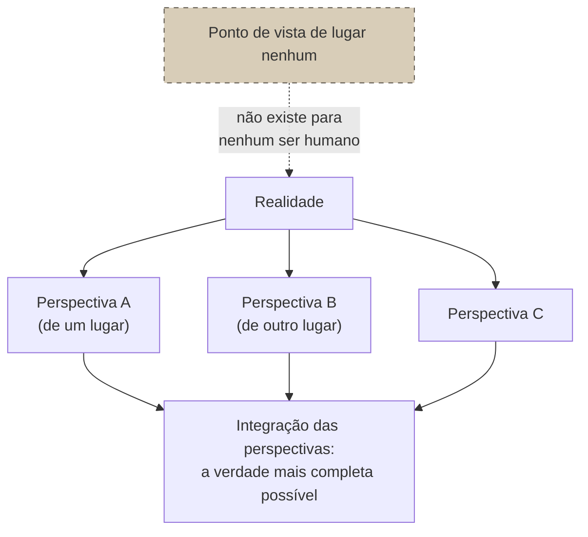
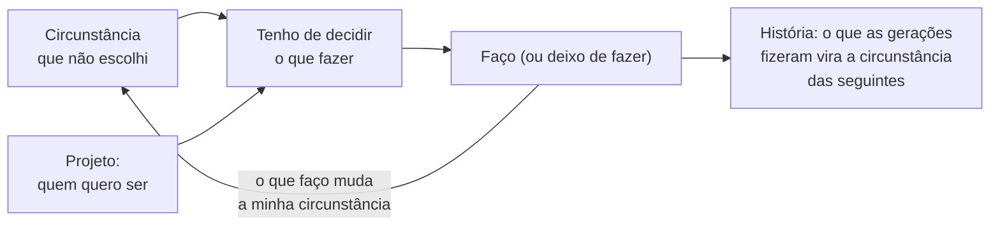

> **Aviso de Idioma:** Este currículo e todos os seus recursos de apoio foram estruturados exclusivamente em **Português (PT-BR)**.

# Aula 1 · Ortega: eu e a minha circunstância

**MOD-205 · 10 horas · Leitura principal:** Ortega y Gasset, *Meditações do Quixote* (1914), "Leitor..." e "Meditação preliminar" (seleção); *O Tema do Nosso Tempo* (1923), capítulo "A doutrina do ponto de vista"; *O que é filosofia?* (1929), lições IX a XI

## O que você vai aprender

- Situar José Ortega y Gasset na história intelectual e política da Espanha do século XX.
- Explicar a frase "eu sou eu e a minha circunstância" e a ideia de <abbr title="Circunstância (em Ortega): tudo o que rodeia o eu (o corpo, as coisas, as outras pessoas, a época, o país) e com que ele tem de se haver para viver. Não é um cenário exterior: é metade da própria vida.">circunstância</abbr>.
- Explicar o <abbr title="Perspectivismo: tese de Ortega segundo a qual a realidade só se dá a partir de pontos de vista, cada um verdadeiro na sua parte; a verdade completa resulta da integração das perspectivas, e não de um olhar de lugar nenhum.">perspectivismo</abbr> e distingui-lo do relativismo.
- Explicar a vida como realidade radical e a <abbr title="Razão vital (ou razão histórica): em Ortega, a razão que parte da vida concreta, sempre situada e obrigada a decidir, em vez de uma razão abstrata e atemporal. O ser humano não tem natureza fixa: tem história.">razão vital</abbr>.
- Relacionar o perspectivismo com a ideia de que todo conjunto de dados é um ponto de vista.

## Pergunta de abertura

> Dois relatórios sobre a mesma cidade, com os mesmos dados, chegam a conclusões opostas: um diz que a renda melhorou, o outro que piorou. Um deles está mentindo? Ou existe algum ponto de vista a partir do qual se vê "a cidade como ela é", sem ponto de vista nenhum?

## 1. Um filósofo na praça pública

José Ortega y Gasset nasceu em Madri, em 1883, numa família ligada ao jornalismo: o avô materno fundara *El Imparcial*, um dos jornais mais influentes do país. Estudou na Alemanha entre 1905 e 1907, em Leipzig, Berlim e sobretudo Marburgo, com os filósofos neokantianos Hermann Cohen e Paul Natorp. Voltou convencido de que a Espanha precisava se "europeizar", isto é, incorporar a ciência e a filosofia modernas, e assumiu em 1910 a cátedra de Metafísica da Universidade de Madri.

Ortega escreveu a maior parte da sua obra em jornais e revistas, e não em tratados. Fundou em 1923 a *Revista de Occidente*, que traduziu para o espanhol boa parte do pensamento europeu da época. Em 1931, com a proclamação da Segunda República, foi eleito deputado e fundou, com o médico Gregorio Marañón e o escritor Ramón Pérez de Ayala, a Agrupação a Serviço da República. Desiludiu-se depressa com os rumos do novo regime ("Não é isto, não é isto", disse num discurso célebre). Com o início da Guerra Civil, em 1936, deixou o país: viveu na França, na Holanda, na Argentina e em Portugal. Voltou à Espanha de Franco a partir de 1945, sem aderir publicamente ao regime e sem combatê-lo, posição ambígua que até hoje divide os seus leitores. Morreu em Madri em 1955.



## 2. "Eu sou eu e a minha circunstância"

A frase mais conhecida de Ortega aparece no seu primeiro livro, *Meditações do Quixote* (1914):

> "Eu sou eu e a minha circunstância, e se não a salvo, não me salvo." (tradução livre)

A palavra *circunstância* vem do latim *circum-stantia*: o que está ao redor. Para Ortega, a circunstância é tudo aquilo com que o eu tem de se haver para viver: o corpo, as coisas, as outras pessoas, a língua, a época, o país. A frase recusa duas ideias opostas:

| Ideia recusada | O que ela afirma | O que Ortega responde |
| :--- | :--- | :--- |
| O idealismo | O eu é anterior ao mundo e o constrói (o sujeito de Descartes e de Kant) | O eu não existe antes da circunstância: só existe vivendo nela |
| O realismo ingênuo | O mundo existe pronto e o eu é só uma coisa entre as coisas | A circunstância só é circunstância **para** alguém que vive nela |



E o que significa **salvar** a circunstância? Para Ortega, é encontrar o sentido do que nos rodeia, o seu *logos*, em vez de passar por ele sem ver. O exemplo do livro é a própria Espanha: em vez de copiar a Europa ou de se fechar nas tradições, o intelectual espanhol devia compreender a sua circunstância concreta e elevá-la ao nível do pensamento. Salvar a circunstância é, ao mesmo tempo, salvar a si mesmo, porque o eu que não compreende o mundo em que vive também não compreende a si.

## 3. O perspectivismo

Em *O Tema do Nosso Tempo* (1923), Ortega dá um passo adiante. Se cada pessoa vive numa circunstância, cada pessoa vê o mundo **a partir de um lugar**. Ele usa o exemplo de uma paisagem: duas pessoas olham a mesma serra de lugares diferentes. Uma vê em primeiro plano o que a outra vê ao fundo; uma vê a encosta que para a outra está escondida. Qual das duas vê a paisagem "verdadeira"?

> "A perspectiva é um dos componentes da realidade. Longe de ser a sua deformação, é a sua organização." (tradução livre)

As duas veem a paisagem verdadeira, cada uma **na sua parte**. Não existe uma terceira paisagem, vista de lugar nenhum, mais real que as duas. Esse é o perspectivismo, que Ortega distingue com cuidado de duas posições vizinhas:

| Posição | Tese | Problema, segundo Ortega |
| :--- | :--- | :--- |
| **Racionalismo** | Existe um ponto de vista absoluto, de lugar nenhum, que vê tudo como é | Esse ponto de vista não existe para nenhum ser humano; quem o reivindica toma a sua perspectiva pela única |
| **Relativismo** | Cada um tem a sua verdade e nenhuma vale mais que outra | Se tudo é igualmente verdadeiro, nada é verdadeiro, e a conversa entre as perspectivas perde o sentido |
| **Perspectivismo** | Cada perspectiva capta uma parte real; a verdade completa se aproxima pela **integração** das perspectivas | Exige reconhecer o próprio lugar e procurar as perspectivas dos outros |



### Os dados também têm ponto de vista

Volte à pergunta de abertura. Um conjunto de dados também é uma perspectiva: alguém decidiu o que registrar, como agrupar, que medida resumir. Com os mesmos números, a média e a mediana contam histórias diferentes:

```python
from statistics import mean, median

# Renda mensal (R$) de dez famílias de um bairro, em dois anos. Dados fictícios.
renda_antes = [1200, 1300, 1400, 1500, 1500, 1600, 1700, 1800, 2000, 9000]
renda_depois = [1100, 1150, 1250, 1300, 1400, 1450, 1500, 1600, 1900, 25000]

for nome, funcao in (("média", mean), ("mediana", median)):
    a, d = funcao(renda_antes), funcao(renda_depois)
    sentido = "subiu" if d > a else "caiu"
    print(f"{nome:<8} antes R$ {a:>7.0f}   depois R$ {d:>7.0f}   a renda {sentido}")
```

A média subiu muito, puxada por uma única família que enriqueceu; a mediana, que mostra a família do meio, caiu. Os dois relatórios dizem a verdade, cada um a partir de um ponto de vista. A desonestidade não está em escolher uma perspectiva, que é inevitável: está em **esconder** que se escolheu, e apresentar uma parte como se fosse o todo. A pergunta perspectivista é: o que esta medida mostra, de onde, e o que ela deixa de mostrar? O MOD-207 transforma essa pergunta em método.

Repare também na relação com a totalidade de Lukács (MOD-203, aula 5). Os dois recusam o fato isolado. Mas Lukács pensa que um ponto de vista de classe pode compreender o todo social; Ortega desconfia de qualquer ponto de vista que se apresente como o do todo. A crítica de Adorno a Lukács ("o todo é o falso") está mais perto de Ortega do que os dois imaginariam.

## 4. A vida como realidade radical

Nas lições de *O que é filosofia?* (1929), Ortega chega à tese central da sua filosofia madura. Qual é a realidade primeira, aquela de que todas as outras dependem? Não é a matéria (como para o materialismo), nem a consciência (como para o idealismo): é a **vida**, a de cada um, no sentido biográfico, não biológico.

A vida, para Ortega, tem algumas características:

- **Encontrar-se no mundo.** Viver é dar-se conta de que se está numa circunstância que não se escolheu.
- **Ter de fazer.** A vida não nos é dada pronta: é um *quefazer*, uma tarefa. A cada momento temos de decidir o que fazer em seguida, mesmo que seja não fazer nada.
- **Projeto.** Decidimos a partir de um projeto de quem queremos ser. A vida é, nas palavras de Ortega, "o que fazemos e o que nos acontece".

Daí a fórmula, desenvolvida em *A História como Sistema* (1935): "o homem não tem natureza, o que tem é história". Uma pedra é o que é; o ser humano tem de **se fazer**, e se faz historicamente, a partir do que as gerações anteriores fizeram. A razão capaz de compreender essa realidade não é a razão abstrata da matemática e da física, que busca o que é sempre igual: é a **razão vital**, ou **razão histórica**, que compreende as decisões a partir das circunstâncias e dos projetos de quem as tomou.



### Ortega e Heidegger

Os leitores do MOD-101 vão reconhecer a vizinhança com *Ser e Tempo* de Heidegger (1927): o ser humano como ser-no-mundo, lançado numa situação que não escolheu, projetando-se para possibilidades. Ortega leu Heidegger com atenção e reivindicou, com alguma razão, ter chegado antes a várias dessas ideias, em textos de 1914 a 1925. A diferença de estilo é grande: Heidegger construiu um vocabulário novo e difícil; Ortega escreveu para o leitor de jornal. E a diferença política também: Ortega era um liberal, Heidegger se filiou ao partido nazista. A aula 5 volta a esse ponto.

## 5. A circunstância de um sistema técnico

O que a filosofia da circunstância tem a dizer a quem constrói software? Pelo menos duas coisas.

A primeira: **nenhum sistema técnico existe fora de uma circunstância**. O mesmo aplicativo de agendamento de consultas funciona de um jeito numa capital com internet rápida e de outro num município do interior com sinal intermitente; de um jeito para quem lê com facilidade e de outro para quem não lê. A engenharia de requisitos (MOD-202, aula 1) é, nesse sentido, uma tentativa de "salvar a circunstância": compreender o mundo concreto em que o sistema vai viver, em vez de projetá-lo para um usuário abstrato que não existe.

A segunda: **toda medida é uma perspectiva**, e um sistema que decide com base em dados decide a partir de um ponto de vista. Quando um sistema de crédito usa o CEP como variável, ele vê o mundo a partir de um lugar (o dos bairros que historicamente pagaram em dia) e trata essa perspectiva como se fosse a realidade de cada pessoa. O perspectivismo não proíbe medir: obriga a declarar de onde se mede e a procurar as perspectivas que faltam.

## Leitura guiada

1. ***Meditações do Quixote***, "Leitor..." e início da "Meditação preliminar" (cerca de 20 páginas): encontre a frase sobre a circunstância e o contexto em que ela aparece. O que Ortega quer salvar?
2. ***O Tema do Nosso Tempo***, "A doutrina do ponto de vista" (cerca de 10 páginas): copie o exemplo da paisagem e a passagem sobre a perspectiva como componente da realidade.
3. ***O que é filosofia?***, lições IX a XI (cerca de 40 páginas): liste as características da vida como realidade radical.

## Exercícios

**1.** Explique a frase "eu sou eu e a minha circunstância, e se não a salvo, não me salvo" mostrando que posições filosóficas ela recusa.

<details>
<summary>Gabarito comentado</summary>

A frase afirma que o eu não existe separado do mundo concreto em que vive: a circunstância é parte da própria vida. Recusa o idealismo (o eu como sujeito anterior ao mundo, que o constrói) e o realismo ingênuo (o eu como mais uma coisa no mundo). "Salvar" a circunstância é compreender o seu sentido; quem não compreende o mundo em que vive também não compreende a si mesmo.
</details>

**2.** Qual é a diferença entre o perspectivismo e o relativismo? Dê um exemplo em que a diferença tenha consequências práticas.

<details>
<summary>Gabarito comentado</summary>

O relativismo afirma que todas as perspectivas valem igualmente e que não há verdade comum; o perspectivismo afirma que cada perspectiva capta uma parte real da realidade e que a verdade se aproxima pela integração das perspectivas. Exemplo: numa audiência pública sobre uma obra viária, o relativista diria que a opinião da empreiteira e a dos moradores removidos são apenas "visões diferentes"; o perspectivista diria que cada uma vê uma parte real do problema (o custo, o deslocamento, o impacto no comércio) e que uma decisão bem fundada precisa integrar todas, sobretudo as que costumam ser ignoradas.
</details>

**3.** Modifique o código da seção 3 para calcular também a proporção de famílias com renda abaixo de R$ 1.500 nos dois anos. Que história essa terceira perspectiva conta?

<details>
<summary>Gabarito</summary>

```python
def proporcao_abaixo(rendas, limite=1500):
    return sum(r < limite for r in rendas) / len(rendas)


print(f"abaixo de R$ 1.500: antes {proporcao_abaixo(renda_antes):.0%}, depois {proporcao_abaixo(renda_depois):.0%}")
```

A proporção passa de 30% para 60%: o dobro de famílias ficou abaixo do limite. A terceira perspectiva confirma a da mediana e mostra algo que nem ela mostrava: quantas famílias pioraram. A média, sozinha, escondia tudo isso.
</details>

**4.** Escreva uma página sobre a "circunstância" de um sistema público que você conhece (um portal de matrícula escolar, um aplicativo de benefícios, um sistema de agendamento do SUS): para quem ele foi projetado, que circunstâncias ele ignora e o que seria "salvá-las".

<details>
<summary>Critérios de correção</summary>

O texto deve identificar o usuário implícito do sistema (com que equipamento, conectividade, escolaridade, tempo disponível ele conta) e confrontá-lo com usuários reais que não se encaixam nesse perfil, com exemplos concretos. A melhor resposta usa a ideia de perspectiva para mostrar que o sistema vê o mundo a partir de um lugar, e propõe mudanças que integrem perspectivas ausentes.
</details>

## Resumo da aula

- Ortega foi um filósofo de jornal e de praça pública, liberal, deputado na Segunda República, exilado na Guerra Civil e de posição ambígua diante do franquismo.
- "Eu sou eu e a minha circunstância": o eu só existe vivendo num mundo concreto, e compreender esse mundo é compreender a si.
- O perspectivismo afirma que toda visão é situada e capta uma parte real; a verdade completa vem da integração das perspectivas, contra o racionalismo e contra o relativismo.
- A vida é a realidade radical: um fazer, a partir de uma circunstância e de um projeto; o ser humano não tem natureza, tem história.
- Todo sistema técnico vive numa circunstância e toda medida é uma perspectiva: declarar de onde se mede é uma exigência intelectual e política.

## Para ir além

- Julián Marías, *Ortega: Circunstância e Vocação* (1960), a grande introdução escrita pelo principal discípulo de Ortega.
- Ortega y Gasset, *A História como Sistema* (1935; edição ampliada em 1941).
