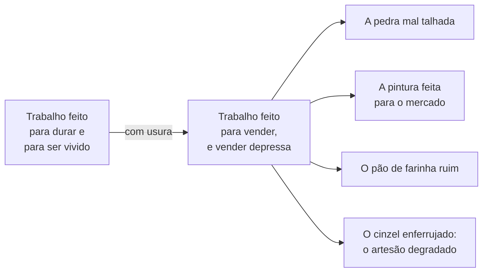
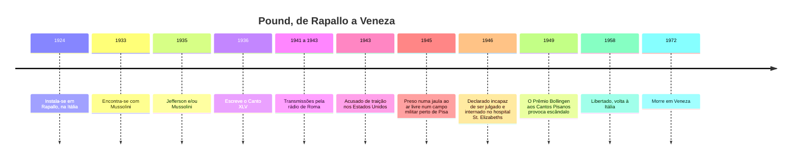
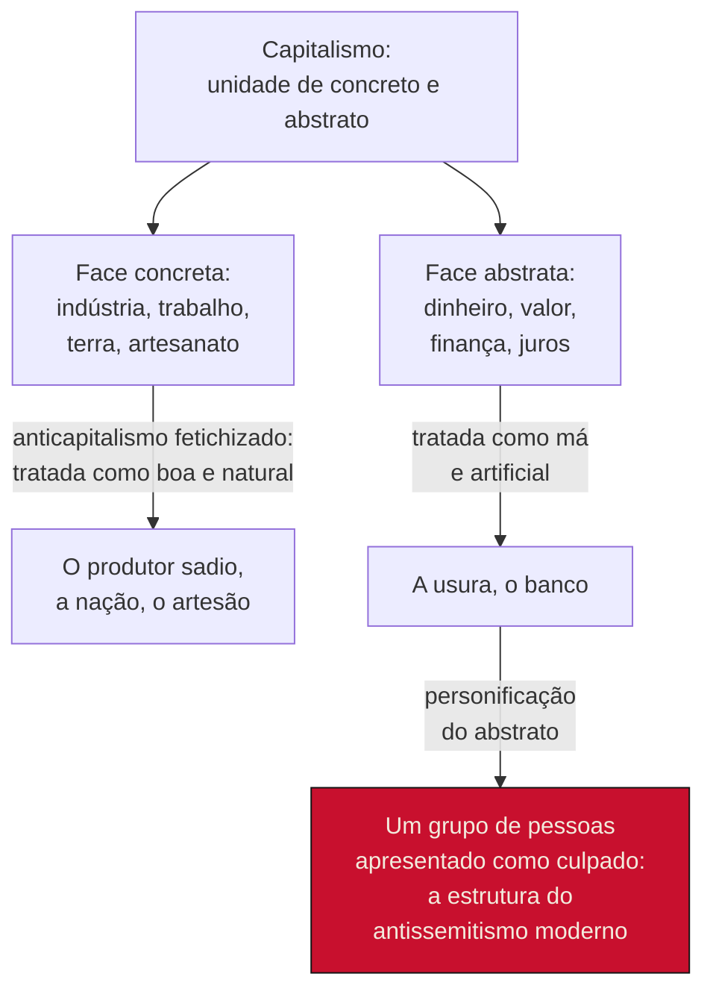

> **Aviso de Idioma:** Este currículo e todos os seus recursos de apoio foram estruturados exclusivamente em **Português (PT-BR)**.

# Aula 4 · Pound: *Os Cantos*, a usura e o fascismo

**MOD-205 · 10 horas · Leitura principal:** Ezra Pound, *Os Cantos*, tradução de José Lino Grünewald, Cantos I, XLV e LXXXI (seleção); Moishe Postone, "Antissemitismo e nacional-socialismo" (1980); Marx, *O Capital*, livro III, capítulo 24, "A exteriorização da relação capital na forma do capital portador de juros"

## O que você vai aprender

- Descrever o projeto, a estrutura e o método de *Os Cantos*.
- Ler o Canto XLV e reconstruir a crítica de Pound à <abbr title="Usura: na tradição medieval, a cobrança de juros sobre empréstimos, condenada pela Igreja. Em Pound, o nome de um poder financeiro que cobra pelo uso do dinheiro sem relação com a produção e que degrada o trabalho, a arte e a vida.">usura</abbr>.
- Situar essa crítica entre Aristóteles, Marx e a economia do Crédito Social.
- Narrar a adesão de Pound ao fascismo, as transmissões de rádio, a prisão e a internação.
- Explicar, com Moishe Postone, como uma crítica da finança pode se converter em antissemitismo pela <abbr title="Personificação do abstrato: em Postone, o mecanismo ideológico que atribui a dominação impessoal e abstrata do capital a um grupo de pessoas concretas, apresentado como culpado. É a estrutura do antissemitismo moderno.">personificação do abstrato</abbr>.

## Pergunta de abertura

> Um poema denuncia, com imagens de grande força, como a busca do lucro financeiro destrói o trabalho bem feito, a arte e a vida comum. O mesmo autor, poucos anos depois, culpa "os judeus" por essa destruição, em transmissões de rádio a serviço de um regime fascista. A primeira coisa contamina a segunda, ou a segunda contamina a primeira? É possível ler o poema sem ler as transmissões?

## 1. *Os Cantos*: um poema que inclui a história

Pound trabalhou em *Os Cantos* por quase cinquenta anos, de 1915 até o início dos anos 1960. O resultado é um poema de mais de oitocentas páginas, com 116 cantos e fragmentos, que ele nunca considerou terminado. Pound definiu a épica como "um poema que inclui a história", e *Os Cantos* tentam incluir a história inteira: a Grécia de Homero, os mercadores e príncipes do Renascimento italiano, a história dinástica chinesa, a fundação dos Estados Unidos, a economia do século XX, a guerra.

| Parte | Cantos | Tema principal |
| :--- | :--- | :--- |
| Início | I | A descida de Odisseu ao mundo dos mortos, traduzida da versão latina de Homero feita no Renascimento |
| Cantos de Malatesta | VIII a XI | Sigismondo Malatesta, senhor de Rimini no século XV, mecenas e guerreiro |
| Cantos chineses e de Adams | LII a LXXI | A história da China segundo a tradição confuciana e a vida de John Adams |
| *Cantos Pisanos* | LXXIV a LXXXIV | Escritos em 1945 num campo de prisioneiros perto de Pisa |
| Últimos cantos | LXXXV a CXVII | *Rock-Drill*, *Thrones* e os fragmentos finais |

O método é o ideogramático da aula 3, levado ao extremo: o poema justapõe trechos de cartas, documentos de arquivo, contas de bancos, citações em grego, latim, italiano, provençal e chinês, ideogramas, memórias pessoais e versos líricos de grande beleza, sem narrador que explique as ligações. É uma montagem, no sentido de Benjamin (MOD-203, aula 6), e, como toda montagem, exige do leitor o trabalho de construir as relações.

No fim, o próprio Pound reconheceu o fracasso do projeto de totalidade. Num dos últimos fragmentos, o Canto CXVI, escreveu: "não consigo fazer que se mantenha coeso" (*I cannot make it cohere*).

## 2. O Canto XLV: "Com usura"

O Canto XLV, de 1936, é o mais citado e o mais traduzido. É uma ladainha, construída pela repetição da expressão "com usura", que enumera o que a usura destrói. Alguns versos, em tradução livre:

> Com usura nenhum homem tem casa de boa pedra,
> cada bloco talhado liso e bem ajustado
> [...]
> com usura
> nenhuma pintura é feita para durar nem para conviver,
> mas feita para vender e vender depressa
> [...]
> A usura enferruja o cinzel,
> enferruja a arte e o artesão.
> (Ezra Pound, Canto XLV, 1936; tradução livre)

O poema opõe dois mundos. Num, o trabalho é feito para durar e para ser vivido: a casa de pedra, a pintura de igreja, o pão de farinha boa, o tecido bem tramado. No outro, tudo é feito **para vender**, e depressa: a qualidade do trabalho, a beleza e até a fertilidade da vida se degradam. Numa nota publicada com o poema, Pound definiu a usura como "uma cobrança pelo uso do poder de compra, imposta sem consideração pela produção".

### Uma crítica com longa história

A condenação dos juros tem uma longa tradição, que Pound conhecia e reivindicava:

| Fonte | Tese |
| :--- | :--- |
| **Aristóteles**, *Política*, livro I | A arte de enriquecer pelo comércio e pelos juros (crematística) é contra a natureza; os juros, "dinheiro que nasce de dinheiro", são a forma mais antinatural de ganho |
| **Doutrina medieval da Igreja** | A usura é pecado; a cobrança de juros entre cristãos é proibida |
| **John Ruskin** e **William Morris** (século XIX) | A produção industrial para o mercado degrada o trabalho artesanal e a beleza; a arte depende do trabalho livre e prazeroso |
| **C. H. Douglas**, Crédito Social (anos 1920) | Os bancos controlam o crédito e criam escassez artificial de dinheiro; o Estado deveria distribuir "dividendos sociais" |
| **Marx**, *O Capital*, livro III | O capital portador de juros (D-D') é a forma mais fetichizada do capital: parece que o dinheiro gera dinheiro sozinho, e a exploração do trabalho, de onde vem o lucro, desaparece da vista |

Repare na proximidade e na diferença entre o Canto XLV e Marx. Os dois veem o trabalho degradado pela produção para o mercado, e os dois veem no juro uma aparência enganosa. Mas para Marx o juro é só a **forma mais visível** de uma relação que está na produção: a exploração do trabalho assalariado pelo capital, inclusive pelo capital industrial "produtivo". Para Pound, o mal está na finança, no **banqueiro**, e a produção, se libertada da usura, seria sadia. Essa diferença, que parece técnica, é o ponto em que tudo se decide.

## 3. O fascismo e as transmissões de rádio

Pound vivia em Rapallo desde 1924. Nos anos 1930, convenceu-se de que o fascismo de Mussolini era o regime capaz de libertar a produção do domínio dos bancos. Encontrou-se com Mussolini em 1933 e publicou em 1935 *Jefferson e/ou Mussolini*, em que comparava o ditador italiano a Thomas Jefferson.

Entre 1941 e 1943, já com os Estados Unidos em guerra contra a Itália, Pound fez mais de cem transmissões pela rádio oficial de Roma, dirigidas ao público de língua inglesa. Nelas atacava o presidente Roosevelt, defendia o Eixo e repetia, com insistência e grosseria, acusações contra "os judeus" como responsáveis pela guerra e pelo domínio financeiro do mundo. Em 1943, foi acusado de traição pelos Estados Unidos.

Em maio de 1945, foi preso pelos militares estadunidenses e mantido durante semanas numa jaula ao ar livre num campo disciplinar perto de Pisa. Ali escreveu os *Cantos Pisanos*, que muitos consideram a parte mais bela do poema, com momentos de humildade e autocrítica raros na sua obra ("Rebaixa a tua vaidade", diz um verso do Canto LXXXI). Levado aos Estados Unidos, foi declarado mentalmente incapaz de ser julgado e internado por doze anos no hospital psiquiátrico St. Elizabeths, em Washington. Em 1949, um júri de escritores concedeu aos *Cantos Pisanos* o Prêmio Bollingen, da Biblioteca do Congresso: o escândalo foi tão grande que o Congresso retirou da biblioteca a responsabilidade pelo prêmio. Uma campanha de escritores conseguiu a sua libertação em 1958. Pound voltou à Itália e passou os últimos anos em quase silêncio. Segundo o relato do poeta Allen Ginsberg, que o visitou em 1967, Pound teria dito que o pior erro que cometeu foi "aquele estúpido preconceito suburbano do antissemitismo".

## 4. Como uma crítica da finança vira antissemitismo

Para entender o que aconteceu com Pound, e não só condená-lo, a ferramenta mais precisa é um ensaio do historiador e teórico Moishe Postone, "Antissemitismo e nacional-socialismo" (1980). Postone parte da análise da mercadoria de Marx (MOD-104) e da reificação de Lukács (MOD-203, aula 4).

O capitalismo, lembra Postone, tem uma dupla face. Toda mercadoria tem um lado **concreto** (o valor de uso: a mesa, o pão, o trabalho do marceneiro) e um lado **abstrato** (o valor: a quantidade de trabalho social medida em dinheiro). A dominação do capital é uma dominação **abstrata**, impessoal, que não tem rosto: é a pressão do mercado, da concorrência, da valorização. Ninguém a comanda, e todos estão submetidos a ela.

O anticapitalismo que Postone chama de "fetichizado" faz duas operações:

1. **Separa as duas faces**: trata o lado concreto (a indústria, o trabalho, a terra, o artesão) como bom e natural, e o lado abstrato (o dinheiro, a finança, os juros) como mau e artificial, como se pudessem existir separados.
2. **Personifica o lado abstrato**: atribui a dominação impessoal a um grupo de pessoas concretas, que passam a ser vistas como a encarnação do dinheiro, da finança, do cosmopolitismo sem raízes. No antissemitismo moderno, esse grupo são os judeus.

A crítica de Pound à usura tem exatamente essa estrutura. O artesão, a pedra bem talhada, o produtor são o lado bom; a usura, o banco, o crédito são o lado mau; e o lado mau ganha um rosto. Por isso a passagem da poesia para a propaganda não foi um acidente na biografia de Pound: ela estava inscrita na forma da sua crítica econômica, que separava o "capital produtivo" do "capital financeiro" em vez de criticar a relação de capital como um todo. Uma frase do século XIX, atribuída ao político austríaco Ferdinand Kronawetter e popularizada pelo socialista alemão August Bebel, resume o problema: o antissemitismo é "o socialismo dos tolos".

Responda à pergunta de abertura. A segunda coisa (o antissemitismo) não é um acréscimo externo à primeira (a crítica da usura): é um desenvolvimento possível de uma **forma de crítica** que já está no poema, a que separa o concreto do abstrato e procura um culpado. Isso não quer dizer que o Canto XLV seja antissemita (ele não fala de judeus) nem que ler o poema seja ler as transmissões. Quer dizer que ler bem o poema exige perceber essa forma e saber onde ela leva.

## 5. O que fica

Diante disso, o que fazer com Pound? A aula 5 vai propor critérios. Mas o caso já mostra algumas distinções:

| Elemento da obra | Depende da forma fetichizada? | Pode ser usado? |
| :--- | :--- | :--- |
| A exigência de precisão da linguagem, o imagismo, as três modalidades (aula 3) | Não: são ferramentas formais que não carregam a teoria econômica | Sim, como fizeram os concretistas brasileiros, que eram de esquerda |
| O método ideogramático e a montagem de documentos | Não em si: Eisenstein e Benjamin usaram o mesmo procedimento com outros fins | Sim, sabendo que o método não garante o resultado |
| A crítica da degradação do trabalho pela produção para o mercado | Em parte: a descrição é compatível com Ruskin e Marx; a explicação de Pound (a usura) não é | A descrição, sim, com outra explicação |
| A teoria da usura como causa dos males e a sua personificação | Sim: é o núcleo da forma fetichizada | Como objeto de estudo crítico, e não como ferramenta |

E o caso ensina uma coisa sobre a crítica da técnica e da economia hoje. Denúncias contra "as grandes empresas de tecnologia", "os algoritmos" ou "os bilionários" podem ter a mesma estrutura: separar uma técnica boa e natural de um uso mau e artificial, e procurar um rosto para a dominação impessoal. A crítica que este curso propõe (MOD-203) pergunta pela **posição dentro das relações de produção**, e não por culpados.

## Leitura guiada

1. ***Os Cantos*, Canto XLV** (duas páginas) e **Canto LXXXI** (seleção, cerca de cinco páginas): leia em voz alta. Anote os recursos de melopeia (a repetição, o ritmo de ladainha) e de fanopeia (as imagens concretas de trabalho).
2. **Moishe Postone, "Antissemitismo e nacional-socialismo"** (cerca de 20 páginas; o original saiu na revista *New German Critique*, e há traduções em português): reconstrua o argumento sobre a dupla face da mercadoria e a personificação do abstrato.
3. **Marx, *O Capital*, livro III, capítulo 24** (cerca de 15 páginas): por que o capital portador de juros é a forma mais fetichizada do capital?

## Exercícios

**1.** Explique a diferença entre a crítica de Pound à usura e a crítica de Marx ao capital portador de juros.

Gabarito comentado

Para Pound, o mal está na finança (a cobrança pelo uso do dinheiro sem relação com a produção), e a produção, libertada da usura, seria sadia. Para Marx, o juro é só a forma mais visível e mais fetichizada de uma relação que nasce na produção, a exploração do trabalho assalariado, e que inclui o capital industrial. Pound separa o capital produtivo do financeiro; Marx critica a relação de capital como um todo.

**2.** Reconstrua o argumento de Postone em quatro passos e aplique-o ao caso de Pound.

Gabarito comentado

(1) A mercadoria tem uma face concreta (valor de uso) e uma abstrata (valor); (2) a dominação do capital é abstrata e impessoal; (3) o anticapitalismo fetichizado separa as faces, tratando a concreta como boa e a abstrata como má; (4) personifica o abstrato num grupo concreto, que no antissemitismo moderno são os judeus. Em Pound: o artesão e a produção são o bem; a usura e o banco, o mal; e nas transmissões de rádio o mal ganha o rosto dos judeus.

**3.** O Canto XLV pode ser lido sem as transmissões de rádio? Responda em uma página, usando a tabela da seção 5.

Critérios de correção

A resposta deve evitar os dois extremos: dizer que o poema é inocente (ignorando que a forma da sua crítica é a que leva à personificação) ou que ele é propaganda antissemita (ignorando que não fala de judeus e que a sua descrição da degradação do trabalho é compartilhada por Ruskin e Marx). A melhor resposta separa a descrição (utilizável) da explicação (a usura como causa), e mostra que a leitura crítica do poema é mais rica justamente porque conhece as transmissões.

**4.** Encontre, no debate público atual sobre tecnologia, um exemplo de crítica que separa uma "técnica boa" de um "uso mau" e procura um culpado pessoal. Analise-o com o esquema de Postone e proponha uma formulação que pergunte pela posição dentro das relações de produção.

Critérios de correção

O exemplo deve ter fonte. A análise deve identificar as duas operações (separação e personificação) e mostrar o que elas escondem: as relações impessoais que continuariam operando mesmo que o culpado fosse removido. A reformulação deve usar as categorias do MOD-203 (aparelho, refuncionalização, finalidades postas por quem).

## Resumo da aula

- *Os Cantos* são uma épica que tenta incluir a história, construída por montagem de documentos e línguas; o próprio Pound admitiu não conseguir dar-lhe coesão.
- O Canto XLV denuncia a usura como força que degrada o trabalho, a arte e a vida; a crítica tem raízes em Aristóteles, na Igreja medieval, em Ruskin e no Crédito Social.
- Pound aderiu ao fascismo, fez propaganda antissemita na rádio de Roma, foi preso, internado por doze anos e libertado em 1958.
- Com Postone: o anticapitalismo fetichizado separa a face concreta da abstrata do capital e personifica o abstrato num grupo; essa é a estrutura que leva da crítica da usura ao antissemitismo.
- Os elementos formais da obra de Pound não dependem dessa estrutura; a sua teoria da usura depende. Distinguir uns dos outros é o trabalho da aula 5.

## Para ir além

- Moishe Postone, *Tempo, Trabalho e Dominação Social* (1993; tradução brasileira de 2014), a reinterpretação de Marx em que se apoia o ensaio sobre o antissemitismo.
- Hugh Kenner, *The Pound Era* (1971, em inglês), o estudo clássico sobre Pound e o modernismo.
