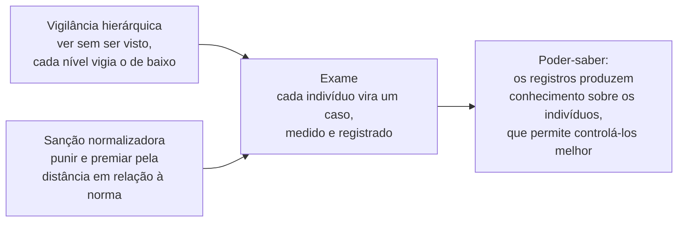
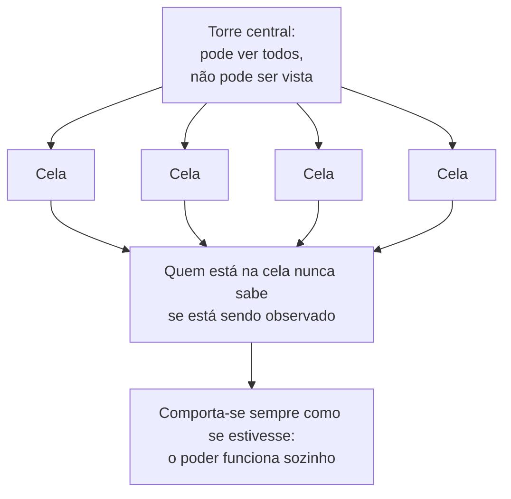

> **Aviso de Idioma:** Este currículo e todos os seus recursos de apoio foram estruturados exclusivamente em **Português (PT-BR)**.

# Aula 6 · Foucault: disciplina, norma e biopolítica

**MOD-205 · 10 horas · Leitura principal:** Michel Foucault, *Vigiar e Punir* (1975), parte I, capítulo 1, e parte III, capítulos 1 a 3; *História da Sexualidade I: A Vontade de Saber* (1976), capítulo V; *Nascimento da Biopolítica* (curso de 1978 e 1979), aulas de 14 e 21 de março de 1979; Gilles Deleuze, "Post-scriptum sobre as sociedades de controle" (1990)

## O que você vai aprender

- Situar Foucault e o seu método <abbr title="Genealogia: em Foucault, inspirado em Nietzsche, a investigação histórica de como práticas e saberes que parecem naturais (a prisão, a loucura, a sexualidade) foram constituídos, por que lutas e com que efeitos de poder.">genealógico</abbr>.
- Explicar a passagem do suplício à <abbr title="Disciplina: em Foucault, o conjunto de técnicas que, a partir dos séculos XVII e XVIII, organizam o espaço, o tempo e os gestos dos corpos em escolas, quartéis, fábricas, hospitais e prisões, para torná-los ao mesmo tempo úteis e obedientes.">disciplina</abbr> e o conceito de <abbr title="Corpos dóceis: corpos que a disciplina torna ao mesmo tempo mais úteis (mais produtivos) e mais obedientes, por meio do controle minucioso das atividades.">corpos dóceis</abbr>.
- Explicar os três instrumentos do poder disciplinar: a vigilância hierárquica, a <abbr title="Sanção normalizadora: em Foucault, a punição ou recompensa de cada um conforme a sua distância em relação a uma norma, que compara, hierarquiza e homogeneíza os indivíduos, e com isso produz o anormal.">sanção normalizadora</abbr> e o <abbr title="Exame: em Foucault, a técnica que combina vigilância e sanção normalizadora, fazendo de cada indivíduo um caso, documentado em registros, provas e dossiês. Exemplos: a prova escolar, o exame médico, a avaliação de desempenho.">exame</abbr>.
- Explicar o <abbr title="Panóptico: projeto de prisão de Jeremy Bentham (1791), com uma torre central de onde um vigia pode ver todas as celas sem ser visto. Para Foucault, o diagrama de um poder que funciona porque quem é vigiado nunca sabe se está sendo observado.">panóptico</abbr> e a noção de <abbr title="Poder-saber: em Foucault, a relação de mútua produção entre poder e saber: o exercício do poder cria objetos de conhecimento (o delinquente, o louco) e os saberes tornam possíveis novas formas de poder.">poder-saber</abbr>.
- Distinguir o poder soberano da <abbr title="Biopolítica (biopoder): em Foucault, a forma de poder que, desde o século XVIII, toma como objeto a vida da população (natalidade, mortalidade, saúde, longevidade) e a regula por meio da estatística, da medicina social e da administração.">biopolítica</abbr>, e explicar a <abbr title="Governamentalidade: em Foucault, o conjunto de práticas e saberes pelos quais se conduz a conduta das pessoas. No neoliberalismo, o governo age criando ambientes de mercado e fazendo de cada um um empresário de si mesmo.">governamentalidade</abbr> neoliberal.
- Usar as categorias de Foucault para analisar plataformas digitais, e conhecer as críticas que ele recebeu.

## Pergunta de abertura

> Um aplicativo de entregas avisa aos entregadores que os 20% com as piores avaliações na semana receberão uma advertência. Na semana seguinte, todos se esforçam e as notas sobem. Quantos recebem a advertência? E o que essa regra faz com o comportamento de cada um, mesmo de quem nunca foi advertido?

## 1. Um historiador do presente

Michel Foucault nasceu em Poitiers, na França, em 1926, e morreu em Paris em 1984. Formou-se em filosofia e psicologia, trabalhou em hospitais psiquiátricos e escreveu a sua tese sobre a história da loucura (1961). A partir de 1970, ocupou no Collège de France uma cátedra que ele mesmo batizou de "História dos sistemas de pensamento". Em 1971, fundou com outros intelectuais o Grupo de Informação sobre as Prisões, que dava voz aos próprios presos para denunciar as condições carcerárias.

O método de Foucault mudou ao longo da obra. Nos anos 1960, ele fez o que chamou de **arqueologia**: a reconstrução das regras que definem o que pode ser dito como verdadeiro numa época (*As Palavras e as Coisas*, 1966). Nos anos 1970, inspirado em Nietzsche, passou à **genealogia**: a investigação de como práticas que parecem naturais, como a prisão, foram constituídas em lutas concretas, e com que efeitos de poder. Foucault dizia fazer uma "história do presente": estudar o passado para mostrar que o que hoje parece evidente e necessário poderia ser de outro modo.

## 2. Do suplício à disciplina

*Vigiar e Punir* (1975) abre com duas cenas. A primeira é a execução de Robert-François Damiens, condenado em março de 1757 por tentar matar o rei Luís XV: um longo suplício público, descrito em detalhes atrozes, com o corpo do condenado queimado, atenazado e esquartejado diante da multidão. A segunda, oitenta anos depois, é um regulamento para uma casa de detenção de jovens em Paris (1838): horários minuciosos, das seis da manhã às nove da noite, para acordar, rezar, trabalhar, comer, estudar e dormir.

Entre as duas cenas, a punição mudou de alvo. O suplício atingia o **corpo** do condenado, em público, como manifestação do poder do rei. A prisão moderna quer atingir a **alma**: corrigir, reeducar, transformar o comportamento. E o castigo deixa de ser espetáculo para se tornar uma rotina escondida.

| | Suplício (poder soberano) | Disciplina |
| :--- | :--- | :--- |
| Alvo | O corpo, marcado e destruído | O comportamento, corrigido e treinado |
| Visibilidade | O condenado é visto por todos | O vigiado é visto, e o poder fica invisível |
| Ritmo | Um acontecimento excepcional | Um controle contínuo, de cada minuto |
| Objetivo | Vingar a ofensa ao soberano | Produzir indivíduos úteis e obedientes |

### Os corpos dóceis

O ponto mais original do livro é que a prisão é só um caso de algo muito mais amplo. As mesmas técnicas de controle do tempo e do espaço se espalham, entre os séculos XVII e XIX, por escolas, quartéis, fábricas, hospitais e oficinas. Foucault chama esse conjunto de técnicas de **disciplina**, e o seu efeito de **corpos dóceis**: corpos ao mesmo tempo mais úteis e mais obedientes.

A disciplina distribui os corpos no espaço (cada um no seu lugar, a fileira, a carteira, o posto na linha de montagem), controla a atividade (o horário, a decomposição dos gestos, a correlação entre o corpo e o instrumento), organiza o tempo em etapas e exercícios progressivos e compõe as forças individuais num conjunto eficiente. Quem estudou Taylor e a linha de montagem no MOD-104 reconhece tudo isso.

## 3. Os três instrumentos

O poder disciplinar funciona com três instrumentos simples, que se combinam:



**A vigilância hierárquica** organiza o espaço para que se possa ver sem ser visto: o pátio da escola sob a janela do diretor, a oficina sob o olhar do contramestre, que por sua vez é vigiado pelo gerente.

**A sanção normalizadora** é a mais sutil. A disciplina não pune só a infração de uma lei: pune o **desvio de uma norma**. O atraso, a desatenção, a falta de zelo, o rendimento abaixo da média. E a norma, ao contrário da lei, é **comparativa**: define cada um pela sua posição em relação aos outros. Ela compara, diferencia, hierarquiza, homogeneíza e, por fim, exclui. A norma não descreve o normal que já existia: ela **produz** o anormal.

**O exame** combina os dois anteriores. A prova escolar, o exame médico, a avaliação de desempenho fazem de cada indivíduo um **caso**, documentado em notas, registros, prontuários e dossiês. Pela primeira vez na história, diz Foucault, a vida comum de pessoas comuns passou a ser escrita e arquivada, não para celebrá-la, como se fazia com os reis, mas para controlá-la.

### A norma produz o anormal

A pergunta de abertura é um caso exato de sanção normalizadora. A regra não diz "quem tiver nota abaixo de 4 será advertido" (isso seria uma lei, com um limite fixo). Diz "os 20% piores serão advertidos": uma norma relativa. O resultado:

```python
from statistics import mean, pstdev

# Nota média de cada entregador numa plataforma (de 1 a 5). Dados fictícios.
semana_1 = {"Ana": 4.82, "Bruno": 4.75, "Carla": 4.91, "Davi": 4.60, "Edu": 4.88,
            "Fabi": 4.79, "Gil": 4.85, "Hana": 4.70, "Ivo": 4.93, "Júlia": 4.66}


def escore_z(notas):
    """Distância de cada nota até a média do grupo, medida em desvios padrão."""
    m, dp = mean(notas.values()), pstdev(notas.values())
    return {nome: (nota - m) / dp for nome, nota in notas.items()}


def sinalizados(notas, fracao=0.2):
    """A regra da plataforma: os 20% com as menores notas recebem advertência."""
    quantos = max(1, round(len(notas) * fracao))
    return sorted(notas, key=notas.get)[:quantos]


semana_2 = {nome: min(5.0, nota + 0.05) for nome, nota in semana_1.items()}   # todos melhoraram

for rotulo, notas in (("semana 1", semana_1), ("semana 2", semana_2)):
    z = escore_z(notas)
    alvo = sinalizados(notas)
    print(f"{rotulo}: média {mean(notas.values()):.2f}; advertidos: "
          + ", ".join(f"{n} (nota {notas[n]:.2f}, z = {z[n]:+.1f})" for n in alvo))
```

Todos melhoraram, a média subiu, e as mesmas duas pessoas foram advertidas, a 1,8 e a 1,2 desvios padrão abaixo da média, exatamente como antes. Com uma norma relativa, **sempre** haverá 20% de "piores", qualquer que seja o desempenho de todos. A regra não mede um problema: fabrica um. E o efeito sobre o comportamento é o que Foucault descreve: cada entregador passa a se comparar o tempo todo com os outros, a aceitar corridas que não queria, a evitar qualquer avaliação negativa, sem que ninguém precise mandar. É a normalização funcionando.

Repare na ligação com a reificação de Lukács (MOD-203, aula 4), que você estudou com um exemplo muito parecido: a pontuação dos trabalhadores apaga o que está fora do modelo. Lukács mostra a pessoa reduzida a número; Foucault mostra o número produzindo um tipo de pessoa.

## 4. O panóptico

Em 1791, o filósofo inglês Jeremy Bentham publicou o projeto de uma prisão ideal, o **panóptico** ("o que tudo vê"): um edifício circular, com as celas na periferia, abertas para o centro e iluminadas por trás, e uma torre no meio, com janelas protegidas por persianas. Da torre, um único vigia pode ver todos os presos; os presos não podem ver o vigia, nem saber se estão sendo observados.


*Plano, corte e elevação do panóptico, desenhado por Willey Reveley para Jeremy Bentham em 1791. Publicado em* The Works of Jeremy Bentham*, volume IV (1843). Domínio público.*

Para Foucault, o panóptico é o **diagrama** do poder disciplinar. O efeito decisivo: como o preso nunca sabe se está sendo observado, ele se comporta **o tempo todo** como se estivesse. O poder passa a funcionar sozinho, automaticamente, sem precisar de violência e quase sem precisar do vigia: o preso vigia a si mesmo. "A visibilidade é uma armadilha."



## 5. Biopolítica e governamentalidade

### Fazer viver e deixar morrer

No último capítulo de *A Vontade de Saber* (1976), Foucault descreve uma segunda transformação. O poder do soberano clássico era, no fundo, o direito de **fazer morrer e deixar viver**: o rei podia mandar matar e, de resto, deixava os súditos em paz. A partir do século XVIII, surge um poder que faz o contrário: **fazer viver e deixar morrer**. Ele toma como objeto a vida de uma **população**: as taxas de natalidade e de mortalidade, as epidemias, a higiene, a longevidade, a saúde pública.

Esse é o **biopoder**, e a política que ele organiza é a **biopolítica**. As suas ferramentas são a estatística (a palavra vem de "ciência do Estado"), a demografia, a medicina social, o urbanismo sanitário. O MOD-207 começa com um exemplo célebre dessa história: o mapa de John Snow sobre o cólera em Londres, em 1854. A disciplina age sobre o corpo de cada um; a biopolítica, sobre a população como um todo. As duas se combinam.

### O neoliberalismo como forma de governo

No curso *Nascimento da Biopolítica* (1978 e 1979), Foucault analisa o neoliberalismo alemão e o da Escola de Chicago, com uma tese que se mostrou profética. Além de política econômica, o neoliberalismo é uma **forma de governar as condutas**, uma governamentalidade. Ele não governa mandando, mas criando **ambientes de mercado** em que cada um passa a agir como uma empresa: a teoria do "capital humano" de Gary Becker trata a educação, a saúde e até as relações afetivas como investimentos. O sujeito neoliberal é o **empresário de si mesmo**.

O entregador do aplicativo, chamado pela plataforma de "parceiro" e "empreendedor", sem patrão visível, governado por notas, metas e incentivos, é a figura acabada dessa governamentalidade.

### Das disciplinas ao controle

Em 1990, Gilles Deleuze escreveu um texto curto, "Post-scriptum sobre as sociedades de controle", que atualizava Foucault. As disciplinas funcionavam em espaços fechados (a escola, a fábrica, a prisão), com começo e fim. As **sociedades de controle** funcionam em espaço aberto e em modulação contínua: a formação permanente, a avaliação contínua, o acesso por senhas, a dívida que não termina. O indivíduo vira um "divíduo", um conjunto de dados, cifras e perfis. Escrito antes da internet comercial, o texto descreve com precisão impressionante o mundo das plataformas.

| | Sociedade disciplinar (Foucault) | Sociedade de controle (Deleuze) |
| :--- | :--- | :--- |
| Espaço | Instituições fechadas | Redes abertas |
| Tempo | Etapas com começo e fim | Modulação contínua, sem fim |
| Instrumento | O olhar, o registro, o exame | A senha, a cifra, o perfil de dados |
| Figura | O preso, o aluno, o operário | O usuário, o "parceiro", o perfil |

No Brasil, a Rede LAVITS (Rede Latino-Americana de Estudos sobre Vigilância, Tecnologia e Sociedade) e pesquisadoras como Fernanda Bruno, em *Máquinas de Ver, Modos de Ser* (2013), desenvolveram essas categorias para estudar a vigilância digital no país.

## 6. As críticas a Foucault

Foucault é um dos autores mais citados das ciências humanas e um dos mais criticados:

| Crítica | Quem | O argumento |
| :--- | :--- | :--- |
| Falta de fundamento normativo | Habermas (*O Discurso Filosófico da Modernidade*, 1985), Nancy Fraser | Se todo saber é efeito de poder, com que critério Foucault denuncia a disciplina? A sua crítica pressupõe normas que a sua teoria não consegue justificar |
| O poder sem sujeito e sem classe | Críticos marxistas | Ao espalhar o poder por toda parte, Foucault perde de vista quem se beneficia dele e a centralidade da exploração econômica |
| A resistência fica sem lugar | Vários leitores | Se o poder produz até os sujeitos que resistem, de onde vem a resistência? Nos últimos trabalhos, Foucault tentou responder com o "cuidado de si" |

A primeira crítica é o ponto de partida da aula 7. Habermas aceita boa parte do diagnóstico de Foucault, mas sustenta que é possível encontrar, na própria comunicação humana, um critério para distinguir o poder legítimo do ilegítimo.

## Leitura guiada

1. ***Vigiar e Punir*, parte I, capítulo 1** (cerca de 25 páginas): compare as duas cenas de abertura. Depois a **parte III, capítulos 1 a 3** (cerca de 80 páginas): os corpos dóceis, os três instrumentos e o panoptismo.
2. ***A Vontade de Saber*, capítulo V** (cerca de 25 páginas): copie a passagem sobre "fazer morrer e deixar viver".
3. **Deleuze, "Post-scriptum sobre as sociedades de controle"** (6 páginas, em *Conversações*): liste as diferenças entre disciplina e controle.

## Exercícios

**1.** Explique a diferença entre uma lei e uma norma, no sentido de Foucault, usando o exemplo do aplicativo.

<details>
<summary>Gabarito comentado</summary>

A lei define um limite fixo e pune quem o ultrapassa ("nota abaixo de 4 recebe advertência"): se todos ficarem acima, ninguém é punido. A norma define cada um pela sua posição em relação aos outros ("os 20% piores recebem advertência"): sempre haverá alguém abaixo da norma, qualquer que seja o desempenho geral. A norma compara, hierarquiza e produz o anormal.
</details>

**2.** Modifique o código da seção 3 para que a advertência dependa de um limite fixo (nota abaixo de 4,7) e rode com as duas semanas. O que muda? Qual das duas regras é mais justa, e por quê?

<details>
<summary>Gabarito</summary>

```python
def sinalizados_por_limite(notas, limite=4.7):
    return [n for n, nota in notas.items() if nota < limite]


print("limite fixo, semana 1:", sinalizados_por_limite(semana_1))
print("limite fixo, semana 2:", sinalizados_por_limite(semana_2))
```

Na semana 1, Davi e Júlia ficam abaixo de 4,7; na semana 2, com a melhora geral, só Davi. Com o limite fixo, a melhora coletiva tem efeito. A regra é mais previsível e mais justa nesse sentido, mas continua sendo disciplinar: alguém definiu o limite, sem participação dos entregadores, e a avaliação dos clientes pode ser enviesada (por exemplo, contra entregadores negros). Uma boa resposta discute também quem deveria definir as regras.
</details>

**3.** Analise uma plataforma que você usa com os três instrumentos do poder disciplinar. Onde está a vigilância hierárquica? Qual é a norma? Qual é o exame?

<details>
<summary>Critérios de correção</summary>

A análise deve identificar cada instrumento com exemplos concretos da plataforma (painéis de métricas, avaliações, rankings, notificações). A melhor resposta mostra também onde o modelo de Foucault deixa de servir e o de Deleuze serve melhor (modulação contínua, perfil de dados em vez de instituição fechada).
</details>

**4.** Responda à crítica de Habermas e Fraser: com que critério Foucault pode denunciar a disciplina? Escreva uma página defendendo ou atacando Foucault.

<details>
<summary>Critérios de correção</summary>

A resposta deve expor a crítica com precisão (a denúncia pressupõe normas que a teoria não justifica) e examinar uma resposta possível: por exemplo, que a genealogia não precisa de fundamento normativo universal para mostrar que algo que parece necessário é contingente, e que isso já abre espaço para a mudança. A avaliação considera a fidelidade às posições dos autores.
</details>

## Resumo da aula

- Foucault praticou a arqueologia e a genealogia, uma história do presente que mostra que o evidente poderia ser de outro modo.
- *Vigiar e Punir* descreve a passagem do suplício à disciplina, que produz corpos dóceis em escolas, quartéis, fábricas e prisões.
- O poder disciplinar usa a vigilância hierárquica, a sanção normalizadora e o exame; a norma é comparativa e produz o anormal.
- O panóptico é o diagrama de um poder que funciona porque quem é vigiado nunca sabe se está sendo observado.
- A biopolítica faz viver e deixa morrer, governando a vida da população; o neoliberalismo é uma governamentalidade que faz de cada um um empresário de si.
- Deleuze atualizou Foucault com as sociedades de controle; Habermas e Fraser criticaram a falta de fundamento normativo.

## Para ir além

- Fernanda Bruno, *Máquinas de Ver, Modos de Ser: Vigilância, Tecnologia e Subjetividade* (2013).
- Michel Foucault, *Em Defesa da Sociedade* (curso de 1975 e 1976), aula de 17 de março de 1976, sobre biopoder e racismo de Estado.
